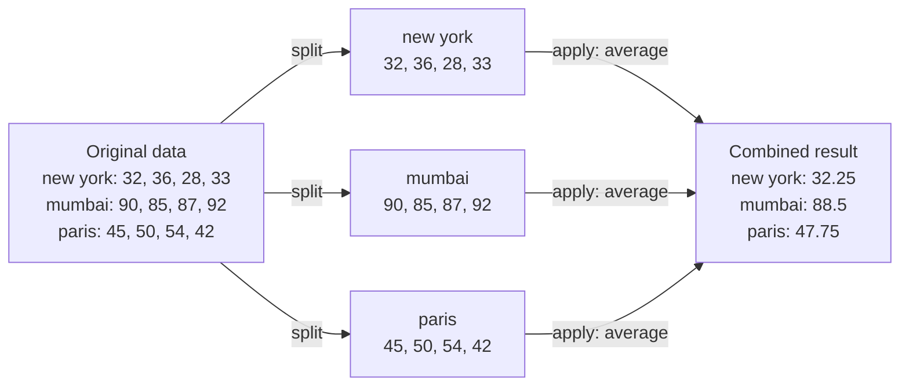

# pandas Group By: My Lecture 22 Notes

*Oct 31, 2026 · Saurabh S*

> [!NOTE]
> **Source:** These notes are based on the **pandas Group By** lecture from the **CodeBasics Python course**. The split-apply-combine diagram is redrawn from the lecture materials.

## Where I started

Until now, I'd summarised a whole table at once, or filtered it one group at a time. This lecture introduced `groupby`, which answers "what's the total, average or maximum **for each** group?" in a single line. The lecture compared it directly to SQL's `GROUP BY`, and for audit work it's probably the command I'll use most.

## The data in brief

A small `weather_by_cities.csv`: **12 rows**, covering 3 cities (New York, Mumbai and Paris) over 4 days (1–4 January 2017). It has 5 columns: `day`, `city`, `temperature`, `windspeed` and `event`.

| City | Max temperature | Average temperature | Average windspeed |
| --- | --- | --- | --- |
| Mumbai | 92 | 88.50 | 9.25 |
| New York | 36 | 32.25 | 8.00 |
| Paris | 54 | 47.75 | 12.75 |

## What I learnt

### Split, apply, combine



1. **Split:** divide the rows into groups by a key, here `city`.
2. **Apply:** run a calculation on each group, such as the average.
3. **Combine:** put the results back together into one table.

```python
g = df.groupby("city")         # split: a DataFrameGroupBy object

for city, data in g:           # each group is a small DataFrame of its own
    print(city, len(data))

g.get_group("mumbai")          # pull out a single group
```

### Summarising each group

| Code | Returns |
| --- | --- |
| `g.max()` / `g.min()` | Highest or lowest value per city, for every column |
| `g.mean(numeric_only=True)` | Average per city, numeric columns only |
| `g.describe()` | Count, mean, standard deviation, min, quartiles and max per city |
| `g.size()` | Number of **rows** per group |
| `g.count()` | Number of **non-missing values** per column, per group |

**Three things to watch, two of them new in pandas 3.0:**

- **`g.mean()` alone now raises a `TypeError`,** because the `day` and `event` columns are text. Use `g.mean(numeric_only=True)` or select the columns first, as in `g[["temperature", "windspeed"]].mean()`.
- **`max()` on text is alphabetical.** `g.max()` said the `event` for every city was `"Sunny"`, only because "S" comes last, not because every city was sunny. This is the same trap as Lecture 19.
- **`size()` and `count()` differ when data is missing.** They matched here only because the dataset is complete.

### Grouping with a custom rule

The lecture grouped days into temperature bands (80–90, 50–60 and "others") with a function:

```python
def grouper(df, idx, col):
    if 80 <= df[col].loc[idx] <= 90:
        return "80-90"
    elif 50 <= df[col].loc[idx] <= 60:
        return "50-60"
    else:
        return "others"

g = df.groupby(lambda x: grouper(df, x, "temperature"))   # the function runs on each row's index
```

This produced 3 Mumbai days in "80-90", 2 Paris days in "50-60", and every other day in "others". `pd.cut` does the same kind of banding in one step, as shown in snippet 3 below.

## How this shows up in financial statement audit work

These snippets use small sample ledger data built in the code.

**1. Flux analysis by financial statement line item.** This compares the current year (CY) with the prior year (PY) for each line item and flags large movements:

```python
import pandas as pd

tb = pd.DataFrame({
    "fsli":    ["Revenue", "Revenue", "COGS", "COGS", "Opex", "Opex", "Receivables"],
    "account": ["4000", "4010", "5000", "5010", "6000", "6100", "1200"],
    "cy":      [1_250_000, 310_000, 690_000, 120_000, 205_000, 98_000, 640_000],
    "py":      [1_180_000, 295_000, 655_000, 118_000, 148_000, 61_000, 470_000],
})

flux = tb.groupby("fsli")[["cy", "py"]].sum()
flux["change_pct"] = ((flux["cy"] - flux["py"]) / flux["py"] * 100).round(1)
print(flux[flux["change_pct"].abs() > 20])
# Opex +45.0% and Receivables +36.2%: get explanations for both
```

**2. Journal entry profile by preparer, using named aggregations.**

```python
je = pd.DataFrame({
    "je_id":    ["JE1", "JE2", "JE3", "JE4", "JE5", "JE6", "JE7"],
    "preparer": ["A. Rao", "A. Rao", "M. Gomez", "M. Gomez", "M. Gomez", "CFO", "CFO"],
    "amount":   [12_500, 860, 4_300, 9_900, 9_950, 250_000, 180_000],
    "approver": ["J. Lee", "J. Lee", "J. Lee", None, "J. Lee", None, None],
})

profile = je.groupby("preparer").agg(
    entries=("je_id", "size"),
    total=("amount", "sum"),
    largest=("amount", "max"),
    approved=("approver", "count"),      # count() skips missing approvers
)
profile["unapproved"] = profile["entries"] - profile["approved"]
print(profile)
# The CFO has 2 large entries and both are unapproved, a management override risk
```

The `size()` vs `count()` difference from the lecture does the real work here: the gap between them is the number of entries with no approver.

**3. Stratifying a population for sampling.** `pd.cut` creates value bands, and `groupby` shows how much of the population falls in each band:

```python
bands = pd.cut(je["amount"], bins=[0, 5_000, 50_000, float("inf")],
               labels=["< 5k", "5k–50k", "> 50k"])
strata = je.groupby(bands, observed=True)["amount"].agg(["size", "sum"])
strata["share_of_value_%"] = (strata["sum"] / strata["sum"].sum() * 100).round(1)
print(strata)
# > 50k: only 2 entries, but 92.0% of the value, so test them all
```

**4. Pulling one group for detailed testing.**

```python
by_preparer = je.groupby("preparer")
print(by_preparer.get_group("M. Gomez")["amount"].tolist())
# [4300, 9900, 9950]: two entries just under 10,000, a possible approval-threshold split
```

## My reflection

`groupby` felt like the moment pandas became a real audit tool for me. Flux analysis, preparer profiles and stratification are things I currently build with pivot tables, and here each one is a few lines that can be re-run on next year's data without rebuilding anything.

The `size()` vs `count()` detail is a small one that I'll remember. Counting rows and counting values sound the same, but the difference between them is exactly where missing approvals hide. The `max()`-on-text trap turned up again too. A summary that looks complete can still be meaningless, so I'll check what each column contains before I aggregate it.
