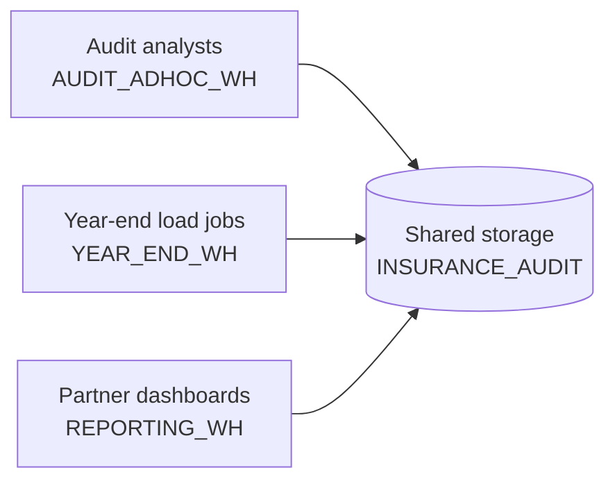
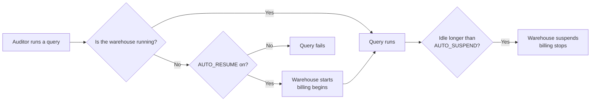
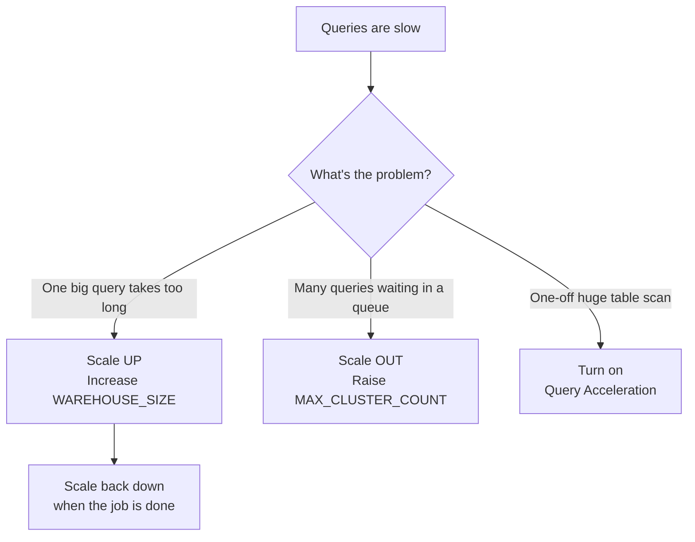

# Lesson 4: Compute (Virtual Warehouses)

> [!NOTE]
> **Source: [AnalystBuilder](https://www.analystbuilder.com)**<br>
> **Date completed:** October 26, 2026

How Snowflake provides the computing power that runs your queries, explained with examples from an insurance company's year-end financial statement audit.

## The Big Picture

Snowflake keeps **storage** (where data lives) and **compute** (the power that reads and processes it) separate. Compute comes from **virtual warehouses**.

| Snowflake | Office analogy |
|---|---|
| **Storage** | The filing cabinets from Lesson 1 |
| **Virtual warehouse** | A team of staff who pull files and do the work |
| **Warehouse size** | How many people are on the team |

Because they're separate, many teams can work on the **same data** at once without slowing each other down, and you pay for compute only while a warehouse runs.



> [!TIP]
> **Screenshot:** In Snowsight, go to **Admin → Warehouses** to see every warehouse, its size, and whether it's running.
> ``

## Warehouse Types

| Type | What it is | Insurance audit example |
|---|---|---|
| **Standard (Gen1)** | The original warehouse | Everyday audit queries |
| **Standard (Gen2)** | Newer, faster version of standard; the default for new warehouses in most regions | Heavy year-end reconciliations |
| **Snowpark-optimized** | Much more memory per node, for Python and machine learning | Training a claims fraud-detection model |
| **Adaptive** | Newer option where Snowflake picks the resources for each query; check availability in your account | Teams that don't want to manage sizes |

## Warehouse Sizes

Each size up **doubles** the computing power and the credits used per hour. You're billed **per second**, with a **60-second minimum** each time the warehouse starts.

| Size | Credits/hour | Good for |
|---|---|---|
| X-Small | 1 | Quick checks, learning |
| Small | 2 | Small reports |
| Medium | 4 | Regular analysis |
| Large | 8 | Large loads and joins |
| X-Large | 16 | Heavy year-end processing |
| 2X-Large to 6X-Large | 32 to 512 | Very large data volumes |

*Credits shown are for standard Gen1 warehouses. Gen2 uses more credits per hour but often finishes faster.*

## Key Parameters

| Parameter | What it does | Typical setting |
|---|---|---|
| `WAREHOUSE_SIZE` | How much power | Start at `XSMALL`, increase if slow |
| `WAREHOUSE_TYPE` | Standard or Snowpark-optimized | `STANDARD` |
| `GENERATION` | Gen1 or Gen2 (standard only) | `'2'` |
| `AUTO_SUSPEND` | Seconds idle before it stops | `60` (default is `600`) |
| `AUTO_RESUME` | Restart automatically when a query arrives | `TRUE` |
| `INITIALLY_SUSPENDED` | Don't start it the moment it's created | `TRUE` |
| `MIN_CLUSTER_COUNT` / `MAX_CLUSTER_COUNT` | Fewest and most clusters (multi-cluster) | `1` / `3` |
| `SCALING_POLICY` | `STANDARD` adds clusters as soon as queries queue (faster); `ECONOMY` waits until a new cluster would stay busy (cheaper) | `STANDARD` |
| `STATEMENT_TIMEOUT_IN_SECONDS` | Cancels queries that run too long | `3600` |
| `ENABLE_QUERY_ACCELERATION` | Borrows extra serverless power for big scans | `TRUE` for large one-off scans |

**Example: an everyday warehouse for auditors**

```sql
CREATE WAREHOUSE AUDIT_ADHOC_WH
  WAREHOUSE_SIZE = 'XSMALL'
  AUTO_SUSPEND = 60
  AUTO_RESUME = TRUE
  INITIALLY_SUSPENDED = TRUE
  STATEMENT_TIMEOUT_IN_SECONDS = 3600;

USE WAREHOUSE AUDIT_ADHOC_WH;
```

> [!TIP]
> **Screenshot:** **Admin → Warehouses → + Warehouse** opens the same settings in a form.
> ``

### How a Warehouse Starts and Stops



## Scale Up vs. Scale Out

- **Scale up** (bigger size) when **one query is slow**.
- **Scale out** (more clusters) when **many people wait in line**. Multi-cluster needs Enterprise edition or higher.



**Example: year-end busy season**

```sql
-- Scale UP: the year-end claims reconciliation takes 2 hours on Medium
ALTER WAREHOUSE YEAR_END_WH SET WAREHOUSE_SIZE = 'XLARGE';
-- ...run the job, then scale back down
ALTER WAREHOUSE YEAR_END_WH SET WAREHOUSE_SIZE = 'MEDIUM';

-- Scale OUT: 40 auditors share the reporting warehouse in January
ALTER WAREHOUSE REPORTING_WH SET
  MIN_CLUSTER_COUNT = 1
  MAX_CLUSTER_COUNT = 4
  SCALING_POLICY = 'STANDARD';
```

## Controlling Cost with Resource Monitors

A **resource monitor** is a credit budget. It can alert you or stop warehouses when spending hits a limit, which helps avoid surprise bills during busy season.

```sql
CREATE RESOURCE MONITOR AUDIT_MONTHLY_BUDGET
  WITH CREDIT_QUOTA = 500
  FREQUENCY = MONTHLY
  START_TIMESTAMP = IMMEDIATELY
  TRIGGERS
    ON 80 PERCENT DO NOTIFY
    ON 100 PERCENT DO SUSPEND;

ALTER WAREHOUSE AUDIT_ADHOC_WH SET RESOURCE_MONITOR = AUDIT_MONTHLY_BUDGET;
```

- `NOTIFY` sends an alert.
- `SUSPEND` stops the warehouse after running queries finish.
- `SUSPEND_IMMEDIATE` stops it and cancels running queries.

> [!TIP]
> **Screenshot:** **Admin → Cost Management** shows credits used by each warehouse.
> ``

## Serverless Compute

Some features don't use your warehouses. Snowflake supplies and bills the compute for you. Examples include **Snowpipe** (automatic file loading from a stage, see Lesson 2), **serverless tasks** (scheduled jobs), and **query acceleration**.

**Example:** Snowpipe loads each night's claims file from S3 automatically, with no warehouse left running.

## Real-World Setup: Insurance Year-End Audit

| Warehouse | Size | Settings | Used for |
|---|---|---|---|
| `AUDIT_ADHOC_WH` | X-Small | Auto-suspend 60s | Quick checks in worksheets |
| `YEAR_END_WH` | Medium, raised to X-Large in January | Auto-suspend 60s | Reconciling claims, premiums, and reserves |
| `REPORTING_WH` | Small, 1 to 4 clusters | Standard scaling | Dashboards for audit partners |
| `FRAUD_MODEL_WH` | Medium, Snowpark-optimized | Auto-suspend 300s | Python fraud model in notebooks |

Giving each workload its own warehouse means the big year-end load never slows down a partner's dashboard, and each team's cost is easy to see.
