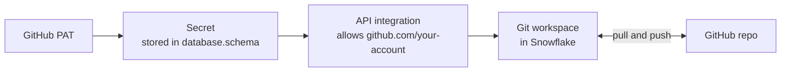

# Lesson 5: Connecting GitHub to Snowflake

> [!NOTE]
> **Source: [AnalystBuilder](https://www.analystbuilder.com)**<br>
> **Date completed:** October 26, 2026

How to link a GitHub repository to Snowflake so you can open, edit, and push its files without downloading and re-uploading them.

## The Big Picture

When you connect a GitHub repo, its files show up inside a Snowflake **Git workspace**. You can edit them there and push changes back to GitHub.

This is optional. You can keep everything inside Snowflake and upload files through **Tables** or a stage (Lesson 2). But most companies connect to GitHub, so it's a useful skill.

Back to the office analogy:

| Piece | What it is | Office analogy |
|---|---|---|
| **GitHub repo** | Where your files are stored and versioned | An off-site records room |
| **API integration** | Snowflake's permission to talk to GitHub | The approved visitor list |
| **Personal access token (PAT)** | A special password from GitHub | The keycard to the records room |
| **Secret** | A secure Snowflake object that stores the token | A locked safe holding the keycard |
| **Git workspace** | Where the repo's files appear in Snowflake | Your desk with the files laid out |

**Real-world example:** an audit team keeps reusable procedures like `premium_cutoff_test.sql` (Lesson 3) in GitHub. Connecting the repo lets auditors edit the procedure in Snowflake, while GitHub records who changed what and when, which is a ready-made audit trail.

## How the Pieces Connect



## Steps

### 1. Create a Git workspace

In Snowsight, open **Workspaces**, then choose **From Git repository** (shown as **Projects → + → Git Workspace** in some versions). Paste your repo's URL.

### 2. Add an API integration

This gives Snowflake permission to talk to GitHub.

- **Name:** for example `github_snowflake_course_api`. Use underscores, because hyphens in Snowflake names need extra quoting.
- **Allowed prefix:** the GitHub account it may access, for example `https://github.com/alextheanalyst`.

Creating an API integration needs an admin-level privilege. On a work account, you may need to ask your Snowflake administrator.

### 3. Create a personal access token in GitHub

In GitHub, go to **Settings → Developer settings → Personal access tokens → Fine-grained tokens**.

- **Expiry:** keep it short, such as 90 days. Never choose "No expiration."
- **Repository access:** choose **Only select repositories** and pick your repo.
- **Permissions:** set **Contents** to **Read and write**, so you can push changes.

> [!IMPORTANT]
> The "Public repositories" option only gives read access, so pushing would fail. Copy the token right away, because GitHub shows it only once.

### 4. Store the token as a secret in Snowflake

Paste the token into a new secret, name it `SNOWFLAKE_TOKEN`, and choose where it lives, for example `snowflake_course_database.public`.

### 5. Connect the repo

Select the secret and click **Create**. The repo's files now appear in your Git workspace.

## The Same Setup in SQL

Steps 2 and 4 can also be done in a worksheet. The secret comes first, because the integration has to name it.

```sql
-- Step 4: store the GitHub token as a secret
CREATE OR REPLACE SECRET snowflake_course_database.public.snowflake_token
  TYPE = PASSWORD
  USERNAME = 'your-github-username'
  PASSWORD = 'paste-your-token-here';

-- Step 2: let Snowflake talk to your GitHub account
CREATE OR REPLACE API INTEGRATION github_snowflake_course_api
  API_PROVIDER = git_https_api
  API_ALLOWED_PREFIXES = ('https://github.com/alextheanalyst')
  API_ALLOWED_AUTHENTICATION_SECRETS = (snowflake_course_database.public.snowflake_token)
  ENABLED = TRUE;
```

> [!CAUTION]
> Never commit a real token to GitHub, including in a `.sql` file like the one above.

## Why Use a Token If the Repo Is Public?

Anyone can **read** a public repo without logging in. But to **push, commit, or merge** changes, GitHub needs to know who you are. The token proves that.

## Working with the Repo

Once connected, open the **Changes** view in your Git workspace to:

- **Pull** the latest files from GitHub.
- **Commit and push** your edits back to GitHub.

By default, Snowflake uses your Snowflake email and username as the author of your commits.
