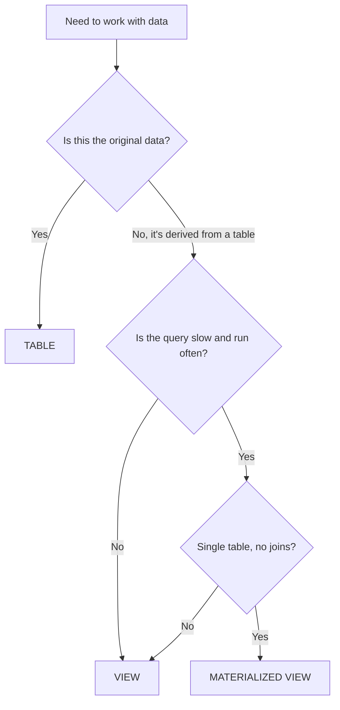

# Lesson 6: Tables, Views, and Materialized Views

> [!NOTE]
> **Source: [AnalystBuilder](https://www.analystbuilder.com)**<br>
> **Date completed:** October 27, 2026

Three ways to store or present data in Snowflake, explained with examples from a company's finance department.

## The Big Picture

| Object | Office analogy | Stores data? |
|---|---|---|
| **Table** | The original ledger book | Yes |
| **View** | A saved request slip ("pull all entries over $10,000") that a clerk runs fresh each time | No |
| **Materialized view** | A summary report the clerk keeps updated in a binder, ready to hand over | Yes (the results) |

The examples use the `FINANCE_AUDIT` database from Lesson 1.

## Table

- Stores data physically in Snowflake. When you query it, you read the stored rows.
- Data only changes when you insert, update, or delete it.

**Example:** every accounting entry is stored in a journal entries table.

```sql
CREATE TABLE FINANCE_AUDIT.GENERAL_LEDGER.JOURNAL_ENTRIES (
  entry_id      INT,
  entry_date    DATE,
  account_name  STRING,
  amount        NUMBER(18,2),
  entry_type    STRING,   -- 'MANUAL' or 'SYSTEM'
  approved_by   STRING
);
```

## View

- A saved SQL query, not stored data. Each time you query it, the SQL runs fresh, so results are always current.
- Great for simplifying complex queries or limiting which columns and rows users can see.

**Example 1: simplify a common audit check.** Auditors often look for large manual entries. Instead of rewriting the filter every time, save it as a view.

```sql
CREATE VIEW FINANCE_AUDIT.GENERAL_LEDGER.LARGE_MANUAL_ENTRIES AS
SELECT entry_id, entry_date, account_name, amount, approved_by
FROM FINANCE_AUDIT.GENERAL_LEDGER.JOURNAL_ENTRIES
WHERE entry_type = 'MANUAL'
  AND amount > 10000;

SELECT * FROM FINANCE_AUDIT.GENERAL_LEDGER.LARGE_MANUAL_ENTRIES;
```

**Example 2: hide sensitive columns.** Junior analysts need the vendor list but shouldn't see bank account numbers.

```sql
CREATE SECURE VIEW FINANCE_AUDIT.ACCOUNTS_PAYABLE.VENDOR_DIRECTORY AS
SELECT vendor_id, vendor_name, city, payment_terms   -- bank_account left out
FROM FINANCE_AUDIT.ACCOUNTS_PAYABLE.VENDORS;
```

A **secure view** also hides its SQL definition from users, so they can't see how it's built or what was left out.

## Materialized View

- Like a view, but the results are pre-computed and stored, so queries are much faster.
- Snowflake refreshes it automatically in the background when the source table changes.

**Example:** finance dashboards show daily totals for each account. Adding up millions of journal entries every time a dashboard loads is slow, so the totals are pre-computed.

```sql
CREATE MATERIALIZED VIEW FINANCE_AUDIT.GENERAL_LEDGER.DAILY_ACCOUNT_TOTALS AS
SELECT entry_date, account_name, SUM(amount) AS total_amount, COUNT(*) AS entry_count
FROM FINANCE_AUDIT.GENERAL_LEDGER.JOURNAL_ENTRIES
GROUP BY entry_date, account_name;
```

**Things to know:**

- Requires **Enterprise edition** or higher.
- Can only read from **one table**. Joins aren't allowed.
- Some SQL isn't allowed, such as window functions and functions like `CURRENT_DATE` whose results change over time.
- Costs money in two ways: **storage** for the saved results and **background compute** for the refreshes. Best when the source data changes less often than it's queried.

## Which One Should I Use?



## Key Takeaway

| | Table | View | Materialized View |
|---|---|---|---|
| **Stores data** | Yes | No, runs the query each time | Yes, stores the results |
| **Speed** | Fast | Depends on the query | Fast |
| **Stays current** | When you change it | Always | Auto-refreshed by Snowflake |
| **Extra cost** | Storage | None beyond the compute to run it | Storage and refresh compute |
| **Finance example** | Journal entries | Large manual entries, vendor directory | Daily account totals |
