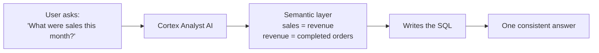

# Lesson 7: The Semantic Layer

> [!NOTE]
> **Source: [AnalystBuilder](https://www.analystbuilder.com)**<br>
> **Date completed:** October 27, 2026

## The Problem

An online store has an `ORDERS` table. Three analysts calculate "monthly revenue" differently:

| Analyst | Counts as revenue |
|---|---|
| A | Completed orders |
| B | Completed + shipped orders |
| C | Everything except cancelled orders |

Result: three dashboards, three different numbers, one unhappy CFO.

## The Fix

A **semantic layer** defines business terms **once**, so everyone gets the same answer.

Think of it as the company's **rulebook**: "Revenue means completed orders only." Analysts, dashboards, and AI all follow the same rule.



## The Main Pieces

| Piece | Meaning | Example |
|---|---|---|
| **Metric** | An agreed calculation | `revenue` |
| **Dimension** | Something to group or filter by | `order_month`, `region` |
| **Synonyms** | Other words people use | "sales" → `revenue` |
| **Relationship** | How tables join | orders → customers |

## A Simple Example

```yaml
name: sales_semantic_model

tables:
  - name: orders
    base_table:
      database: ANALYTICS
      schema: SALES
      table: ORDERS

    time_dimensions:
      - name: order_month
        expr: DATE_TRUNC('month', ORDER_DATE)
        data_type: DATE
        description: '"This month" means the current calendar month'

    metrics:
      - name: revenue
        synonyms: [sales, turnover]
        description: Revenue from completed orders only
        expr: SUM(CASE WHEN STATUS = 'completed' THEN AMOUNT ELSE 0 END)
```

The "completed only" rule is built into the `revenue` metric, so nobody can forget it.

## What Happens When Someone Asks a Question

**"What were sales this month?"**

1. "sales" → `revenue`
2. "this month" → the current calendar month
3. Cortex Analyst writes the SQL and returns one answer

The user writes no SQL, and the number matches the CFO's dashboard.

## Why It Matters for AI

AI can't tell what "revenue" means from column names alone, so without a semantic layer it guesses. The semantic layer gives it the business rules, which makes its answers accurate.

> [!TIP]
> Snowflake now recommends **semantic views**, which store these same definitions as a database object instead of a YAML file.
