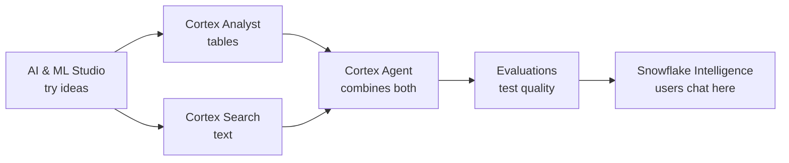

# Lesson 8: AI Features in Snowflake

> [!NOTE]
> **Source: [AnalystBuilder](https://www.analystbuilder.com)** 
> **Date completed:** October 28, 2026

Snowflake's AI tools work like a team of helpers, each with its own job. The examples use a finance team.

## The Tools at a Glance

| Tool | Its job | In one line |
|---|---|---|
| 🎨 **AI & ML Studio** | Try things out | A no-code playground |
| 📊 **Cortex Analyst** | Answer questions about tables | Plain English in, SQL answer out |
| 🔍 **Cortex Search** | Search text | Find answers in free text and documents |
| 🤖 **Cortex Agents** | Get tasks done | Plans the steps and uses the other tools |
| ✅ **Evaluations** | Quality check | Tests and grades AI answers before launch |
| 💬 **Snowflake Intelligence** | Chat with your data | A ChatGPT-style app for business users |

## 1. AI & ML Studio 🎨

A no-code playground. Click around, try different AI models, and get a feel for what they can do.

**Example:** a finance analyst tests whether AI can summarize a vendor contract before building anything.

## 2. Cortex Analyst 📊

Ask a question in plain English, and it writes the SQL and returns the answer.

**Example:** "What were operating expenses last quarter?"

> [!IMPORTANT]
> It needs a good **semantic model** (Lesson 7) to be accurate. That model is your source of truth.

## 3. Cortex Search 🔍

Built for **unstructured text**, like comment fields, emails, or PDFs. Search it in plain English instead of reading it all yourself.

**Example:** "Find all invoice disputes that mention late delivery."

## 4. Cortex Agents 🤖

You give it a goal. It breaks the goal into steps, picks the right tools (such as Cortex Analyst for tables and Cortex Search for documents), and combines the results into one answer.

**Example:** "Why did travel expenses jump in March?" The agent pulls the numbers with Cortex Analyst and searches expense notes with Cortex Search to explain the cause.

## 5. Evaluations ✅

A quality-check station. Before real users get an AI tool, you test it with sample questions and grade the answers for accuracy. Snowflake uses another AI as the "judge."

**Example:** test the expense agent with 50 questions that have known answers, and fix it before the CFO uses it.

## 6. Snowflake Intelligence 💬

The front end where managers, executives, or customers chat with business data, save chats, and use agents.

> [!IMPORTANT]
> You need to build an **agent** first. Snowflake Intelligence is the window, and agents do the work behind it.

**Example:** the CFO asks, "How are we tracking against budget this month?" and gets an answer with a chart.

## How They Fit Together

> [!TIP]
> **Also worth knowing:** **AI SQL functions** like `AI_COMPLETE`, `AI_CLASSIFY`, and `AI_SENTIMENT` let you use AI inside a regular SQL query, for example to tag thousands of invoice notes by category.
