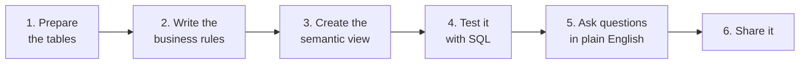

# Lesson 9: Building a Semantic View, Step by Step

> [!NOTE]
> **Source: [AnalystBuilder](https://www.analystbuilder.com)**<br>
> **Date completed:** October 28, 2026

A hands-on guide to building a semantic view (the "rulebook" from Lesson 7), using a finance team's unpaid customer invoices.

## The Scenario

The CFO keeps asking questions like:

- "How much do customers owe us?"
- "How much is overdue, by region?"
- "Which industries pay late?"

Each analyst calculates "overdue" a little differently. The goal: build one semantic view so every answer, from analysts or from Cortex Analyst, uses the same rules.

## The Steps



## Step 1: Prepare the Tables

We need two tables: invoices and customers. Run this to create sample data.

```sql
CREATE SCHEMA IF NOT EXISTS FINANCE_AUDIT.REVENUE;
USE SCHEMA FINANCE_AUDIT.REVENUE;

CREATE OR REPLACE TABLE CUSTOMERS (
  customer_id   INT,
  customer_name STRING,
  region        STRING,
  industry      STRING
);

CREATE OR REPLACE TABLE CUSTOMER_INVOICES (
  invoice_id    INT,
  customer_id   INT,
  invoice_date  DATE,
  due_date      DATE,
  amount        NUMBER(12,2),
  status        STRING      -- 'paid', 'open', or 'void'
);

INSERT INTO CUSTOMERS VALUES
  (1, 'Acme Retail',   'East', 'Retail'),
  (2, 'Bolt Energy',   'West', 'Utilities'),
  (3, 'Cedar Health',  'East', 'Healthcare');

INSERT INTO CUSTOMER_INVOICES VALUES
  (101, 1, '2026-08-01', '2026-08-31', 12000, 'paid'),
  (102, 1, '2026-09-15', '2026-10-15',  8000, 'open'),
  (103, 2, '2026-09-01', '2026-10-01', 25000, 'open'),
  (104, 2, '2026-10-10', '2026-11-09',  5000, 'open'),
  (105, 3, '2026-09-20', '2026-10-20',  9000, 'void');
```

## Step 2: Write the Business Rules

Before writing any code, agree on the definitions with the finance team. This is the most important step.

| Term | Rule |
|---|---|
| **Total billed** | All invoices except voided ones |
| **Outstanding balance** | Invoices with status `open` |
| **Overdue amount** | `open` invoices past their due date |
| **Invoice count** | Number of invoices, excluding voided ones |

## Step 3: Create the Semantic View

A semantic view has five parts, and they must appear in this order:

| Part | What it does | In our example |
|---|---|---|
| **TABLES** | Which tables to use, with a primary key | Invoices and customers |
| **RELATIONSHIPS** | How the tables join | Invoices → customers on `customer_id` |
| **FACTS** | Row-level values used in calculations | Invoice amount |
| **DIMENSIONS** | What you group or filter by | Region, industry, month |
| **METRICS** | The agreed calculations from Step 2 | Total billed, overdue amount |

```sql
CREATE OR REPLACE SEMANTIC VIEW FINANCE_AUDIT.REVENUE.RECEIVABLES_SV

  -- Which tables, and the column that makes each row unique
  TABLES (
    invoices  AS FINANCE_AUDIT.REVENUE.CUSTOMER_INVOICES PRIMARY KEY (invoice_id)
      WITH SYNONYMS = ('bills', 'receivables'),
    customers AS FINANCE_AUDIT.REVENUE.CUSTOMERS PRIMARY KEY (customer_id)
      WITH SYNONYMS = ('clients', 'accounts')
  )

  -- Each invoice belongs to one customer
  RELATIONSHIPS (
    invoice_to_customer AS invoices (customer_id) REFERENCES customers
  )

  -- Row-level values
  FACTS (
    invoices.invoice_amount AS amount
  )

  -- Ways to slice the numbers
  DIMENSIONS (
    customers.region        AS region,
    customers.industry      AS industry,
    customers.customer_name AS customer_name
      WITH SYNONYMS = ('client name'),
    invoices.status         AS status,
    invoices.invoice_month  AS DATE_TRUNC('month', invoice_date)
      COMMENT = 'Calendar month the invoice was issued'
  )

  -- The business rules from Step 2
  METRICS (
    invoices.total_billed AS
      SUM(CASE WHEN invoices.status <> 'void' THEN invoices.invoice_amount ELSE 0 END)
      WITH SYNONYMS = ('total invoiced', 'billings')
      COMMENT = 'All invoices except voided ones',

    invoices.outstanding_balance AS
      SUM(CASE WHEN invoices.status = 'open' THEN invoices.invoice_amount ELSE 0 END)
      WITH SYNONYMS = ('amount owed', 'unpaid', 'AR balance')
      COMMENT = 'Open invoices not yet paid',

    invoices.overdue_amount AS
      SUM(CASE WHEN invoices.status = 'open' AND invoices.due_date < CURRENT_DATE
               THEN invoices.invoice_amount ELSE 0 END)
      WITH SYNONYMS = ('past due', 'late payments')
      COMMENT = 'Open invoices past their due date',

    invoices.invoice_count AS
      COUNT(CASE WHEN invoices.status <> 'void' THEN invoices.invoice_id END)
      WITH SYNONYMS = ('number of invoices')
      COMMENT = 'Number of invoices, excluding voided ones'
  )

  COMMENT = 'Customer invoices and amounts owed, for the finance team';
```

**Why each choice matters:**

- **Synonyms** connect everyday words ("amount owed", "past due") to the right metric, which helps Cortex Analyst understand questions.
- **Comments** explain each rule in plain English, for both people and AI.
- **Voided invoices are excluded inside the metrics**, so no one can forget the rule.

## Step 4: Test It with SQL

Check that the semantic view exists and lists everything you defined:

```sql
SHOW SEMANTIC VIEWS IN SCHEMA FINANCE_AUDIT.REVENUE;
DESCRIBE SEMANTIC VIEW FINANCE_AUDIT.REVENUE.RECEIVABLES_SV;
```

Then query it. You pick the metrics and dimensions you want, and Snowflake writes the joins and calculations for you:

```sql
SELECT *
FROM SEMANTIC_VIEW(
  FINANCE_AUDIT.REVENUE.RECEIVABLES_SV
  DIMENSIONS customers.region
  METRICS invoices.outstanding_balance, invoices.overdue_amount
)
ORDER BY overdue_amount DESC;
```

Check a few results against the raw tables by hand. If a number looks wrong, fix the metric in Step 3 and run it again.

## Step 5: Ask Questions in Plain English

In Snowsight, go to **AI & ML → Cortex Analyst**, select `RECEIVABLES_SV`, and try questions like:

| Question | What the semantic view uses |
|---|---|
| "How much do clients owe us?" | `outstanding_balance` (through the synonyms "clients" and "owe") |
| "Show past due amounts by region" | `overdue_amount` + `region` |
| "Which industry has the most unpaid invoices?" | `outstanding_balance` + `industry` |

> [!TIP]
> You can also build a semantic view without code. Go to **AI & ML → Cortex Analyst → Create new → Create new Semantic View**, and a guided form walks through the same parts.

## Step 6: Share It

Give the finance team access, the same way you would for a regular view:

```sql
GRANT SELECT, REFERENCES ON SEMANTIC VIEW FINANCE_AUDIT.REVENUE.RECEIVABLES_SV
  TO ROLE FINANCE_ANALYST;

-- Needed only if they'll use Cortex Analyst or Cortex Agents
GRANT SELECT ON TABLE FINANCE_AUDIT.REVENUE.CUSTOMER_INVOICES TO ROLE FINANCE_ANALYST;
GRANT SELECT ON TABLE FINANCE_AUDIT.REVENUE.CUSTOMERS         TO ROLE FINANCE_ANALYST;
```

Querying the semantic view with SQL needs access to the semantic view only. Cortex Analyst and Cortex Agents also need access to the underlying tables. Once shared, the semantic view can power a Cortex Agent and Snowflake Intelligence (Lesson 8), so the CFO can ask these questions directly.

## Checklist

- [ ] Tables have a primary key
- [ ] Business rules are agreed with the finance team **before** coding
- [ ] Every metric has a comment and synonyms
- [ ] Results are checked against the raw data
- [ ] Access is granted to the right roles
