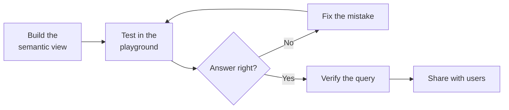

# Lesson 10: Cortex Analyst

> [!NOTE]
> **Source: [AnalystBuilder](https://www.analystbuilder.com)**<br>
> **Date completed:** October 28, 2026

## What It Is

Cortex Analyst is a **chatbot for your data**. You ask a question in plain English, and it writes the SQL and gives you the answer.

It works because it reads your **semantic view** (Lessons 7 and 9), which explains what your tables, columns, metrics, and relationships mean.

The examples use the `RECEIVABLES_SV` semantic view from Lesson 9.

## The Workflow



## 1. The Semantic View in Plain Text

Open **AI & ML → Cortex Analyst** and select your semantic view. Snowflake shows it section by section: tables, relationships, facts, dimensions, and metrics. Nothing new, just your model in an easy-to-read layout.

## 2. Verified Queries: The "Gold Star" Answers

When the AI gives a good answer, you can **verify** it. That saves the question and its SQL as a trusted example. When someone asks something similar later, the AI reuses that logic instead of guessing.

**Example:** the AI suggests the query "Top 10 customers by outstanding balance." You run the SQL, confirm the results match the raw data, and save it as verified.

> [!IMPORTANT]
> Only verify a query after you've checked the results yourself. A wrong verified query teaches the AI the wrong answer.

## 3. The Playground: Test Before You Ship

The playground is where you try questions **before** real users see the tool.

**Example: the capital-letter bug**

You ask: *"How much do customers in the east region owe?"*
The answer comes back **$0**, which is clearly wrong.

| | |
|---|---|
| **What the AI wrote** | `WHERE region = 'east'` |
| **What the data holds** | `'East'` (capital E) |
| **Why it failed** | Snowflake text matching is case-sensitive, so `'east'` matches nothing |

**The fix:**

1. Tell the AI in the playground: *"The region is stored as 'East' with a capital E."*
2. It rewrites the SQL and returns the correct amount.
3. **Verify** the corrected query so similar questions use the right version.

> [!TIP]
> **Prevent this bug for every column at once.** In the semantic view, add **sample values** to text dimensions like `region` (for example `East`, `West`). The AI then knows the exact spelling to use without needing a correction.

## 4. Sharing It

Grant a role access to the semantic view. Users with that role can ask questions, but only the owner can edit the view.

In the course, Alex shares it with the `PUBLIC` role, which means **every user** in the account. That's fine for practice data. For real financial data, share with a specific role instead:

```sql
GRANT SELECT, REFERENCES ON SEMANTIC VIEW FINANCE_AUDIT.REVENUE.RECEIVABLES_SV
  TO ROLE FINANCE_ANALYST;
```

As covered in Lesson 9, Cortex Analyst users also need `SELECT` on the underlying tables.

## Key Takeaway

**Always test in the playground before sharing.** Otherwise, your users will be the ones discovering bugs like the capital-letter issue.

**Build → Test → Fix → Verify → Share**
