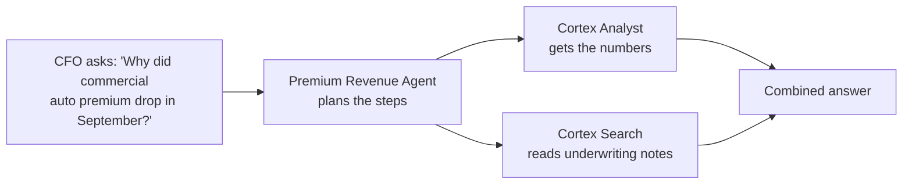

# Lesson 11: AI Agents (Cortex Agents)

> [!NOTE]
> **Source: [AnalystBuilder](https://www.analystbuilder.com)**<br>
> **Date completed:** October 29, 2026

## What Is an AI Agent?

A Cortex Agent is like a **custom ChatGPT connected to your own data and tools**. You build it once, give it a job, and people chat with it to get answers and get things done.

## Agent vs. Analyst

| | Cortex Analyst | Cortex Agent |
|---|---|---|
| **Job** | Answers questions over tables | Handles multi-step tasks |
| **Data it can use** | One semantic view | Semantic views, documents, web, custom tools |
| **Can it take action?** | No, it answers | Yes, through custom tools |
| **How it works** | Turns a question into SQL | Plans the steps, picks the tools, combines the results |

**In short:** Analyst answers questions. Agent answers questions **and** takes action.

## The Main Settings

| Tab | What you set | Examples |
|---|---|---|
| **About** | Name, description, sample questions | "Answers questions about insurance premium revenue" |
| **Tools** | What the agent can use | Cortex Analyst, Cortex Search, web search, custom tools |
| **Orchestration** | How it should think and talk | "Always state the time period" / "Be concise" |
| **Access** | Who can use it | A specific role, such as `FINANCE_ANALYST` |

**The four tool types:**

- **Cortex Analyst:** answers questions over tables using a semantic view
- **Cortex Search:** searches documents and free text
- **Web search:** looks things up on the internet
- **Custom tools:** your own functions or stored procedures, so the agent can **do** things, such as create a report table

## Real-World Example: An Insurance Revenue Agent

**Scenario:** An insurance company's finance team spends hours answering premium revenue questions from executives. They build a **Premium Revenue Agent** that answers questions like:

- "What was written premium by product line in Q3?"
- "Which region grew earned premium the most compared with last year?"
- "Why did commercial auto premium drop in September?"

The last question needs **numbers** (from tables) and **reasons** (from underwriting notes). That's why it needs an agent, not just Cortex Analyst.



### Step 1: Prepare the Data and Semantic View

The agent is only as good as the semantic view behind it. This example uses two tables: `POLICIES` and `PREMIUM_TRANSACTIONS`. (See Lesson 9 for a full walkthrough.)

```sql
CREATE OR REPLACE SEMANTIC VIEW INSURANCE.REVENUE.PREMIUM_REVENUE_SV
  TABLES (
    policies AS INSURANCE.REVENUE.POLICIES PRIMARY KEY (policy_id),
    premiums AS INSURANCE.REVENUE.PREMIUM_TRANSACTIONS PRIMARY KEY (transaction_id)
  )
  RELATIONSHIPS (
    premium_to_policy AS premiums (policy_id) REFERENCES policies
  )
  FACTS (
    premiums.written_amount AS written_premium,
    premiums.earned_amount  AS earned_premium
  )
  DIMENSIONS (
    policies.product_line AS product_line
      WITH SYNONYMS = ('line of business', 'LOB'),
    policies.region       AS region,
    premiums.premium_month AS DATE_TRUNC('month', transaction_date)
  )
  METRICS (
    premiums.total_written_premium AS SUM(premiums.written_amount)
      WITH SYNONYMS = ('GWP', 'gross written premium', 'sales')
      COMMENT = 'Premium from policies sold in the period',
    premiums.total_earned_premium AS SUM(premiums.earned_amount)
      WITH SYNONYMS = ('revenue', 'earned revenue')
      COMMENT = 'Premium recognized as revenue as coverage is provided'
  );
```

> [!TIP]
> **Written vs. earned premium:** written premium is what was sold. Earned premium is the part recognized as revenue so far. A 12-month, $1,200 policy sold in January is $1,200 written but only $100 earned after one month. Defining both clearly stops the agent from mixing them up.

**Optional:** create a Cortex Search service over an `UNDERWRITING_NOTES` table so the agent can read the reasons behind the numbers.

### Step 2: Create the Agent

1. In Snowsight, go to **AI & ML → Agents**.
2. Select **Create agent**.
3. Choose the **database and schema** where the agent will live.
4. Enter an **object name** (`PREMIUM_REVENUE_AGENT`) and a **display name** ("Premium Revenue Agent").

### Step 3: Describe It (About)

- **Description:** "Answers questions about insurance premium revenue by product line, region, and month, and explains changes using underwriting notes."
- **Sample questions** (these appear as clickable prompts):
  - "What was written premium by product line in Q3?"
  - "Show earned premium by region this year vs. last year"

### Step 4: Add Tools

| Tool | Setting | Value |
|---|---|---|
| **Cortex Analyst** | Name | `PremiumAnalytics` |
| | Semantic view | `INSURANCE.REVENUE.PREMIUM_REVENUE_SV` |
| | Description | "Premium figures by product line, region, and month" |
| | Warehouse | `AGENT_WH` |
| **Cortex Search** (optional) | Name | `UnderwritingNotesSearch` |
| | Description | "Underwriter comments explaining rate changes and lost business" |

A clear tool description matters: the agent reads it to decide **which tool to use** for each question.

### Step 5: Set Orchestration

- **Model:** choose `auto`, so Snowflake picks the best available model.
- **Orchestration instructions** (how to work):
  > "Use PremiumAnalytics for any numbers. Use UnderwritingNotesSearch only to explain why numbers changed. If the user says 'revenue', use earned premium."
- **Response instructions** (how to talk):
  > "Be concise. Always state the time period and whether figures are written or earned premium. Show tables for comparisons."

### Step 6: Set Access

Grant the agent to a specific role, such as `FINANCE_ANALYST`. Alex uses `PUBLIC` in the course, which gives **every user** access. That's fine for practice data, but not for real financial data.

Users also need access to the semantic view and its underlying tables (Lesson 9).

### Step 7: Test, Then Share

1. Ask the sample questions in the agent's test chat.
2. Check the answers against the raw data, just like the playground in Lesson 10.
3. Fix the semantic view or instructions if anything is wrong.
4. Add the agent to **Snowflake CoWork** so business users can chat with it.

> [!WARNING]
> On a **trial account**, running the agent may return "access denied," as it did in the course. That's a trial limit, not a mistake in your setup.

## Creating the Same Agent in SQL

You can also create an agent with SQL, using a YAML specification:

```sql
CREATE OR REPLACE AGENT INSURANCE.REVENUE.PREMIUM_REVENUE_AGENT
  COMMENT = 'Answers premium revenue questions for the finance team'
  PROFILE = '{"display_name": "Premium Revenue Agent"}'
  FROM SPECIFICATION
  $$
  models:
    orchestration: auto

  instructions:
    orchestration: "Use PremiumAnalytics for numbers. If the user says 'revenue', use earned premium."
    response: "Be concise. Always state the time period and whether figures are written or earned premium."
    sample_questions:
      - question: "What was written premium by product line in Q3?"

  tools:
    - tool_spec:
        type: "cortex_analyst_text_to_sql"
        name: "PremiumAnalytics"
        description: "Premium figures by product line, region, and month"

  tool_resources:
    PremiumAnalytics:
      semantic_view: "INSURANCE.REVENUE.PREMIUM_REVENUE_SV"
      execution_environment:
        type: "warehouse"
        warehouse: "AGENT_WH"
  $$;
```

## Key Takeaway

**Build the semantic view → Create the agent → Add tools → Write instructions → Limit access → Test → Share in CoWork**
