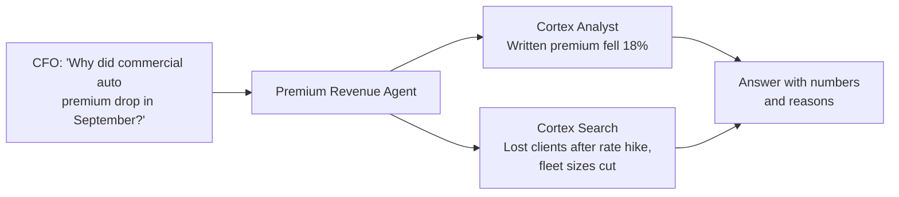

# Lesson 12: Cortex Search

> [!NOTE]
> **Source: [AnalystBuilder](https://www.analystbuilder.com)**<br>
> **Date completed:** October 29, 2026

## What It Is

Cortex Search is **Google search for your own text data inside Snowflake**.

Normally, you can only search free text with exact matches or `LIKE` patterns. Cortex Search searches by **meaning**. A search for "price increase" also finds notes that say "rate hike" or "premium went up," even though the exact words never appear.

| Search method | Query | Finds "Client left after 15% rate hike"? |
|---|---|---|
| `LIKE '%price increase%'` | Exact words | ❌ No |
| Cortex Search | "price increase" | ✅ Yes |

## Real-World Example: Underwriting Notes

In Lesson 11, the Premium Revenue Agent could see **that** commercial auto premium dropped, but not **why**. The reasons sit in free-text **underwriting notes**, which underwriters write each time a policy is renewed, priced, or lost.

| note_id | policy_id | product_line | region | note_type | note_date | note_text |
|---|---|---|---|---|---|---|
| 1 | P-1042 | Commercial Auto | East | Lost Business | 2026-09-03 | Client moved to a competitor after our 15% rate hike. |
| 2 | P-2210 | Commercial Auto | West | Renewal | 2026-09-12 | Fleet cut from 40 trucks to 22, so premium dropped at renewal. |
| 3 | P-3301 | Property | East | Pricing | 2026-09-18 | Coastal flood exposure raised; added a 10% surcharge. |

Cortex Search lets finance ask: *"Why did we lose commercial auto business?"* and get the right notes back.

## The Three Column Types

This is the most important part of setting up a search service.

| Column type | What it does | Insurance example |
|---|---|---|
| **Search column** | The text Cortex Search actually reads | `note_text` |
| **Attribute columns** | Used to **filter** results, not searched | `product_line`, `region`, `note_type` |
| **Included columns** | Returned with results for context | `policy_id`, `note_date` |

> [!WARNING]
> **The gotcha:** only the **search column** is searched. Searching "Property" does **not** match notes because `product_line = 'Property'`. It only matches notes where the word appears in `note_text`. To get property notes, **filter** on `product_line` instead.

## Step by Step

### Step 1: Load the Notes

Notes often arrive as a JSON export from the policy system, such as `underwriting_notes.json`. When loading it through **Tables → Load data**, **untick "Load as a single variant column"**. That splits the file into proper columns instead of one block of JSON.

### Step 2: Create the Search Service

In Snowsight, go to **AI & ML → Cortex Search → Create**, choose the database and schema, name the service, and pick the three column types. Or run it in SQL:

```sql
CREATE OR REPLACE CORTEX SEARCH SERVICE INSURANCE.REVENUE.UNDERWRITING_NOTES_SEARCH
  ON note_text                                  -- search column
  ATTRIBUTES product_line, region, note_type    -- filter columns
  WAREHOUSE = AGENT_WH
  TARGET_LAG = '1 day'                          -- how often new notes are picked up
  AS (
    SELECT note_text, product_line, region, note_type,   -- search + attributes
           policy_id, note_date                          -- included columns
    FROM INSURANCE.REVENUE.UNDERWRITING_NOTES
  );
```

- **`WAREHOUSE`** builds and refreshes the search index.
- **`TARGET_LAG`** sets how fresh results must be. New notes appear in search within this time.

### Step 3: Test It in the Playground

Open the service and try searches, adding included columns to the output so you can see the policy and date.

| Search | Filter | Finds |
|---|---|---|
| "why did clients leave" | `note_type = 'Lost Business'` | Note 1 (competitor after rate hike) |
| "smaller fleet or fewer vehicles" | `product_line = 'Commercial Auto'` | Note 2 (fleet cut from 40 to 22) |
| "weather or flood risk" | `region = 'East'` | Note 3 (coastal flood surcharge) |

You can also test it in a worksheet:

```sql
SELECT SNOWFLAKE.CORTEX.SEARCH_PREVIEW(
  'INSURANCE.REVENUE.UNDERWRITING_NOTES_SEARCH',
  '{
     "query": "why did clients leave",
     "columns": ["note_text", "policy_id", "note_date"],
     "filter": {"@eq": {"product_line": "Commercial Auto"}},
     "limit": 5
   }'
);
```

### Step 4: Use It

The service now appears in your database next to semantic views and agents. You can:

- **Add it to an agent** as a tool (Lesson 11), so the Premium Revenue Agent can explain the numbers it finds
- **Call it from a Streamlit app**, for example a search box for the underwriting team

## Cortex Search + Cortex Analyst Together



## Key Takeaway

Free text is messy and hard to query. Cortex Search makes it searchable by meaning. Remember: **search the text column, filter with attribute columns.**
