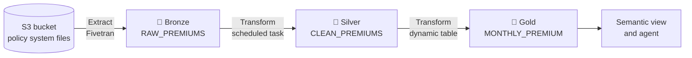

# Lesson 13: ELT vs. ETL

> [!NOTE]
> **Source: [AnalystBuilder](https://www.analystbuilder.com)**<br>
> **Date completed:** October 29, 2026

## Only the Order Changes

| | Steps | Where cleaning happens |
|---|---|---|
| **ETL** (older approach) | Extract → **Transform** → Load | Before the data reaches the database |
| **ELT** (modern, used with Snowflake) | Extract → Load → **Transform** | Inside the database |

**Why ELT?** Snowflake is a powerful cloud warehouse, so it transforms data much faster than a laptop or a separate server. Load the raw data first, then let Snowflake do the heavy lifting.

A bonus for auditors: because the raw data is kept, you can always trace a reported number back to its original source.

## The Medallion Architecture

A naming convention for how "cooked" the data is:

| Layer | What's in it | Kitchen analogy |
|---|---|---|
| 🥉 **Bronze** | Raw, untouched data | Raw ingredients |
| 🥈 **Silver** | Cleaned data | Chopped and prepped |
| 🥇 **Gold** | Summarized, ready-to-use data | The plated meal |

## Real-World Example: Insurance Premium Pipeline

Every night, the policy system drops premium transactions into an S3 bucket. The finance team needs clean monthly premium figures to power the semantic view and agent from Lesson 11.



### Extract and Load → Bronze

**Fivetran**, a third-party connector, copies the files from S3 into Snowflake as they are, mistakes included. (Snowflake's own Snowpipe can do this too.)

**`INSURANCE.BRONZE.RAW_PREMIUMS`** might look like this:

| policy_id | product_line | written_premium | txn_date |
|---|---|---|---|
| P-1042 | comm auto | 1200 | 2026-09-03 |
| P-1042 | comm auto | 1200 | 2026-09-03 |
| P-2210 | Commercial Auto | 850 | 2026-09-12 |
| P-3301 | PROPERTY | NULL | 2026-09-18 |

Problems: a duplicate row, inconsistent product names, and a missing amount.

### Bronze → Silver: A Scheduled Task

A **task** is SQL that runs on a timer. This one cleans the data every night at 2 a.m.

```sql
CREATE OR REPLACE TASK INSURANCE.SILVER.CLEAN_PREMIUMS_TASK
  WAREHOUSE = ETL_WH
  SCHEDULE = 'USING CRON 0 2 * * * America/Chicago'
AS
  INSERT OVERWRITE INTO INSURANCE.SILVER.CLEAN_PREMIUMS
  SELECT DISTINCT                                  -- remove duplicates
    policy_id,
    CASE
      WHEN UPPER(product_line) IN ('COMM AUTO', 'COMMERCIAL AUTO') THEN 'Commercial Auto'
      WHEN UPPER(product_line) = 'PROPERTY' THEN 'Property'
      ELSE INITCAP(product_line)
    END AS product_line,                           -- standardize names
    written_premium,
    txn_date
  FROM INSURANCE.BRONZE.RAW_PREMIUMS
  WHERE written_premium IS NOT NULL;               -- drop incomplete rows

-- New tasks start paused, so turn it on
ALTER TASK INSURANCE.SILVER.CLEAN_PREMIUMS_TASK RESUME;
```

> [!TIP]
> In real audit work, send incomplete rows to an exceptions table for review instead of silently dropping them.

### Silver → Gold: A Dynamic Table

A **dynamic table** keeps itself up to date. You write the query and say how fresh it must be, and Snowflake handles the refreshes.

```sql
CREATE OR REPLACE DYNAMIC TABLE INSURANCE.GOLD.MONTHLY_PREMIUM
  TARGET_LAG = '1 hour'                  -- never more than 1 hour behind silver
  WAREHOUSE = ETL_WH
AS
  SELECT
    DATE_TRUNC('month', txn_date) AS premium_month,
    product_line,
    SUM(written_premium) AS total_written_premium,
    COUNT(DISTINCT policy_id) AS policy_count
  FROM INSURANCE.SILVER.CLEAN_PREMIUMS
  GROUP BY premium_month, product_line;
```

### Task vs. Dynamic Table

Either could be used at each step. The course shows both so you can compare them.

| | Task | Dynamic Table |
|---|---|---|
| **You write** | The SQL **and** the schedule | Just the query and a freshness target |
| **When it runs** | On a fixed timer | Automatically, when the source changes |
| **Flexibility** | Any SQL, including multi-step logic | A single `SELECT` |
| **Must turn on?** | Yes, `ALTER TASK ... RESUME` | No, starts automatically |
| **Best for** | Jobs at fixed times, like nightly close | Keeping summaries fresh |

## Tools for Transforming

| Tool | What it is | Example |
|---|---|---|
| **SQL** | The classic | Cleaning names and removing duplicates |
| **Python** | For more complex logic | Pro-rating premium across policy months |
| **Snowpark** | Write Python, Java, or Scala that **runs on Snowflake's compute**, not your laptop | Processing millions of transactions without slowing your machine |

```python
# Snowpark: the same cleaning step, written in Python but run inside Snowflake
from snowflake.snowpark.functions import col

clean = (
    session.table("INSURANCE.BRONZE.RAW_PREMIUMS")
    .filter(col("WRITTEN_PREMIUM").is_not_null())
    .drop_duplicates()
)
clean.write.save_as_table("INSURANCE.SILVER.CLEAN_PREMIUMS", mode="overwrite")
```

## Key Takeaway

**Extract** the data, **load** it raw into bronze, then **transform** it inside Snowflake as it moves from bronze → silver → gold, using **tasks** and **dynamic tables**.
