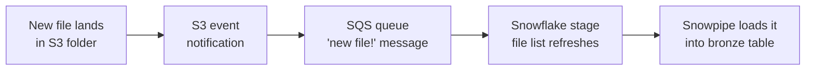

# Lesson 14: Automating Data Ingestion from S3

> [!NOTE]
> **Source: [AnalystBuilder](https://www.analystbuilder.com)**<br>
> **Date completed:** October 30, 2026

## The Goal

Drop a file into an S3 bucket, and Snowflake picks it up automatically, with no manual uploads or refreshes.

**Example:** every night, an insurer's policy system drops a premium file into `s3://insurer-finance-raw/premiums/`. The finance team wants each file to land in the bronze layer from Lesson 13 without anyone touching it.

## How It Works



**The key idea:** Snowflake can't watch your S3 bucket. **Amazon has to tell Snowflake** when a new file arrives.

## The Three Pieces

| Piece | Where | What it does | Analogy |
|---|---|---|---|
| **Stage** | Snowflake | Points at the S3 folder | A bookmark |
| **Directory table + auto refresh** | Snowflake | Keeps a live list of the files in the folder | An inbox that updates itself |
| **Event notification (SQS)** | AWS | Tells Snowflake when a file is added | The doorbell |

## Step by Step

### Step 1: Create the Stage (Snowflake)

In S3, open the folder and click **Copy S3 URI** (for example `s3://insurer-finance-raw/premiums/`). Then create the stage in Snowflake's **Ingestion** screen, or in SQL:

```sql
CREATE OR REPLACE STAGE INSURANCE.BRONZE.PREMIUM_FILES_STAGE
  URL = 's3://insurer-finance-raw/premiums/'
  CREDENTIALS = (AWS_KEY_ID = '<key id>' AWS_SECRET_KEY = '<secret>')  -- from Step 2
  DIRECTORY = (ENABLE = TRUE AUTO_REFRESH = TRUE);
```

`DIRECTORY = (ENABLE = TRUE AUTO_REFRESH = TRUE)` turns on the **directory table** (the live file list) and **auto refresh** (updates it when files change).

### Step 2: Fix "Access Denied" (AWS)

You'll almost certainly see **"Access denied"** at first. That's normal: AWS blocks access by default. Give Snowflake read access:

1. In AWS, open **IAM** and create a user, such as `snowflakeuser`.
2. Attach the **AmazonS3ReadOnlyAccess** policy.
3. Create an **access key** for that user.
4. Paste the key ID and secret into the Snowflake stage settings.

> [!WARNING]
> **For real company data, use a safer setup:**
> - `AmazonS3ReadOnlyAccess` can read **every** bucket in the AWS account. Limit the policy to just this bucket.
> - Snowflake recommends a **storage integration** (an AWS role, as in Lesson 2) instead of access keys, so no secret key is stored in Snowflake.
> - Never commit access keys to GitHub.

### Step 3: Connect the Notification (AWS)

1. In Snowflake, find the stage's **SQS ARN** (the queue's address):

   ```sql
   DESC STAGE INSURANCE.BRONZE.PREMIUM_FILES_STAGE;
   -- copy the value of DIRECTORY_NOTIFICATION_CHANNEL
   ```

2. In S3, open the bucket's **Properties → Event notifications → Create event notification**.
3. Set the prefix to `premiums/` and choose **All object create events** (add **object removal events** too, so deleted files leave the list).
4. For the destination, choose **SQS queue** and paste the ARN.

**SQS vs. SNS:**

| | SQS (Simple Queue Service) | SNS (Simple Notification Service) |
|---|---|---|
| **What it is** | A queue that holds "new file" messages for Snowflake | A system that broadcasts messages to many listeners |
| **Use when** | Most setups; Snowflake provides the queue | Your company already uses SNS for this bucket |

### Step 4: Check the File List

Drop a test file into the folder, then run:

```sql
SELECT relative_path, size, last_modified
FROM DIRECTORY(@INSURANCE.BRONZE.PREMIUM_FILES_STAGE);
```

The new file should appear within a minute or so.

### Step 5: Load the Files Automatically (Snowpipe)

> [!IMPORTANT]
> The directory table only **lists** files. It doesn't load their data into a table. To load each new file automatically, add **Snowpipe**.

```sql
CREATE OR REPLACE PIPE INSURANCE.BRONZE.PREMIUM_PIPE
  AUTO_INGEST = TRUE
AS
  COPY INTO INSURANCE.BRONZE.RAW_PREMIUMS
  FROM @INSURANCE.BRONZE.PREMIUM_FILES_STAGE
  FILE_FORMAT = (TYPE = CSV SKIP_HEADER = 1);
```

Run `SHOW PIPES;` and check that the `notification_channel` matches the SQS ARN from Step 3. Now each new premium file flows straight into bronze, and the task and dynamic table from Lesson 13 take it from there.

## Key Takeaway

**Point Snowflake at the S3 folder → turn on auto refresh → give Snowflake read access → connect an SQS notification → add Snowpipe to load the data.**

After that, a new file dropped into S3 shows up in Snowflake automatically.
