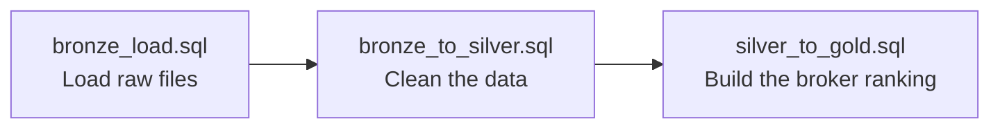

# Lesson 15: Silver to Gold

> [!NOTE]
> **Source: [AnalystBuilder](https://www.analystbuilder.com)**<br>
> **Date completed:** October 31, 2026

## Quick Recap

| Layer | What's in it | Kitchen analogy |
|---|---|---|
| 🥉 **Bronze** | Raw files, untouched | Groceries straight from the store |
| 🥈 **Silver** | Cleaned data | Washed and chopped ingredients |
| 🥇 **Gold** | Built for one specific use | The finished dish |

## Gold Is Optional

You don't always need a gold layer. Alex skips it about **60% of the time**, because the silver table is often clean enough to use directly. There's no point copying it again.

| Use silver directly when... | Build a gold table when... |
|---|---|
| The cleaned data already answers the question | You need a summary or ranking for one specific purpose |
| Many teams use the data in different ways | An app, dashboard, or report needs a ready-made table |
| No extra calculations are needed | The calculation is complex and shouldn't be repeated |

## Real-World Example: Most Consistent Brokers

**Business question:** *"Which brokers bring in new business most consistently?"*

The insurer wants to reward its most reliable brokers with a bonus program. "Consistent" means a broker wrote policies in the **most different months**, not just one big month.

**Source:** the silver table from Lesson 13, `INSURANCE.SILVER.CLEAN_PREMIUMS`, with a `broker_id` column added. It holds `policy_id`, `broker_id`, `product_line`, `written_premium`, and `txn_date`.

### The Query

Create a new SQL file called `silver_to_gold.sql`:

```sql
CREATE OR REPLACE TABLE INSURANCE.GOLD.MOST_CONSISTENT_BROKERS AS
SELECT
    broker_id,
    COUNT(DISTINCT DATE_TRUNC('month', txn_date)) AS active_months,
    ROUND(
      COUNT(DISTINCT DATE_TRUNC('month', txn_date)) * 100.0
      / (SELECT COUNT(DISTINCT DATE_TRUNC('month', txn_date))
         FROM INSURANCE.SILVER.CLEAN_PREMIUMS),
      1) AS pct_months_active,
    COUNT(DISTINCT policy_id) AS policies_written,
    SUM(written_premium)      AS total_written_premium
FROM INSURANCE.SILVER.CLEAN_PREMIUMS
GROUP BY broker_id
ORDER BY active_months DESC, total_written_premium DESC
LIMIT 20;
```

**How it works:**

| Part | What it does |
|---|---|
| `COUNT(DISTINCT DATE_TRUNC('month', ...))` | Counts the different months each broker was active |
| `pct_months_active` | Active months ÷ all months in the data, as a percentage |
| `ORDER BY ... DESC` and `LIMIT 20` | Keeps the top 20, using premium to break ties |
| `CREATE OR REPLACE TABLE ... AS` | Saves the result as a new gold table |

### The Result

| broker_id | active_months | pct_months_active | policies_written | total_written_premium |
|---|---|---|---|---|
| B-104 | 12 | 100.0 | 310 | 1,845,000 |
| B-087 | 12 | 100.0 | 198 | 1,120,000 |
| B-215 | 11 | 91.7 | 402 | 2,630,000 |

This gold table can now power the broker bonus program or a leaderboard on the sales dashboard.

> [!TIP]
> `CREATE TABLE ... AS` saves a **snapshot**. It won't update when new data arrives. To keep the gold table current, make it a **dynamic table** or rebuild it with a **scheduled task** (both from Lesson 13).

## The Full Pipeline: Three SQL Files

Each file does one job:



| File | Layer | Job |
|---|---|---|
| `bronze_load.sql` | 🥉 Bronze | Load the raw premium files |
| `bronze_to_silver.sql` | 🥈 Silver | Remove duplicates, fix names, drop incomplete rows |
| `silver_to_gold.sql` | 🥇 Gold | Build the most-consistent-brokers table |

## Key Takeaway

Gold is optional. Build it only when a specific use, like a bonus program or a dashboard, needs a purpose-built table.
