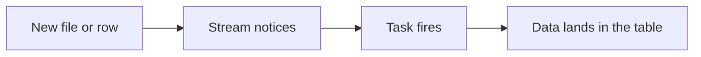

# Lesson 16: Triggers in Snowflake

> [!NOTE]
> **Source: [AnalystBuilder](https://www.analystbuilder.com)**<br>
> **Date completed:** October 31, 2026

## The Big Picture

A **trigger** runs an action automatically when something happens. Snowflake has **no `CREATE TRIGGER` command**, so you build one from two pieces:

| Piece | Job | Doorbell analogy 🔔 |
|---|---|---|
| **Stream** | Detects new or changed data | The doorbell sensor |
| **Triggered task** | Runs your SQL when the stream has data | What you do when the bell rings |
| `WHEN SYSTEM$STREAM_HAS_DATA(...)` | Connects the two | The wiring |



## Scheduled vs. Triggered Task

| | Scheduled task | Triggered task |
|---|---|---|
| **Runs** | At a set time, e.g. every night at 3 a.m. | As soon as new data appears |
| **Code** | Less | A little more |
| **Data is ready** | Hours later | Within about a minute |
| **Compute when nothing changes** | Still runs | Skipped, so no cost |

## Example 1: Load New Premium Files Automatically

**Scenario:** premium files land in the S3 stage from Lesson 14. Today someone runs `COPY INTO` by hand to load them into bronze. The goal: load each file **the moment it arrives**.

```sql
-- Step 1: Turn on the directory table (Snowflake's list of files in the stage)
ALTER STAGE INSURANCE.BRONZE.PREMIUM_FILES_STAGE
  SET DIRECTORY = (ENABLE = TRUE);

-- Step 2: Refresh the list so it's up to date
ALTER STAGE INSURANCE.BRONZE.PREMIUM_FILES_STAGE REFRESH;

-- Step 3: Create the stream (the doorbell sensor)
CREATE OR REPLACE STREAM INSURANCE.BRONZE.PREMIUM_FILES_STREAM
  ON STAGE INSURANCE.BRONZE.PREMIUM_FILES_STAGE;

-- A small table to record each file loaded
CREATE TABLE IF NOT EXISTS INSURANCE.BRONZE.FILE_LOAD_LOG (
  file_name STRING, file_size NUMBER, loaded_at TIMESTAMP_LTZ
);

-- Step 4: Create the triggered task (what happens when the bell rings)
CREATE OR REPLACE TASK INSURANCE.BRONZE.LOAD_PREMIUMS_TASK
  WAREHOUSE = ETL_WH
  WHEN SYSTEM$STREAM_HAS_DATA('INSURANCE.BRONZE.PREMIUM_FILES_STREAM')
AS
EXECUTE IMMEDIATE $$
BEGIN
  -- Load the new files into bronze
  COPY INTO INSURANCE.BRONZE.RAW_PREMIUMS
  FROM @INSURANCE.BRONZE.PREMIUM_FILES_STAGE
  FILE_FORMAT = (TYPE = CSV SKIP_HEADER = 1);

  -- Record which files arrived; this also resets the stream
  INSERT INTO INSURANCE.BRONZE.FILE_LOAD_LOG
  SELECT relative_path, size, CURRENT_TIMESTAMP()
  FROM INSURANCE.BRONZE.PREMIUM_FILES_STREAM
  WHERE METADATA$ACTION = 'INSERT';
END;
$$;

-- Step 5: Turn it on (tasks start paused)
ALTER TASK INSURANCE.BRONZE.LOAD_PREMIUMS_TASK RESUME;
```

> [!IMPORTANT]
> **Why the log step matters:** `COPY INTO` reads the **stage**, not the stream, so it doesn't reset the stream. Without a statement that reads the stream, the stream keeps reporting "new data," and the task keeps firing. Writing the file names to a log fixes this and gives auditors a record of every file loaded.

> [!WARNING]
> Use **either** this task **or** Snowpipe (Lesson 14) to load a stage, not both, or files may load twice.

## Example 2: Audit Log of Commission Rate Changes

**Scenario:** commission rates affect revenue, so auditors need a record of **every change**, with the old and new rate.

```sql
CREATE OR REPLACE STREAM INSURANCE.FINANCE.COMMISSION_RATES_STREAM
  ON TABLE INSURANCE.FINANCE.COMMISSION_RATES;

CREATE OR REPLACE TASK INSURANCE.FINANCE.LOG_COMMISSION_CHANGES_TASK
  WAREHOUSE = ETL_WH
  WHEN SYSTEM$STREAM_HAS_DATA('INSURANCE.FINANCE.COMMISSION_RATES_STREAM')
AS
  INSERT INTO INSURANCE.FINANCE.COMMISSION_RATES_AUDIT_LOG
  SELECT broker_id, product_line, commission_rate,
         CASE
           WHEN METADATA$ISUPDATE AND METADATA$ACTION = 'INSERT' THEN 'UPDATE (new)'
           WHEN METADATA$ISUPDATE AND METADATA$ACTION = 'DELETE' THEN 'UPDATE (old)'
           ELSE METADATA$ACTION
         END AS change_type,
         CURRENT_TIMESTAMP() AS logged_at
  FROM INSURANCE.FINANCE.COMMISSION_RATES_STREAM;

ALTER TASK INSURANCE.FINANCE.LOG_COMMISSION_CHANGES_TASK RESUME;
```

After a rate change, the log shows both rates:

| broker_id | product_line | commission_rate | change_type |
|---|---|---|---|
| B-104 | Property | 12.50 | UPDATE (new) |
| B-104 | Property | 10.00 | UPDATE (old) |

## Example 3: Alert on an Unusually Large Premium

An **alert** checks a condition on a schedule and acts if it's true. Here, it emails finance when a premium over $500,000 appears, which could be a data-entry mistake.

```sql
CREATE OR REPLACE ALERT INSURANCE.FINANCE.LARGE_PREMIUM_ALERT
  WAREHOUSE = ETL_WH
  SCHEDULE = '60 MINUTE'
  IF (EXISTS (
    SELECT 1 FROM INSURANCE.SILVER.CLEAN_PREMIUMS
    WHERE written_premium > 500000
      AND txn_date >= DATEADD('day', -1, CURRENT_DATE())
  ))
  THEN
    CALL SYSTEM$SEND_EMAIL(
      'finance_email_integration',          -- set up once by an admin
      'finance-team@insurer.com',
      'Large premium detected',
      'A premium over $500,000 was recorded in the last day. Please review.'
    );

ALTER ALERT INSURANCE.FINANCE.LARGE_PREMIUM_ALERT RESUME;
```

## Which One Should I Use?

| You want to... | Use |
|---|---|
| Load or process data **as soon as** it arrives | Stream + triggered task |
| Keep a **history of changes** | Stream + triggered task writing to a log |
| **Warn someone** when something looks wrong | Alert |
| Run a job at a **fixed time** | Scheduled task (Lesson 13) |

## Common Gotchas

- **Forgetting `RESUME`.** Tasks and alerts start paused, and a paused task does nothing.
- **Not reading the stream.** The task must read the stream in an `INSERT` or similar statement, or it keeps firing.
- **One stream per task.** Reading a stream resets it, so two tasks need two streams.
- **Directory table not refreshed.** A stage stream only sees files after the file list refreshes, either by `REFRESH` or by auto refresh (Lesson 14).
