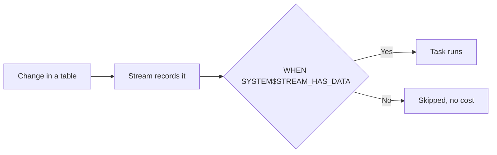
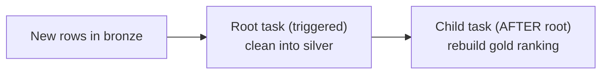

# Lesson 17: Triggered Tasks

> [!NOTE]
> **Source: [AnalystBuilder](https://www.analystbuilder.com)**<br>
> **Date completed:** November 1, 2026

A closer look at triggered tasks, building on Lesson 16. The examples follow an insurer's premium revenue data.

## Quick Recap

A **triggered task** has **no schedule**. It runs when a **stream** reports new data, and skips (at no cost) when nothing has changed.



## The Recipe

| Step | What you do |
|---|---|
| 1 | Create a **stream** on the source |
| 2 | Create the **task** with a `WHEN SYSTEM$STREAM_HAS_DATA(...)` condition and **no** `SCHEDULE` |
| 3 | Make the task **read the stream** in an `INSERT`, `MERGE`, or similar, so the stream resets |
| 4 | **Resume** the task |

**Two ways to provide compute:**

| | User-managed | Serverless |
|---|---|---|
| **Setting** | `WAREHOUSE = ETL_WH` | `TARGET_COMPLETION_INTERVAL = '5 MINUTES'` (no warehouse) |
| **Who sizes it** | You | Snowflake, to finish within the target time |
| **Best for** | Steady workloads, existing warehouses | Small or unpredictable workloads |

## Example 1: Record Return Premium When a Policy Is Cancelled

**Scenario:** when a customer cancels a policy mid-term, the insurer owes back the unused part of the premium, called **return premium**. That reduces revenue, so finance wants it recorded the moment a cancellation is entered. This example uses a **serverless** task.

```sql
CREATE OR REPLACE STREAM INSURANCE.FINANCE.CANCELLATIONS_STREAM
  ON TABLE INSURANCE.FINANCE.POLICY_CANCELLATIONS
  APPEND_ONLY = TRUE;

CREATE OR REPLACE TASK INSURANCE.FINANCE.RECORD_RETURN_PREMIUM_TASK
  TARGET_COMPLETION_INTERVAL = '5 MINUTES'          -- serverless
  WHEN SYSTEM$STREAM_HAS_DATA('INSURANCE.FINANCE.CANCELLATIONS_STREAM')
AS
  INSERT INTO INSURANCE.SILVER.CLEAN_PREMIUMS (policy_id, product_line, written_premium, txn_date)
  SELECT policy_id,
         product_line,
         -unearned_premium,                          -- negative: money going back
         cancel_date
  FROM INSURANCE.FINANCE.CANCELLATIONS_STREAM;

ALTER TASK INSURANCE.FINANCE.RECORD_RETURN_PREMIUM_TASK RESUME;
```

**Result:** a $1,200 annual policy cancelled after 3 months adds a −$900 row, so revenue reports stay accurate without waiting for the nightly job.

## Example 2: React to Either of Two Streams

**Scenario:** a **daily premium movement** table tracks both new business and cancellations. The task should run when **either** source changes.

```sql
CREATE OR REPLACE STREAM INSURANCE.FINANCE.NEW_POLICIES_STREAM
  ON TABLE INSURANCE.FINANCE.NEW_POLICIES APPEND_ONLY = TRUE;

CREATE OR REPLACE STREAM INSURANCE.FINANCE.CANCELLATIONS_MOVEMENT_STREAM
  ON TABLE INSURANCE.FINANCE.POLICY_CANCELLATIONS APPEND_ONLY = TRUE;   -- separate from Example 1

CREATE OR REPLACE TASK INSURANCE.FINANCE.PREMIUM_MOVEMENT_TASK
  WAREHOUSE = ETL_WH
  WHEN SYSTEM$STREAM_HAS_DATA('INSURANCE.FINANCE.NEW_POLICIES_STREAM')
    OR SYSTEM$STREAM_HAS_DATA('INSURANCE.FINANCE.CANCELLATIONS_MOVEMENT_STREAM')
AS
  INSERT INTO INSURANCE.FINANCE.PREMIUM_MOVEMENT (policy_id, movement_type, amount, movement_date)
  SELECT policy_id, 'New business', written_premium, start_date
  FROM INSURANCE.FINANCE.NEW_POLICIES_STREAM
  UNION ALL
  SELECT policy_id, 'Cancellation', -unearned_premium, cancel_date
  FROM INSURANCE.FINANCE.CANCELLATIONS_MOVEMENT_STREAM;

ALTER TASK INSURANCE.FINANCE.PREMIUM_MOVEMENT_TASK RESUME;
```

| Condition | Runs when... |
|---|---|
| `OR` | **Either** stream has new data |
| `AND` | **Both** streams have new data (skips if only one does) |

> [!NOTE]
> Example 1 and Example 2 both watch the cancellations table, but each has its **own stream**. Reading a stream resets it, so two tasks can't share one.

## Example 3: Chain Tasks into a Pipeline

**Scenario:** when new premiums arrive, finance wants them cleaned **and then** the gold broker ranking (Lesson 15) rebuilt. A **task graph** runs tasks in order: a triggered **root** task starts, then **child** tasks run after it.



```sql
-- Root: triggered by new bronze rows
CREATE OR REPLACE TASK INSURANCE.SILVER.CLEAN_PREMIUMS_ROOT
  WAREHOUSE = ETL_WH
  WHEN SYSTEM$STREAM_HAS_DATA('INSURANCE.BRONZE.RAW_PREMIUMS_STREAM')
AS
  INSERT INTO INSURANCE.SILVER.CLEAN_PREMIUMS (policy_id, broker_id, product_line, written_premium, txn_date)
  SELECT DISTINCT policy_id, broker_id, INITCAP(product_line), written_premium, txn_date
  FROM INSURANCE.BRONZE.RAW_PREMIUMS_STREAM
  WHERE written_premium IS NOT NULL;

-- Child: runs only after the root finishes successfully
CREATE OR REPLACE TASK INSURANCE.GOLD.REBUILD_BROKER_RANKING
  WAREHOUSE = ETL_WH
  AFTER INSURANCE.SILVER.CLEAN_PREMIUMS_ROOT
AS
  CREATE OR REPLACE TABLE INSURANCE.GOLD.MOST_CONSISTENT_BROKERS AS
  SELECT broker_id,
         COUNT(DISTINCT DATE_TRUNC('month', txn_date)) AS active_months,
         SUM(written_premium) AS total_written_premium
  FROM INSURANCE.SILVER.CLEAN_PREMIUMS
  GROUP BY broker_id
  ORDER BY active_months DESC, total_written_premium DESC
  LIMIT 20;

-- Resume the root and all its children in one step
SELECT SYSTEM$TASK_DEPENDENTS_ENABLE('INSURANCE.SILVER.CLEAN_PREMIUMS_ROOT');
```

> [!TIP]
> Only the **root** task has the `WHEN` condition. Child tasks use `AFTER` and inherit the trigger.

## Example 4: Turn a Scheduled Task into a Triggered One

The nightly cleaning task from Lesson 13 can become triggered without rewriting it:

```sql
ALTER TASK INSURANCE.SILVER.CLEAN_PREMIUMS_TASK SUSPEND;
ALTER TASK INSURANCE.SILVER.CLEAN_PREMIUMS_TASK UNSET SCHEDULE;
ALTER TASK INSURANCE.SILVER.CLEAN_PREMIUMS_TASK
  MODIFY WHEN SYSTEM$STREAM_HAS_DATA('INSURANCE.BRONZE.RAW_PREMIUMS_STREAM');
ALTER TASK INSURANCE.SILVER.CLEAN_PREMIUMS_TASK RESUME;
```

> [!WARNING]
> The Lesson 13 task rebuilt silver from **all** of bronze with `INSERT OVERWRITE`. As a triggered task, change it to read only the **new rows from the stream**, as in Example 3. Otherwise, it reprocesses everything each time a single row arrives, and the stream never resets.

## Monitoring

```sql
-- Triggered tasks show SCHEDULE = NULL
SHOW TASKS IN SCHEMA INSURANCE.FINANCE;

-- Recent runs, and whether each succeeded
SELECT name, state, scheduled_from, scheduled_time, error_message
FROM TABLE(INFORMATION_SCHEMA.TASK_HISTORY())
WHERE scheduled_from = 'TRIGGER'
ORDER BY scheduled_time DESC;
```

In Snowsight, find the task in the database object explorer to see its **Run History** and, for task graphs, a diagram of the pipeline.

## Things to Know

| | |
|---|---|
| **Speed** | Runs at most every **30 seconds** by default, so "instant" means within about a minute |
| **One run at a time** | If new data arrives mid-run, the next run waits until the current one finishes |
| **Health check** | If a task hasn't run for 12 hours, Snowflake checks the stream to keep it from going stale |
| **Stale streams** | If stream data isn't read before the table's data retention period ends, the stream must be recreated |
| **Works on** | Tables, views, dynamic tables, Iceberg tables, and directory tables (after a refresh) |

## Key Takeaway

**Stream → task with `WHEN` and no schedule → read the stream → `RESUME`.** Use serverless for small or unpredictable work, `OR` / `AND` for multiple sources, and `AFTER` to chain steps into a pipeline.
