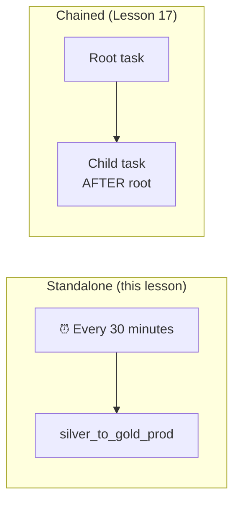

# Lesson 18: Scheduling Tasks

> [!NOTE]
> **Source: [AnalystBuilder](https://www.analystbuilder.com)**<br>
> **Date completed:** November 1, 2026

## The Big Picture

So far, the pipeline ran only when someone started it. **Scheduling** makes it run by itself, on a timer.

**Example:** the gold broker ranking from Lesson 15 was a one-time snapshot. Scheduling it keeps the ranking fresh with no one pressing a button.

## Two Ways to Schedule

Think of the alarm on your phone:

| | Interval | Cron |
|---|---|---|
| **Phone analogy** | "Remind me every 30 minutes" | "Wake me up at 6 a.m. every day" |
| **Timing** | Relative: counts from when the task starts | Absolute: fixed clock time |
| **Cares about time of day?** | No | Yes, including the time zone |
| **Best for** | Frequent refreshes and testing | Business deadlines, like a morning report |

### 1. Interval-Based

Runs every set number of minutes from when the task is resumed.

```sql
-- SQL
SCHEDULE = '30 MINUTE'
```

```python
# Python (Snowflake Python API)
from datetime import timedelta
schedule = timedelta(minutes=30)
```

### 2. Cron-Based

Runs at a fixed time of day.

```sql
-- SQL: every day at 6:00 a.m. Eastern Time
SCHEDULE = 'USING CRON 0 6 * * * America/New_York'
```

```python
# Python (Snowflake Python API)
from snowflake.core.task import Cron
schedule = Cron("0 6 * * *", "America/New_York")
```

> [!IMPORTANT]
> A cron expression needs **five** parts. The course shorthand `"06 * * *"` has only four. The correct form for 6:00 a.m. is `"0 6 * * *"`.

### Reading a Cron Expression

`0 6 * * *` has five positions:

| Minute | Hour | Day of month | Month | Day of week |
|---|---|---|---|---|
| `0` | `6` | `*` | `*` | `*` |
| at minute 0 | of hour 6 | every day | every month | any weekday |

`*` means "every." Common finance schedules:

| Cron | Runs | Finance use |
|---|---|---|
| `0 6 * * *` | Daily at 6:00 a.m. | Morning premium report for the CFO |
| `0 6 * * 1-5` | Weekdays at 6:00 a.m. | Business-day dashboards |
| `0 2 1 * *` | 2:00 a.m. on the 1st of each month | Month-end close summary |
| `0 7 * * 1` | Mondays at 7:00 a.m. | Weekly broker performance email |

## Why Alex Uses 30 Minutes

With the 6 a.m. cron schedule, you'd wait until **tomorrow morning** to see whether it worked. With a 30-minute interval, you can drop in a file and watch it run soon after. That's better for learning and testing. In real use, switch to cron once it's proven.

## The Production Task

Alex renames the task `silver_to_gold_prod`. **`prod`** means **production**: the real, live version that keeps running on its own.

```sql
CREATE OR REPLACE TASK INSURANCE.GOLD.SILVER_TO_GOLD_PROD
  WAREHOUSE = ETL_WH
  SCHEDULE = '30 MINUTE'
  -- Later, for a daily 6 a.m. report:
  -- SCHEDULE = 'USING CRON 0 6 * * * America/New_York'
AS
  CREATE OR REPLACE TABLE INSURANCE.GOLD.MOST_CONSISTENT_BROKERS AS
  SELECT broker_id,
         COUNT(DISTINCT DATE_TRUNC('month', txn_date)) AS active_months,
         SUM(written_premium) AS total_written_premium
  FROM INSURANCE.SILVER.CLEAN_PREMIUMS
  GROUP BY broker_id
  ORDER BY active_months DESC, total_written_premium DESC
  LIMIT 20;
```

The same task in Python, using the Snowflake Python API:

```python
from datetime import timedelta
from snowflake.core.task import Task

task = Task(
    name="SILVER_TO_GOLD_PROD",
    definition="CREATE OR REPLACE TABLE INSURANCE.GOLD.MOST_CONSISTENT_BROKERS AS SELECT ...",
    warehouse="ETL_WH",
    schedule=timedelta(minutes=30),
)
root.databases["INSURANCE"].schemas["GOLD"].tasks.create(task)
```

## Standalone vs. Chained

This task is **standalone**. It isn't linked to any other task. It simply wakes up every 30 minutes and does its job.



| | Standalone | Chained |
|---|---|---|
| **Starts** | On its own schedule | After another task finishes |
| **Has a schedule?** | Yes | No, only the root task does |

## Things to Know

- **New tasks start paused.** Run `ALTER TASK ... RESUME` to start the schedule. The next lesson covers deploying it.
- **Always set a time zone** in cron, or it uses UTC, and a 6 a.m. report could arrive at 1 or 2 a.m. local time.
- **Interval timing resets** when you resume the task, so it counts from that moment.
- **Each run costs compute**, even when no data has changed. Pick the longest schedule the business can accept, or use a triggered task (Lesson 17) if runs should only happen when new data arrives.

## Key Takeaway

**Interval** = every X minutes, good for testing. **Cron** = a fixed time of day, good for business deadlines. Name the live version `_prod`, and remember to resume it.
