<div align="center">

# 🚀 Vibe Coding with Google Antigravity
### A Step-by-Step Guide, a Prompt Playbook, and a Complete Python App Build


**📅 Written on Sunday, November 8, 2026**

</div>

> [!NOTE]
> Antigravity moves fast. This guide reflects the platform as of **November 8, 2026** (Antigravity 2.0, launched at Google I/O on May 19, 2026, with Gemini 3.5 Flash as the default model). Button names, slash commands and default models can change between releases, so always cross-check with the [official docs](https://antigravity.google/docs/home).

---

## 📑 Table of Contents

1. [What is Vibe Coding?](#1--what-is-vibe-coding)
2. [Google Antigravity at a Glance](#2--google-antigravity-at-a-glance)
3. [Step-by-Step: Install and Set Up](#3--step-by-step-install-and-set-up)
4. [Core Concepts You Must Know](#4--core-concepts-you-must-know)
5. [The Vibe Coding Loop](#5--the-vibe-coding-loop)
6. [Prompt Playbook: Examples That Show the Power](#6--prompt-playbook-examples-that-show-the-power)
7. [Hands-On Project: Build "SpendWise" Step by Step](#7--hands-on-project-build-spendwise-step-by-step)
8. [Teach the Agent Your Style: Rules, Workflows and Skills](#8--teach-the-agent-your-style-rules-workflows-and-skills)
9. [Best Practices, Pitfalls and Safety](#9--best-practices-pitfalls-and-safety)
10. [Troubleshooting](#10--troubleshooting)
11. [One-Page Cheat Sheet](#11--one-page-cheat-sheet)
12. [References](#12--references)

---

## 1. 🎧 What is Vibe Coding?

**Vibe coding** is a style of software development where you describe *what you want* in plain language and an AI agent writes, runs and fixes the code. Your job shifts from **typing code** to **steering outcomes**: you set the goal, review the plan, test the result and give feedback.

The term was popularised in early 2025. In 2026, agent-first tools like Google Antigravity turned it from "chat and paste" into a real workflow where the agent plans, edits many files, runs the terminal, opens a browser and verifies its own work.

### Traditional coding vs vibe coding

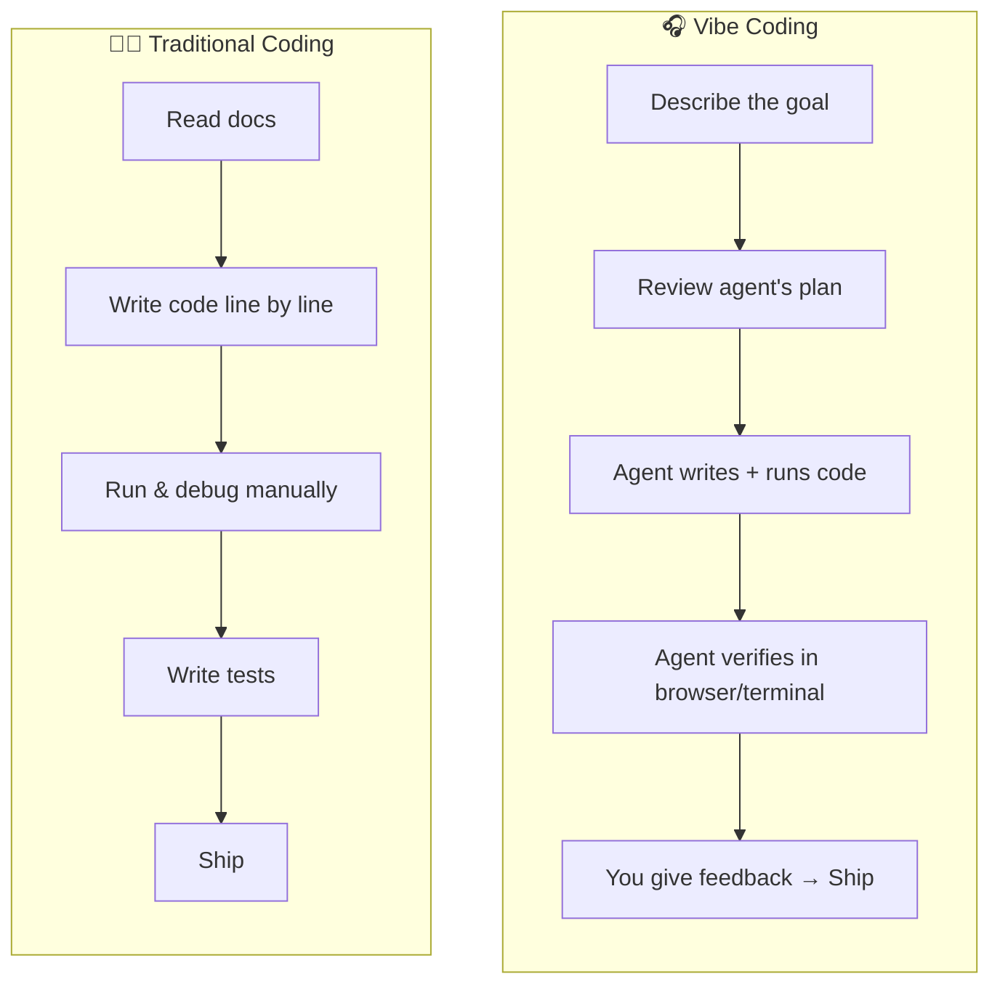

| Aspect | Traditional Coding | Vibe Coding in Antigravity |
|---|---|---|
| **Your main skill** | Syntax and APIs | Clear intent, good judgement, reviewing |
| **Unit of work** | A line or a function | A feature or a whole app |
| **Debugging** | Read stack traces yourself | Paste the error, the agent explains and fixes it |
| **Feedback** | Code review after the fact | Comments on plans, diffs and screenshots *while* it works |
| **Speed to a prototype** | Hours to days | Minutes to an hour |
| **Risk** | Bugs you wrote | Bugs you *didn't read*, so reviewing matters more |

> [!IMPORTANT]
> Vibe coding does **not** remove the need to understand code. It moves your effort to the most valuable parts: deciding *what* to build and checking that it is *right*.

---

## 2. 🌌 Google Antigravity at a Glance

Antigravity is Google's **agentic development platform**. Its first release was an agent-first IDE built on the open-source VS Code foundation. **Antigravity 2.0** (May 2026) expanded it into four products that share the same underlying agents:

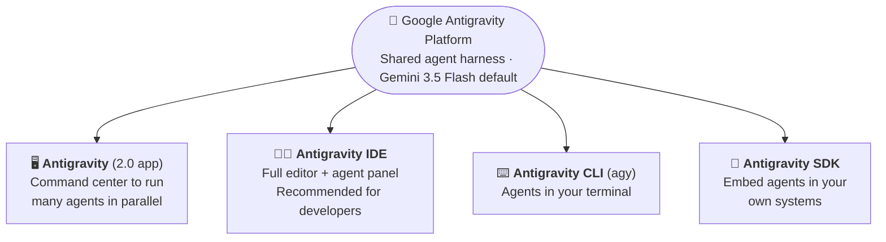

| Product | Level of control | Best for |
|---|---|---|
| **Antigravity (2.0 app)** | High level: you talk, agents code | Orchestrating several tasks at once, non-developers, scheduled tasks |
| **Antigravity IDE** | Low level: code is in front of you | Developers who want to see and edit every file (**used in this guide**) |
| **Antigravity CLI** | Terminal | Scripting, servers, terminal lovers |
| **Antigravity SDK** | Programmatic | Building your own agent-powered tools |

**Key features that make vibe coding powerful here:**

- 🗺️ **Planning mode**: the agent writes an implementation plan and task list *before* coding, and you can comment on it like a Google Doc.
- 📦 **Artifacts**: plans, task lists, code diffs and walkthroughs (with screenshots or browser recordings) that show what the agent did.
- 🌐 **Built-in browser**: the agent can launch your app and click through it to verify it works.
- 🔀 **Multiple models**: Gemini is the default, and other models can be selected from the agent panel.
- 🧠 **Rules, Workflows, Skills and MCP servers**: teach the agent your standards and connect it to external tools.

---

## 3. 🛠️ Step-by-Step: Install and Set Up

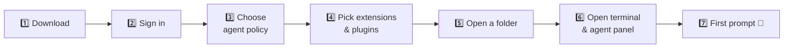

### Step 1: Check the requirements

| Requirement | Details |
|---|---|
| Operating system | macOS, Windows (64-bit Windows 10/11), or supported Linux distributions |
| Browser | Google Chrome (used by the agent to test web apps) |
| Account | A personal Google (Gmail) account |
| For this guide | Python **3.10+** installed and on your `PATH` |

> [!TIP]
> On Windows, install to your system drive (usually `C:`) to avoid permission problems when the agent runs terminal commands.

### Step 2: Download and install

1. Go to **[antigravity.google/download](https://antigravity.google/download)**.
2. Download **Antigravity IDE** for your operating system and run the installer.
3. If you already have the Antigravity 2.0 app, you can instead click **Install IDE** in its top-right corner.

### Step 3: Sign in and choose a theme

Sign in with your Google account when the welcome screen appears, then pick a light or dark theme.

### Step 4: Choose how much freedom the agent gets

During onboarding you set the **terminal execution policy**, **review policy** and **JavaScript execution policy**.

| Option | What it means | Recommended for |
|---|---|---|
| ✅ **Review-driven development** | The agent asks before important actions and you review its plans | **Beginners and this guide** |
| Agent-driven | The agent acts more autonomously | Experienced users on throwaway projects |
| Custom | Fine-grained control per policy | Teams with specific security needs |

You can change this later in **Settings → Advanced Settings → agent security mode**.

### Step 5: Extensions, CLI command and plugins

Install only the extensions you need (for this guide, the **Python** extension is enough). Optionally install the `agy-ide` command-line launcher and any Google plugins (bundles of skills and MCP servers) that match your work.

### Step 6: Open a workspace

1. **File → Open Folder** and create an empty folder, for example `spendwise`.
2. Open a terminal with **Terminal → New Terminal**.
3. Toggle the **agent panel** with `Cmd + L` (macOS) or `Ctrl + L` (Windows/Linux).

You now have three panes: **Editor**, **Terminal** and **Agent**.

```
┌──────────────────────────────┬──────────────────────┐
│  📝 EDITOR                    │  🤖 AGENT PANEL       │
│  (AI tab-completion,          │  • model picker       │
│   tab-to-jump, tab-to-import) │  • Planning / Fast    │
│                               │  • @ context, / cmds  │
├───────────────────────────────┤  • Artifacts, Browser │
│  ⌨️ TERMINAL                   │  • Changes overview   │
└───────────────────────────────┴──────────────────────┘
```

### Step 7: Send your first prompt

In the agent panel, choose **Planning** mode and type:

```text
Create a Python script hello.py that asks for my name and prints a friendly
greeting with today's date. Then run it once to show it works.
```

Review the plan, click **Proceed**, and watch the agent create the file, run it in the terminal and report back. 🎉

---

## 4. 🧠 Core Concepts You Must Know

### 4.1 Planning mode vs Fast mode

| | 🗺️ **Planning** | ⚡ **Fast** |
|---|---|---|
| What happens | Plan → task list → code → verify → walkthrough | Executes directly, no plan |
| Speed | Slower | Very fast |
| Artifacts | Many (plan, tasks, diffs, walkthrough) | Few |
| Use it for | New features, multi-file changes, new apps | Renames, small fixes, quick questions |
| Rule of thumb | *"Would I want to see the plan first?"* → Planning | *"Could I do this in 2 minutes myself?"* → Fast |

### 4.2 Artifacts: how the agent talks to you

Artifacts are the agent's way of showing its work, and your way of steering it. You can leave **Google-Docs-style comments** on them and submit, and the agent revises.

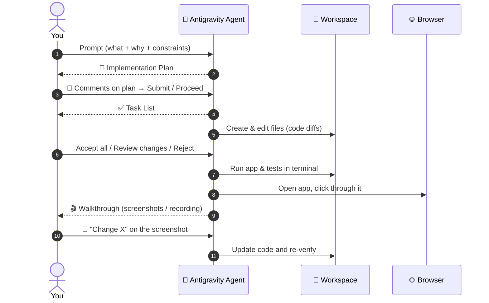

| Artifact | When it appears | What you should do |
|---|---|---|
| **Implementation plan** | Before coding | Check stack, file layout, scope. Comment if anything is off |
| **Task list** | After plan approval | Skim it to track progress |
| **Code diffs** | During coding | *Accept all* for trivial work, *Review changes* for anything important |
| **Walkthrough** | After coding | Check the screenshots and test results, comment to request changes |

> [!TIP]
> After adding comments, **remember to submit them**. That is what triggers the agent to update its plan. If something goes wrong, use **↩️ Undo changes up to this point** in the chat.

### 4.3 Context: `@` mentions

Type `@` in the agent panel to attach **files, folders, terminal output or MCP servers** as context. Precise context gives precise results.

```text
@app.py @tests/test_app.py The delete test is failing. Explain why, then fix it.
```

Other quick ways to pull the agent in:

- Hover a lint error → **Explain and fix**.
- **Problems** tab → **Send to Agent**.
- Select an error in the terminal → `Cmd/Ctrl + L` to send it to the chat.

### 4.4 Built-in slash commands

| Command | What it does | Example use |
|---|---|---|
| `/goal` | Keeps the agent working on a task until it is complete | `/goal all tests in tests/ pass` |
| `/schedule` | Runs a task once or on a recurring schedule | Nightly dependency check |
| `/grill-me` | The agent interviews you to align on a plan before building | Kicking off a new app |
| `/learn` | Extracts reusable rules or skills from the conversation | Saving your preferred project style |
| `/your-workflow` | Any saved workflow you create (see Section 8) | `/generate-unit-tests` |

---

## 5. 🔁 The Vibe Coding Loop

Every successful vibe coding session follows the same loop. Small loops beat one giant prompt.

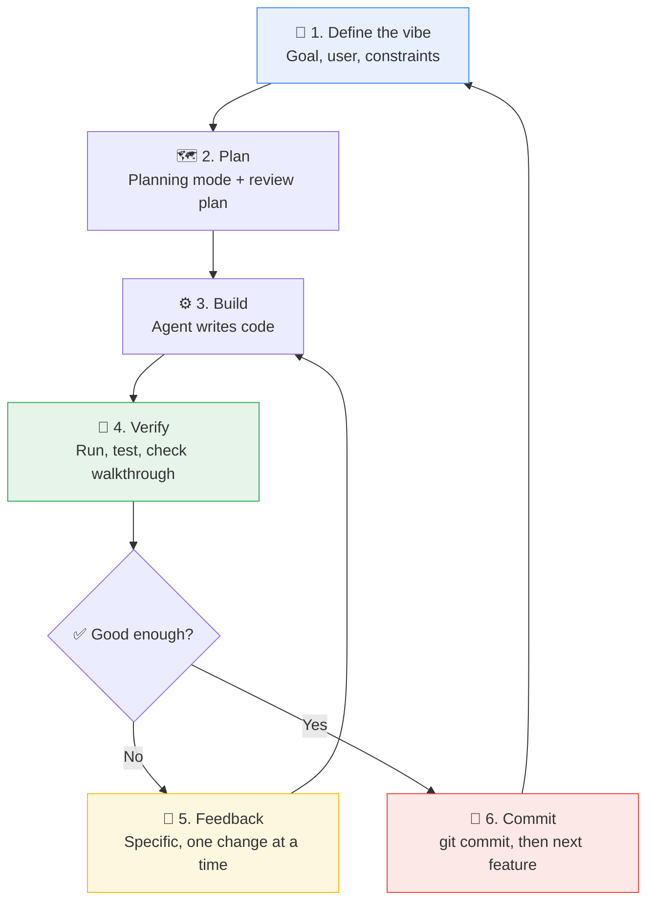

**The golden rules of the loop:**

1. **One feature per loop.** "Add login" is a loop. "Add login, payments and a dashboard" is three loops.
2. **Commit after every green loop** so you can always roll back.
3. **Verify with evidence**: tests passing, a screenshot, a terminal output. Never just "the agent said it works".
4. **Be specific in feedback**: "The total shows 3.456, round it to 2 decimals" beats "fix the numbers".

---

## 6. ✍️ Prompt Playbook: Examples That Show the Power

### 6.1 Anatomy of a great prompt

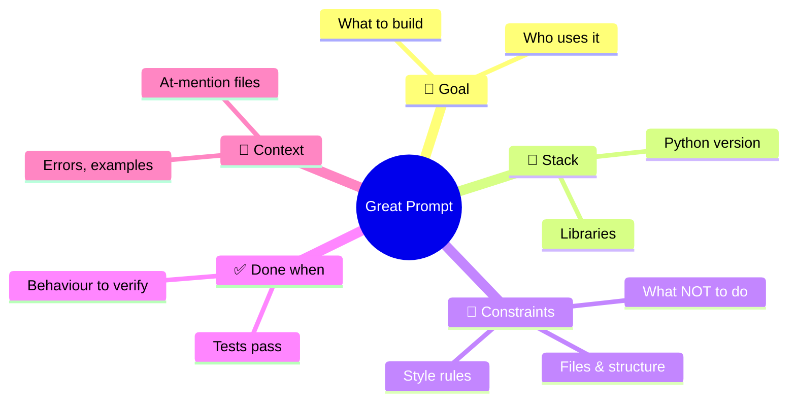

| Part | Question it answers | Example |
|---|---|---|
| **Goal** | What and for whom? | "A CLI tool for teachers to convert grade CSVs into a report" |
| **Stack** | With what? | "Python 3.12, standard library + pandas only" |
| **Constraints** | Within which limits? | "Single file, type hints, no network calls" |
| **Done when** | How do we know it works? | "pytest passes and running it on sample.csv prints a table" |
| **Context** | What should it look at? | `@sample.csv @README.md` |

### 6.2 Weak vs strong prompts

| ❌ Weak prompt | ✅ Strong prompt | Why it's better |
|---|---|---|
| "Make a todo app" | "Build a todo app in Python with Flask and SQLite. Features: add, complete, delete. Keep it in at most 3 files. Run it and verify in the browser that adding a task works." | Stack, scope, size and verification are clear |
| "Fix my code" | "`@scraper.py` crashes with the `KeyError: 'price'` shown in `@terminal`. Explain the cause in 2 sentences, then fix it so missing prices are skipped and logged." | Gives the error, context and the desired behaviour |
| "Make it look better" | "Restyle the dashboard: use a 4-column KPI row at the top, put charts side by side, and use a calm green colour for positive numbers." | Concrete, checkable design changes |
| "Add tests" | "Write pytest tests for every public function in `@app.py`. Use an in-memory SQLite DB. Cover the happy path and at least one edge case each. Run them and show me the result." | Defines coverage, setup and verification |

### 6.3 Prompt library by goal

<details>
<summary><b>🏗️ Starting a new project</b> (click to expand)</summary>

```text
/grill-me I want to build a Python app that tracks my daily reading
(book, pages read, minutes). Ask me up to 5 questions to pin down the
scope, then propose a plan.
```

```text
Create a new Python 3.12 project for a command-line weather tool.
Use a src/ layout, a virtual environment, requirements.txt, a README with
setup steps, and a pytest test folder. Don't implement features yet; just
scaffold and make `pytest` run successfully with one placeholder test.
```

</details>

<details>
<summary><b>⚡ Building features</b></summary>

```text
Add a "search by keyword" feature to @app.py. It should be case-insensitive,
search the note and category columns, and show the number of matches.
Add tests for it. Keep the data layer separate from the UI.
```

```text
Turn the script @report.py into a Streamlit app with a file uploader,
a summary table and a bar chart. Keep the original functions and import
them; don't duplicate logic.
```

</details>

<details>
<summary><b>🐞 Debugging</b></summary>

```text
Running `streamlit run app.py` gives the error in @terminal.
1) Explain the root cause in plain English.
2) Propose the smallest fix.
3) Apply it, re-run, and confirm the error is gone.
```

```text
/goal Make every test in tests/ pass without deleting or skipping any test.
```

</details>

<details>
<summary><b>🧹 Refactoring and quality</b></summary>

```text
Refactor @app.py: add type hints and docstrings to every function, follow
PEP 8, and split anything longer than 40 lines. Behaviour must not change;
prove it by running the existing tests before and after.
```

```text
Review @app.py like a senior Python engineer. List the top 5 issues
(bugs, security, performance, readability) as a table with severity,
then fix only the high-severity ones.
```

</details>

<details>
<summary><b>📚 Learning while you vibe</b></summary>

```text
Explain how @app.py works to someone who knows basic Python but has never
used Streamlit. Use a numbered walkthrough of what happens when the page
loads and when I click "Save".
```

```text
Before you change anything, show me 2 alternative designs for storing
the data (SQLite vs JSON file) with pros/cons, and recommend one.
```

</details>

<details>
<summary><b>🚀 Shipping</b></summary>

```text
Prepare this repo for GitHub: add a .gitignore for Python, a README with
screenshots placeholders, setup + run + test instructions, and a MIT LICENSE.
Make sure the SQLite database file is not committed.
```

</details>

### 6.4 The power in action: one prompt, many steps

To appreciate what an agent does with **one** good prompt, here is what typically happens behind the scenes:

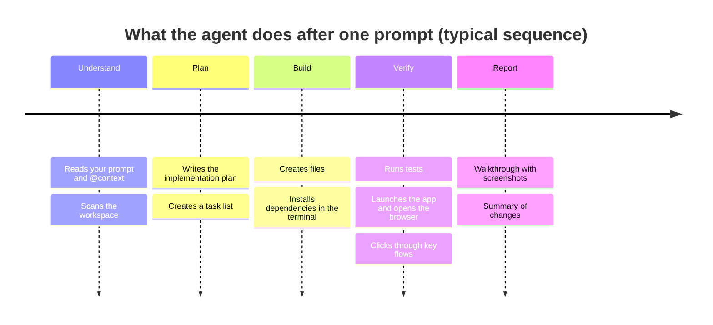

### 6.5 Choosing prompt scope

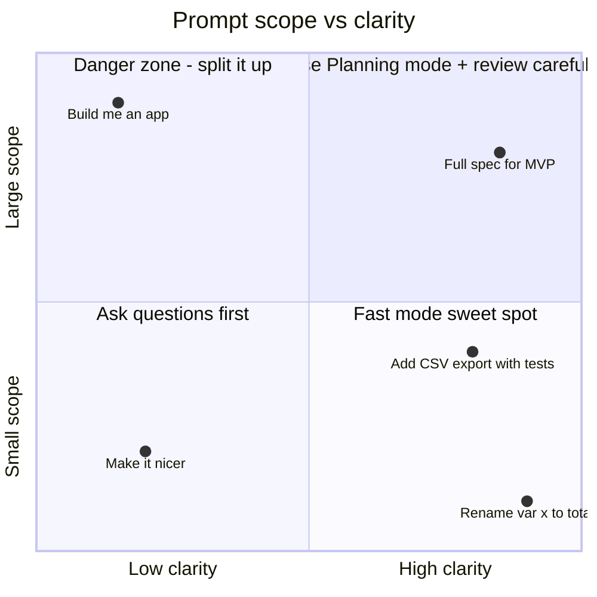

---

## 7. 🧪 Hands-On Project: Build "SpendWise" Step by Step

We'll vibe-code **SpendWise**, a personal expense tracker with a web dashboard, using **Python + Streamlit + SQLite**.

### 7.1 What we're building

| Feature | Description |
|---|---|
| ➕ Add expenses | Date, category, amount and note via a sidebar form |
| ✅ Validation | No negative amounts, no future dates, known categories only |
| 📊 Dashboard | KPI cards, spending by category (bar) and by month (line) |
| 🎯 Budget | Monthly budget with progress bar and over-budget warning |
| 🗑️ Manage | Table of all expenses, delete by id, CSV download |
| 🧪 Tests | 10 pytest tests on the data layer |

### 7.2 Architecture

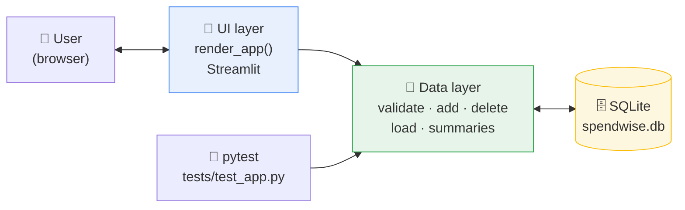

**Why this design?** The data layer is plain Python, so it can be tested without a browser. The UI layer only calls data functions. That separation is something *you* ask for in the prompt, which is a big part of vibe coding well.

### 7.3 Build roadmap

```mermaid
gantt
    title SpendWise build plan (approx. 45–60 minutes)
    dateFormat HH:mm
    axisFormat %H:%M
    section Setup
    Step 1 Workspace & venv      :s1, 00:00, 5m
    Step 2 Add project rules     :s2, after s1, 5m
    section Build
    Step 3 Plan with the agent   :s3, after s2, 5m
    Step 4 Data layer            :s4, after s3, 10m
    Step 5 Streamlit UI          :s5, after s4, 10m
    section Verify & polish
    Step 6 Tests                 :s6, after s5, 5m
    Step 7 Browser verification  :s7, after s6, 5m
    Step 8 Iterate with feedback :s8, after s7, 10m
    section Ship
    Step 9 Push to GitHub        :s9, after s8, 5m
```

---

### Step 1: Create the workspace and virtual environment

Open an empty folder named `spendwise` in Antigravity IDE. Use **Fast mode** for this quick setup:

```text
Create a Python virtual environment in .venv, activate it, and create a
requirements.txt with streamlit>=1.50, pandas>=2.2 and pytest>=8.
Install the requirements and show me the installed versions.
```

✅ **Check:** the terminal shows the three packages installed. If you'd rather do it yourself:

```bash
python -m venv .venv
# macOS/Linux
source .venv/bin/activate
# Windows
.venv\Scripts\activate

pip install "streamlit>=1.50" "pandas>=2.2" "pytest>=8"
```

---

### Step 2: Give the agent your project rules

Rules are like standing instructions. Click **`...` → Customizations → Rules → + Workspace** and create a rule called `python-style`:

```markdown
* Use Python 3.10+ with type hints on every function.
* Follow PEP 8. Every function gets a one-line docstring.
* Keep data/business logic separate from Streamlit UI code.
* Use parameterised SQL queries only (never string formatting for SQL).
* Every new public function needs at least one pytest test.
```

It is saved to `.agents/rules/` in your workspace, so the agent applies it to every request.

---

### Step 3: Kick off with a planning prompt

Switch to **Planning mode** and send:

```text
Build "SpendWise", a personal expense tracker in a single file app.py
using Python, Streamlit and SQLite (built-in sqlite3).

Features:
- Sidebar form: date (not in the future), category (Food, Transport,
  Housing, Entertainment, Health, Shopping, Other), amount (> 0), note
  (max 120 chars).
- KPI row: this month's total, all-time total, number of entries, top category.
- Monthly budget input with a progress bar and an over-budget warning.
- Bar chart by category and line chart by month.
- Table of all expenses, CSV download, delete by id.

Architecture:
- A pure-Python data layer (Expense dataclass, validate, add_expense,
  delete_expense, load_expenses, category_summary, monthly_summary,
  month_to_date_total) that takes a sqlite3 connection as a parameter.
- A render_app() function for the UI, called under if __name__ == "__main__".

Done when: the app runs with `streamlit run app.py` and you've verified
adding an expense in the browser.
```

**Review the implementation plan** before clicking Proceed. Example comments you might add:

| Plan says... | Your comment | Why |
|---|---|---|
| "Store amount as text" | *"Store amount as REAL with a CHECK (amount > 0) constraint"* | Data integrity at the database level |
| "Use a global connection" | *"Cache the connection with st.cache_resource"* | Streamlit reruns the script on every interaction |
| No mention of rounding | *"Round amounts to 2 decimals on insert"* | Avoid 3.4560000001 surprises |

Submit the comments and let the agent revise, then click **Proceed**.

---

### Step 4: Review the data layer

When the diffs arrive, click **Review changes** (not *Accept all*) for the data layer, because it is the heart of the app. Things to verify:

- [ ] SQL uses `?` placeholders (no f-strings in SQL).
- [ ] `validate()` returns a list of messages rather than crashing.
- [ ] Functions accept a `conn` parameter, so tests can pass `":memory:"`.

---

### Step 5: Review the UI

For UI code it's fine to **Accept all**, then judge it by how it looks in the walkthrough. Useful follow-up prompts:

```text
Put the four KPI cards in one row with st.columns(4), and show the two
charts side by side below the budget bar.
```

```text
When there are no expenses yet, show a friendly st.info message pointing
to the sidebar instead of empty charts.
```

---

### Step 6: Generate and run tests

```text
Create tests/test_app.py with pytest tests for the data layer of @app.py.
Use a fixture that creates a fresh in-memory database for every test.
Cover: valid input, each validation error, rounding and trimming on insert,
delete (existing and missing ids), summaries, and the empty-database case.
Run pytest and show me the results.
```

✅ **Check:** the terminal shows something like:

```text
..........                                                [100%]
10 passed in 0.58s
```

---

### Step 7: Let the agent verify in the browser

```text
Start the app with `streamlit run app.py`, open it in the browser, add
three expenses in different categories, and confirm the KPI cards and
both charts update. Include screenshots in the walkthrough.
```

Open the **walkthrough** artifact. If something looks off, **comment directly on the screenshot**, for example *"Make the delete button red"*, and submit.

---

### Step 8: Iterate with feedback (the fun part 🎨)

Pick one change per loop and commit in between:

| Loop | Prompt | Mode |
|---|---|---|
| 1 | "Format all money values with thousands separators and 2 decimals." | Fast |
| 2 | "Add a date-range filter above the table that also filters the charts." | Planning |
| 3 | "Add a currency selector (USD, EUR, INR) that only changes the symbol shown." | Planning |
| 4 | "/goal pytest passes and there are no lint warnings in app.py" | Planning |

---

### Step 9: The finished code

Here is the complete, tested result of the steps above. You can paste it straight into your workspace.

#### 📁 Project structure

```text
spendwise/
├── .agents/
│   └── rules/
│       └── python-style.md   # Step 2 rule
├── tests/
│   └── test_app.py           # pytest suite
├── app.py                    # the whole app
├── requirements.txt
└── README.md
```

#### 📦 `requirements.txt`

```text
streamlit>=1.50
pandas>=2.2
pytest>=8
```

#### 🐍 `app.py`

```python
"""SpendWise: a tiny personal expense tracker, vibe-coded in Google Antigravity.

Run with:
    streamlit run app.py
"""
from __future__ import annotations

import sqlite3
from dataclasses import dataclass
from datetime import date
from pathlib import Path

import pandas as pd
import streamlit as st

DB_PATH = Path(__file__).with_name("spendwise.db")
CATEGORIES = ["Food", "Transport", "Housing", "Entertainment", "Health", "Shopping", "Other"]
MAX_NOTE_LENGTH = 120


# ---------------------------------------------------------------------------
# Data layer (pure Python, no Streamlit, easy to unit test)
# ---------------------------------------------------------------------------
@dataclass(frozen=True)
class Expense:
    """A single expense entry."""

    spent_on: date
    category: str
    amount: float
    note: str = ""


def get_connection(db_path: str | Path = DB_PATH) -> sqlite3.Connection:
    """Open a SQLite connection and make sure the expenses table exists."""
    conn = sqlite3.connect(db_path, check_same_thread=False)
    conn.execute(
        """
        CREATE TABLE IF NOT EXISTS expenses (
            id        INTEGER PRIMARY KEY AUTOINCREMENT,
            spent_on  TEXT    NOT NULL,
            category  TEXT    NOT NULL,
            amount    REAL    NOT NULL CHECK (amount > 0),
            note      TEXT    DEFAULT ''
        )
        """
    )
    conn.commit()
    return conn


def validate(expense: Expense) -> list[str]:
    """Return a list of human-readable validation errors (empty if valid)."""
    errors: list[str] = []
    if expense.amount <= 0:
        errors.append("Amount must be greater than zero.")
    if expense.category not in CATEGORIES:
        errors.append(f"Category must be one of: {', '.join(CATEGORIES)}.")
    if expense.spent_on > date.today():
        errors.append("Date cannot be in the future.")
    if len(expense.note) > MAX_NOTE_LENGTH:
        errors.append(f"Note must be {MAX_NOTE_LENGTH} characters or fewer.")
    return errors


def add_expense(conn: sqlite3.Connection, expense: Expense) -> int:
    """Insert a validated expense and return its new id."""
    errors = validate(expense)
    if errors:
        raise ValueError(" ".join(errors))
    cursor = conn.execute(
        "INSERT INTO expenses (spent_on, category, amount, note) VALUES (?, ?, ?, ?)",
        (expense.spent_on.isoformat(), expense.category, round(expense.amount, 2), expense.note.strip()),
    )
    conn.commit()
    return int(cursor.lastrowid)


def delete_expense(conn: sqlite3.Connection, expense_id: int) -> bool:
    """Delete an expense by id. Returns True if a row was removed."""
    cursor = conn.execute("DELETE FROM expenses WHERE id = ?", (expense_id,))
    conn.commit()
    return cursor.rowcount > 0


def load_expenses(conn: sqlite3.Connection) -> pd.DataFrame:
    """Load all expenses as a DataFrame, newest first."""
    df = pd.read_sql_query(
        "SELECT id, spent_on, category, amount, note FROM expenses ORDER BY spent_on DESC, id DESC",
        conn,
    )
    df["spent_on"] = pd.to_datetime(df["spent_on"])
    return df


def category_summary(df: pd.DataFrame) -> pd.DataFrame:
    """Total spend per category, largest first."""
    if df.empty:
        return pd.DataFrame(columns=["category", "total"])
    return (
        df.groupby("category", as_index=False)["amount"].sum()
        .rename(columns={"amount": "total"})
        .sort_values("total", ascending=False, ignore_index=True)
    )


def monthly_summary(df: pd.DataFrame) -> pd.DataFrame:
    """Total spend per calendar month (YYYY-MM), oldest first."""
    if df.empty:
        return pd.DataFrame(columns=["month", "total"])
    months = df["spent_on"].dt.strftime("%Y-%m")
    return (
        df.assign(month=months)
        .groupby("month", as_index=False)["amount"].sum()
        .rename(columns={"amount": "total"})
        .sort_values("month", ignore_index=True)
    )


def month_to_date_total(df: pd.DataFrame, today: date | None = None) -> float:
    """Sum of expenses in the current calendar month."""
    today = today or date.today()
    if df.empty:
        return 0.0
    mask = (df["spent_on"].dt.year == today.year) & (df["spent_on"].dt.month == today.month)
    return float(df.loc[mask, "amount"].sum())


# ---------------------------------------------------------------------------
# UI layer (Streamlit)
# ---------------------------------------------------------------------------
@st.cache_resource
def _cached_connection() -> sqlite3.Connection:
    return get_connection()


def render_app() -> None:
    """Draw the SpendWise dashboard."""
    st.set_page_config(page_title="SpendWise", page_icon="💸", layout="wide")
    st.title("💸 SpendWise")
    st.caption("A tiny expense tracker, built by vibe coding in Google Antigravity.")

    conn = _cached_connection()

    # Sidebar: add an expense and set a budget
    with st.sidebar:
        st.header("➕ Add expense")
        with st.form("add_expense", clear_on_submit=True):
            spent_on = st.date_input("Date", value=date.today(), max_value=date.today())
            category = st.selectbox("Category", CATEGORIES)
            amount = st.number_input("Amount", min_value=0.0, step=1.0, format="%.2f")
            note = st.text_input("Note (optional)", max_chars=MAX_NOTE_LENGTH)
            submitted = st.form_submit_button("Save", width="stretch")
        if submitted:
            try:
                add_expense(conn, Expense(spent_on, category, amount, note))
                st.success("Saved!")
            except ValueError as err:
                st.error(str(err))

        st.divider()
        budget = st.number_input("🎯 Monthly budget", min_value=0.0, value=1000.0, step=50.0)

    df = load_expenses(conn)
    spent_this_month = month_to_date_total(df)

    # KPI row
    col1, col2, col3, col4 = st.columns(4)
    col1.metric("This month", f"{spent_this_month:,.2f}")
    col2.metric("All time", f"{df['amount'].sum():,.2f}")
    col3.metric("Entries", len(df))
    cats = category_summary(df)
    col4.metric("Top category", cats.iloc[0]["category"] if not cats.empty else "—")

    # Budget progress
    if budget > 0:
        ratio = spent_this_month / budget
        st.progress(min(ratio, 1.0), text=f"{ratio:.0%} of monthly budget used")
        if ratio > 1:
            st.warning(f"Over budget by {spent_this_month - budget:,.2f}")

    if df.empty:
        st.info("No expenses yet. Add your first one from the sidebar 👈")
        return

    # Charts
    left, right = st.columns(2)
    with left:
        st.subheader("By category")
        st.bar_chart(cats, x="category", y="total")
    with right:
        st.subheader("By month")
        st.line_chart(monthly_summary(df), x="month", y="total")

    # Table, export, delete
    st.subheader("All expenses")
    st.dataframe(df, width="stretch", hide_index=True)

    export_col, delete_col = st.columns(2)
    with export_col:
        st.download_button(
            "⬇️ Download CSV",
            df.to_csv(index=False).encode("utf-8"),
            file_name="spendwise_expenses.csv",
            mime="text/csv",
        )
    with delete_col:
        to_delete = st.selectbox("Delete expense by id", df["id"].tolist(), index=None)
        if st.button("🗑️ Delete", disabled=to_delete is None):
            delete_expense(conn, int(to_delete))
            st.rerun()


if __name__ == "__main__":
    render_app()
```

#### 🧪 `tests/test_app.py`

```python
"""Unit tests for the SpendWise data layer."""
from datetime import date, timedelta

import pytest

from app import (
    Expense,
    add_expense,
    category_summary,
    delete_expense,
    get_connection,
    load_expenses,
    month_to_date_total,
    monthly_summary,
    validate,
)


@pytest.fixture
def conn():
    """A fresh in-memory database for every test."""
    connection = get_connection(":memory:")
    yield connection
    connection.close()


def test_validate_accepts_good_expense():
    assert validate(Expense(date.today(), "Food", 12.5, "Lunch")) == []


@pytest.mark.parametrize(
    "expense, fragment",
    [
        (Expense(date.today(), "Food", 0), "greater than zero"),
        (Expense(date.today(), "Spaceships", 10), "Category"),
        (Expense(date.today() + timedelta(days=1), "Food", 10), "future"),
        (Expense(date.today(), "Food", 10, "x" * 121), "Note"),
    ],
)
def test_validate_rejects_bad_expense(expense, fragment):
    assert any(fragment in err for err in validate(expense))


def test_add_and_load(conn):
    new_id = add_expense(conn, Expense(date(2026, 11, 2), "Transport", 3.456, " bus "))
    df = load_expenses(conn)
    assert new_id == 1
    assert len(df) == 1
    assert df.loc[0, "amount"] == 3.46        # rounded to cents
    assert df.loc[0, "note"] == "bus"         # whitespace trimmed


def test_add_invalid_raises(conn):
    with pytest.raises(ValueError):
        add_expense(conn, Expense(date.today(), "Food", -5))


def test_delete(conn):
    new_id = add_expense(conn, Expense(date.today(), "Food", 10))
    assert delete_expense(conn, new_id) is True
    assert delete_expense(conn, new_id) is False
    assert load_expenses(conn).empty


def test_summaries(conn):
    add_expense(conn, Expense(date(2026, 10, 5), "Food", 20))
    add_expense(conn, Expense(date(2026, 11, 1), "Food", 10))
    add_expense(conn, Expense(date(2026, 11, 3), "Housing", 500))
    df = load_expenses(conn)

    cats = category_summary(df)
    assert cats.iloc[0].to_dict() == {"category": "Housing", "total": 500.0}

    months = monthly_summary(df)
    assert months["month"].tolist() == ["2026-10", "2026-11"]
    assert months["total"].tolist() == [20.0, 510.0]

    assert month_to_date_total(df, today=date(2026, 11, 8)) == 510.0


def test_summaries_handle_empty(conn):
    df = load_expenses(conn)
    assert category_summary(df).empty
    assert monthly_summary(df).empty
    assert month_to_date_total(df) == 0.0
```

#### ▶️ Run it

```bash
# run the tests
python -m pytest -q

# launch the app (opens http://localhost:8501)
streamlit run app.py
```

#### 🗺️ How a click flows through the code

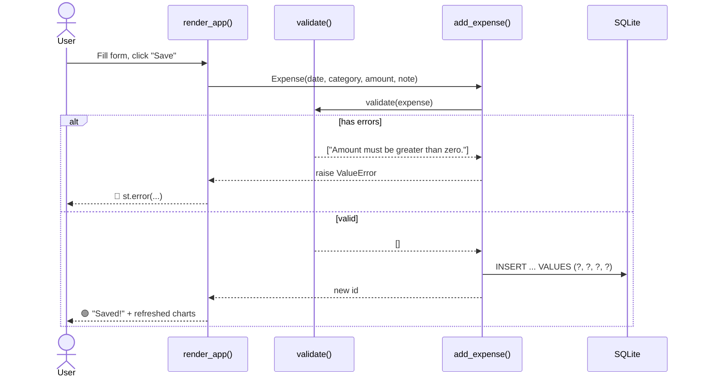

#### 🧾 Function reference

| Function | Input | Output | Layer |
|---|---|---|---|
| `get_connection(db_path)` | path or `":memory:"` | `sqlite3.Connection` with table created | Data |
| `validate(expense)` | `Expense` | `list[str]` of errors | Data |
| `add_expense(conn, expense)` | connection, `Expense` | new row id (raises `ValueError` if invalid) | Data |
| `delete_expense(conn, id)` | connection, id | `True` if deleted | Data |
| `load_expenses(conn)` | connection | `DataFrame`, newest first | Data |
| `category_summary(df)` | `DataFrame` | totals per category, descending | Data |
| `monthly_summary(df)` | `DataFrame` | totals per `YYYY-MM`, ascending | Data |
| `month_to_date_total(df, today)` | `DataFrame`, optional date | `float` | Data |
| `render_app()` | — | draws the dashboard | UI |

---

### Step 10: Push to GitHub

```text
Initialise a git repo, add a Python .gitignore that excludes .venv/,
__pycache__/ and *.db, commit everything with the message
"SpendWise: initial version", and show me the commands to push to a new
GitHub repository.
```

Or by hand:

```bash
git init
printf ".venv/\n__pycache__/\n*.db\n.pytest_cache/\n" > .gitignore
git add .
git commit -m "SpendWise: initial version"
git branch -M main
git remote add origin https://github.com/<your-username>/spendwise.git
git push -u origin main
```

---

## 8. 🧠 Teach the Agent Your Style: Rules, Workflows and Skills

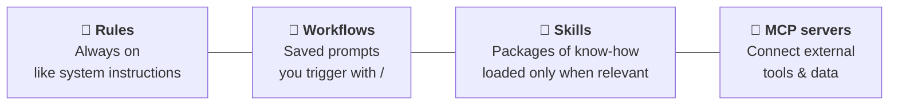

| Customisation | Global location | Workspace location |
|---|---|---|
| Rules | `~/.gemini/GEMINI.md` | `.agents/rules/` |
| Workflows | `~/.gemini/config/global_workflows/` | `.agents/workflows/` |
| Skills | `~/.gemini/config/skills/` | `.agents/skills/` |
| MCP servers | `~/.gemini/config/mcp_config.json` | — |

### Example workflow: `/generate-unit-tests`

Create it under **Customizations → Workflows → + Workspace**:

```markdown
* Generate pytest unit tests for each file and each public function.
* Name test files after the source file with a test_ prefix.
* Use fixtures for setup; never touch the real database.
* Run the tests and report pass/fail counts.
```

Then simply type `/generate-unit-tests` in the agent panel.

### Example skill: Python code review

Create `.agents/skills/python-review/SKILL.md`:

```markdown
---
name: python-review
description: Reviews Python code for bugs, security, PEP 8 style and missing tests. Use when the user asks for a review or code quality check.
---

# Python Review Skill

## Checklist
1. **Correctness**: does it do what the docstring says?
2. **Edge cases**: empty inputs, None, negative numbers, missing files.
3. **Security**: parameterised SQL, no secrets in code, no eval().
4. **Style**: PEP 8, type hints, docstrings.
5. **Tests**: is every public function covered?

## Output format
A table with columns: Issue | Severity (High/Med/Low) | Line | Suggested fix.
```

Now `review @app.py` automatically loads this skill, because skills are only pulled into context when the request matches their description.

---

## 9. ✅ Best Practices, Pitfalls and Safety

### Do's and don'ts

| ✅ Do | ❌ Don't |
|---|---|
| Start in Planning mode for anything non-trivial | Accept a plan you haven't read |
| Ask for a clean separation of logic and UI | Let everything grow into one giant function |
| Commit after every working loop | Stack ten changes before testing |
| Ask the agent to **explain** code you don't understand | Ship code you can't explain |
| Ask for tests and run them | Trust "it works" without evidence |
| Keep prompts focused on one feature | Paste a 3-page spec in one go |
| Use rules for standards you repeat | Repeat the same instructions in every prompt |

### Safety checklist 🔒

- [ ] Use **review-driven** policies until you trust your setup.
- [ ] Never paste API keys or passwords into prompts. Use environment variables or a `.env` file listed in `.gitignore`.
- [ ] Read any terminal command that deletes files, changes system settings or pushes to remote repos before approving it.
- [ ] Check new dependencies the agent adds: are they real, maintained packages?
- [ ] Run tests before every commit.

### Common anti-patterns

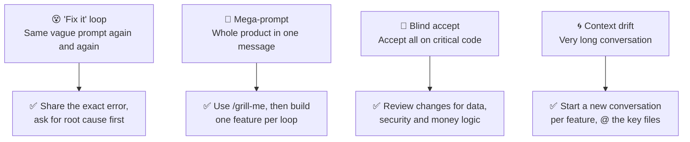

---

## 10. 🧯 Troubleshooting

| Symptom | Likely cause | Fix |
|---|---|---|
| Agent went straight to coding without waiting | Plan auto-proceeded | Comment on the plan anyway and submit, or stop the task, comment and retry |
| `ModuleNotFoundError: streamlit` | Virtual env not active | Activate `.venv` in the terminal, or ask the agent to use `.venv` |
| Agent can't run terminal commands | Strict terminal policy or install location | Check **Settings → Advanced Settings**; on Windows install on `C:` |
| Browser verification doesn't start | Browser integration not enabled | Enable it in settings, make sure Chrome is installed |
| Answers ignore your project standards | No rules defined | Add workspace rules (Section 8) |
| Agent keeps making the same mistake | Vague feedback | Quote the exact wrong output and the exact expected output |
| You want to roll back | Bad change | **↩️ Undo changes up to this point** in the chat, or `git checkout .` |

---

## 11. 📋 One-Page Cheat Sheet

| Need | Do this |
|---|---|
| Open the agent panel | `Cmd + L` / `Ctrl + L` |
| Add context | `@file`, `@folder`, `@terminal`, `@mcp-server` |
| Big task | **Planning** mode |
| Small task | **Fast** mode |
| Align on a fuzzy idea | `/grill-me` |
| Keep going until done | `/goal <condition>` |
| Recurring task | `/schedule` |
| Save what you learned | `/learn` |
| Fix a lint error | Hover → **Explain and fix** |
| Fix all problems | **Problems** tab → **Send to Agent** |
| Change UI from a screenshot | Comment on the walkthrough screenshot and submit |
| Roll back | **↩️ Undo changes up to this point** |

**The 5-word summary of vibe coding:** *Describe. Review. Verify. Iterate. Commit.*

---

## 12. 📚 References

- Official site: <https://antigravity.google/>
- Documentation: <https://antigravity.google/docs/home>
- Download: <https://antigravity.google/download>
- Codelab, Getting Started with Antigravity IDE: <https://codelabs.developers.google.com/getting-started-agy-ide>
- Codelab, Getting Started with Google Antigravity: <https://codelabs.developers.google.com/getting-started-google-antigravity>
- Streamlit docs: <https://docs.streamlit.io/>
- Python `sqlite3` docs: <https://docs.python.org/3/library/sqlite3.html>

---

<div align="center">

**Made with 🎧 vibes · Last updated Sunday, November 8, 2026**

*If this guide helped you, ⭐ star the repo and share your own vibe-coded apps!*

</div>
