<div align="center">

# 🤖 Vibe Coding with Claude Code
### A Step-by-Step Guide, a Prompt Playbook, and a Complete Python App Build


**📅 Written on Sunday, November 8, 2026**

</div>

> [!NOTE]
> Claude Code ships updates frequently. Commands, shortcuts and default models in this guide reflect the product as of **November 8, 2026**. Inside any session, type `/help` or press `?` to see the exact commands and shortcuts available in your version, and check the [official docs](https://code.claude.com/docs/en/overview) for the latest.

---

## 📑 Table of Contents

1. [What is Vibe Coding?](#1--what-is-vibe-coding)
2. [Claude Code at a Glance](#2--claude-code-at-a-glance)
3. [Step-by-Step: Install and Set Up](#3--step-by-step-install-and-set-up)
4. [Core Concepts You Must Know](#4--core-concepts-you-must-know)
5. [The Vibe Coding Loop](#5--the-vibe-coding-loop)
6. [Prompt Playbook: Examples That Show the Power](#6--prompt-playbook-examples-that-show-the-power)
7. [Hands-On Project: Build "HabitHero" Step by Step](#7--hands-on-project-build-habithero-step-by-step)
8. [Teach Claude Your Style: CLAUDE.md, Skills, Subagents and Hooks](#8--teach-claude-your-style-claudemd-skills-subagents-and-hooks)
9. [Best Practices, Pitfalls and Safety](#9--best-practices-pitfalls-and-safety)
10. [Troubleshooting](#10--troubleshooting)
11. [One-Page Cheat Sheet](#11--one-page-cheat-sheet)
12. [References](#12--references)

---

## 1. 🎧 What is Vibe Coding?

**Vibe coding** means building software by describing *what you want* in plain language while an AI agent writes, runs and fixes the code. You stop being the typist and become the **director**: you set the goal, approve the plan, check the result and give feedback.

Claude Code is especially well suited to this because it is an **agent**, not just a chatbot. It reads your whole project, edits multiple files, runs commands in your terminal, executes tests, reads the errors and tries again, all while asking your permission for anything risky.

### Traditional coding vs vibe coding

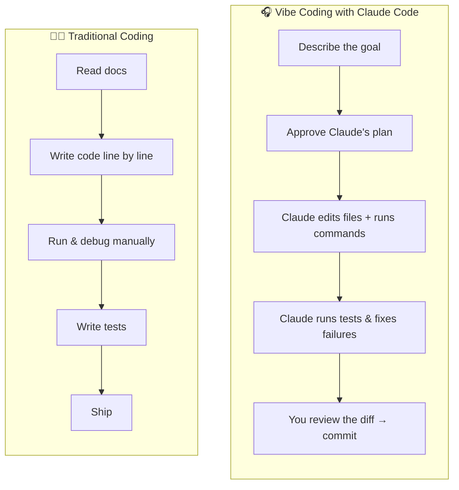

| Aspect | Traditional Coding | Vibe Coding with Claude Code |
|---|---|---|
| **Your main skill** | Syntax and APIs | Clear intent, judgement and reviewing |
| **Unit of work** | A line or a function | A feature, a refactor, a whole app |
| **Debugging** | Read stack traces yourself | Claude runs the code, reads the error and fixes it |
| **Where it happens** | Editor | Terminal, IDE, desktop app, web or mobile |
| **Speed to a prototype** | Hours to days | Minutes to an hour |
| **Biggest risk** | Bugs you wrote | Bugs you *didn't read*, so reviewing matters more |

> [!IMPORTANT]
> Vibe coding does **not** remove the need to understand code. It moves your effort to the highest-value parts: deciding *what* to build and checking that it is *right*.

---

## 2. 🧭 Claude Code at a Glance

Claude Code is Anthropic's agentic coding tool. The same agent is available on several surfaces:

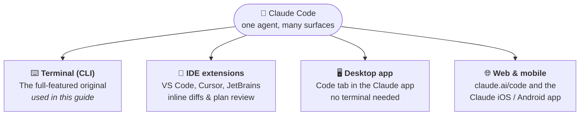

| What Claude Code can do | Example |
|---|---|
| 📂 Understand your codebase | "Explain how authentication works in this repo" |
| ✏️ Edit many files at once | "Rename `User` to `Account` everywhere and update the tests" |
| ⌨️ Run terminal commands | Installs packages, runs `pytest`, starts servers |
| 🔁 Fix its own mistakes | Reads failing test output and tries again |
| 🌿 Work with git | Writes commit messages, creates branches, opens PRs |
| 🔌 Connect to tools | GitHub, databases, issue trackers through MCP servers |
| 🧠 Remember your rules | Reads `CLAUDE.md` at the start of every session |

---

## 3. 🛠️ Step-by-Step: Install and Set Up

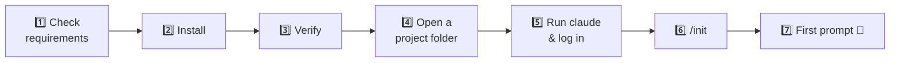

### Step 1: Check the requirements

| Requirement | Details |
|---|---|
| Account | A paid Claude plan (Pro, Max, Team or Enterprise) or an Anthropic Console (API) account |
| Operating system | macOS, Linux, or Windows (native or WSL). On native Windows, [Git for Windows](https://git-scm.com/downloads/win) is recommended |
| For this guide | Python **3.10+** and `git` installed |

### Step 2: Install Claude Code

Pick the command for your system (the native installer is the recommended option):

| System | Command |
|---|---|
| macOS / Linux / WSL | `curl -fsSL https://claude.ai/install.sh \| bash` |
| Windows PowerShell | `irm https://claude.ai/install.ps1 \| iex` |
| macOS with Homebrew | `brew install --cask claude-code` |
| Windows with WinGet | `winget install Anthropic.ClaudeCode` |

> [!TIP]
> Prefer not to use a terminal? Install the **Claude desktop app**, sign in and open the **Code** tab. Or install the **Claude Code extension** in VS Code. Everything in this guide works there too, though the screens look different.

### Step 3: Verify the installation

```bash
claude --version
```

If you see `command not found`, open a new terminal window (so your `PATH` refreshes), or run `/doctor` later inside Claude Code to diagnose the problem.

### Step 4: Open a project folder

```bash
mkdir habithero
cd habithero
git init
```

> [!TIP]
> Always start Claude Code **inside a git repository**. Git is your safety net: every working step can be committed and every bad step can be undone.

### Step 5: Start Claude Code and log in

```bash
claude
```

The first time, your browser opens so you can sign in with your Claude account. Then you'll see the interactive prompt:

```
╭──────────────────────────────────────────────╮
│ ✻ Welcome to Claude Code!                     │
│                                               │
│   /help for help, /status for your setup      │
│   cwd: ~/habithero                            │
╰──────────────────────────────────────────────╯
> _
```

### Step 6: Create project memory with `/init`

```text
/init
```

Claude explores the folder and creates a starter **`CLAUDE.md`**, a file it reads at the start of every session. You'll customise it in Step 2 of the project.

### Step 7: Send your first prompt

```text
Create hello.py that asks for my name and prints a friendly greeting with
today's date. Then run it once with the name "Ada" to show it works.
```

Claude shows you the file it wants to create and the command it wants to run, and asks for permission. Approve, and watch it work. 🎉

---

## 4. 🧠 Core Concepts You Must Know

### 4.1 Permission modes: how much freedom Claude has

Press **`Shift + Tab`** to cycle through the modes. The current mode is shown at the bottom of the screen.

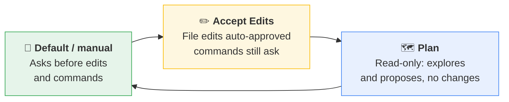

| Mode | What Claude may do without asking | Use it when |
|---|---|---|
| 🙋 **Default (manual)** | Read files | You're learning, or the work is sensitive |
| ✏️ **Accept Edits** | Read and edit files (shell commands still ask) | You trust the direction and don't want to approve every diff |
| 🗺️ **Plan** | Read and propose only, nothing is changed | **Starting any non-trivial feature**, exploring unfamiliar code |
| ⚡ **Auto** (if enabled) | Routine actions approved automatically, risky ones still checked | Experienced users on well-tested projects |

> [!TIP]
> The single best habit for vibe coding: **start every new feature in Plan mode**. You can also jump straight in with `/plan <description>`.

### 4.2 The context window

Everything Claude has read or said in a session lives in its **context window**. When it fills up, quality drops. Manage it actively:

| Command | What it does | When to use it |
|---|---|---|
| `/context` | Shows what's using up the context | When answers start getting vague |
| `/compact` | Summarises the conversation to free space | Mid-feature, to keep going |
| `/clear` | Starts fresh (`CLAUDE.md` stays) | **Between features** |
| `/btw` | Quick side question without polluting context | "btw, what does `PRAGMA` do?" |

### 4.3 Giving context: `@`, `!` and images

| Prefix | Meaning | Example |
|---|---|---|
| `@` | Reference a file or folder | `@habithero.py explain the streak logic` |
| `!` | Run a shell command directly | `!pytest -q` |
| Paste image | Show a screenshot or diagram | Paste a UI mockup and say "build this" |

### 4.4 Undo: checkpoints and rewind

Claude Code saves checkpoints as it works. Press **`Esc` twice** (or type `/rewind`) to roll the conversation and/or your code back to an earlier point. Press **`Esc` once** to interrupt Claude mid-task and redirect it.

### 4.5 How an agent turn works

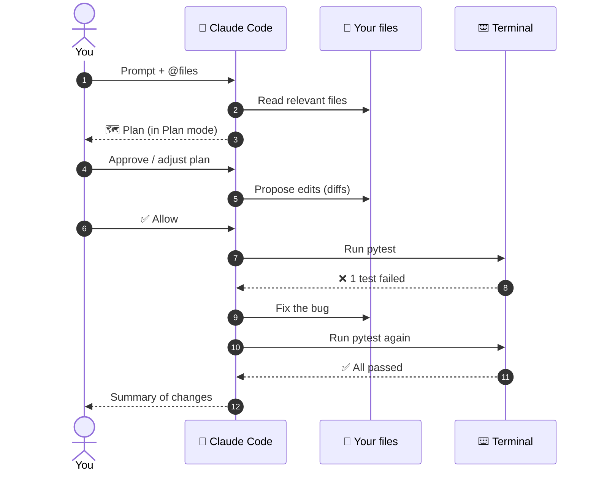

---

## 5. 🔁 The Vibe Coding Loop

The most reliable workflow is **Explore → Plan → Code → Verify → Commit**, repeated in small loops.

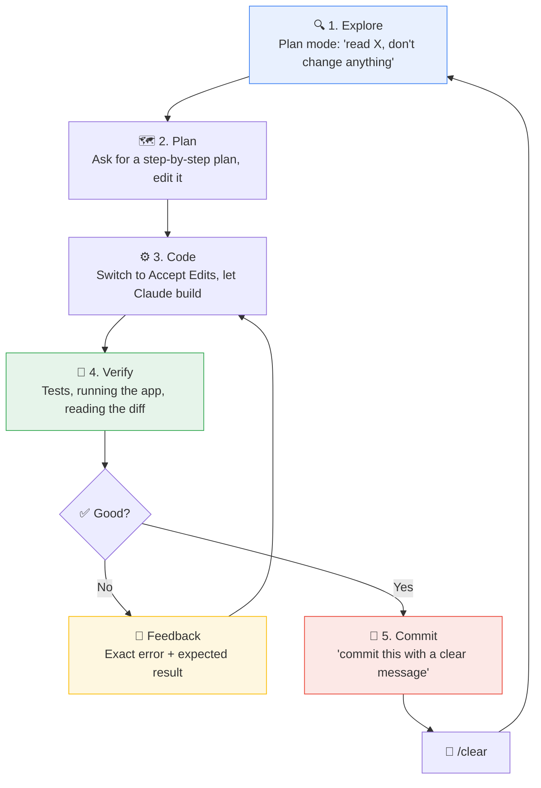

**Golden rules:**

1. **One feature per loop.** Small loops are faster than one giant prompt.
2. **Give Claude a way to check its own work**, such as tests, a command to run, or expected output. This is the biggest quality multiplier.
3. **Commit after every green loop** so you can always roll back.
4. **`/clear` between unrelated tasks** to keep the context sharp.
5. **Be specific in feedback**: "Streak shows 0 but I did it yesterday and today" beats "streaks are broken".

---

## 6. ✍️ Prompt Playbook: Examples That Show the Power

### 6.1 Anatomy of a great prompt

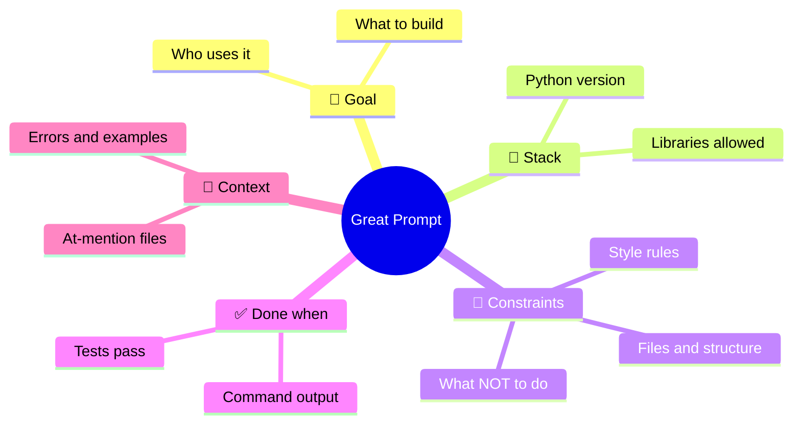

| Part | Question it answers | Example |
|---|---|---|
| **Goal** | What and for whom? | "A CLI for students to track daily study habits" |
| **Stack** | With what? | "Python 3.12, standard library plus `rich`" |
| **Constraints** | Within which limits? | "Single file, type hints, no network calls" |
| **Done when** | How do we know it works? | "`pytest` passes and `python app.py list` prints a table" |
| **Context** | What should Claude look at? | `@data/sample.csv @README.md` |

### 6.2 Weak vs strong prompts

| ❌ Weak prompt | ✅ Strong prompt | Why it's better |
|---|---|---|
| "Make a todo app" | "Build a todo CLI in Python with argparse and SQLite: add, list, done, delete. One file plus a pytest file. Run the tests when done." | Stack, scope, size and verification are all clear |
| "Fix my code" | "Running `python app.py list` gives the traceback below. Explain the root cause in 2 sentences, then make the smallest fix and re-run the command." | Gives the error and the expected behaviour |
| "Make it look nicer" | "Use `rich` to show the list as a table with columns Habit, Today (✅/⬜), Last 7 days and Streak. Colour the title magenta." | Concrete, checkable changes |
| "Add tests" | "Write pytest tests for every public function in `@habithero.py`. Use an in-memory SQLite DB. Cover one happy path and one edge case each, then run them." | Defines coverage, setup and verification |

### 6.3 Prompt library by goal

<details>
<summary><b>🔍 Understanding an existing codebase</b> (click to expand)</summary>

```text
Give me a tour of this repo for someone new. What does it do, what are
the main modules, and how does data flow from input to output? Draw it
as a Mermaid diagram. Don't change any files.
```

```text
@src/billing/ Where would I add support for a new currency? List the
files I'd need to touch and why.
```

</details>

<details>
<summary><b>🏗️ Starting a new project</b></summary>

```text
I want to build a Python app that tracks my reading (book, pages,
minutes). Before writing code, ask me up to 5 questions to pin down the
scope, then propose a plan.
```

```text
Scaffold a Python 3.12 project: src/ layout, .venv, requirements.txt,
README with setup steps and a tests/ folder. Don't implement features yet.
Finish by running pytest with one placeholder test.
```

</details>

<details>
<summary><b>⚡ Building features</b></summary>

```text
Add a `history <name>` command to @habithero.py that shows the last 30
days as a calendar grid. Write tests first, confirm they fail, then
implement until they pass.
```

```text
Turn @report.py into a Streamlit app with a file uploader, a summary
table and a bar chart. Reuse the existing functions; don't duplicate logic.
```

</details>

<details>
<summary><b>🐞 Debugging</b></summary>

```text
!python habithero.py list
That traceback is the bug. 1) Explain the root cause in plain English.
2) Propose the smallest fix. 3) Apply it and re-run the same command.
```

```text
The test test_current_streak fails only on Mondays. Think hard about
date edge cases, write a test that reproduces it, then fix it.
```

</details>

<details>
<summary><b>🧹 Refactoring and quality</b></summary>

```text
Refactor @habithero.py so no function is longer than 30 lines. Behaviour
must not change: run the tests before and after and show both results.
```

```text
Review the changes on this branch like a senior Python engineer. List
the top 5 issues in a table (issue, severity, file:line, fix), then fix
only the high-severity ones.
```

</details>

<details>
<summary><b>🚀 Git and shipping</b></summary>

```text
Look at the uncommitted changes, group them into logical commits with
clear messages, and commit them.
```

```text
Prepare this repo for GitHub: Python .gitignore (exclude *.db), a README
with install, usage and test instructions, and an MIT LICENSE.
```

</details>

### 6.4 The power in action: one prompt, many steps

This is what typically happens after **one** well-written prompt:

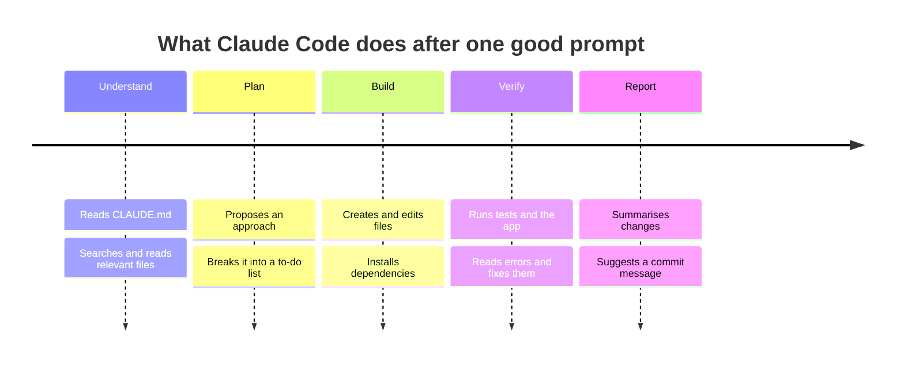

### 6.5 Choosing the right mode for a prompt

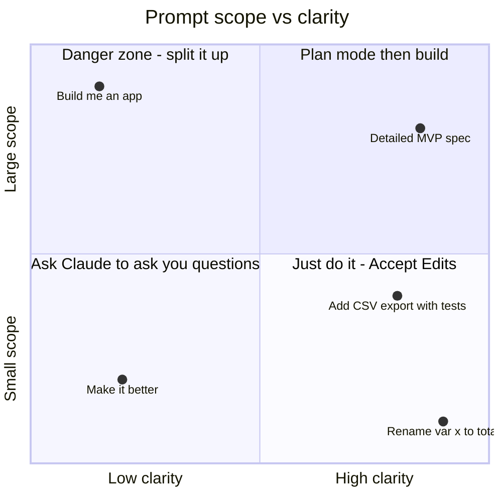

### 6.6 Power-user prompt patterns

| Pattern | Prompt snippet | Why it works |
|---|---|---|
| **Test-first** | "Write failing tests first, then implement until they pass" | Gives Claude an objective target |
| **Interview me** | "Ask me questions before you start" | Surfaces hidden requirements |
| **Think harder** | "Think hard about edge cases before coding" | Encourages deeper reasoning on tricky logic |
| **Show alternatives** | "Give me 2 designs with pros/cons, recommend one" | You make the key decision |
| **Explain like a teacher** | "Explain this as if I know basic Python only" | You learn while you build |
| **Scope guard** | "Only change @file.py. Don't touch anything else" | Prevents sprawling edits |
| **Headless** | `claude -p "summarise TODOs in this repo"` | Use Claude in scripts and CI |

---

## 7. 🧪 Hands-On Project: Build "HabitHero" Step by Step

We'll vibe-code **HabitHero**, a colourful habit tracker for the terminal, using **Python + SQLite + Rich**. This is the actual output of the finished app:

```text
                             🦸 HabitHero
┏━━━━━━━━━━━━━━━━┳━━━━━━━┳━━━━━━━━━━━━━┳━━━━━━━━━━━┳━━━━━━━━━┳━━━━━━━┓
┃ Habit          ┃ Today ┃ Last 7 days ┃ 🔥 Streak ┃ 🏆 Best ┃ Total ┃
┡━━━━━━━━━━━━━━━━╇━━━━━━━╇━━━━━━━━━━━━━╇━━━━━━━━━━━╇━━━━━━━━━╇━━━━━━━┩
│ Walk 30 min    │  ✅   │   ■□■■■■■   │         5 │       5 │     6 │
│ Read 20 pages  │  ⬜   │   □□□□■■□   │         2 │       2 │     2 │
│ Drink 2L water │  ✅   │   ■■■■□□■   │         1 │       7 │     8 │
└────────────────┴───────┴─────────────┴───────────┴─────────┴───────┘
📊 2/3 habits done today · 🏆 best streak ever: 7 days
```

### 7.1 Features

| Command | What it does |
|---|---|
| `add "<name>"` | Create a habit (names are trimmed, max 40 chars, no duplicates) |
| `done "<name>"` | Check in for today (doing it twice is harmless) |
| `undo "<name>"` | Remove today's check-in |
| `delete "<name>"` | Delete a habit and its whole history |
| `list` | Colourful table with today's status, 7-day heatmap, streaks and totals |
| `stats` | One-line summary |
| `--db PATH` | Use a different database file (default `~/.habithero.db`, or the `HABITHERO_DB` env var) |

### 7.2 Architecture

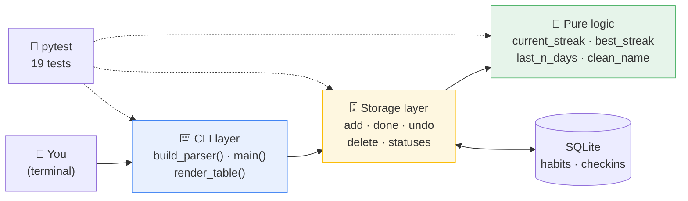

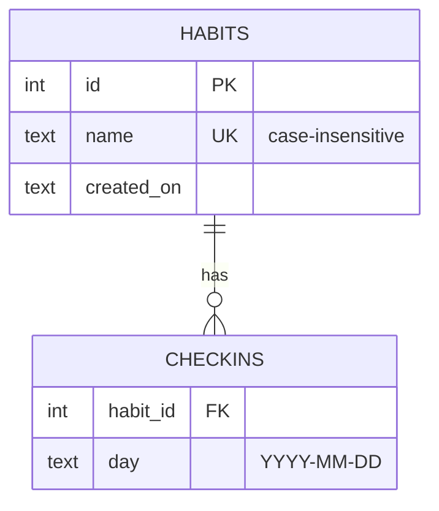

**Why three layers?** The streak maths is pure Python with no database, so it's trivial to test. Storage only talks to SQLite. The CLI only formats output. You *ask* for this structure in your prompt, and that is a big part of vibe coding well.

### 7.3 Build roadmap

```mermaid
gantt
    title HabitHero build plan (approx. 45–60 minutes)
    dateFormat HH:mm
    axisFormat %H:%M
    section Setup
    Step 1 Project & venv          :s1, 00:00, 5m
    Step 2 CLAUDE.md               :s2, after s1, 5m
    section Build
    Step 3 Plan mode               :s3, after s2, 5m
    Step 4 Streak logic (test-first) :s4, after s3, 10m
    Step 5 Storage + CLI           :s5, after s4, 10m
    section Verify & polish
    Step 6 Try it & fix            :s6, after s5, 5m
    Step 7 Iterate                 :s7, after s6, 10m
    section Ship
    Step 8-9 Review & commit       :s8, after s7, 5m
    Step 10 Push to GitHub         :s9, after s8, 5m
```

---

### Step 1: Set up the project

In your terminal:

```bash
mkdir habithero && cd habithero
git init
claude
```

Then ask Claude (default mode, approve each command):

```text
Create a Python virtual environment in .venv, a requirements.txt with
rich>=13 and pytest>=8, and install them. Show me the installed versions.
```

✅ **Check:** the output lists `rich` and `pytest`. Doing it by hand instead:

```bash
python -m venv .venv
source .venv/bin/activate        # Windows: .venv\Scripts\activate
pip install "rich>=13" "pytest>=8"
```

---

### Step 2: Write your project memory (`CLAUDE.md`)

Run `/init`, then `/memory` to edit the file. Replace it with:

```markdown
# HabitHero

## Commands
- Run app: `python habithero.py <command>`
- Run tests: `python -m pytest -q`

## Code style
- Python 3.10+, type hints on every function, one-line docstrings.
- PEP 8. Keep functions under ~30 lines.
- Three layers: pure logic (no I/O) → storage (sqlite3) → CLI (argparse + rich).
- Parameterised SQL only (`?` placeholders). Never f-strings in SQL.

## Workflow
- Write or update tests for every change and run them before saying "done".
- Don't add new dependencies without asking.
```

Claude reads this **automatically at the start of every session**, so you never repeat yourself.

---

### Step 3: Plan the app in Plan mode

Press **`Shift + Tab`** until you see **plan mode**, then send:

```text
Plan "HabitHero", a terminal habit tracker in a single file habithero.py.

Commands: add <name>, done <name>, undo <name>, delete <name>, list, stats.
Global option --db PATH (default ~/.habithero.db, overridable with the
HABITHERO_DB environment variable).

Data: SQLite with tables habits (id, unique case-insensitive name,
created_on) and checkins (habit_id, day) with ON DELETE CASCADE.
Checking in twice on the same day must be harmless.

Logic: current streak (still alive if done yesterday but not yet today),
best streak ever, and a 7-day heatmap string like ■■□■■■■.

`list` shows a rich table: Habit, Today (✅/⬜), Last 7 days, 🔥 Streak,
🏆 Best, Total. Sorted by current streak.

Errors (unknown habit, empty name, future date) print a friendly red
message and exit with code 1, never a traceback.

Done when: tests/test_habithero.py passes and the commands work.
```

Claude replies with a plan. **Read it and push back** where needed:

| Plan says... | Your reply | Why |
|---|---|---|
| "Use a JSON file for storage" | *"Use SQLite as specified, with a composite primary key on (habit_id, day)"* | The key makes double check-ins impossible |
| "Calculate streaks inside the SQL query" | *"Keep streak maths in pure Python functions that take a set of dates"* | Much easier to test |
| No mention of `today` parameter | *"Let functions accept an optional `today` so tests can use a fixed date"* | Tests that depend on the real date are flaky |

When you're happy, approve the plan.

---

### Step 4: Build the streak logic test-first

Switch to **Accept Edits** mode (`Shift + Tab`) and send:

```text
Start with the pure logic only. Write tests in tests/test_habithero.py for
current_streak, best_streak, last_n_days and clean_name, using a fixed
TODAY = date(2026, 11, 8). Run them and confirm they fail. Then implement
the functions until they pass.
```

✅ **Check:** you see the tests fail first (red), then pass (green). That proves the tests actually test something.

---

### Step 5: Add storage and the CLI

```text
Now add the SQLite storage layer and the argparse + rich CLI following
the plan. Add tests using an in-memory database and one end-to-end CLI
test using tmp_path. Run the full test suite.
```

✅ **Check:**

```text
...................                                       [100%]
19 passed in 0.10s
```

---

### Step 6: Try it yourself

Use `!` to run commands without leaving Claude Code:

```text
!python habithero.py add "Read 20 pages"
!python habithero.py done "Read 20 pages"
!python habithero.py list
!python habithero.py done "Meditate"
```

The last command should show a friendly error, not a traceback:

```text
Error: No habit called 'Meditate'. Add it first with: add "Meditate"
```

If something is off, paste the output and describe the expected result.

---

### Step 7: Iterate with feedback (the fun part 🎨)

One change per loop, committing in between:

| Loop | Prompt | Mode |
|---|---|---|
| 1 | "Add a `stats` line showing how many habits are done today and the best streak ever." | Accept Edits |
| 2 | "Add `history <name>` showing the last 30 days as a 5×6 grid. Test-first." | Plan → Accept Edits |
| 3 | "Add a `--json` flag to `list` for scripting. Include a test." | Accept Edits |
| 4 | "Run /simplify on the files we changed and keep the tests green." | Default |

---

### Step 8: Review the diff

```text
/diff
```

Read every change. Ask about anything you don't understand:

```text
Explain why current_streak starts from yesterday when today isn't done.
Is there an edge case around midnight?
```

---

### Step 9: The finished code

Here is the complete, tested result of the steps above. Copy it into your project.

#### 📁 Project structure

```text
habithero/
├── .claude/
│   ├── agents/
│   │   └── test-runner.md      # optional subagent (Section 8)
│   ├── skills/
│   │   └── python-review/
│   │       └── SKILL.md        # optional skill (Section 8)
│   └── settings.json           # optional hooks (Section 8)
├── tests/
│   └── test_habithero.py       # 19 pytest tests
├── CLAUDE.md                   # project memory
├── habithero.py                # the whole app
├── requirements.txt
└── README.md
```

#### 📦 `requirements.txt`

```text
rich>=13
pytest>=8
```

#### 🐍 `habithero.py`

```python
"""HabitHero: a tiny habit tracker for your terminal, vibe-coded with Claude Code.

Usage examples:
    python habithero.py add "Read 20 pages"
    python habithero.py done "Read 20 pages"
    python habithero.py list
    python habithero.py stats
"""
from __future__ import annotations

import argparse
import os
import sqlite3
import sys
from dataclasses import dataclass
from datetime import date, timedelta
from pathlib import Path

from rich.console import Console
from rich.table import Table

DEFAULT_DB = Path(os.environ.get("HABITHERO_DB", Path.home() / ".habithero.db"))
MAX_NAME_LENGTH = 40
console = Console()


# ---------------------------------------------------------------------------
# Pure logic (no I/O, easy to test)
# ---------------------------------------------------------------------------
def current_streak(days: set[date], today: date) -> int:
    """Consecutive days ending today (or yesterday, so a streak survives until tonight)."""
    cursor = today if today in days else today - timedelta(days=1)
    streak = 0
    while cursor in days:
        streak += 1
        cursor -= timedelta(days=1)
    return streak


def best_streak(days: set[date]) -> int:
    """Longest run of consecutive days ever recorded."""
    best = 0
    for day in days:
        if day - timedelta(days=1) in days:
            continue  # not the start of a run
        length = 1
        while day + timedelta(days=length) in days:
            length += 1
        best = max(best, length)
    return best


def last_n_days(days: set[date], today: date, n: int = 7) -> str:
    """A mini heatmap such as '■■□■■■■' (oldest on the left)."""
    return "".join(
        "■" if today - timedelta(days=offset) in days else "□"
        for offset in range(n - 1, -1, -1)
    )


def clean_name(name: str) -> str:
    """Normalise and validate a habit name."""
    cleaned = " ".join(name.split())
    if not cleaned:
        raise ValueError("Habit name cannot be empty.")
    if len(cleaned) > MAX_NAME_LENGTH:
        raise ValueError(f"Habit name must be {MAX_NAME_LENGTH} characters or fewer.")
    return cleaned


# ---------------------------------------------------------------------------
# Storage (SQLite)
# ---------------------------------------------------------------------------
@dataclass(frozen=True)
class HabitStatus:
    """Everything the UI needs to show one habit."""

    name: str
    current: int
    best: int
    total: int
    done_today: bool
    week: str


def connect(db_path: str | Path = DEFAULT_DB) -> sqlite3.Connection:
    """Open the database and create tables if needed."""
    conn = sqlite3.connect(db_path)
    conn.execute("PRAGMA foreign_keys = ON")
    conn.executescript(
        """
        CREATE TABLE IF NOT EXISTS habits (
            id         INTEGER PRIMARY KEY AUTOINCREMENT,
            name       TEXT NOT NULL UNIQUE COLLATE NOCASE,
            created_on TEXT NOT NULL
        );
        CREATE TABLE IF NOT EXISTS checkins (
            habit_id INTEGER NOT NULL REFERENCES habits(id) ON DELETE CASCADE,
            day      TEXT    NOT NULL,
            PRIMARY KEY (habit_id, day)
        );
        """
    )
    return conn


def _habit_id(conn: sqlite3.Connection, name: str) -> int:
    row = conn.execute("SELECT id FROM habits WHERE name = ?", (clean_name(name),)).fetchone()
    if row is None:
        raise KeyError(f"No habit called '{name}'. Add it first with: add \"{name}\"")
    return int(row[0])


def add_habit(conn: sqlite3.Connection, name: str, today: date | None = None) -> None:
    """Create a new habit."""
    today = today or date.today()
    try:
        conn.execute(
            "INSERT INTO habits (name, created_on) VALUES (?, ?)",
            (clean_name(name), today.isoformat()),
        )
    except sqlite3.IntegrityError as err:
        raise ValueError(f"Habit '{clean_name(name)}' already exists.") from err
    conn.commit()


def mark_done(conn: sqlite3.Connection, name: str, day: date | None = None) -> bool:
    """Record a check-in. Returns False if it was already recorded for that day."""
    day = day or date.today()
    if day > date.today():
        raise ValueError("You can't check in for a future date.")
    cursor = conn.execute(
        "INSERT OR IGNORE INTO checkins (habit_id, day) VALUES (?, ?)",
        (_habit_id(conn, name), day.isoformat()),
    )
    conn.commit()
    return cursor.rowcount == 1


def undo(conn: sqlite3.Connection, name: str, day: date | None = None) -> bool:
    """Remove a check-in. Returns True if one was removed."""
    day = day or date.today()
    cursor = conn.execute(
        "DELETE FROM checkins WHERE habit_id = ? AND day = ?",
        (_habit_id(conn, name), day.isoformat()),
    )
    conn.commit()
    return cursor.rowcount == 1


def delete_habit(conn: sqlite3.Connection, name: str) -> None:
    """Delete a habit and all its check-ins."""
    conn.execute("DELETE FROM habits WHERE id = ?", (_habit_id(conn, name),))
    conn.commit()


def statuses(conn: sqlite3.Connection, today: date | None = None) -> list[HabitStatus]:
    """Build a status line for every habit, best current streak first."""
    today = today or date.today()
    result: list[HabitStatus] = []
    for habit_id, name in conn.execute("SELECT id, name FROM habits"):
        days = {
            date.fromisoformat(row[0])
            for row in conn.execute("SELECT day FROM checkins WHERE habit_id = ?", (habit_id,))
        }
        result.append(
            HabitStatus(
                name=name,
                current=current_streak(days, today),
                best=best_streak(days),
                total=len(days),
                done_today=today in days,
                week=last_n_days(days, today),
            )
        )
    return sorted(result, key=lambda s: (-s.current, s.name.lower()))


# ---------------------------------------------------------------------------
# Command-line interface
# ---------------------------------------------------------------------------
def render_table(rows: list[HabitStatus]) -> Table:
    """Turn statuses into a colourful Rich table."""
    table = Table(title="🦸 HabitHero", title_style="bold magenta")
    table.add_column("Habit", style="bold")
    table.add_column("Today", justify="center")
    table.add_column("Last 7 days", justify="center", style="green")
    table.add_column("🔥 Streak", justify="right")
    table.add_column("🏆 Best", justify="right")
    table.add_column("Total", justify="right")
    for s in rows:
        table.add_row(
            s.name,
            "✅" if s.done_today else "⬜",
            s.week,
            str(s.current),
            str(s.best),
            str(s.total),
        )
    return table


def build_parser() -> argparse.ArgumentParser:
    """Define the CLI commands."""
    parser = argparse.ArgumentParser(prog="habithero", description="Track daily habits and streaks.")
    parser.add_argument("--db", default=str(DEFAULT_DB), help="Path to the SQLite database file.")
    sub = parser.add_subparsers(dest="command", required=True)
    for cmd, help_text in [
        ("add", "Add a new habit"),
        ("done", "Mark a habit as done today"),
        ("undo", "Remove today's check-in"),
        ("delete", "Delete a habit and its history"),
    ]:
        p = sub.add_parser(cmd, help=help_text)
        p.add_argument("name", help="Habit name, in quotes if it has spaces")
    sub.add_parser("list", help="Show all habits with streaks")
    sub.add_parser("stats", help="Show a one-line summary")
    return parser


def main(argv: list[str] | None = None) -> int:
    """Entry point. Returns a process exit code."""
    args = build_parser().parse_args(argv)
    conn = connect(args.db)
    try:
        if args.command == "add":
            add_habit(conn, args.name)
            console.print(f"[green]➕ Added[/] {clean_name(args.name)}")
        elif args.command == "done":
            new = mark_done(conn, args.name)
            console.print("[green]✅ Nice work![/]" if new else "[yellow]Already checked in today.[/]")
        elif args.command == "undo":
            removed = undo(conn, args.name)
            console.print("[yellow]↩️ Check-in removed.[/]" if removed else "Nothing to undo.")
        elif args.command == "delete":
            delete_habit(conn, args.name)
            console.print(f"[red]🗑️ Deleted[/] {clean_name(args.name)}")
        elif args.command == "list":
            rows = statuses(conn)
            if rows:
                console.print(render_table(rows))
            else:
                console.print('No habits yet. Try: [bold]python habithero.py add "Drink water"[/]')
        elif args.command == "stats":
            rows = statuses(conn)
            done = sum(s.done_today for s in rows)
            best = max((s.best for s in rows), default=0)
            console.print(f"📊 {done}/{len(rows)} habits done today · 🏆 best streak ever: {best} days")
    except (ValueError, KeyError) as err:
        console.print(f"[red]Error:[/] {err.args[0]}")
        return 1
    finally:
        conn.close()
    return 0


if __name__ == "__main__":
    sys.exit(main())
```

#### 🧪 `tests/test_habithero.py`

```python
"""Tests for HabitHero."""
from datetime import date, timedelta

import pytest

import habithero as hh

TODAY = date(2026, 11, 8)


def days_ago(*offsets: int) -> set[date]:
    """Helper: build a set of dates relative to TODAY."""
    return {TODAY - timedelta(days=o) for o in offsets}


@pytest.fixture
def conn():
    """Fresh in-memory database for each test."""
    connection = hh.connect(":memory:")
    yield connection
    connection.close()


# --- pure logic ------------------------------------------------------------
@pytest.mark.parametrize(
    "days, expected",
    [
        (set(), 0),
        (days_ago(0), 1),
        (days_ago(0, 1, 2), 3),
        (days_ago(1, 2), 2),        # not done yet today: streak still alive
        (days_ago(2, 3), 0),        # missed yesterday: streak broken
        (days_ago(0, 2, 3), 1),
    ],
)
def test_current_streak(days, expected):
    assert hh.current_streak(days, TODAY) == expected


def test_best_streak():
    assert hh.best_streak(set()) == 0
    assert hh.best_streak(days_ago(0, 1, 5, 6, 7, 8)) == 4


def test_last_n_days():
    assert hh.last_n_days(days_ago(0, 1, 3), TODAY) == "□□□■□■■"


@pytest.mark.parametrize("bad", ["", "   ", "x" * 41])
def test_clean_name_rejects_bad(bad):
    with pytest.raises(ValueError):
        hh.clean_name(bad)


def test_clean_name_collapses_spaces():
    assert hh.clean_name("  Read   20  pages ") == "Read 20 pages"


# --- storage ---------------------------------------------------------------
def test_add_and_duplicate(conn):
    hh.add_habit(conn, "Walk", TODAY)
    with pytest.raises(ValueError):
        hh.add_habit(conn, "walk", TODAY)   # case-insensitive duplicate


def test_mark_done_is_idempotent(conn):
    hh.add_habit(conn, "Walk", TODAY)
    assert hh.mark_done(conn, "Walk", TODAY) is True
    assert hh.mark_done(conn, "Walk", TODAY) is False


def test_mark_done_unknown_habit(conn):
    with pytest.raises(KeyError):
        hh.mark_done(conn, "Ghost", TODAY)


def test_mark_done_future_rejected(conn):
    hh.add_habit(conn, "Walk", TODAY)
    with pytest.raises(ValueError):
        hh.mark_done(conn, "Walk", date.today() + timedelta(days=1))


def test_undo_and_delete_cascade(conn):
    hh.add_habit(conn, "Walk", TODAY)
    hh.mark_done(conn, "Walk", TODAY)
    assert hh.undo(conn, "Walk", TODAY) is True
    assert hh.undo(conn, "Walk", TODAY) is False
    hh.mark_done(conn, "Walk", TODAY)
    hh.delete_habit(conn, "Walk")
    assert conn.execute("SELECT COUNT(*) FROM checkins").fetchone()[0] == 0


def test_statuses_sorted_by_streak(conn):
    hh.add_habit(conn, "Read", TODAY)
    hh.add_habit(conn, "Walk", TODAY)
    for offset in (0, 1, 2):
        hh.mark_done(conn, "Walk", TODAY - timedelta(days=offset))
    hh.mark_done(conn, "Read", TODAY)
    rows = hh.statuses(conn, TODAY)
    assert [r.name for r in rows] == ["Walk", "Read"]
    assert rows[0].current == 3 and rows[0].done_today and rows[0].total == 3


# --- CLI -------------------------------------------------------------------
def test_cli_flow(tmp_path, capsys):
    db = str(tmp_path / "test.db")
    assert hh.main(["--db", db, "add", "Drink water"]) == 0
    assert hh.main(["--db", db, "done", "Drink water"]) == 0
    assert hh.main(["--db", db, "list"]) == 0
    assert hh.main(["--db", db, "done", "Nope"]) == 1
    out = capsys.readouterr().out
    assert "Drink water" in out and "Error" in out
```

#### ▶️ Run it

```bash
python -m pytest -q                       # run the tests
python habithero.py add "Drink 2L water"  # add a habit
python habithero.py done "Drink 2L water" # check in
python habithero.py list                  # see your streaks
```

#### 🔥 How streaks are calculated

Example: today is **Nov 8** and the habit was done on these days.

| Day | Nov 2 | Nov 3 | Nov 4 | Nov 5 | Nov 6 | Nov 7 | Nov 8 (today) |
|---|:-:|:-:|:-:|:-:|:-:|:-:|:-:|
| Done? | ■ | □ | ■ | ■ | ■ | ■ | ■ |

- **Current streak = 5**: counting back from today, Nov 8 → Nov 4, stopping at the gap on Nov 3.
- **Best streak = 5**: the longest run anywhere in the history.
- If today weren't done yet, the streak would count back from **yesterday**, so you don't "lose" it until the day is over.

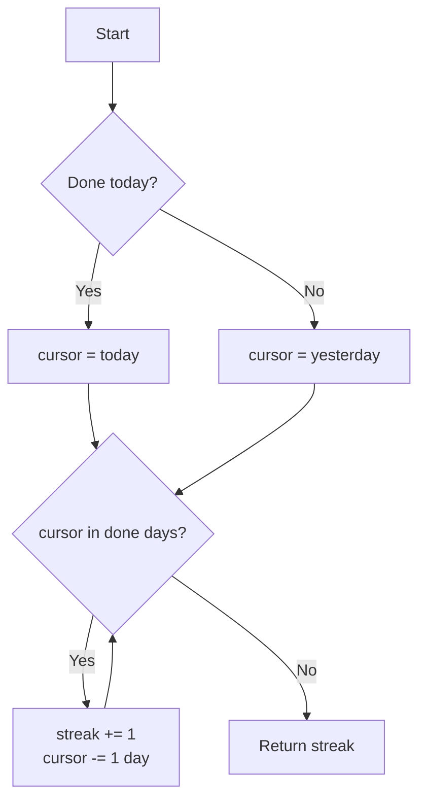

#### 🧾 Function reference

| Function | Layer | Input | Output |
|---|---|---|---|
| `current_streak(days, today)` | Logic | `set[date]`, `date` | `int` |
| `best_streak(days)` | Logic | `set[date]` | `int` |
| `last_n_days(days, today, n=7)` | Logic | `set[date]`, `date` | `str` like `■■□■■■■` |
| `clean_name(name)` | Logic | `str` | trimmed `str` (raises `ValueError`) |
| `connect(db_path)` | Storage | path or `":memory:"` | `sqlite3.Connection` |
| `add_habit(conn, name)` | Storage | connection, name | `None` (raises on duplicate) |
| `mark_done(conn, name, day)` | Storage | connection, name, date | `True` if new check-in |
| `undo(conn, name, day)` | Storage | connection, name, date | `True` if removed |
| `delete_habit(conn, name)` | Storage | connection, name | `None` |
| `statuses(conn, today)` | Storage | connection, date | `list[HabitStatus]` |
| `render_table(rows)` | CLI | statuses | `rich.table.Table` |
| `main(argv)` | CLI | argument list | exit code `0` or `1` |

---

### Step 10: Commit and push to GitHub

```text
Add a Python .gitignore (exclude .venv/, __pycache__/, *.db,
.pytest_cache/), then commit everything with a clear message.
```

Then push. If you have the GitHub CLI (`gh`) installed and logged in, Claude can do it all:

```text
Create a public GitHub repo called habithero with gh and push main to it.
```

Or by hand:

```bash
git branch -M main
git remote add origin https://github.com/<your-username>/habithero.git
git push -u origin main
```

---

## 8. 🧠 Teach Claude Your Style: CLAUDE.md, Skills, Subagents and Hooks

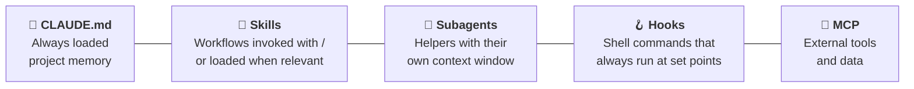

| Customisation | Where it lives | Manage with |
|---|---|---|
| Project memory | `CLAUDE.md` (project root; also `~/.claude/CLAUDE.md` for personal defaults) | `/init`, `/memory` |
| Skills | `.claude/skills/<name>/SKILL.md` | `/skills` |
| Subagents | `.claude/agents/<name>.md` | `/agents` |
| Hooks & permissions | `.claude/settings.json` | `/hooks`, `/permissions` |
| MCP servers | `claude mcp add ...` | `/mcp` |

> [!TIP]
> Commit the `.claude/` folder and `CLAUDE.md` to git. Then everyone who clones your repo gets the same Claude setup.

### 8.1 Skill: a Python code review you can run with `/python-review`

`.claude/skills/python-review/SKILL.md`:

```markdown
---
name: python-review
description: Reviews Python code for bugs, security, PEP 8 style and missing tests. Use when the user asks for a review or a quality check.
---

# Python Review

## Checklist
1. **Correctness**: does each function do what its docstring says?
2. **Edge cases**: empty input, None, dates around midnight, duplicates.
3. **Security**: parameterised SQL, no secrets in code, no eval().
4. **Style**: PEP 8, type hints, docstrings.
5. **Tests**: is every public function covered?

## Output
A table: Issue | Severity (High/Med/Low) | file:line | Suggested fix.
Then ask before fixing anything.
```

### 8.2 Subagent: a dedicated test runner

`.claude/agents/test-runner.md`:

```markdown
---
name: test-runner
description: Runs the pytest suite and reports failures with likely causes. Use after code changes.
tools: Bash, Read, Grep
---

You are a test specialist. Run `python -m pytest -q`. If anything fails,
read the failing test and the code under test, and report for each
failure: the test name, the root cause in one sentence, and a suggested
fix. Do not edit files.
```

Use it with: *"Use the test-runner subagent to check my changes."* It works in its own context window, so long test output doesn't clutter your main conversation.

### 8.3 Hook: auto-format every file Claude edits

Hooks run **every time**, unlike instructions that Claude might forget. `.claude/settings.json`:

```json
{
  "hooks": {
    "PostToolUse": [
      {
        "matcher": "Edit|Write",
        "hooks": [
          { "type": "command", "command": "ruff format ." }
        ]
      }
    ]
  }
}
```

(Requires `pip install ruff`.)

### 8.4 Which one should I use?

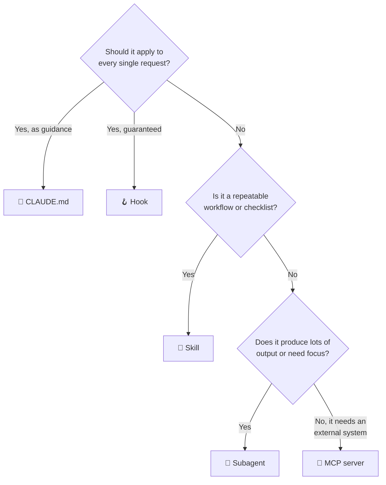

---

## 9. ✅ Best Practices, Pitfalls and Safety

### Do's and don'ts

| ✅ Do | ❌ Don't |
|---|---|
| Start features in **Plan mode** | Let Claude code before you've agreed on an approach |
| Give Claude a way to verify (tests, commands) | Accept "it should work now" without evidence |
| Keep `CLAUDE.md` short and update it when Claude repeats a mistake | Write a 500-line `CLAUDE.md` nobody maintains |
| `/clear` between unrelated tasks | Run one endless session for the whole day |
| Commit after every working loop | Stack ten changes before testing |
| Ask Claude to **explain** code you don't understand | Ship code you can't explain |
| Press `Esc` early when Claude heads the wrong way | Wait for it to finish a wrong approach |

### Safety checklist 🔒

- [ ] Work inside a **git repository** and commit often.
- [ ] Stay in **default** or **Accept Edits** mode until you know your project's tests are trustworthy.
- [ ] Read every shell command before approving, especially anything that deletes files, touches system settings, or pushes to remote repos.
- [ ] Never paste secrets into prompts. Keep them in environment variables or a `.env` file listed in `.gitignore`.
- [ ] Check any new dependency Claude adds: is it a real, maintained package?
- [ ] Use `/permissions` to pre-approve safe commands (like `pytest`) rather than switching off all checks.

### Common anti-patterns and fixes

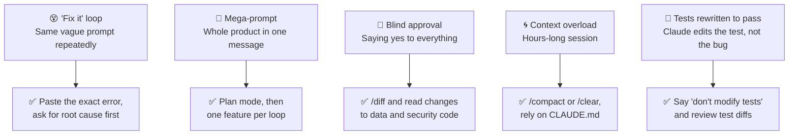

---

## 10. 🧯 Troubleshooting

| Symptom | Likely cause | Fix |
|---|---|---|
| `claude: command not found` | `PATH` not refreshed | Open a new terminal; see the [install troubleshooting guide](https://code.claude.com/docs/en/troubleshoot-install) |
| Install fails in Windows with `'&&' is not a valid statement separator` | You're in PowerShell, not CMD | Use the PowerShell command `irm https://claude.ai/install.ps1 \| iex` |
| Something feels broken | Environment issue | Run `/doctor` inside Claude Code |
| `ModuleNotFoundError: rich` | Virtual env not active | Activate `.venv`, or add the command to `CLAUDE.md` |
| Answers get vague or forgetful | Context window is full | `/context` to inspect, then `/compact` or `/clear` |
| Claude keeps breaking the same rule | Rule isn't written down | Add it to `CLAUDE.md`, or enforce it with a hook |
| Too many permission prompts | Default mode | Pre-approve safe commands with `/permissions`, or use Accept Edits |
| A change went badly wrong | — | `Esc Esc` / `/rewind`, or `git checkout .` |
| Hitting usage limits | Heavy use | Check `/usage`; keep sessions focused and use `/clear` |

---

## 11. 📋 One-Page Cheat Sheet

| Need | Do this |
|---|---|
| Start a session | `claude` (inside your project folder) |
| One-off task from a script | `claude -p "your prompt"` |
| Continue your last session | `claude -c` or `/resume` |
| Create project memory | `/init`, then `/memory` |
| Cycle permission modes | `Shift + Tab` |
| Plan before coding | `/plan <task>` |
| Reference a file | `@path/to/file.py` |
| Run a shell command | `!pytest -q` |
| Interrupt Claude | `Esc` |
| Undo / rewind | `Esc Esc` or `/rewind` |
| See changes | `/diff` |
| Clean up recent changes | `/simplify` |
| Check context usage | `/context` |
| Free up context | `/compact` (mid-task) or `/clear` (new task) |
| Quick side question | `/btw <question>` |
| Switch model | `/model` |
| List commands | `/help`, or press `?` for shortcuts |

**The 5-word summary of vibe coding:** *Explore. Plan. Build. Verify. Commit.*

---

## 12. 📚 References

- Claude Code overview and install: <https://code.claude.com/docs/en/overview>
- Claude Code cheatsheet (Claude Help Center): <https://support.claude.com/en/articles/14553413-claude-code-cheatsheet>
- Claude Code power user tips: <https://support.claude.com/en/articles/14554000-claude-code-power-user-tips>
- Hooks reference: <https://code.claude.com/docs/en/hooks>
- Rich (terminal formatting): <https://rich.readthedocs.io/>
- Python `sqlite3` docs: <https://docs.python.org/3/library/sqlite3.html>
- pytest docs: <https://docs.pytest.org/>

---

<div align="center">

**Made with 🎧 vibes and 🤖 Claude Code · Last updated Sunday, November 8, 2026**

*If this guide helped you, ⭐ star the repo and share your own vibe-coded apps!*

</div>
