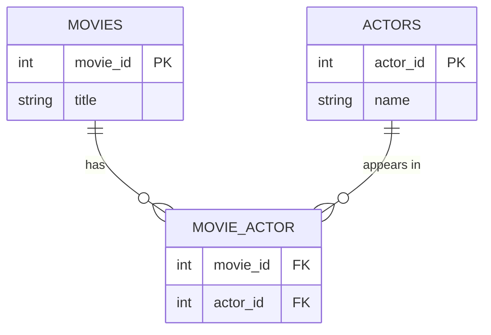

# SQL: Joining More Than Two Tables, and GROUP_CONCAT: My Notes

*Nov 10, 2026 · Saurabh S*

> [!NOTE]
> **Source:** These notes are based on the **SQL Basics: Data Retrieval – Multiple Tables** course, chapter **"Join more than two tables"**, from **[Codebasics.io](https://codebasics.io)**. The audit examples run on SQLite 3.45 through Python's built-in `sqlite3` module. MySQL differences are noted.

## Where I started

So far, every join connected **two** tables. Real questions usually need more: which actors appeared in which movies, or, in my world, **who approved which journal entry, and in what role**. This chapter showed how to chain joins through a **bridge table**, and how `GROUP_CONCAT` collapses many matching rows into one readable line.

## The data in brief

Three tables from the movies database:

- **`movies`:** one row per movie (`movie_id`, `title`, …).
- **`actors`:** one row per actor (`actor_id`, `name`, …).
- **`movie_actor`:** a **bridge table** with just `movie_id` and `actor_id`, one row per actor per movie.

A movie has many actors, and an actor appears in many movies. That's a **many-to-many** relationship, and it's why the bridge table exists: neither `movies` nor `actors` can hold the link on its own.



## What I learnt

**Break the requirement into steps first.** The lecture's advice: before writing anything, ask *which tables hold the pieces?* and *how are they connected?* An **Entity Relationship Diagram (ERD)**, like the one above, answers both.

**Chain the joins through the bridge table:**

```sql
-- every actor's name, listed against each movie
SELECT m.title, GROUP_CONCAT(a.name SEPARATOR ' | ') AS actors
FROM movies m
JOIN movie_actor ma ON m.movie_id = ma.movie_id     -- movie -> bridge
JOIN actors a       ON a.actor_id = ma.actor_id     -- bridge -> actor
GROUP BY m.movie_id;

-- the reverse: every movie an actor appeared in, and how many
SELECT a.name,
       GROUP_CONCAT(m.title SEPARATOR ' | ') AS movies,
       COUNT(m.title) AS num_movies
FROM actors a
JOIN movie_actor ma ON a.actor_id = ma.actor_id
JOIN movies m       ON ma.movie_id = m.movie_id
GROUP BY a.actor_id
ORDER BY num_movies DESC;
```

| Piece | What it does |
| --- | --- |
| Second `JOIN ... ON` | Adds a third table, matched through the bridge |
| `GROUP BY m.movie_id` | One output row per movie |
| `GROUP_CONCAT(x SEPARATOR ' | ')` | Combines the text from every row in the group into one string |
| `COUNT(...)` | Counts the rows in each group, alongside the list |

**Three details worth knowing:**

- **Group by the ID, not the name.** Two different actors can share a name. `GROUP BY a.actor_id` keeps them separate.
- **Syntax differs by database.** MySQL uses `GROUP_CONCAT(x SEPARATOR ' | ')`. SQLite uses `group_concat(x, ' | ')`. PostgreSQL uses `string_agg(x, ' | ')`. In MySQL, `GROUP_CONCAT(x ORDER BY x SEPARATOR ...)` also sorts the list.
- **MySQL quietly truncates long lists.** By default, `GROUP_CONCAT` stops at **1,024 characters** (the `group_concat_max_len` setting) with only a warning. For long lists, raise the limit or count the items separately.

## How this shows up in financial statement audit work

Journal entry approval data is a classic many-to-many structure: an entry can have several approval steps, and a user approves many entries. The **approvals** table is the bridge. These snippets build a small example and follow the lecture's advice to build the query step by step.

```python
import sqlite3

con = sqlite3.connect(":memory:")
con.executescript("""
CREATE TABLE journal_entries (je_id TEXT PRIMARY KEY, amount REAL, preparer_id TEXT);
INSERT INTO journal_entries VALUES ('JE01',  9950,'U01'), ('JE02', 250000,'U02'),
                                   ('JE03', 98000,'U01'), ('JE04',    850,'U03');

CREATE TABLE users (user_id TEXT PRIMARY KEY, user_name TEXT, role TEXT);
INSERT INTO users VALUES ('U01','A. Rao','Accountant'), ('U02','M. Gomez','Controller'),
                         ('U03','J. Lee','Accountant'), ('U04','K. Wong','Finance Manager'),
                         ('U05','D. Smith','CFO');

-- bridge table: one row per approval step
CREATE TABLE approvals (je_id TEXT, approver_id TEXT, step INTEGER);
INSERT INTO approvals VALUES ('JE01','U04',1),
                             ('JE02','U02',1), ('JE02','U05',2),
                             ('JE03','U04',1), ('JE03','U05',2);
""")

def run(sql):
    return con.execute(sql).fetchall()
```

**1. Step by step: who approved each entry?** Step 1 joins entries to the bridge, step 2 adds the users, and step 3 groups and concatenates:

```python
for row in run("""
SELECT j.je_id, j.amount,
       group_concat(u.user_name || ' (' || u.role || ')', ' | ') AS approvers,
       COUNT(a.approver_id) AS approval_steps
FROM journal_entries j
LEFT JOIN approvals a ON j.je_id = a.je_id          -- LEFT keeps entries with no approval at all
LEFT JOIN users u     ON a.approver_id = u.user_id
GROUP BY j.je_id
ORDER BY j.amount DESC"""):
    print(row)
# ('JE02', 250000.0, 'M. Gomez (Controller) | D. Smith (CFO)', 2)
# ('JE03', 98000.0, 'K. Wong (Finance Manager) | D. Smith (CFO)', 2)
# ('JE01', 9950.0, 'K. Wong (Finance Manager)', 1)
# ('JE04', 850.0, None, 0)                       <- no approval recorded
```

The lecture used inner joins. Here, `LEFT JOIN` keeps JE04, which an inner join would have silently dropped, and that missing approval is the finding.

**2. Segregation of duties: did anyone approve their own entry?** Joining the **users table twice**, once as preparer and once as approver, compares the two:

```python
print(run("""
SELECT j.je_id, j.amount, p.user_name AS preparer, ap.user_name AS approver
FROM journal_entries j
JOIN users p      ON j.preparer_id = p.user_id         -- users, in the role of preparer
JOIN approvals a  ON j.je_id = a.je_id
JOIN users ap     ON a.approver_id = ap.user_id        -- users again, in the role of approver
WHERE j.preparer_id = a.approver_id"""))
# [('JE02', 250000.0, 'M. Gomez', 'M. Gomez')]: the largest entry was self-approved at step 1
```

Using the same table twice under different aliases (`p` and `ap`) is a common pattern, and only possible because aliases tell SQL which copy is which.

**3. The reverse view: each approver's workload,** as with the lecture's movies per actor:

```python
for row in run("""
SELECT u.user_name, u.role,
       group_concat(a.je_id, ', ') AS entries_approved,
       COUNT(a.je_id) AS num_approved,
       SUM(j.amount) AS value_approved
FROM users u
JOIN approvals a        ON u.user_id = a.approver_id
JOIN journal_entries j  ON a.je_id = j.je_id
GROUP BY u.user_id
ORDER BY value_approved DESC"""):
    print(row)
# ('D. Smith', 'CFO', 'JE02, JE03', 2, 348000.0)
# ('M. Gomez', 'Controller', 'JE02', 1, 250000.0)
# ('K. Wong', 'Finance Manager', 'JE01, JE03', 2, 107950.0)
```

## My reflection

The lecture's advice to **break the requirement down first** proved its worth here. "Who approved each entry?" sounds like one question, but it's really three: which entries, which approval steps, and which people. Drawing the ERD made the joins obvious, and the bridge table is exactly how ERP systems store approval workflows.

The audit extensions came naturally from that structure. A `LEFT JOIN` exposed an entry with **no approval**, and joining the users table **twice** found a self-approved 250,000 entry. Neither would show up in a flat export that lists only one approver per line. The detail I'll remember for real engagements is MySQL's **1,024-character limit** on `GROUP_CONCAT`: a long list of approvers or invoices can be cut off with only a warning.
