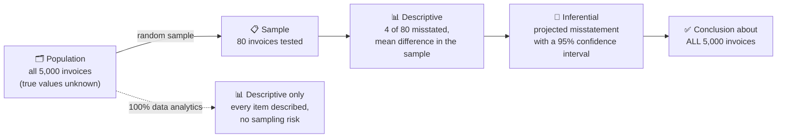
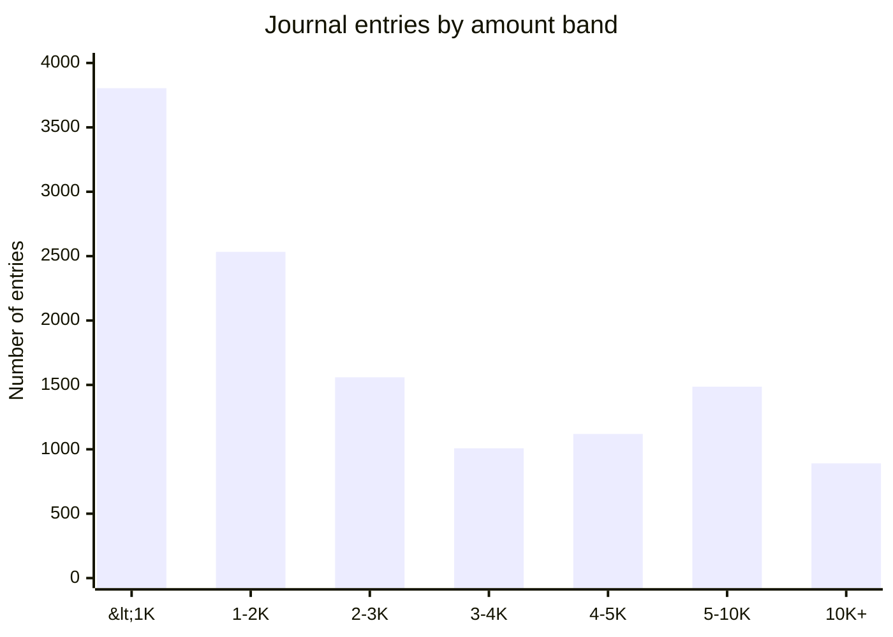
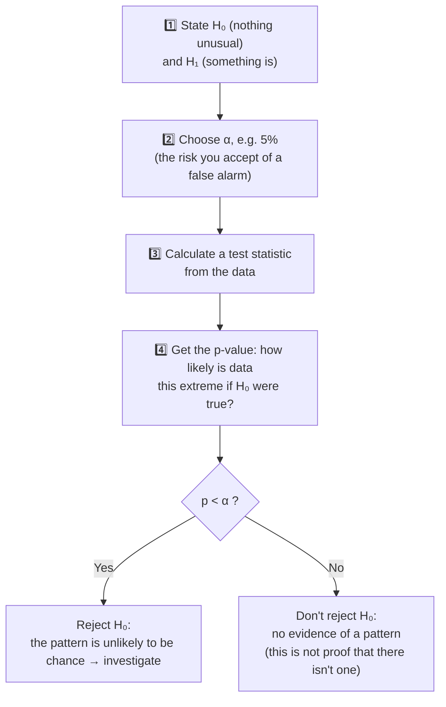
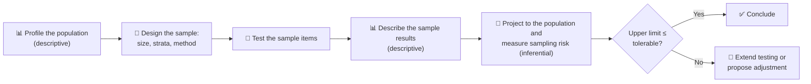
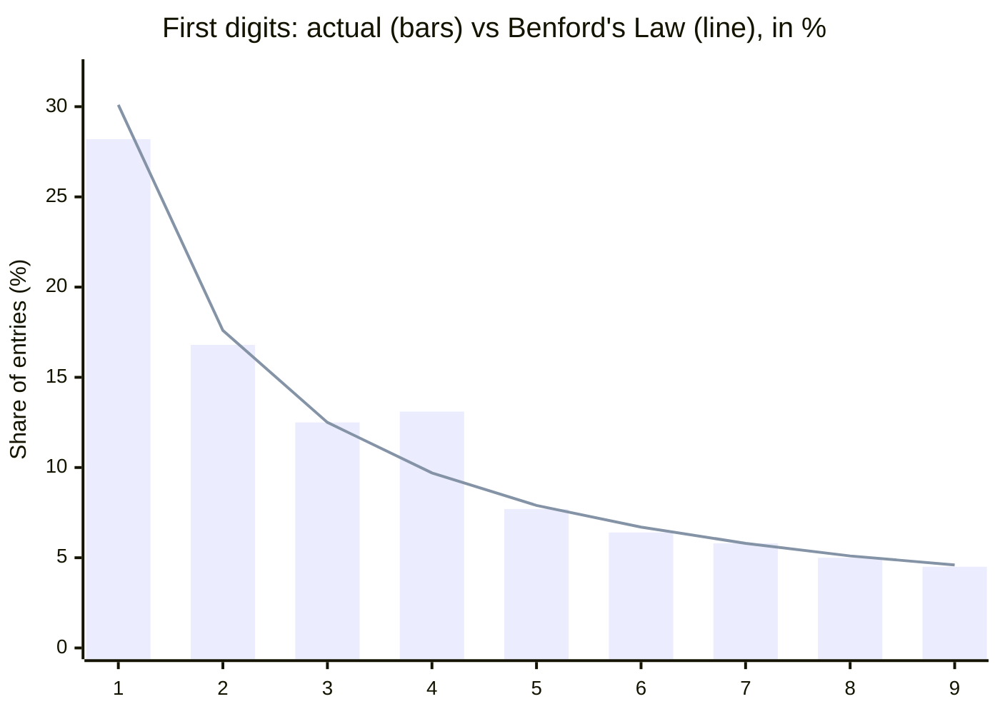

<div align="center">

# 📊 Descriptive vs Inferential Statistics
### …and how they power financial statement audits

*Nov 12, 2026 · Saurabh S*

</div>

> [!NOTE]
> **Sources:** Definitions come from open statistics textbooks: [*Introductory Statistics* (Saylor Academy)](https://saylordotorg.github.io/text_introductory-statistics/s05-01-basic-definitions-and-concepts.html) and [*Introduction to Statistics* (MacEwan University)](https://openbooks.macewan.ca/introstats/chapter/1-1-what-is-statistics/). Audit sampling concepts come from [ISA (UK) 530 *Audit Sampling* (FRC)](https://www.frc.org.uk/docs/106/html) and [PCAOB AS 2315 *Audit Sampling*](https://pcaobus.org/oversight/standards/auditing-standards/details/AS2315). The Benford's Law material draws on Mark Nigrini's articles in the [*Journal of Accountancy*](https://www.journalofaccountancy.com/issues/2022/sep/using-benfords-law-reveal-journal-entry-irregularities.html). The full list is in [Sources](#sources). All code was run on Python 3.12, pandas 3.0 and SciPy 1.18, using simulated audit data.

## Contents

1. [The big picture](#1-the-big-picture)
2. [Side-by-side comparison](#2-side-by-side-comparison)
3. [Descriptive statistics: describing what you have](#3-descriptive-statistics-describing-what-you-have)
4. [Inferential statistics: concluding about what you haven't seen](#4-inferential-statistics-concluding-about-what-you-havent-seen)
5. [Both at work in a financial statement audit](#5-both-at-work-in-a-financial-statement-audit)
6. [Common pitfalls](#6-common-pitfalls)
7. [Interview key takeaways](#7-interview-key-takeaways)
8. [Sources](#sources)

---

## 1. The big picture

Statistics has two branches:

- **Descriptive statistics** organises, displays and describes data.
- **Inferential statistics** draws conclusions about a population from the information in a sample taken from it.

The relationship between a **population** and a **sample** drawn from it underpins everything else.



**The same number can play either role.** Computing a single average to summarise data is descriptive. Using that average to make a statement about the wider population is inferential. The difference lies in **what you claim**, not in the calculation.

| Term | Belongs to | Notation | Audit example |
| --- | --- | --- | --- |
| **Parameter** | The population (usually unknown) | μ (mean), σ (std dev), p (proportion) | The true error in all 5,000 invoices |
| **Statistic** | The sample (calculated) | x̄, s, p̂ | The average error in the 80 invoices tested |

---

## 2. Side-by-side comparison

| | 📊 Descriptive | 🔮 Inferential |
| --- | --- | --- |
| **Question** | What does this data look like? | What can I conclude beyond this data? |
| **Works on** | The data in hand (a sample or a full population) | A **sample**, to say something about the **population** |
| **Outputs** | Counts, totals, means, medians, spread, charts | Estimates, confidence intervals, p-values, predictions |
| **Uncertainty** | None about the data described | Always present, and **quantified** |
| **Typical tools** | `describe()`, histograms, box plots, pivot tables | t-tests, chi-square tests, confidence intervals, regression |
| **Audit example** | "12,400 journal entries totalling 46.3M, with a median of 1,934" | "Projected misstatement of 115K, with 95% confidence it's below 254K" |
| **Audit standard link** | Analytical procedures, population profiling | ISA 530 / AS 2315 statistical sampling |

---

## 3. Descriptive statistics: describing what you have

Descriptive statistics covers numerical and graphical methods for organising and summarising data. It focuses only on the data itself and doesn't generalise beyond it.

| Family | Measures | What it tells an auditor |
| --- | --- | --- |
| **Central tendency** | Mean, median, mode | The "typical" entry |
| **Dispersion** | Range, variance, standard deviation, IQR | How spread out the amounts are |
| **Shape** | Skewness, kurtosis | Whether a few large items dominate |
| **Position** | Percentiles, quartiles, z-scores | Where an item sits relative to the rest, and whether it's an outlier |
| **Frequency** | Counts, histograms, value counts | Where entries cluster |

### Example: profiling a journal entry population

The setup creates 12,400 simulated journal entries: right-skewed amounts, plus **400 manual entries kept just below a 5,000 testing threshold**, the kind of pattern behind the HealthSouth fraud described in the *Journal of Accountancy* article cited above.

```python
import numpy as np
import pandas as pd
from scipy import stats

rng = np.random.default_rng(2026)

# a full-year journal entry population: right-skewed amounts, like real ledgers
je = pd.DataFrame({
    "je_id": [f"JE{i:05d}" for i in range(12_000)],
    "amount": rng.lognormal(mean=7.5, sigma=1.2, size=12_000).round(2),
    "source": rng.choice(["Automated", "Manual"], 12_000, p=[0.85, 0.15]),
})
# planted pattern: 400 manual entries kept just below a 5,000 testing threshold
planted = pd.DataFrame({
    "je_id": [f"JX{i:05d}" for i in range(400)],
    "amount": rng.uniform(4_500, 4_999, 400).round(2),
    "source": "Manual",
})
je = pd.concat([je, planted], ignore_index=True)
print(len(je))
```

```python
amt = je["amount"]
summary = {
    "count": len(amt),
    "total": round(amt.sum()),
    "mean": round(amt.mean()),
    "median": round(amt.median()),
    "std_dev": round(amt.std()),
    "skewness": float(round(amt.skew(), 2)),
    "q1": round(amt.quantile(0.25)),
    "q3": round(amt.quantile(0.75)),
}
print(summary)

q1, q3 = amt.quantile([0.25, 0.75])
upper_fence = q3 + 1.5 * (q3 - q1)
print(f"IQR upper fence: {upper_fence:,.0f} | entries above it: {(amt > upper_fence).sum():,}")

bands = pd.cut(amt, bins=[0, 1_000, 2_000, 3_000, 4_000, 5_000, 10_000, np.inf],
               labels=["<1K", "1-2K", "2-3K", "3-4K", "4-5K", "5-10K", "10K+"])
print(bands.value_counts(sort=False).to_dict())
```

**Results:**

| Measure | Value | Reading |
| --- | --- | --- |
| Count / total | 12,400 / 46.3M | Agree these to the trial balance first: a completeness check |
| Mean vs median | **3,733 vs 1,934** | The mean is almost double the median, so a few large entries pull it up |
| Skewness | 7.55 | Strongly right-skewed, as financial amounts usually are |
| IQR upper fence | 10,056 | 884 entries sit above it, which makes them candidate outliers for review |



> [!TIP]
> **The descriptive red flag:** counts *fall* steadily from band to band, then **rise** in the 4–5K band (1,119 vs 1,008). That bump, just below the testing threshold, is the planted pattern. Descriptive statistics **spot** it, and inferential statistics (section 5) **test** whether it could be chance.

---

## 4. Inferential statistics: concluding about what you haven't seen

Inferential statistics makes estimates, decisions, predictions and other generalisations about a population. Its main tools:

| Tool | Answers | Audit use |
| --- | --- | --- |
| **Point estimate** | "What's our best single guess?" | Projected misstatement |
| **Confidence interval** | "Within what range is the true value likely to lie?" | Upper misstatement limit vs tolerable misstatement |
| **Hypothesis test** | "Is this pattern real, or chance?" | Benford's Law, comparing manual and automated entries |
| **Regression** | "What value should we expect?" | Predicting payroll from headcount in substantive analytics |

### How a hypothesis test works



### The two errors, in audit language

PCAOB AS 2315 describes two sampling risks in substantive testing: **incorrect acceptance** (concluding a balance isn't materially misstated when it is) and **incorrect rejection** (concluding it is misstated when it isn't). These correspond directly to the two classic statistical errors:

| | Balance actually **fine** | Balance actually **materially misstated** |
| --- | --- | --- |
| **Sample says "fine"** | ✅ Correct | ❌ **Type II error = risk of incorrect acceptance.** Affects audit **effectiveness**, which is the dangerous one |
| **Sample says "misstated"** | ❌ **Type I error = risk of incorrect rejection.** Affects audit **efficiency**: extra work, but the right answer in the end | ✅ Correct |

AS 2315 also notes that, for a sample of a given design, the smaller the sample, the greater the sampling risk.

---

## 5. Both at work in a financial statement audit

ISA 530 defines **statistical sampling** by two features: random selection of the sample items, **and** the use of probability theory to evaluate the results, including measuring sampling risk. Without both, the sampling is non-statistical. The two features map neatly onto the two branches of statistics: the **evaluation** step is where inference happens.



### 5.1 Tests of details: projecting misstatement with a confidence interval

ISA 530 requires the auditor to **project** misstatements found in a sample to the population. Here, 80 of 5,000 invoices are tested and the result is projected, with a 95% confidence interval:

```python
# Population: 5,000 sales invoices with a recorded total. The auditor tests a random sample of 80.
invoices = pd.DataFrame({"recorded": rng.lognormal(7.8, 0.9, 5_000).round(2)})
invoices["audited"] = invoices["recorded"]
errors = rng.choice(len(invoices), 250, replace=False)                 # 5% of invoices overstated
invoices.loc[errors, "audited"] = (invoices.loc[errors, "recorded"] * rng.uniform(0.7, 0.98, 250)).round(2)
invoices["difference"] = invoices["recorded"] - invoices["audited"]     # overstatement

N, n = len(invoices), 80
sample = invoices.sample(n, random_state=7)
mean_diff = sample["difference"].mean()
se = sample["difference"].std(ddof=1) / np.sqrt(n) * np.sqrt(1 - n / N)  # finite population correction
t = stats.t.ppf(0.975, df=n - 1)

projected = N * mean_diff
low, high = N * (mean_diff - t * se), N * (mean_diff + t * se)
print(f"misstatements found in sample: {(sample['difference'] > 0).sum()} of {n}")
print(f"projected overstatement: {projected:,.0f}  (95% CI {low:,.0f} to {high:,.0f})")
print(f"actual overstatement in the population: {invoices['difference'].sum():,.0f}")
```

| | Value |
| --- | --- |
| Misstatements found (**descriptive**) | 4 of 80 invoices |
| Projected overstatement (**inferential**, point estimate) | 114,745 |
| 95% confidence interval (**inferential**) | −24,444 to **253,934** |
| True overstatement (known only because the data is simulated) | 157,258 |

**Reading it:** if tolerable misstatement were 200,000, the point estimate (115K) looks comfortable, but the **upper bound (254K) exceeds it**. So the auditor *can't* conclude the balance is fairly stated without more testing. A descriptive summary alone would have missed that risk.

> [!NOTE]
> The negative lower bound shows a known weakness of this classical (normal-approximation) method when few errors are found. That's one reason audit practice often prefers **monetary unit sampling (MUS)**, which is designed for populations with low error rates.

### 5.2 Tests of controls: attribute sampling

60 approvals are tested and 2 lack evidence of review. Is the control reliable, when the tolerable deviation rate is 10%?

```python
# Test of controls: 60 approvals sampled, 2 deviations found. Tolerable deviation rate: 10%.
n_ctrl, deviations, tolerable = 60, 2, 0.10
sample_rate = deviations / n_ctrl
upper_limit = stats.beta.ppf(0.95, deviations + 1, n_ctrl - deviations)   # one-sided 95% upper bound
print(f"sample deviation rate: {sample_rate:.1%} | 95% upper limit: {upper_limit:.1%}")
print("control can be relied on" if upper_limit <= tolerable else "control cannot be relied on")
```

| | Value |
| --- | --- |
| Sample deviation rate (**descriptive**) | 3.3%, which looks fine |
| 95% upper deviation limit (**inferential**) | **10.1%**, which is above the 10% tolerable rate |
| Conclusion | The control **can't** be relied on at this sample size |

This is the clearest example in the whole document of why inference matters: **3.3% describes the sample, but 10.1% is what the evidence supports about the population.**

### 5.3 Fraud analytics: Benford's Law as a hypothesis test

Benford's Law gives the expected proportions of first digits in naturally occurring numbers. Auditors use deviations from it to find irregularities, including large numbers of fictitious entries kept **below the testing threshold**. A **chi-square goodness-of-fit test** turns the visual comparison into a formal test:

```python
first_digit = je["amount"].astype(str).str.lstrip("0.").str[0].astype(int)
observed = first_digit.value_counts().reindex(range(1, 10), fill_value=0)
expected_share = np.log10(1 + 1 / np.arange(1, 10))
expected = expected_share * observed.sum()

chi2, p_value = stats.chisquare(observed, expected)
print(f"chi-square = {chi2:.1f}, p-value = {p_value:.2g}")
comparison = pd.DataFrame({"actual_%": (observed / observed.sum() * 100).round(1),
                           "benford_%": (expected_share * 100).round(1)})
print(comparison.T.to_string())
```



**Result:** χ² = 174.7 and p ≈ 1.3 × 10⁻³³, so the digit pattern is very unlikely to be chance. **Digit 4 is over-represented** (13.1% vs 9.7% expected), which points straight at the entries just below 5,000.

> [!WARNING]
> With 12,400 entries, even **tiny** deviations become "statistically significant". Nigrini's work uses measures such as the **mean absolute deviation (MAD)** alongside chi-square for exactly this reason. Statistical significance isn't the same as **audit significance**: always weigh the result against materiality.

### 5.4 Comparing two groups

Are manual entries systematically larger than automated ones? Amounts are skewed, so a **non-parametric** test (Mann-Whitney U) is safer than a t-test:

```python
manual = je.loc[je["source"] == "Manual", "amount"]
automated = je.loc[je["source"] == "Automated", "amount"]
stat, p = stats.mannwhitneyu(manual, automated, alternative="greater")
print(f"median manual {manual.median():,.0f} vs automated {automated.median():,.0f} | p-value = {p:.2g}")
```

The median manual entry is 2,603 against 1,836 for automated entries, and the p-value is about 4 × 10⁻¹⁵, so manual entries are **significantly larger**. That supports focusing testing on manual entries.

### 5.5 Where each branch fits in the audit

| Audit activity | Mostly descriptive | Mostly inferential |
| --- | --- | --- |
| Agreeing population counts and totals to the trial balance | ✅ | |
| Flux and trend analysis | ✅ | |
| Stratifying and profiling a population | ✅ | |
| Testing **100% of a population** with data analytics | ✅ (no sampling risk) | |
| Statistical sampling: tests of details | | ✅ projection and confidence intervals |
| Attribute sampling: tests of controls | | ✅ upper deviation limit |
| Benford's Law and anomaly significance | Charts | ✅ chi-square, z-tests |
| Regression-based substantive analytics | | ✅ prediction intervals |

> [!TIP]
> **100% testing changes the picture.** ISA 500 lists **selecting all items** as an alternative to sampling. When analytics cover every item, there's no sampling risk, but **non-sampling risk** remains: AS 2315 notes that an auditor can apply a procedure to every item and still fail to detect a misstatement.

---

## 6. Common pitfalls

| Pitfall | Why it matters in audit | Better practice |
| --- | --- | --- |
| Reporting the **mean** of skewed amounts | The mean (3,733) overstates the typical entry (median 1,934) | Report the median and IQR alongside the mean |
| Treating sample rates as population rates | 3.3% in the sample, but up to 10.1% in the population | Always state the **upper limit** |
| A **non-random** (haphazard) sample used for projection | The results can't be generalised statistically | Use random, systematic or MUS selection when you need to project |
| Sampling from the **wrong population** | Sampling recorded receivables can't reveal **unrecorded** ones | Sample from a source that contains the omitted items (AS 2315) |
| "p < 0.05, so it's fraud" | A p-value measures surprise, not intent or materiality | Investigate the cause, and weigh it against materiality |
| "p > 0.05, so everything's fine" | No evidence of a pattern isn't evidence of no pattern | Consider sample size and power |
| Running many tests on the same data | Some will flag **by chance** | Adjust for multiple tests, or confirm with follow-up work |

---

## 7. Interview key takeaways

### 🎯 The ten points to remember

1. **Descriptive statistics summarises the data you have. Inferential statistics generalises from a sample to a population, with quantified uncertainty.**
2. **Parameter vs statistic:** parameters describe populations (μ, σ) and are usually unknown. Statistics describe samples (x̄, s) and are calculated.
3. **The same calculation can be either.** A mean is descriptive when it summarises, and inferential when it estimates a population value.
4. **Random sampling is what makes inference valid.** A biased sample gives precise but wrong answers.
5. **Standard deviation vs standard error:** the SD describes the spread of the data. The **SE = s/√n** describes the uncertainty in the estimate, and it shrinks as the sample grows.
6. **The Central Limit Theorem:** sample means are approximately normally distributed for large samples, even when the data (like financial amounts) is skewed. That's why confidence intervals for means work.
7. **A 95% confidence interval** means that if we repeated the sampling many times, about 95% of the intervals would contain the true value. It does **not** mean there's a 95% chance that this particular interval contains it.
8. **A p-value** is the probability of results at least this extreme **if the null hypothesis were true**. It isn't the probability that H₀ is true.
9. **Type I error = a false positive (α). Type II error = a false negative (β).** Know which costs more in context: in audit, a **Type II** error (missing a material misstatement) is the costly one.
10. **Statistical significance isn't practical significance.** With big data, everything is "significant", so weigh results against effect size or **materiality**.

### 💬 Quick-fire interview questions

| Question | Strong answer |
| --- | --- |
| Is a dashboard KPI descriptive or inferential? | Descriptive: it summarises observed data, unless it's used to forecast or generalise |
| Why use the median for transaction amounts? | Amounts are right-skewed, and the median resists outliers |
| What drives sample size? | Confidence level, tolerable error, expected error and population variability |
| Can you do inference on 100% of the data? | Analysing the full population describes it exactly, with no sampling error. Inference returns when predicting the **future** or testing whether a pattern is **unusual** |
| When would you choose a non-parametric test? | When the data is skewed or ordinal, or the samples are small, so normality can't be assumed |
| How would you test whether journal entry amounts are manipulated? | Profile them descriptively, then apply a Benford first-digit or first-two-digits test with chi-square and MAD, then drill into the spikes |

---

## Sources

**Statistics fundamentals**

- Saylor Academy, [*Introductory Statistics*, §1.1 Basic Definitions and Concepts](https://saylordotorg.github.io/text_introductory-statistics/s05-01-basic-definitions-and-concepts.html): definitions of descriptive and inferential statistics, population and sample
- MacEwan University, [*Introduction to Statistics*, §1.1 What is Statistics?](https://openbooks.macewan.ca/introstats/chapter/1-1-what-is-statistics/): the scope of each branch

**Auditing standards**

- Financial Reporting Council, [ISA (UK) 530 *Audit Sampling*](https://www.frc.org.uk/docs/106/html): the definition of statistical sampling and the requirement to project misstatements. ISA (UK) 530 is based on the IAASB's ISA 530
- PCAOB, [AS 2315 *Audit Sampling*](https://pcaobus.org/oversight/standards/auditing-standards/details/AS2315): sampling risk, incorrect acceptance and rejection, and non-sampling risk

**Benford's Law in audit**

- M. Nigrini, ["Using Benford's Law to reveal journal entry irregularities"](https://www.journalofaccountancy.com/issues/2022/sep/using-benfords-law-reveal-journal-entry-irregularities.html), *Journal of Accountancy*, Sept 2022
- M. Nigrini, ["I've Got Your Number"](https://www.journalofaccountancy.com/issues/1999/may/nigrini.html), *Journal of Accountancy*, May 1999

**Verification:** every code example was run in order on Python 3.12 with pandas 3.0, NumPy 2.5 and SciPy 1.18. All figures in the tables and charts are the actual outputs on simulated data.
