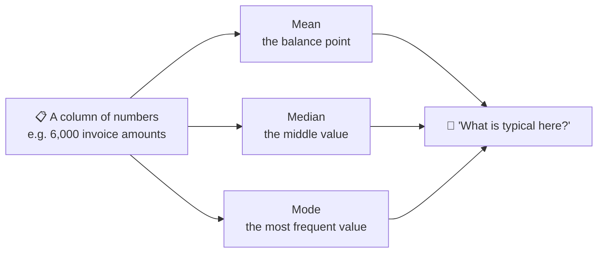
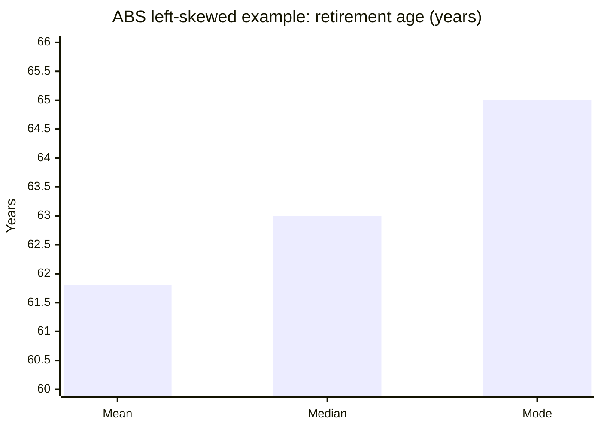
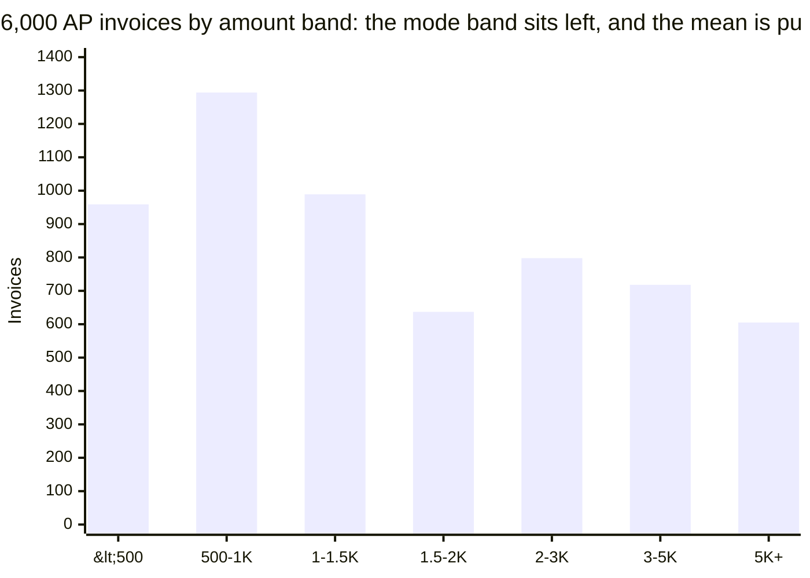
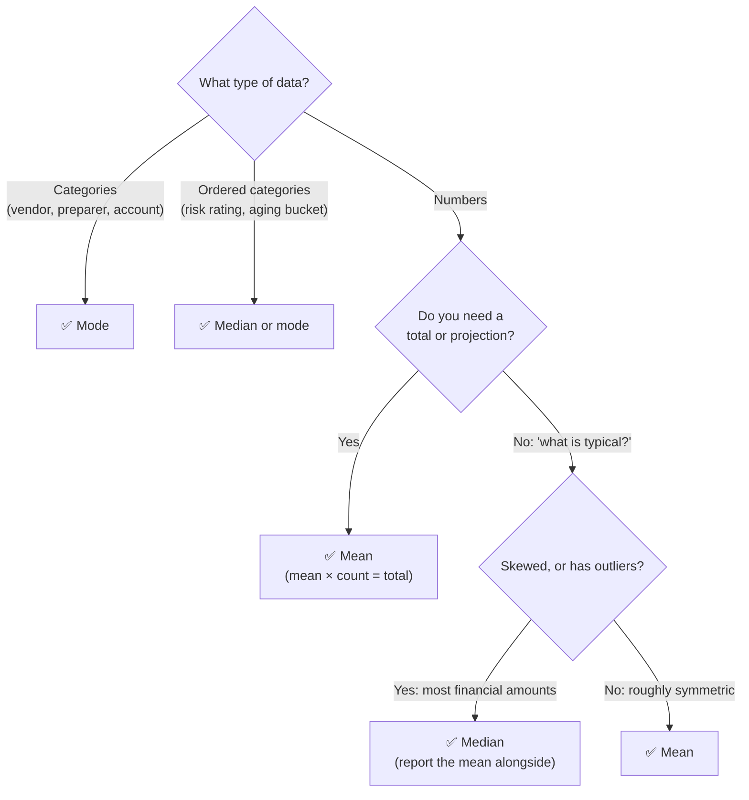
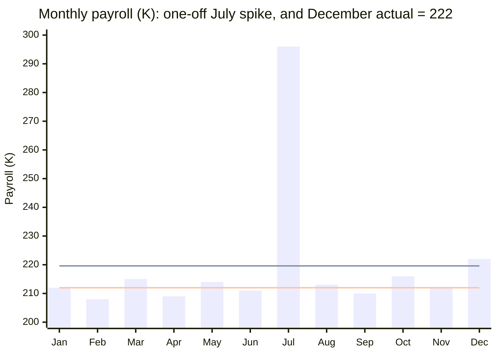

<div align="center">

# 🎯 Measures of Central Tendency: Mean, Median and Mode
### …and how auditors use them on financial data

*Nov 12, 2026 · Saurabh S*

</div>

> [!NOTE]
> **Sources:** Definitions and the skewness examples come from the [Australian Bureau of Statistics (ABS)](https://www.abs.gov.au/statistics/understanding-statistics/statistical-terms-and-concepts/measures-central-tendency). The audit applications draw on [ISA (UK) 520 *Analytical Procedures* (FRC)](https://www.frc.org.uk/docs/2453/html), [ACCA's technical article on analytical procedures](https://www.accaglobal.com/gb/en/student/acca-qual-student-journey/qual-resource/acca-qualification/p7/technical-articles/analytical-procedures.html) and [KPMG's IAS 2 inventory comparison](https://kpmg.com/us/en/articles/2026/inventory-accounting-ifrs-accounting-standards-vs-us-gaap.html). The full list is in [Sources](#sources). All code was run on Python 3.12, pandas 3.0 and SciPy 1.18, using simulated audit data.

## Contents

1. [What central tendency means](#1-what-central-tendency-means)
2. [The three measures](#2-the-three-measures)
3. [How skewness separates them](#3-how-skewness-separates-them)
4. [Choosing the right measure](#4-choosing-the-right-measure)
5. [Central tendency in financial statement audit](#5-central-tendency-in-financial-statement-audit)
6. [Beyond the big three: weighted, trimmed and robust](#6-beyond-the-big-three-weighted-trimmed-and-robust)
7. [Common pitfalls](#7-common-pitfalls)
8. [Interview key takeaways](#8-interview-key-takeaways)
9. [Sources](#sources)

---

## 1. What central tendency means

The ABS defines a measure of central tendency as a summary measure that describes a whole set of data with **a single value** representing the middle or centre of its distribution. There are three main measures: the **mode**, the **median** and the **mean**. Each gives a different indication of the typical value.



---

## 2. The three measures

| Measure | How to calculate it | Uses every value? | Affected by outliers? | Works for categories? |
| --- | --- | --- | --- | --- |
| **Mean** | Sum ÷ count | ✅ Yes | ⚠️ **Strongly** | ❌ |
| **Median** | The middle value once sorted (the average of the two middle values if the count is even) | ❌ Only their order | ✅ Barely | ❌ (only for ordered categories) |
| **Mode** | The most frequent value | ❌ | ✅ No | ✅ **The only one that does** |

The ABS points out that the mode is the one measure that works for both numeric and categorical data, and that the median is less affected by outliers and skew than the mean.

### Worked example: ten expense claims, one of them unusual

```python
import pandas as pd

claims = pd.Series([120, 95, 140, 110, 95, 130, 95, 105, 125, 2_400],
                   index=[f"EC{i:02d}" for i in range(1, 11)], name="amount")

print("mean  :", claims.mean())               # pulled up by the 2,400 claim
print("median:", claims.median())
print("mode  :", claims.mode().tolist())

without_outlier = claims.drop("EC10")
print("without EC10 -> mean", round(without_outlier.mean(), 1), "| median", without_outlier.median())
```

| | All 10 claims | Without EC10 (2,400) |
| --- | --- | --- |
| **Mean** | **341.5** | 112.8 |
| **Median** | 115.0 | 110.0 |
| **Mode** | 95 | 95 |

**One claim tripled the mean**, while the median barely moved. This is the single most important behaviour to understand.

### But the mean is the only one that ties to the total

```python
print(claims.mean() * claims.count() == claims.sum())    # True: mean × count = total
print(claims.median() * claims.count(), "vs actual total", claims.sum())
```

Mean × count **always** equals the total (341.5 × 10 = 3,415). The median × count (1,150) doesn't. That's why the **mean** is the right measure when the question is about **totals**: projecting misstatements, mean-per-unit estimation, budgets. The **median** is right when the question is "what's **typical**?"

---

## 3. How skewness separates them

In a **symmetric** distribution, all three measures sit in the middle. In a **skewed** distribution, the mode stays at the most common value and the median at the middle, but the mean is **pulled towards the tail**.

| Shape | Typical order | ABS retirement-age example |
| --- | --- | --- |
| Symmetric | Mean = median = mode | All three = **58** years |
| **Right (positive) skew**: a long tail of high values | Mode < median < mean | Typical of **financial amounts** |
| Left (negative) skew: a long tail of low values | Mean < median < mode | Mean **61.8**, median **63**, mode **65** |



### Financial data is almost always right-skewed

Transaction amounts have many small values and a few very large ones. Here's a simulated set of 6,000 accounts payable invoices:

```python
import numpy as np

rng = np.random.default_rng(12)
ap = pd.DataFrame({
    "invoice_id": [f"INV{i:05d}" for i in range(6_000)],
    "vendor": rng.choice([f"V{i:03d}" for i in range(60)], 6_000),
    "amount": rng.lognormal(7.2, 1.0, 6_000).round(2),
})
# planted: a vendor billed the same round amount repeatedly
ap.loc[rng.choice(6_000, 45, replace=False), ["vendor", "amount"]] = ["V999", 4_750.00]
# planted: one vendor's invoice far above its usual level
v017 = ap.index[ap["vendor"] == "V017"][0]
ap.loc[v017, "amount"] = 58_000.00
```

```python
amt = ap["amount"]
print(f"mean {amt.mean():,.0f} | median {amt.median():,.0f} | skewness {amt.skew():.1f}")

bands = pd.cut(amt, bins=[0, 500, 1_000, 1_500, 2_000, 3_000, 5_000, np.inf],
               labels=["<500", "500-1K", "1-1.5K", "1.5-2K", "2-3K", "3-5K", "5K+"])
counts = bands.value_counts(sort=False)
print(counts.to_dict())
print("modal band:", counts.idxmax())
```



| Measure | Value | Where it sits |
| --- | --- | --- |
| **Mode** (modal band) | **500–1K** | The peak of the histogram |
| **Median** | **1,361** | Half the invoices are below this |
| **Mean** | **2,295** | Pulled right by the long tail (skewness 5.2) |

> [!TIP]
> **The gap between the mean and median is a quick skewness check.** Here the mean is 69% above the median, which is a clear signal that the "average invoice" is not a typical one.

---

## 4. Choosing the right measure



---

## 5. Central tendency in financial statement audit

### 5.1 The mode: finding repeated amounts

On continuous amounts, an **exact** value that repeats many times is unusual. It can point to duplicate billing, round-sum fraud or a recurring entry. `value_counts()` reveals the mode immediately:

```python
top_amounts = amt.value_counts().head(3)
print(top_amounts.to_dict())

repeat = ap[ap["amount"] == top_amounts.index[0]]
print(repeat["vendor"].value_counts().to_dict())      # who is billing this exact amount?
```

**Result:** 4,750.00 appears **45 times**, against at most 2 for any other amount, and **every one** comes from vendor **V999**. On categorical fields, the mode answers questions like "who posts the most manual entries?" or "which account is used most?"

### 5.2 The median per group: spotting unusual invoices

A single overall threshold misses context: a 5,000 invoice is normal for one vendor and extreme for another. Comparing each invoice with **its own vendor's median** (robust to that vendor's outliers) finds the true anomalies:

```python
vendor_median = ap.groupby("vendor")["amount"].transform("median")
ap["times_vendor_median"] = (ap["amount"] / vendor_median).round(1)
flags = ap[ap["times_vendor_median"] >= 10].sort_values("times_vendor_median", ascending=False)
print(flags[["invoice_id", "vendor", "amount", "times_vendor_median"]].head(3).to_string(index=False))
```

**Result:** invoice INV00030 from V017 is **44 times** that vendor's median invoice, which makes it a clear selection for testing. Using each vendor's *mean* instead would let a single large invoice inflate its own benchmark.

### 5.3 The median as a robust expectation in analytical procedures

ISA 520 requires the auditor to develop an expectation of recorded amounts and decide in advance how large a difference is acceptable **without further investigation**. ACCA calls developing an appropriately precise expectation the most important step in substantive analytical procedures. The choice of central tendency directly shapes that expectation:

```python
months = pd.Series([212, 208, 215, 209, 214, 211, 296, 213, 210, 216, 212],
                   index=pd.period_range("2026-01", periods=11, freq="M"), name="payroll_k")
expect_mean, expect_median = months.mean(), months.median()
december_actual, threshold = 222, 8

for label, expectation in [("mean", expect_mean), ("median", expect_median)]:
    diff = december_actual - expectation
    verdict = "investigate" if abs(diff) > threshold else "within threshold"
    print(f"{label:6}: expectation {expectation:.1f}K | difference {diff:+.1f}K -> {verdict}")
```



*The upper line is the mean of January to November (219.6K) and the lower line is the median (212K).*

| Expectation for December | Difference from 222K | With an 8K threshold |
| --- | --- | --- |
| **Mean** of Jan–Nov: 219.6K | +2.4K | ✅ "Within threshold": the July one-off **masks** the increase |
| **Median** of Jan–Nov: 212.0K | +10.0K | ⚠️ **Investigate**: a genuine 10K rise is caught |

A single one-off month (July's bonus run, say) inflated the mean expectation and would have hidden December's increase. The median-based expectation caught it.

### 5.4 The weighted mean: inventory under IAS 2

IAS 2 allows inventory cost to be assigned using **FIFO** or the **weighted average cost** formula. Under weighted average cost, each item's cost comes from the weighted average of similar items at the start of the period and those purchased during it. The weighting matters:

```python
purchases = pd.DataFrame({
    "date": ["01-Jan", "15-Jan", "28-Jan"],
    "units": [1_000, 200, 4_000],
    "unit_cost": [10.00, 14.00, 11.50],
})
simple_avg = purchases["unit_cost"].mean()
weighted_avg = (purchases["units"] * purchases["unit_cost"]).sum() / purchases["units"].sum()
print(f"simple average {simple_avg:.2f} | weighted average {weighted_avg:.4f}")

closing_units = 1_500
print(f"closing inventory: simple {closing_units * simple_avg:,.2f} vs weighted {closing_units * weighted_avg:,.2f}")
```

| | Unit cost | Closing inventory (1,500 units) |
| --- | --- | --- |
| Simple average of prices (incorrect) | 11.83 | 17,750.00 |
| **Weighted average** (IAS 2) | **11.31** | **16,961.54** |
| **Overstatement if unweighted** | | **788.46** |

The simple average gives the small, expensive January purchase (200 units at 14.00) the same influence as the 4,000-unit purchase. Re-performing the client's weighted average calculation is a standard inventory valuation test.

### 5.5 Where each measure fits in the audit

| Audit task | Measure | Why |
| --- | --- | --- |
| Projecting sample misstatements to the population | **Mean** | Mean × count = total |
| Weighted average inventory cost | **Weighted mean** | Required by the IAS 2 cost formula |
| A "typical" transaction size for scoping | **Median** | Amounts are skewed |
| Expectations for analytical procedures | **Median** (or mean excluding one-offs) | Resistant to one-off months |
| Vendor, employee or account benchmarks | **Group median** | Context-specific and robust |
| Repeated amounts, most active user, most-used account | **Mode** | The only measure for frequency and categories |

---

## 6. Beyond the big three: weighted, trimmed and robust

| Measure | Idea | Audit use |
| --- | --- | --- |
| **Weighted mean** | Each value counts in proportion to a weight | Inventory cost (IAS 2), average interest rates |
| **Trimmed mean** | Drop the top and bottom x%, then average | Benchmarks that ignore a few extremes |
| **Median absolute deviation (MAD)** | The median distance from the median | Robust outlier detection |

```python
from scipy import stats

print(f"mean {claims.mean():.1f} | 10% trimmed mean {stats.trim_mean(claims, 0.1):.1f} | median {claims.median():.1f}")

mad = (claims - claims.median()).abs().median()
modified_z = 0.6745 * (claims - claims.median()) / mad
print(modified_z[modified_z.abs() > 3.5].round(1).to_dict())
```

With the 2,400 claim included, the plain mean is 341.5 while the 10% trimmed mean and the median both give 115. The **modified z-score**, built from the median and the MAD, flags EC10 with a score of 88. A common rule flags scores above 3.5.

---

## 7. Common pitfalls

| Pitfall | Example | Better practice |
| --- | --- | --- |
| Quoting the "average" of skewed data as typical | An average invoice of 2,295 when half are below 1,361 | Report the **median** alongside the mean |
| Using the median to estimate a total | 115 × 10 = 1,150, but the true total is 3,415 | Use the **mean** for totals and projections |
| An unweighted average of rates or prices | Inventory overstated by 788 | Use a **weighted** mean |
| Benchmarks distorted by one-off items | The July spike hid a 10K payroll increase | Use the median, or remove known one-offs first |
| Ignoring the mode | Missing 45 identical 4,750 invoices | Run `value_counts()` on amounts and categories |
| Assuming the mode exists or is unique | Continuous data often has no repeated value, or several | Use the **modal band** of a histogram |
| Averaging averages | The mean of entity means ≠ the group mean, when entities differ in size | Recompute from the totals, or weight by count |

---

## 8. Interview key takeaways

### 🎯 The points to remember

1. **Mean = sum ÷ n, median = the middle value, mode = the most frequent value.** All three answer "what is typical?" in different ways.
2. **The mean is sensitive to outliers, while the median and mode are robust.** One 2,400 claim tripled the mean.
3. **Right skew gives mode < median < mean**, which is typical of income, prices and transaction amounts. **Left skew** reverses the order.
4. **The mean is the only measure that reconstructs the total** (mean × n), so use it for totals, projections and expected values.
5. **The mode is the only measure for nominal categorical data.** For ordinal data, the median also works.
6. **Report more than one.** A large mean–median gap signals skew and should prompt a look at the distribution.
7. **Know the robust alternatives:** the trimmed mean, the median, MAD and modified z-scores, plus weighted means for rates and prices.
8. **In machine learning:** fill missing values with the median for skewed numeric features and the mode for categories. Minimising squared error predicts the **mean**, while minimising absolute error predicts the **median**.

### 💬 Quick-fire interview questions

| Question | Strong answer |
| --- | --- |
| Mean or median for salaries or house prices? | **Median**: the data is right-skewed, with outliers |
| When is the mean better than the median? | When the data is symmetric, or when you need **totals** or expected values |
| Can a dataset have no mode, or several? | Yes: no repeats means no mode, and two peaks make it **bimodal** |
| How does adding an outlier affect each measure? | The mean shifts a lot, the median slightly, and the mode not at all (unless the outlier repeats) |
| How do you impute missing values in a skewed column? | The median, or the mode for categories, and add a flag column marking the imputed values |
| Which loss function corresponds to the median? | **Mean absolute error** (L1), whereas mean squared error corresponds to the mean |
| A KPI shows an "average transaction" of 2,295. What do you ask? | What's the median? How skewed is the data? Are a few large items driving the average? |

---

## Sources

- Australian Bureau of Statistics, [*Measures of central tendency*](https://www.abs.gov.au/statistics/understanding-statistics/statistical-terms-and-concepts/measures-central-tendency): definitions, the mode for categorical data, the median's resistance to skew, and the retirement-age examples
- Financial Reporting Council, [ISA (UK and Ireland) 520 *Analytical Procedures*](https://www.frc.org.uk/docs/2453/html): developing expectations, and acceptable differences
- ACCA, [*Analytical procedures*, technical article](https://www.accaglobal.com/gb/en/student/acca-qual-student-journey/qual-resource/acca-qualification/p7/technical-articles/analytical-procedures.html): the expectation as the key step
- KPMG, [*Inventory accounting: IFRS Accounting Standards vs US GAAP*](https://kpmg.com/us/en/articles/2026/inventory-accounting-ifrs-accounting-standards-vs-us-gaap.html): the IAS 2 cost formulas and weighted average cost

**Verification:** every code example was run in order on Python 3.12 with pandas 3.0, NumPy 2.5 and SciPy 1.18. All figures in the tables and charts are the actual outputs on simulated data, except the ABS retirement-age figures, which are quoted from the ABS.
