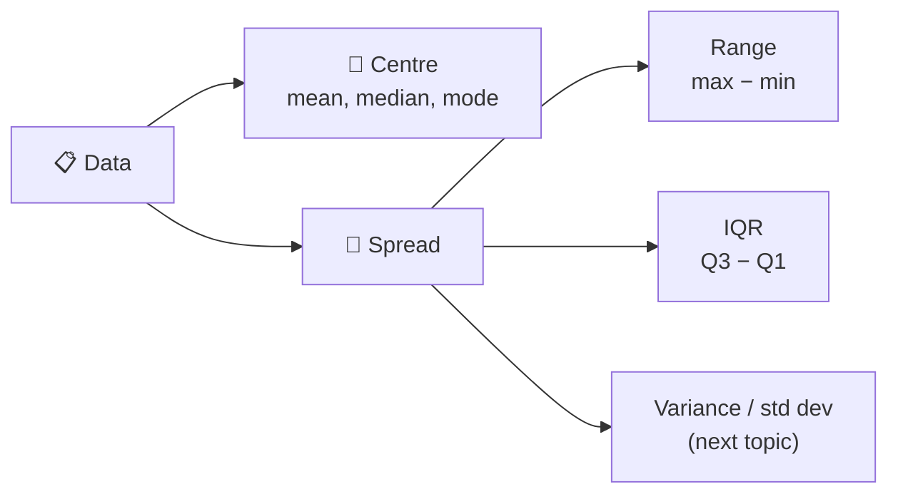
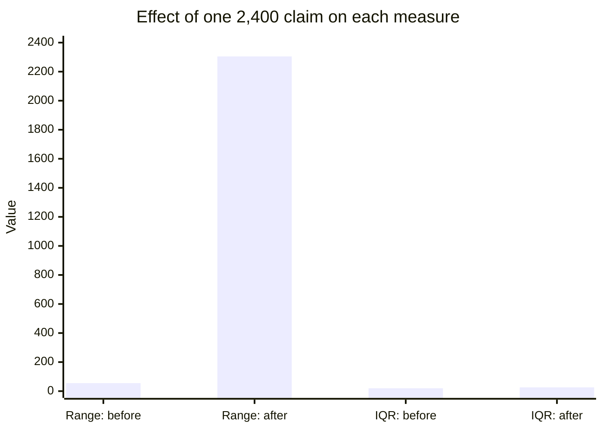
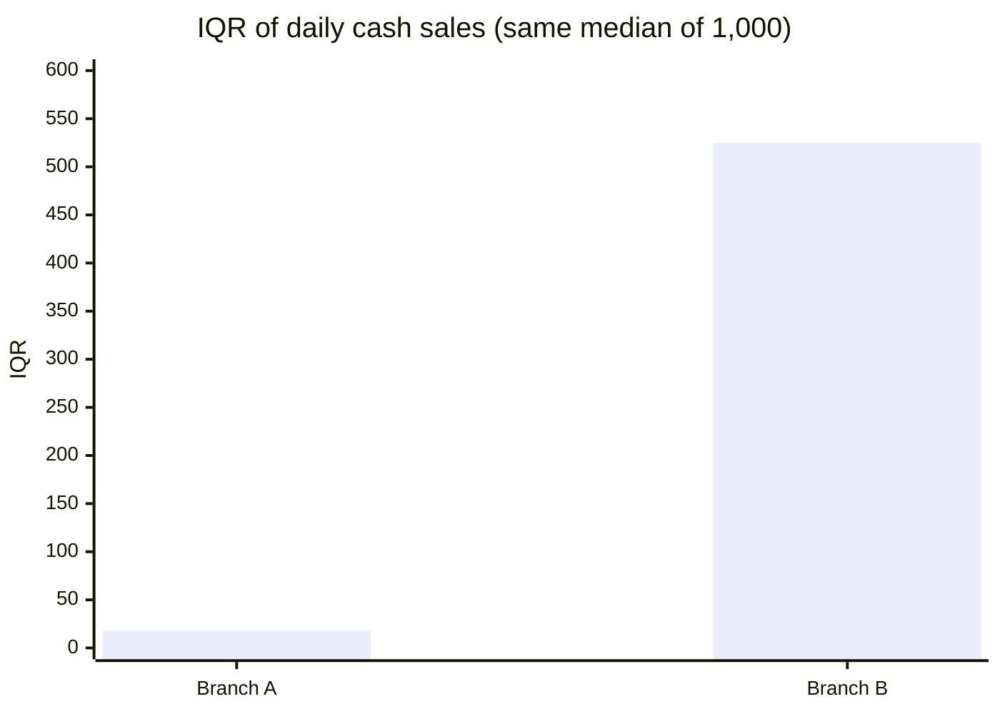
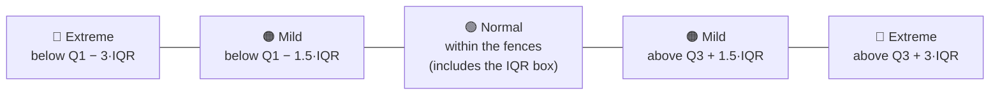

<div align="center">

# 📐 Measures of Dispersion: Range and IQR
### A concise guide for audit data science

</div>

> [!NOTE]
> **Sources:** [Australian Bureau of Statistics, *Measures of spread*](https://www.abs.gov.au/statistics/understanding-statistics/statistical-terms-and-concepts/measures-spread), [ABS, *Statistics: A Powerful Edge!*, Measures of Spread – Range](https://www.abs.gov.au/ausstats/abs@.Nsf/Latestproducts/D932F51DED751050CA2571FE007D69DF), [NIST/SEMATECH *e-Handbook of Statistical Methods*, §7.1.6 What are outliers in the data?](https://itl.nist.gov/div898/handbook/prc/section1/prc16.htm) and [ISA (UK) 520 *Analytical Procedures*](https://www.frc.org.uk/docs/2453/html). The examples use simulated data and were run on Python 3.12 with pandas 3.0.

## 1. Why dispersion matters

The mean, median and mode tell you where the **centre** of the data is. **Dispersion** (spread) tells you how **tightly or loosely** the values sit around it. The ABS describes measures of spread as showing how similar or varied the observed values are. Two populations can share the same median and still behave completely differently.



## 2. Range vs IQR

| | **Range** | **Interquartile range (IQR)** |
| --- | --- | --- |
| Formula | Maximum − minimum | Q3 − Q1 (75th − 25th percentile) |
| Covers | All values, **including outliers** | The **middle 50%** of values |
| Affected by outliers? | ⚠️ Completely | ✅ Barely |
| Strength | Simple; shows the full extent of the data | Robust; describes the typical spread |
| Weakness | Uses only two values, so it says nothing about the majority | Ignores the tails, where risk often sits |
| Audit use | **Boundary checks:** dates, sign, limits | **Outlier fences** and comparing variability |

The ABS notes that the range doesn't measure the spread of the majority of values, and that the IQR is often seen as the better measure because it isn't affected by outliers.

### One unusual claim

```python
import pandas as pd

claims = pd.Series([95, 105, 110, 115, 120, 125, 130, 140, 150])
with_outlier = pd.concat([claims, pd.Series([2_400])], ignore_index=True)
for name, s in [("without outlier", claims), ("with 2,400 claim", with_outlier)]:
    q1, q3 = s.quantile([0.25, 0.75])
    print(f"{name:17} range = {s.max() - s.min():>5.0f} | IQR = {q3 - q1:5.1f}")
```

| | Range | IQR |
| --- | --- | --- |
| 9 normal claims | 55 | 20.0 |
| Plus one 2,400 claim | **2,305** (42× larger) | **26.2** (barely moved) |



**Reading it:** a huge range with a small IQR means **"mostly consistent, with an extreme value somewhere"**. That's the first clue to go looking.

## 3. Real-world audit examples

### 3.1 Same median, very different risk

Two branches report the same median daily cash sales, but one is far less predictable:

```python
branch_a = pd.Series([980, 1_000, 1_010, 990, 1_005, 995, 1_020, 985, 1_000, 1_015])
branch_b = pd.Series([400, 1_600, 700, 1_300, 1_000, 1_900, 250, 1_000, 850, 1_150])
for name, s in [("Branch A", branch_a), ("Branch B", branch_b)]:
    q1, q3 = s.quantile([0.25, 0.75])
    print(f"{name}: median {s.median():.0f} | range {s.max() - s.min():.0f} | IQR {q3 - q1:.0f}")
```

| Branch | Median | Range | IQR |
| --- | --- | --- | --- |
| A | 1,000 | 40 | **18** |
| B | 1,000 | 1,650 | **525** |



**Audit meaning:** ISA 520 asks the auditor to develop an expectation precise enough to identify a misstatement. Branch A is predictable, so an analytical procedure can work well. Branch B's wide IQR makes any expectation imprecise, so it needs **more detailed testing**, and its volatility is itself worth asking about (cash handling, cut-off).

### 3.2 IQR fences: finding outliers in journal entries

NIST defines **inner fences** at Q1 − 1.5×IQR and Q3 + 1.5×IQR, and **outer fences** at 3×IQR. Points beyond an inner fence are **mild outliers**, and points beyond an outer fence are **extreme outliers**.



```python
import numpy as np

rng = np.random.default_rng(42)
je = pd.DataFrame({
    "account": rng.choice(["Revenue", "Travel", "Consulting"], 10_000, p=[0.5, 0.3, 0.2]),
    "amount": rng.lognormal(7.5, 0.6, 10_000).round(2),
})
je["amount"] *= je["account"].map({"Revenue": 3.0, "Travel": 0.25, "Consulting": 1.0})
je.loc[je.sample(4, random_state=3).index, ["account", "amount"]] = ["Travel", 6_500.00]   # unusual for travel

def iqr_flags(s):
    q1, q3 = s.quantile([0.25, 0.75])
    iqr = q3 - q1
    return np.select([(s > q3 + 3 * iqr) | (s < q1 - 3 * iqr),
                      (s > q3 + 1.5 * iqr) | (s < q1 - 1.5 * iqr)],
                     ["extreme", "mild"], default="normal")

je["flag_overall"] = iqr_flags(je["amount"])
je["flag_by_account"] = je.groupby("account")["amount"].transform(iqr_flags)

planted = je[(je["account"] == "Travel") & (je["amount"] == 6_500)]
print(planted[["flag_overall", "flag_by_account"]].value_counts().to_dict())
# {('normal', 'extreme'): 4}
```

| Fences calculated on… | The four 6,500 travel entries |
| --- | --- |
| The **whole population** | 🟢 "Normal": hidden among large revenue entries |
| **Each account separately** | 🔴 **Extreme** outliers |

**Lesson:** IQR fences work best **within comparable groups** (account, vendor, entity). Across mixed groups, the large items of one group make the unusual items of another look ordinary.

### 3.3 Range as a boundary check

The range is weak as a summary but excellent as a **validity check**: the minimum and maximum instantly show whether anything sits outside allowed limits.

```python
posted = pd.to_datetime(pd.Series(["2026-01-03", "2026-06-30", "2026-12-31", "2027-01-02", "2025-12-30"]))
print(posted.min().date(), "to", posted.max().date(),
      "| outside FY2026:", int(((posted < "2026-01-01") | (posted > "2026-12-31")).sum()))
# 2025-12-30 to 2027-01-02 | outside FY2026: 2
```

| Field | What min and max reveal |
| --- | --- |
| Posting date | Entries outside the period: completeness and cut-off |
| Amount | Negative values where none should exist; amounts above an approval limit |
| Unit price or rate | Prices far outside the price list |
| Employee age, hours | Impossible values from data entry errors |

### 3.4 Where each measure fits

| Audit task | Use |
| --- | --- |
| Period, sign and limit checks on an extract | **Range** (min and max) |
| Outlier selection in a population | **IQR fences**, by group |
| Comparing variability of branches, months or vendors | **IQR** |
| Judging how precise an analytical expectation can be | **IQR** (low spread = more reliable expectation) |
| Box plots in workpapers | Both: the box is the IQR, and the whiskers extend towards the range |

## 4. Common pitfalls

- **Quoting the range as "the spread"**: one extreme value dominates it.
- **One set of fences for mixed groups**: unusual items in small-value groups are hidden.
- **Treating fence breaches as errors**: a flag is a reason to **investigate**, not a misstatement. Large, legitimate items will breach the fences in skewed data.
- **Ignoring skew**: with heavily right-skewed amounts, the upper fence flags many genuine large entries. Apply fences to log amounts, or within groups.
- **Different quartile methods**: tools calculate Q1 and Q3 slightly differently, so document the method on small samples.

## 5. Interview key takeaways

1. **Range = max − min.** It's simple, but it's driven entirely by the two most extreme values.
2. **IQR = Q3 − Q1**, the spread of the middle 50%. It's **robust to outliers**, like the median.
3. **Pair the median with the IQR**, and the mean with the standard deviation. Report centre and spread together.
4. **Tukey/NIST fences:** 1.5×IQR for mild outliers, 3×IQR for extreme ones. They're distribution-free and need no normality assumption.
5. **A box plot** draws the IQR as the box, the median as the line, and fence-limited whiskers, with points beyond them shown as outliers.
6. **For a normal distribution, IQR ≈ 1.35σ**, a handy link between robust and classical spread.
7. **In feature engineering**, IQR-based capping or robust scaling (`(x − median) / IQR`, as in scikit-learn's `RobustScaler`) limits outlier influence.

| Quick question | Strong answer |
| --- | --- |
| Range or IQR for skewed salary data? | **IQR**: the range is dominated by a few extreme salaries |
| What does a large range but small IQR tell you? | Most values are similar, but there are outliers in the tails |
| Why 1.5×IQR? | A convention from Tukey: for normal data, it flags about 0.7% of points, so flagged points are genuinely unusual |
| Can you remove every point outside the fences? | Not automatically. Investigate first: in audit and fraud work, the outliers are often the point |
