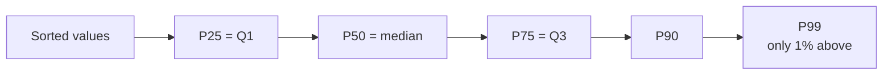
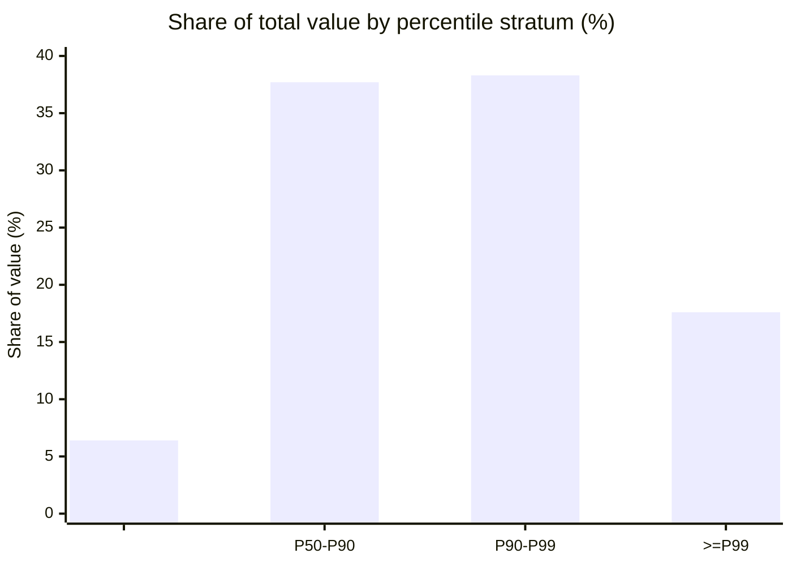

<div align="center">

# 📏 Percentiles: A Concise Guide for Audit Data Science

*Nov 12, 2026 · Saurabh S*

</div>

> [!NOTE]
> **Sources:** [NIST/SEMATECH *e-Handbook of Statistical Methods*, §7.2.6.2 Percentiles](https://itl.nist.gov/div898/handbook/prc/section2/prc262.htm), the [NumPy `percentile` documentation](https://numpy.org/devdocs/reference/generated/numpy.percentile.html), Hyndman & Fan (1996) *Sample quantiles in statistical packages*, [ISA (UK) 530 *Audit Sampling*](https://www.frc.org.uk/docs/106/html) and [PCAOB AS 2315](https://pcaobus.org/oversight/standards/auditing-standards/details/AS2315). The examples use simulated data and were run on Python 3.12 with pandas 3.0.

## 1. What is a percentile?

Sort the data from smallest to largest. **The p-th percentile is the value below which about p% of the observations fall.**



| Term | Meaning |
| --- | --- |
| **Quartiles** | P25, P50, P75. **IQR = Q3 − Q1**, the middle 50% of the data |
| **Deciles** | P10, P20, …, P90 |
| **Percentile** | % → **value**: "what amount has 90% of entries below it?" (`s.quantile(0.9)`) |
| **Percentile rank** | Value → **%**: "how unusual is this entry?" (`s.rank(pct=True)`) |

**Why auditors like percentiles:** they're based on **position**, not averages, so outliers don't distort them. That suits skewed financial data.

> [!WARNING]
> **Tools calculate percentiles differently.** Hyndman & Fan describe **nine methods**. NumPy and pandas default to `linear` (the same as Excel `PERCENTILE.INC`), while NIST's p(N+1) formula matches Excel `PERCENTILE.EXC`. On 11 expense claims, P90 came out as **240** with one method and **1,568** with the other. On large populations, the methods converge. Always **document the method** used.

## 2. Percentiles in financial statement audit

```python
import numpy as np
import pandas as pd

rng = np.random.default_rng(31)
n = 20_000
je = pd.DataFrame({
    "account": rng.choice(["Revenue", "Payroll", "Travel", "Consulting"], n, p=[0.4, 0.3, 0.2, 0.1]),
    "amount": rng.lognormal(7.0, 1.3, n).round(2),
})
je["amount"] *= je["account"].map({"Revenue": 4.0, "Payroll": 2.0, "Travel": 0.3, "Consulting": 1.5})
je.loc[je.sample(5, random_state=1).index, ["account", "amount"]] = ["Travel", 9_800.00]   # unusual for travel

# 1. thresholds
print(je["amount"].quantile([0.5, 0.9, 0.95, 0.99]).round(0).to_dict())

# 2. concentration: value held by the top 5% of entries
p95 = je["amount"].quantile(0.95)
print(f"{je.loc[je['amount'] >= p95, 'amount'].sum() / je['amount'].sum():.0%}")

# 3. stratify by percentile bands
edges = je["amount"].quantile([0, 0.5, 0.9, 0.99, 1]).values
je["stratum"] = pd.cut(je["amount"], edges, labels=["<P50", "P50-P90", "P90-P99", ">=P99"], include_lowest=True)
print((je.groupby("stratum", observed=True)["amount"].sum() / je["amount"].sum() * 100).round(1).to_dict())

# 4. percentile rank within each account
je["rank_in_account"] = je.groupby("account")["amount"].rank(pct=True)
je["rank_overall"] = je["amount"].rank(pct=True)
print(je.loc[je["amount"] == 9_800, ["rank_in_account", "rank_overall"]].iloc[0].round(3).to_dict())
```

### Results at a glance

| Use | Result | Audit meaning |
| --- | --- | --- |
| **Thresholds** | P50 2,116 · P90 14,612 · P95 23,973 · P99 60,397 | Objective cut-offs for selecting large entries |
| **Concentration** | The top 5% of entries hold **41%** of the value | Testing a few large items gives high coverage |
| **Stratification** | Below P50: **6.4%** of value. At or above P99: **17.6%** | Test the top stratum in full, and sample the rest |
| **Rank within a group** | The 9,800 travel entries rank **99.5%** within Travel, but only **84.3%** overall | A single global threshold would miss them |



**Other audit uses:**

- **IQR fences** (Q1 − 1.5×IQR, Q3 + 1.5×IQR) for outliers.
- **P90 and P99 of approval or posting lag** to measure control timeliness.
- **Comparing deciles year on year** to spot shifts in the distribution.

Stratifying a population into similar groups, as ISA 530 and AS 2315 describe, is where percentile bands fit naturally.

## 3. Common pitfalls

- **P90 is a share of the *count*, not the value:** the top 10% of entries held 56% of the value here.
- **One global percentile on mixed groups** misses unusual items, so rank within peer groups (account, vendor, user).
- **Tiny groups:** P99 of 20 items is just the maximum.
- **Different tools give different results:** state the method, especially on small samples.

## 4. Interview key takeaways

1. **The p-th percentile is the value below which about p% of the data falls.** P50 is the median, and P25 and P75 are the quartiles.
2. **Percentiles are robust to outliers**, ideal for skewed data such as amounts, salaries and response times.
3. **Percentile vs percentile rank:** value from a percent, vs percent from a value.
4. **IQR = Q3 − Q1**, the basis of box plots and outlier fences.
5. **There are nine estimation methods** (Hyndman & Fan). The NumPy and pandas default is `linear`.
6. **Tail percentiles (P95, P99) reveal what the mean hides:** latency, risk (Value at Risk is a loss percentile) and control timeliness.
7. **In modelling:** percentile ranks make good scale-free anomaly features, and **winsorising** caps values at P1 and P99 to limit outlier influence.

| Quick question | Answer |
| --- | --- |
| The 90th percentile vs the top 10%? | P90 is a **threshold value**. The top 10% is the **set of items** above it |
| Why use P95 latency instead of the mean? | The tail matters, and the mean hides it |
| How do you flag unusual transactions fairly? | Percentile rank **within peer groups**, not one global cut-off |
