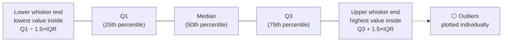
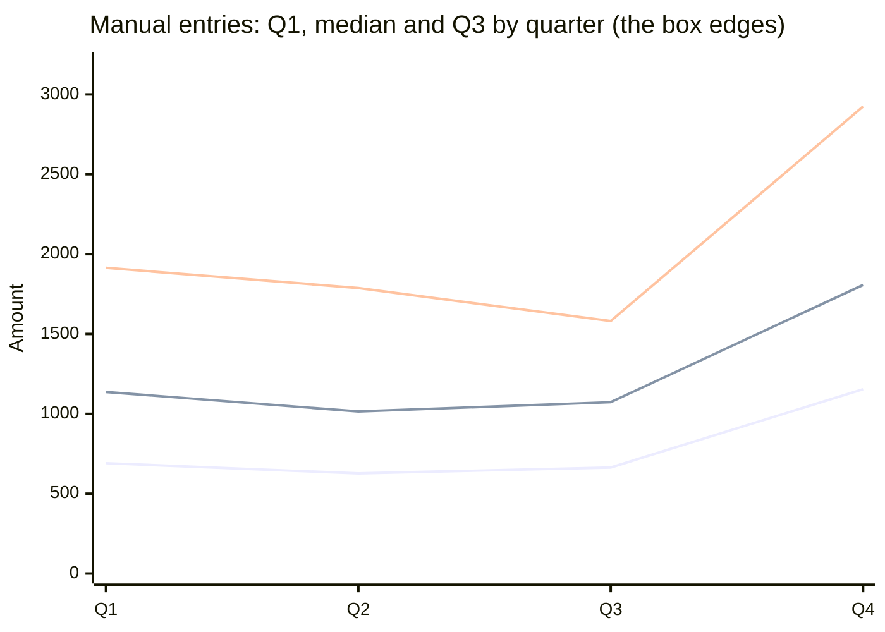

<div align="center">

# 📦 Box-and-Whisker Plots
### A concise guide for audit data science

</div>

> [!NOTE]
> **Sources:** [NIST/SEMATECH *e-Handbook of Statistical Methods*, Box Plot](https://www.itl.nist.gov/div898/handbook/eda/section3/boxplot.htm) and [§7.1.6 outlier fences](https://itl.nist.gov/div898/handbook/prc/section1/prc16.htm), [OpenStax *Statistics*, §2.4 Box Plots](https://openstax.org/books/statistics/pages/2-4-box-plots), [ABS, *Measures of Spread – Box and Whisker Plots*](https://abs.gov.au/ausstats/abs@.nsf/bb8db737e2af84b8ca2571780015701e/ef79ea6fbccba53bca2571fe007d69e0!OpenDocument), [GraphPad, *Five ways to plot whiskers*](https://www.graphpad.com/support/faq/five-ways-to-plot-whiskers-in-box-and-whisker-plots/) and the [Matplotlib `boxplot` documentation](https://matplotlib.org/stable/api/_as_gen/matplotlib.pyplot.boxplot.html). The examples use simulated data and were run on Python 3.12 with pandas 3.0 and Matplotlib 3.10.

## 1. What a box plot shows

A box plot draws the **five-number summary** (minimum, Q1, median, Q3, maximum) of a numeric variable, so a whole distribution fits in one compact picture. The box spans the **interquartile range (IQR)**, the line inside it marks the **median**, and the whiskers reach out towards the extremes.

```text
     whisker         box (middle 50% = IQR)          whisker      outliers
  |-----------[ Q1 ======|====== Q3 ]-------------|       o    o      *
 lowest point          median                highest point  (beyond the
 within fence                                within fence    1.5×IQR fence)
```



| Element | Meaning | What to read from it |
| --- | --- | --- |
| **Box** | Q1 to Q3 (the IQR) | Where the middle half of the values sit; a tall box = high variability |
| **Line in the box** | Median | The typical value |
| **Whiskers** | Extend to the most extreme points **within** 1.5 × IQR of the box (Tukey's convention, Matplotlib's default `whis=1.5`) | The normal range of the data |
| **Dots beyond whiskers** | Points outside the fences | Candidate outliers to investigate |
| **Median off-centre / uneven whiskers** | Skewness | A longer upper whisker = right skew, typical of amounts |

> [!WARNING]
> **Whiskers aren't standardised.** Some tools draw them to the minimum and maximum, others to 1.5×IQR, others to percentiles (e.g. P5–P95), as GraphPad documents. Always state the convention in a workpaper chart.

NIST uses the same fences to classify outliers: beyond 1.5×IQR is **mild**, beyond 3×IQR is **extreme**.

## 2. Why data scientists and auditors like them

- **Compare many groups at once:** months, entities, vendors, preparers, side by side.
- **Robust:** built on the median and quartiles, so a single huge value doesn't distort the box.
- **Outliers shown individually,** ready to select for testing.
- **Compact:** a histogram per group takes a page; a row of box plots takes one chart.

**Limitation:** a box plot hides the **shape inside the box**, such as two clusters (bimodality), and the **group size**. Pair it with a histogram or a count when that matters.

## 3. Audit example: manual journal entries by quarter

The setup creates 8,000 simulated journal entries. Q4 manual entries are made larger and more varied, and three 48,000 entries are planted in Q4 — the kind of year-end pattern auditors look for.

```python
import numpy as np
import pandas as pd
import matplotlib
matplotlib.use("Agg")
import matplotlib.pyplot as plt

rng = np.random.default_rng(7)
je = pd.DataFrame({
    "quarter": rng.choice(["Q1", "Q2", "Q3", "Q4"], 8_000),
    "source": rng.choice(["Automated", "Manual"], 8_000, p=[0.8, 0.2]),
    "amount": rng.lognormal(7.0, 0.7, 8_000).round(2),
})
q4_manual = (je["quarter"] == "Q4") & (je["source"] == "Manual")
je.loc[q4_manual, "amount"] *= rng.uniform(1.0, 2.5, q4_manual.sum())     # Q4 manual entries larger and more varied
je.loc[je.sample(3, random_state=2).index, ["quarter", "source", "amount"]] = ["Q4", "Manual", 48_000.0]

# five-number summary + fences per group
def five_num(s):
    q1, med, q3 = s.quantile([0.25, 0.5, 0.75])
    iqr = q3 - q1
    return pd.Series({"min": s.min(), "Q1": q1, "median": med, "Q3": q3, "max": s.max(),
                      "IQR": iqr, "outliers": int(((s < q1 - 1.5 * iqr) | (s > q3 + 1.5 * iqr)).sum())})

summary = je[je["source"] == "Manual"].groupby("quarter")["amount"].apply(five_num).unstack().round(0)
print(summary.to_string())

# side-by-side box plots, log scale
fig, ax = plt.subplots(figsize=(8, 4.5), layout="constrained")
groups = [je.loc[(je["quarter"] == q) & (je["source"] == "Manual"), "amount"] for q in ["Q1", "Q2", "Q3", "Q4"]]
ax.boxplot(groups, tick_labels=["Q1", "Q2", "Q3", "Q4"], whis=1.5)
ax.set_yscale("log")
ax.set_title("Manual journal entry amounts by quarter")
ax.set_ylabel("Amount (log scale)")
fig.savefig("manual_je_by_quarter.png", dpi=120)

auto_vs_manual = je.groupby("source")["amount"].median().round(0)
print(auto_vs_manual.to_dict())
```

**Five-number summary of manual entries per quarter:**

| Quarter | Min | Q1 | Median | Q3 | Max | IQR | Points beyond fences |
| --- | --- | --- | --- | --- | --- | --- | --- |
| Q1 | 182 | 691 | 1,137 | 1,914 | 8,876 | 1,223 | 13 |
| Q2 | 183 | 627 | 1,015 | 1,788 | 8,678 | 1,161 | 29 |
| Q3 | 147 | 664 | 1,073 | 1,581 | 5,499 | 916 | 15 |
| **Q4** | 179 | **1,154** | **1,807** | **2,924** | **48,000** | **1,770** | **30** |



*The three lines show Q1 (bottom), the median (middle) and Q3 (top): the "box" for each quarter. Q4's box sits higher and is wider.*

**What the box plot tells the auditor at a glance:**

1. **Q4's box is shifted up:** the median manual entry is about 60–80% higher than in Q1–Q3.
2. **Q4's box is taller** (IQR 1,770 vs about 900–1,200): year-end manual entries are less predictable.
3. **Three dots far above everything else** (48,000) stand out immediately as selections for testing.
4. Many dots above the whiskers in **every** quarter: amounts are right-skewed, so a log scale (as in the code) is used, and not every dot is a problem.

Running the code saves `manual_je_by_quarter.png` for the workpaper.

## 4. Other audit uses

| Audit question | Box plot by… |
| --- | --- |
| Are some entities or branches more volatile? | Entity: compare box heights (IQR) |
| Does any preparer post unusually large manual entries? | Preparer |
| Are invoices from one vendor out of line with its peers? | Vendor, or vendor category |
| Is year-end activity different from the rest of the year? | Month or quarter |
| Are approval delays longer for some approvers? | Approver, using approval lag |
| Are expense claims for one cost centre unusual? | Cost centre |

## 5. Common pitfalls

- **Unlabelled whisker rule:** readers assume min/max when the tool used 1.5×IQR, or the reverse.
- **Every dot treated as an exception:** skewed financial data always produces dots; investigate the extreme and unexpected ones, against materiality.
- **Comparing groups of very different sizes** without showing counts: a box from 12 items is far less reliable than one from 5,000.
- **Linear scale on skewed amounts:** the boxes get squashed at the bottom; use a log scale.
- **Missing bimodality:** two clusters inside one box look like ordinary spread.

## 6. Interview key takeaways

1. **A box plot visualises the five-number summary**: min, Q1, median, Q3, max.
2. **The box is the IQR**, the line is the median, and the whiskers usually extend to the last point within **1.5×IQR**; points beyond are plotted as outliers.
3. **It's robust**, because it's built on order statistics, not the mean and standard deviation.
4. **Skewness shows up** as an off-centre median and unequal whiskers.
5. **Best for comparing distributions across groups**; a histogram is better for the detailed shape of one group.
6. **Know the variants:** notched box plots (overlapping notches suggest the medians may not differ), violin plots (box plot + density), and box plots with jittered points.
7. **In code:** `plt.boxplot(..., whis=1.5)`, `sns.boxplot(x=group, y=value)`, `df.boxplot(column=..., by=...)`.

| Quick question | Strong answer |
| --- | --- |
| What do the whiskers represent? | It depends on the tool — commonly the furthest points within 1.5×IQR of the box; sometimes min/max |
| Box plot or histogram? | Box plot to **compare groups**; histogram to see the **shape** of one distribution |
| What can a box plot hide? | Bimodality, gaps and sample size |
| How do you spot skew? | Median nearer one end of the box, and one whisker much longer than the other |
| Is every outlier dot an error? | No — it's a prompt to investigate, especially with skewed data |
