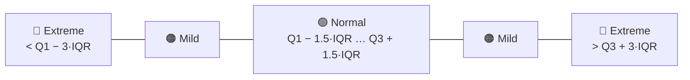
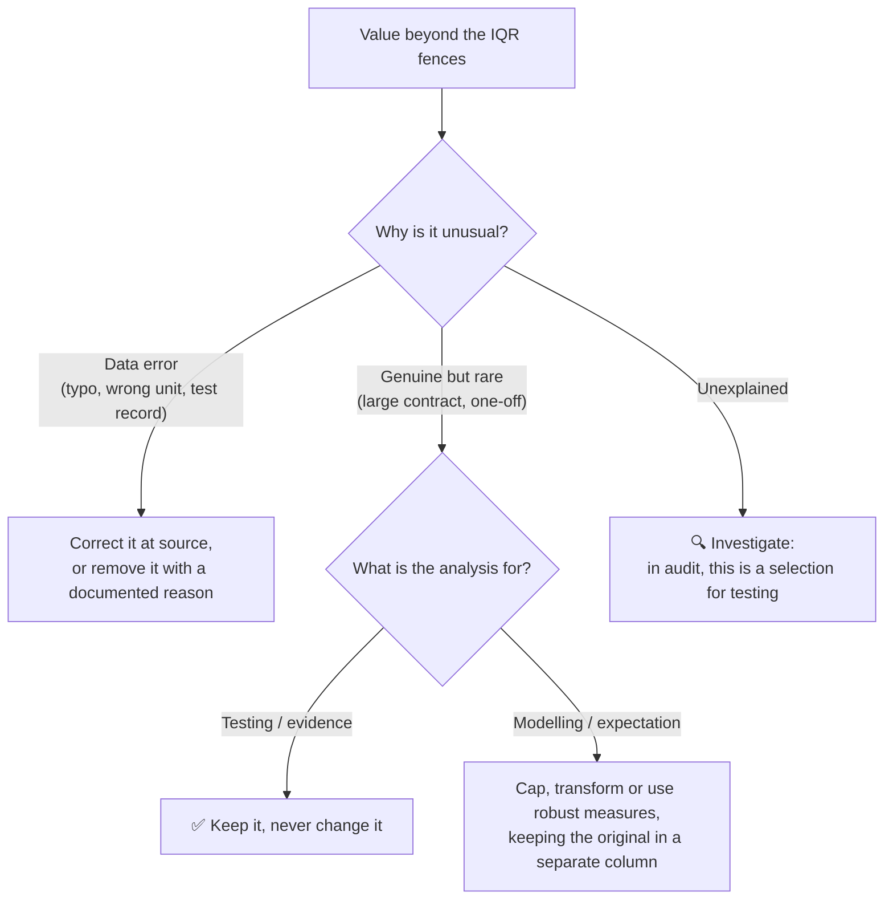
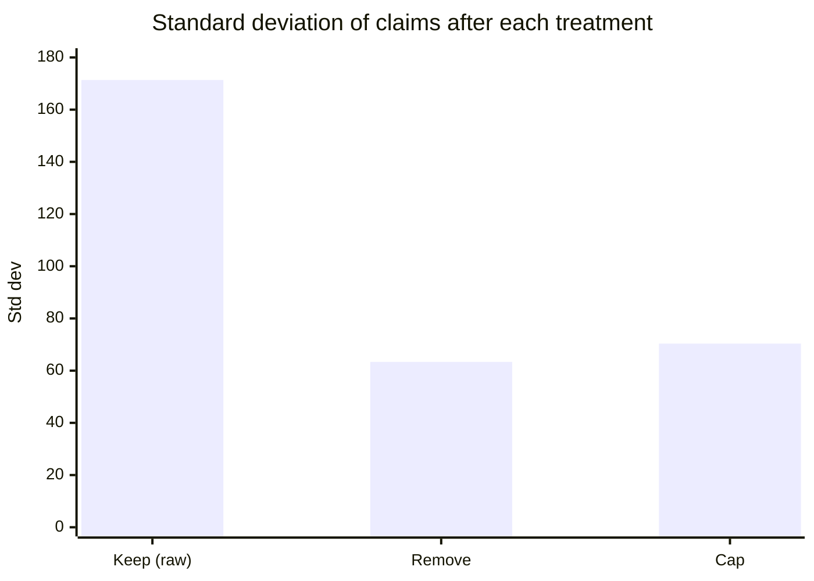

<div align="center">

# 🧹 Outlier Treatment Using the IQR Method
### A concise guide for audit data science

</div>

> [!NOTE]
> **Sources:** [NIST/SEMATECH *e-Handbook of Statistical Methods*, §7.1.6 What are outliers in the data?](https://itl.nist.gov/div898/handbook/prc/section1/prc16.htm) and [§1.3.5.17 Detection of Outliers](https://itl.nist.gov/div898/handbook/eda/section3/eda35h.htm), [ABS, *Measures of spread*](https://www.abs.gov.au/statistics/understanding-statistics/statistical-terms-and-concepts/measures-spread), [ISA (UK) 520 *Analytical Procedures*](https://www.frc.org.uk/docs/2453/html) and the [pandas `Series.clip` documentation](https://pandas.pydata.org/docs/reference/api/pandas.Series.clip.html). The examples use simulated data and were run on Python 3.12 with pandas 3.0.

## 1. The IQR method in one picture

The **interquartile range** (IQR = Q3 − Q1) measures the spread of the middle 50% of the data, and isn't affected by outliers. NIST builds **fences** from it:

| Fence | Formula | A value beyond it is… |
| --- | --- | --- |
| Inner (lower / upper) | Q1 − 1.5×IQR / Q3 + 1.5×IQR | a **mild** outlier |
| Outer (lower / upper) | Q1 − 3×IQR / Q3 + 3×IQR | an **extreme** outlier |



**Why IQR?** The fences depend only on quartiles, so they need no normality assumption, and the outliers themselves can't drag the fences outwards (unlike mean ± 3 standard deviations).

## 2. Detect first, then decide

NIST's guidance on outliers is to investigate them before acting, because they can carry valuable information about the process or about how the data was recorded. Treatment is a **decision**, not a default:



| Treatment | How | Effect | Audit-safe use |
| --- | --- | --- | --- |
| **Keep and flag** | Add a flag column | Nothing changes; outliers are visible | ✅ Always the default for testing |
| **Remove (trim)** | Drop rows outside the fences | Lowers spread, but **loses data and totals** | ⚠️ Only proven errors, documented |
| **Cap (winsorise)** | `s.clip(lower, upper)` | Keeps every row, limits influence | ✅ For expectations and models, on a copy |
| **Transform** | `np.log(s)` | Compresses the long right tail | ✅ For skewed amounts before fencing |
| **Robust statistics** | Median, IQR instead of mean, SD | Outliers barely matter | ✅ For benchmarks and summaries |

## 3. Audit examples

### 3.1 Detecting outliers in expense claims

1,000 simulated expense claims, with two planted large claims (2,950 and 4,100) and one data-entry error (0.01):

```python
import numpy as np
import pandas as pd

rng = np.random.default_rng(11)
claims = pd.DataFrame({
    "claim_id": [f"EC{i:04d}" for i in range(1_000)],
    "amount": rng.lognormal(5.0, 0.45, 1_000).round(2),
})
claims.loc[[17, 402, 811], "amount"] = [2_950.00, 4_100.00, 0.01]       # planted: two large claims, one data-entry error

def iqr_fences(s, k=1.5):
    q1, q3 = s.quantile([0.25, 0.75])
    iqr = q3 - q1
    return q1 - k * iqr, q3 + k * iqr

low, high = iqr_fences(claims["amount"])
print(f"fences: {low:,.2f} to {high:,.2f}")
```

```python
mild_low, mild_high = iqr_fences(claims["amount"], 1.5)
ext_low, ext_high = iqr_fences(claims["amount"], 3.0)
a = claims["amount"]
claims["outlier"] = np.select(
    [(a < ext_low) | (a > ext_high), (a < mild_low) | (a > mild_high)],
    ["extreme", "mild"], default="normal")
print(claims["outlier"].value_counts().to_dict())
print(claims.loc[[17, 402, 811], ["claim_id", "amount", "outlier"]].to_string(index=False))
```

| Claim | Amount | IQR flag (raw scale) |
| --- | --- | --- |
| EC0017 | 2,950.00 | 🔴 Extreme |
| EC0402 | 4,100.00 | 🔴 Extreme |
| EC0811 | **0.01** | 🟢 **"Normal"** |

**Result:** 967 normal, 28 mild and 5 extreme. The two large claims are caught, but the **0.01 error slips through**: on right-skewed data, the lower fence is **negative** (−30.11), so nothing small can ever breach it.

### 3.2 Comparing the treatments

```python
s = claims["amount"]
treatments = {
    "1. Keep (raw)": s,
    "2. Remove (trim)": s[(s >= low) & (s <= high)],
    "3. Cap at fences (winsorise)": s.clip(lower=low, upper=high),
    "4. Log transform": np.log(s),
}
rows = []
for name, x in treatments.items():
    rows.append({"treatment": name, "rows": len(x), "mean": round(x.mean(), 2),
                 "std": round(x.std(), 2), "total": round(x.sum(), 0) if "Log" not in name else None})
print(pd.DataFrame(rows).to_string(index=False))
log_low, log_high = iqr_fences(np.log(s))
log_flags = (np.log(s) < log_low) | (np.log(s) > log_high)
print("outliers on log scale:", int(log_flags.sum()), "| includes the 0.01 claim:", bool(log_flags[811]))
```

| Treatment | Rows | Mean | Std dev | Total |
| --- | --- | --- | --- | --- |
| 1. Keep (raw) | 1,000 | 171.97 | 171.37 | **171,968** |
| 2. Remove (trim) | **967** | 157.06 | 63.36 | 151,880 |
| 3. Cap at fences (winsorise) | 1,000 | 163.10 | 70.36 | 163,101 |
| 4. Log transform | 1,000 | 5.00 (log) | 0.56 (log) | n/a |



**Reading it:**

- **Removing** cut the spread most, but deleted 33 claims and **20,088 of value**. In a test population, that's 33 items never tested and a total that no longer agrees to the ledger.
- **Capping** kept every row and still cut the spread by about 60%, but changed 33 amounts, so the total no longer agrees either. That's fine for modelling, never for evidence.
- **Log transform + fences** flags 8 claims, **including the 0.01 error** the raw fences missed. On skewed financial data, fencing on the log scale finds problems at both ends.

### 3.3 Capping to build a better analytical expectation

ISA 520 asks the auditor to build an expectation precise enough to identify a misstatement. Here, December revenue is predicted as units × the average price from January to November. A one-off June adjustment inflates the raw average price, and December has a planted 6,000 overstatement, against an acceptable difference of 4,000:

```python
months = pd.period_range("2026-01", "2026-12", freq="M")
units = pd.Series([4_100, 3_950, 4_300, 4_250, 4_400, 4_150, 4_050, 4_350, 4_200, 4_500, 4_300, 4_600], index=months)
revenue = (units * rng.normal(25, 0.6, 12)).round(0)
revenue[pd.Period("2026-06", "M")] += 120_000           # one-off June adjustment distorts the price
revenue[pd.Period("2026-12", "M")] += 6_000             # December overstated by 6,000
threshold = 4_000                                        # acceptable difference without investigation
price = revenue / units
history = price.iloc[:11]                                 # Jan-Nov builds the expectation

p_low, p_high = iqr_fences(history)
for label, unit_price in [("raw mean price", history.mean()),
                          ("capped mean price", history.clip(p_low, p_high).mean())]:
    expected_dec = units.iloc[-1] * unit_price
    print(f"{label:17}: {unit_price:6.2f} -> December expectation {expected_dec:,.0f} "
          f"| difference {revenue.iloc[-1] - expected_dec:+,.0f} -> "
          f"{'investigate' if abs(revenue.iloc[-1] - expected_dec) > threshold else 'within threshold'}")
```

| Price used for the expectation | Unit price | December difference | Conclusion |
| --- | --- | --- | --- |
| Raw mean (June included) | 27.48 | −3,128 | ✅ "Within threshold": **misstatement missed** |
| Mean **capped at the IQR fences** | 25.03 | **+8,135** | ⚠️ **Investigate**: misstatement caught |

The one-off month made the expectation too high and hid the overstatement. Capping the history at the IQR fences gave a cleaner expectation. **The June adjustment itself is not ignored:** it's a separate item to vouch.

## 4. Where each treatment fits in the audit

| Audit activity | Outlier treatment |
| --- | --- |
| Journal entry testing, sampling, exception reports | **Keep and flag**; outliers become selections |
| Data cleaning of a client extract | **Remove or correct only proven errors**, with a documented reason, agreed back to totals |
| Expectations for substantive analytical procedures | **Cap or use the median**, so one-off items don't distort the expectation |
| Training anomaly or fraud models | **Cap or log-transform features** on a copy; keep raw values for review |
| Workpaper summaries | Report **median and IQR** alongside the mean |

## 5. Common pitfalls

- **Deleting outliers from a test population:** in audit, they're often the most important items.
- **Fencing raw amounts that are heavily skewed:** the lower fence goes negative and many legitimate large items are flagged; fence on log amounts, or within groups.
- **One set of fences for mixed groups:** fence within accounts, vendors or entities.
- **Treating before splitting** train and test data in a model: calculate fences on the training data only, then apply them to the test data.
- **Overwriting the original column:** always keep the raw value and add `amount_capped` or `is_outlier` beside it.
- **Forgetting totals:** removal and capping both change sums, so reconcile back to the ledger.

## 6. Interview key takeaways

1. **IQR = Q3 − Q1. Fences: 1.5×IQR for mild outliers, 3×IQR for extreme ones.**
2. **IQR fences are robust and distribution-free,** unlike z-scores (mean ± 3σ), which outliers themselves distort.
3. **The four main treatments:** remove (trim), cap (winsorise), transform (log), or use robust statistics and models.
4. **Detect ≠ delete.** Always ask whether an outlier is an error, a rare-but-real event, or the signal itself (fraud, failure).
5. **Capping keeps the sample size**; trimming reduces it. Both change totals and means.
6. **Skewed data:** log-transform before fencing; on raw skewed data, the lower fence is often negative and useless.
7. **Avoid leakage:** fit fences on training data only.
8. **Model choice matters:** tree-based models are fairly robust to outliers; linear regression, k-means and distance-based methods are sensitive.

| Quick question | Strong answer |
| --- | --- |
| How would you handle outliers in a dataset? | Detect (IQR, by group), investigate the cause, then fix errors, and cap, transform or keep depending on the purpose |
| Winsorising vs trimming? | Winsorising replaces extreme values with the fence values; trimming removes the rows |
| Why not just use z-scores? | They assume normality, and outliers inflate the mean and SD that define them |
| When should outliers never be removed? | When they're the target, such as fraud, failures or audit exceptions, or when totals must reconcile |
