# Python Basics – Session Notes (11 Oct 2026)


Revision notes for the **Python-1** live session from **KrishNaikAcademy** (instructor: Monal S), built from the class notebook (`variables_datatype.ipynb`), the handwritten notes and the recording transcript.

## Contents

1. [Session overview](#session-overview)
2. [Variables and memory](#variables-and-memory)
3. [Data types](#data-types)
4. [Mutable vs immutable](#mutable-vs-immutable)
5. [Operators](#operators)
6. [Collections](#collections)
7. [Key takeaways and audit application](#key-takeaways-and-audit-application)
8. [Real-world audit examples](#real-world-audit-examples)

---

## Session overview

| Item | Details |
| --- | --- |
| Source | KrishNaikAcademy |
| Date | 11 Oct 2026 |
| Prerequisite | Basic Python (watch the previous recap class if needed) |
| Assignment | Operator precedence (BODMAS for Python) |

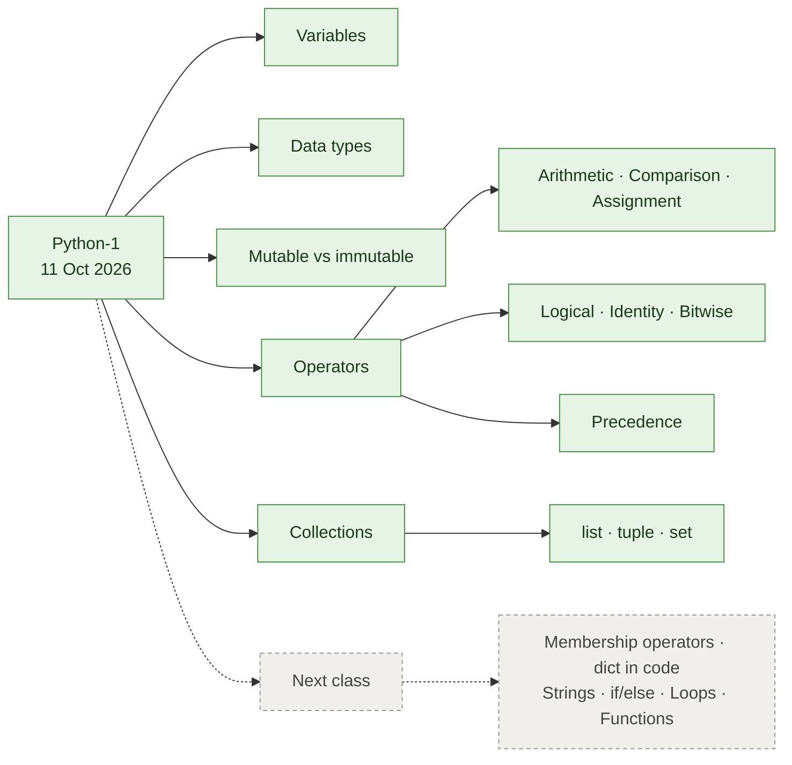

> Solid boxes were covered in this session; dashed boxes were deferred to the next class.

A programming language is a language for giving a computer commands it runs to complete a task. Python is used in machine learning, computer vision, generative AI, agentic AI, web development and API servers.

---

## Variables and memory

A variable is a **name that refers to an object** in Python. In `a = 3`, Python creates an `int` object holding `3` in memory, and `a` is a label pointing to that object's address.

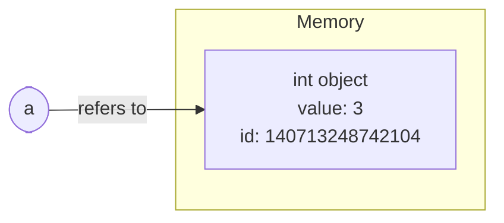

```python
a = 3
b = 4
age = 25             # int
name = "Krish naik"  # str
print(a)             # 3
```

### Naming rules

| Rule | Valid | Invalid / not standard |
| --- | --- | --- |
| Letters, digits, underscores only | `name_0`, `_name_0` | `name-0` |
| Cannot start with a digit | `name1` | `1name` |
| Use meaningful names | `age`, `name` | `x1` |
| Use **snake_case** (Python convention) | `first_name` | `firstName` (works, but not standard) |

### `id()` and `type()`

- `id(variable)` returns a number for the object's identity (its reference in memory). Same `id` = same object.
- `type(variable)` returns the data type, e.g. `<class 'int'>`.
- When a name moves to a new object, the old one is cleaned up by **garbage collection** once nothing refers to it.

---

## Data types

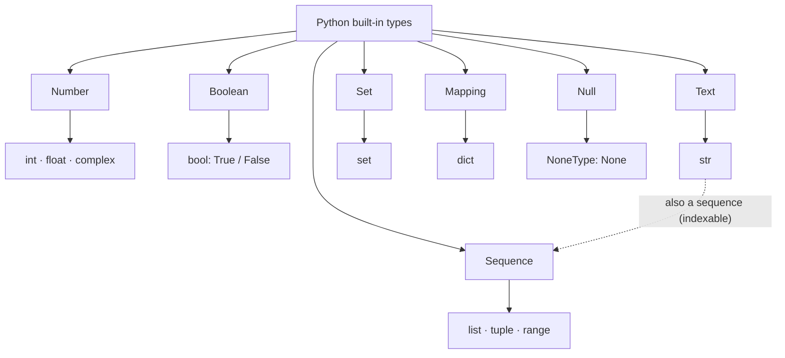

| Category | Type(s) | Example | `type()` output |
| --- | --- | --- | --- |
| Number | `int`, `float`, `complex` | `12`, `12.0008`, `13+2j` | `<class 'int'>` / `'float'` / `'complex'` |
| Boolean | `bool` | `True`, `False` | `<class 'bool'>` |
| Text | `str` | `"hello"`, `'123'` | `<class 'str'>` |
| Sequence | `list`, `tuple`, `range` | `[1, 2]`, `(1, 2)` | `<class 'list'>` / `'tuple'` |
| Set | `set` | `{1, 2, 3}` | `<class 'set'>` |
| Mapping | `dict` | `{"a": 1}` | `<class 'dict'>` |
| Null | `NoneType` | `None` | `<class 'NoneType'>` |

```python
num_complex_1 = 13+2j   # a + bj form
num_str_2 = 'True'      # str, not bool: quotes make it text
num_str_3 = '123'       # str, not int
value_none_type = None  # NoneType: "no value"
```

> [!TIP]
> Anything inside quotes is a string, even `'True'` or `'123'`. Python has no native array type; arrays come from NumPy.

---

## Mutable vs immutable

Mutable objects can be changed **in place**; immutable objects cannot, so any "change" creates a **new object**. The `id()` test proves which is which.

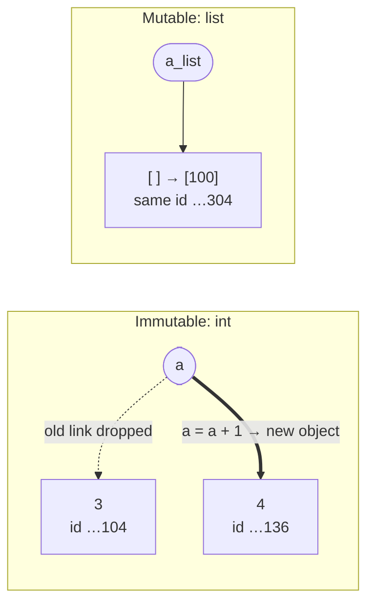

| Kind | Meaning | Types |
| --- | --- | --- |
| Mutable | Changes in place; same object, same `id` | `list`, `dict`, `set` |
| Immutable | Cannot change; new object, new `id` | `int`, `float`, `bool`, `str`, `tuple` |

```python
# Immutable: id changes
a = 10
print(id(a))   # 140713248742104
a = a + 1
print(id(a))   # 140713248742136  -> different object

# Mutable: id stays the same
a_list = []
print(id(a_list))      # 2381679834304
a_list.append(100)
print(id(a_list))      # 2381679834304  -> same object, modified
```

### Primitive vs non-primitive

| Primitive (basic) | Non-primitive (collections) |
| --- | --- |
| `int`, `float`, `bool`, `str`, `NoneType` | `list`, `tuple`, `set`, `dict` |

> [!NOTE]
> This split is borrowed from C++/Java; in Python everything is an object. The instructor noted it is unlikely to come up in interviews.

---

## Operators

An operator is a symbol or keyword that performs an operation on values or variables. In `2 + 3`, `+` is the operator and `2`, `3` are the operands.

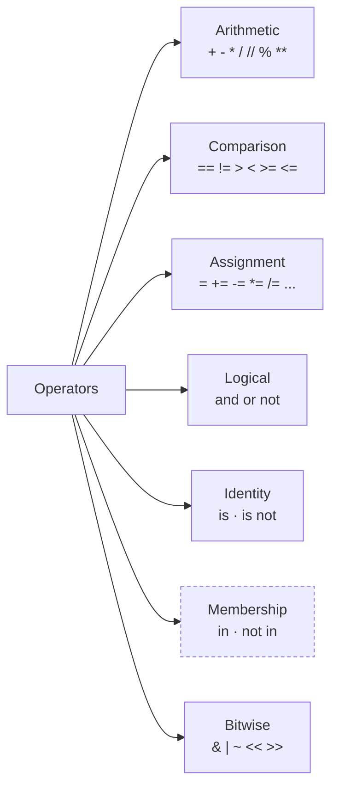

### Arithmetic

| Operator | Meaning | Example | Result |
| --- | --- | --- | --- |
| `+` | Addition | `10 + 3` | `13` |
| `-` | Subtraction | `10 - 3` | `7` |
| `*` | Multiplication | `10 * 3` | `30` |
| `/` | True division (always a float) | `10 / 3` | `3.333...` |
| `//` | Floor division (drops the decimal part) | `10 // 3` | `3` |
| `%` | Modulus (remainder) | `10 % 3` | `1` |
| `**` | Exponentiation | `2 ** 3` | `8` |

### Comparison

Compare two values and return a Boolean.

| Operator | Meaning | Example | Result |
| --- | --- | --- | --- |
| `==` | Equal to | `2 == 3` | `False` |
| `!=` | Not equal to | `2 != 3` | `True` |
| `>` | Greater than | `2 > 3` | `False` |
| `<` | Less than | `2 < 3` | `True` |
| `>=` | Greater than or equal | `2 >= 3` | `False` |
| `<=` | Less than or equal | `10 <= 10` | `True` |

### Assignment

Each row starts fresh from `x = 10`.

| Short form | Long form | Result |
| --- | --- | --- |
| `x += 5` | `x = x + 5` | `15` |
| `x -= 2` | `x = x - 2` | `8` |
| `x *= 2` | `x = x * 2` | `20` |
| `x /= 2` | `x = x / 2` | `5.0` |
| `x //= 2` | `x = x // 2` | `5` |
| `x %= 3` | `x = x % 3` | `1` |
| `x **= 2` | `x = x ** 2` | `100` |
| `x &= 3` | `x = x & 3` | `2` |

### Logical

Combine or reverse Boolean conditions. Think `True` = 1, `False` = 0.

| A | B | A `and` B | A `or` B | `not` A |
| :-: | :-: | :-: | :-: | :-: |
| 0 | 0 | 0 | 0 | 1 |
| 0 | 1 | 0 | 1 | 1 |
| 1 | 0 | 0 | 1 | 0 |
| 1 | 1 | 1 | 1 | 0 |

```python
# Party entry check
age = 16
has_id = True
validate_id = (age > 18 and has_id)   # False and True -> False
has_id = not has_id                    # False
```

### Identity

`is` / `is not` check whether two names point to the **same object**, not just equal values.

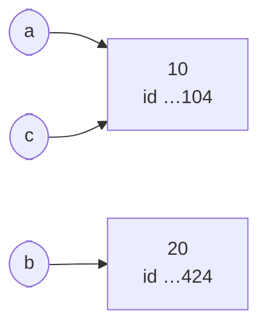

```python
a = 10; b = 20; c = 10
print(a is b)       # False
print(a is c)       # True: both point to the same 10 object
print(a is not b)   # True
```

> [!WARNING]
> Use `==` to compare values and `is` mainly for `None` checks (`if x is None`). `a is c` is `True` here only because Python reuses small integers.

### Membership

Deferred to the next class. For reference: `in` / `not in` check whether a value exists in a collection, e.g. `3 in [1, 2, 3]` → `True`.

### Bitwise (binary)

These work on the binary bits of integers. 12 = `1100` (8 + 4) and 4 = `0100`.

| Bit place | 2⁴ | 2³ | 2² | 2¹ | 2⁰ | Decimal |
| --- | :-: | :-: | :-: | :-: | :-: | :-: |
| Value | 16 | 8 | 4 | 2 | 1 | |
| 12 | 0 | **1** | **1** | 0 | 0 | 12 |
| 4 | 0 | 0 | **1** | 0 | 0 | 4 |
| `12 & 4` | 0 | 0 | **1** | 0 | 0 | **4** |
| 5 | 0 | 0 | **1** | 0 | **1** | 5 |
| `5 << 1` | 0 | **1** | 0 | **1** | 0 | **10** |

4 bits can hold up to 15; 5 bits up to 31.

| Operator | Meaning | Example | Result |
| --- | --- | --- | --- |
| `&` | AND (1 only if both bits are 1) | `12 & 4` | `4` |
| `\|` | OR (1 if either bit is 1) | `12 \| 4` | `12` |
| `~` | NOT (flip every bit) | `~12` | `-13` |
| `<<` | Left shift (× 2 per shift) | `5 << 1` | `10` |
| `>>` | Right shift (÷ 2, floored, per shift) | `12 >> 1` | `6` |

> [!IMPORTANT]
> Two corrections to the 4-bit sketches in the handwritten notes:
> - `~12` is **-13**, not 3. Python integers aren't fixed at 4 bits, so `~x` always equals `-(x + 1)`.
> - `15 << 1` is **30**, not 14. Python never drops bits off the left; the number just grows.

### Operator precedence (assignment: practise this)

Python's version of BODMAS, evaluated top to bottom:

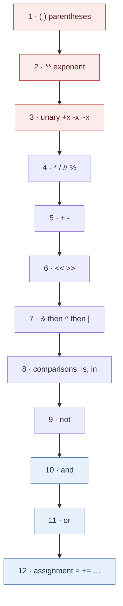

```python
result = 2 + 3 * 4      # 3*4 = 12, then 2+12 -> 14
result = (2 + 3) * 4    # 2+3 = 5,  then 5*4  -> 20
```

> [!NOTE]
> Logical `not` sits low (below comparisons), whereas bitwise `~` sits high.

---

## Collections

A collection stores multiple values in a single object, so you don't need `name_1`, `name_2`, … for a million users.

### Which collection should I use?

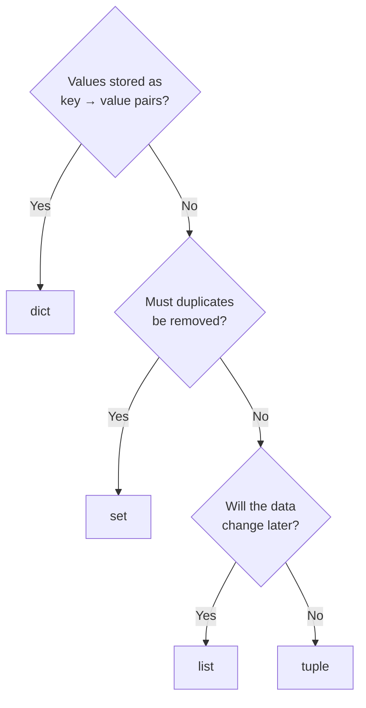

| Type | Syntax | Ordered | Mutable | Duplicates |
| --- | --- | :-: | :-: | :-: |
| `list` | `[1, 2, 3]` | ✅ | ✅ | ✅ Allowed |
| `tuple` | `(1, 2, 3)` | ✅ | ❌ | ✅ Allowed |
| `set` | `{1, 2, 3}` | ❌ No positional order | ✅ | ❌ Not allowed |
| `dict` | `{"k": "v"}` | ✅ Insertion order | ✅ | Keys must be unique |

### Indexing

An index is the position of a value in a sequence. Positions start at **0** from the left.

| Index | 0 | 1 | 2 | **3** | 4 | 5 |
| --- | :-: | :-: | :-: | :-: | :-: | :-: |
| `a` | 1 | 2 | 3 | **4** | 5 | 6 |

```python
a = [1, 2, 3, 4, 5, 6]
a[3]    # 4
```

### List

Ordered, mutable, allows duplicates and mixed types.

| Method | What it does | Example (on `[10, 10, 20, 20, 130]`) |
| --- | --- | --- |
| `append(x)` | Add one item at the end | `append(1000)` → `[..., 130, 1000]` |
| `remove(x)` | Remove the **first** matching value | `remove(130)` |
| `pop(index)` | Remove **and return** the item at an index | `pop(4)` → returns the removed value |
| `insert(index, value)` | Insert at a position, shifting the rest right | `[1,2,3].insert(1, 5)` → `[1, 5, 2, 3]` |
| `index(value)` | Index of the first match | `index(45)` → `4` |
| `count(value)` | How many times a value appears | `count(10)` → `2` |
| `sort()` | Sort in place | `['z','a','c']` → `['a','c','z']` |
| `reverse()` | Reverse in place | `['a','c','z']` → `['z','c','a']` |
| `len(seq)` | Number of items (a function, not a method) | `len(['z','c','a'])` → `3` |

```python
dummy_list_3 = [1, 2, 3, 4, 5, 6]
dummy_list_3[3] = 100        # [1, 2, 3, 100, 5, 6]; id() unchanged -> mutable
```

> [!CAUTION]
> - `sort()` on mixed types fails: `["a", 1, 4].sort()` raises `TypeError: '<' not supported between instances of 'int' and 'str'`.
> - `True` counts as 1 and `False` as 0, so `[1, 2, True].index(True)` returns `0` (it matches the `1` first).

### Tuple

An ordered, **immutable** collection: read it, but don't edit it. Use it for fixed data (days of the week, weekend class days); use a list for things that grow (topics).

```python
tuple_1 = (1, 2, 3, 4, 5, 6)
tuple_1[2]          # 3
tuple_1[2] = 100    # TypeError: 'tuple' object does not support item assignment
tuple_1.index(6)    # 5
tuple_1.count(6)    # 1

("MONDAY")          # str, not a tuple!
("MONDAY",)         # tuple: a single-item tuple needs a trailing comma
```

### Set

Unordered, mutable, no duplicates. Duplicates are dropped automatically.

```python
numbers = {1, 1, 2, 3, 4, 5, 6, 6, 7, 8}   # {1, 2, 3, 4, 5, 6, 7, 8}
s = set()          # empty set ({} would make an empty dict)
s.add(4); s.add(400); s.add("ajay")      # {400, 'ajay', 4}
s[1]               # TypeError: 'set' object is not subscriptable (no indexing)
s.discard(400)     # remove by VALUE, not index -> {4, 'ajay'}
```

Sets also support union and intersection (to be covered later).

### Dictionary

Key–value mapping; keys must be unique. Listed in the overview but not yet coded in this session.

---

## Key takeaways and audit application

Each concept from this session maps to a routine audit task: holding balances, testing assertions, and checking populations for completeness and accuracy.

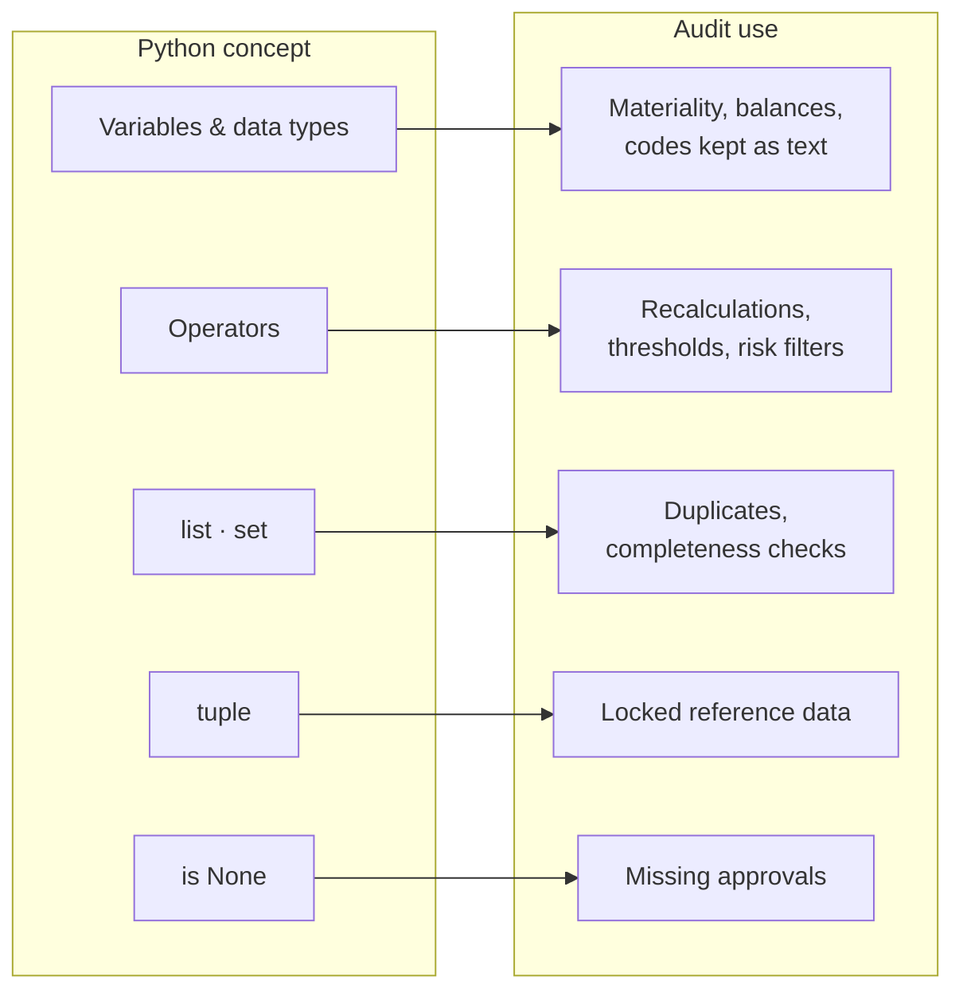

| Concept | Key takeaway | Application in financial statement audit |
| --- | --- | --- |
| Variables | A name points to a value in memory | Store materiality, trial balance totals or thresholds once (`materiality = 500000`) and reuse them across every test |
| Data types | Pick the right type for the data | Amounts as `float`, counts as `int`, account codes and invoice numbers as `str` (keeps leading zeros like `"00145"`), flags as `bool`, missing approvals as `None` |
| String vs number | `'123'` is text, not a number | ERP exports often store amounts as text; convert before summing or the totals won't foot |
| Mutable vs immutable | Lists change in place; tuples don't | Keep fixed reference data (financial year quarters, approved GL codes) in tuples; use lists for exceptions you build up |
| Arithmetic operators | `/`, `//`, `%`, `**` behave differently | Recalculate depreciation, interest and tax; `%` finds round-sum entries (`amount % 1000 == 0`) |
| Comparison operators | Return `True` / `False` | Test thresholds: payments above approval limits, variances above performance materiality |
| Logical operators | `and` / `or` / `not` combine conditions | Risk filters: posted on a weekend `and` above threshold `and` `not` approved |
| Identity (`is`) | Same object vs equal value | Check missing data with `is None` (e.g. no approver recorded) |
| Operator precedence | `()` decide evaluation order | Wrong order silently gives wrong recalculations; bracket formulas like `(revenue - cost) / revenue` |
| List | Ordered, allows duplicates | Hold a population of invoice numbers; `count()` flags duplicate payments |
| Set | No duplicates, no order | `set()` removes duplicates and tests completeness between two sources |
| Indexing | Positions start at 0 | Pick specific items or samples from a population list |

> [!TIP]
> The big idea: scripts let you test **100% of a population** instead of a sample, and the same script can be rerun on next year's data.

---

## Real-world audit examples

These use only what this session covered, so each can be run as-is in the class notebook. The data is illustrative.

| # | Example | Assertion / risk | Python concepts |
| :-: | --- | --- | --- |
| 1 | [Duplicate payment check](#1-duplicate-payment-check) | Occurrence | list, `count`, `set`, `len` |
| 2 | [Completeness of revenue](#2-completeness-of-revenue) | Completeness | set difference |
| 3 | [Journal entry risk flag](#3-journal-entry-risk-flag) | Management override | comparison, logical |
| 4 | [Recalculating depreciation](#4-recalculating-depreciation) | Accuracy / valuation | arithmetic, precedence |
| 5 | [Round-sum entries](#5-round-sum-entries) | Fraud indicator | modulus |
| 6 | [Approved account codes](#6-approved-account-codes) | Classification | tuple, `in` |
| 7 | [Missing approver](#7-missing-approver) | Control exception | `is None` |
| 8 | [Amounts exported as text](#8-amounts-exported-as-text) | Data integrity | data types |

### 1. Duplicate payment check

Risk: the same supplier invoice is paid twice.

```python
paid_invoices = ["INV-101", "INV-102", "INV-103", "INV-102", "INV-104"]

print(len(paid_invoices))              # 5 payments
print(len(set(paid_invoices)))         # 4 unique invoices -> 1 duplicate exists
print(paid_invoices.count("INV-102"))  # 2 -> INV-102 paid twice
```

### 2. Completeness of revenue

Every invoice raised should be recorded in the general ledger.

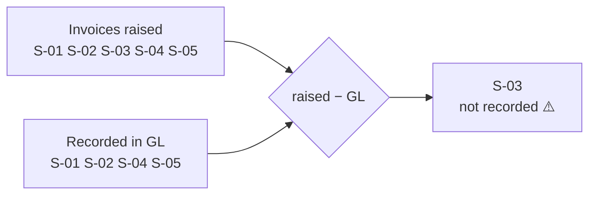

```python
invoices_raised = {"S-01", "S-02", "S-03", "S-04", "S-05"}
invoices_in_gl  = {"S-01", "S-02", "S-04", "S-05"}

print(invoices_raised - invoices_in_gl)   # {'S-03'} -> raised but not recorded
print(invoices_in_gl - invoices_raised)   # set() -> nothing recorded without an invoice (occurrence)
```

### 3. Journal entry risk flag

Auditing standards require testing journal entries for management override. Flag entries that are large and posted on a weekend, or unapproved.

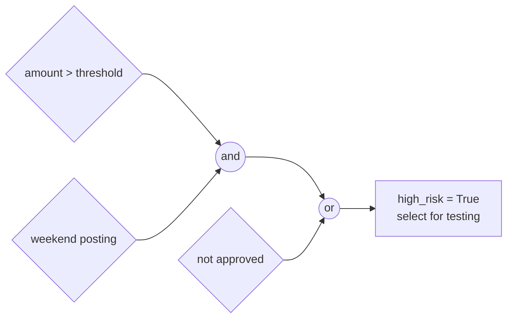

```python
amount = 750000
posted_day = "Sunday"
approved = False
threshold = 500000

weekend = (posted_day == "Saturday" or posted_day == "Sunday")
high_risk = (amount > threshold and weekend) or not approved
print(high_risk)   # True -> select for testing
```

### 4. Recalculating depreciation

```python
cost = 1200000
residual_value = 200000
useful_life_years = 5
booked_depreciation = 220000

expected = (cost - residual_value) / useful_life_years   # 200000.0
difference = booked_depreciation - expected               # 20000.0
print(difference > 0)   # True -> depreciation over-charged by 20,000

# Without brackets: cost - residual_value / useful_life_years = 1160000.0  (wrong!)
```

### 5. Round-sum entries

Round amounts like 50,000.00 can indicate estimates or manual manipulation.

```python
entry_amount = 50000
print(entry_amount % 1000 == 0)   # True -> round sum, review support

entry_amount = 48732.55
print(entry_amount % 1000 == 0)   # False
```

### 6. Approved account codes

Keep reference data immutable so no test accidentally changes it.

```python
approved_expense_codes = ("6100", "6200", "6300")   # tuple: cannot be edited
posted_code = "6999"
print(posted_code in approved_expense_codes)         # False -> posting to an unapproved code
```

> [!NOTE]
> `in` is a membership operator, covered in the next class. Codes are stored as `str`, not `int`, so codes such as `"0610"` keep their leading zero.

### 7. Missing approver

Every purchase order over the limit needs an approver.

```python
po_amount = 120000
approver = None   # field blank in the ERP export

print(po_amount > 100000 and approver is None)   # True -> control exception
```

### 8. Amounts exported as text

ERP and bank exports often store amounts as strings, which breaks totals.

```python
balance_a = "1250.50"
balance_b = "749.50"
print(balance_a + balance_b)                 # '1250.50749.50' -> joined text, not a sum!
print(float(balance_a) + float(balance_b))   # 2000.0 -> correct total
print(type(balance_a))                       # <class 'str'>: always check type() first
```

Once loops and functions are covered, each of these checks can run across an entire ledger instead of a single record.

---

<sub>Source: KrishNaikAcademy · Python-1 session · 11 Oct 2026</sub>
