# Python Recap 2 – Session Notes (17 Oct 2026)


Revision notes for the **Python Recap 2** live session from **KrishNaikAcademy** (instructor: Monal S), built from the class notebook (`17-10-2026.ipynb`), the demo scripts (`input_demo.py`, `print_demo.py`), the handwritten notes, the assignment sheet and the recording transcript.

## Contents

1. [Session overview](#session-overview)
2. [Sets](#sets)
3. [Dictionaries](#dictionaries)
4. [Type casting](#type-casting)
5. [Input and output](#input-and-output)
6. [Reference, shallow copy and deep copy](#reference-shallow-copy-and-deep-copy)
7. [Strings](#strings)
8. [Assignment](#assignment)
9. [Key takeaways and audit application](#key-takeaways-and-audit-application)
10. [Real-world audit examples](#real-world-audit-examples)

---

## Session overview

| Item | Details |
| --- | --- |
| Source | KrishNaikAcademy |
| Date | 17 Oct 2026 |
| Previous session | [Python-1 (11 Oct 2026)](python-basics-2026-10-11.md): variables, data types, operators, list, tuple, set basics |
| Covered | Sets (operations), dictionaries, type casting, input/output, reference vs copy, strings |
| Next | List comprehension, functions → Functions-2 → Intro to OOP |

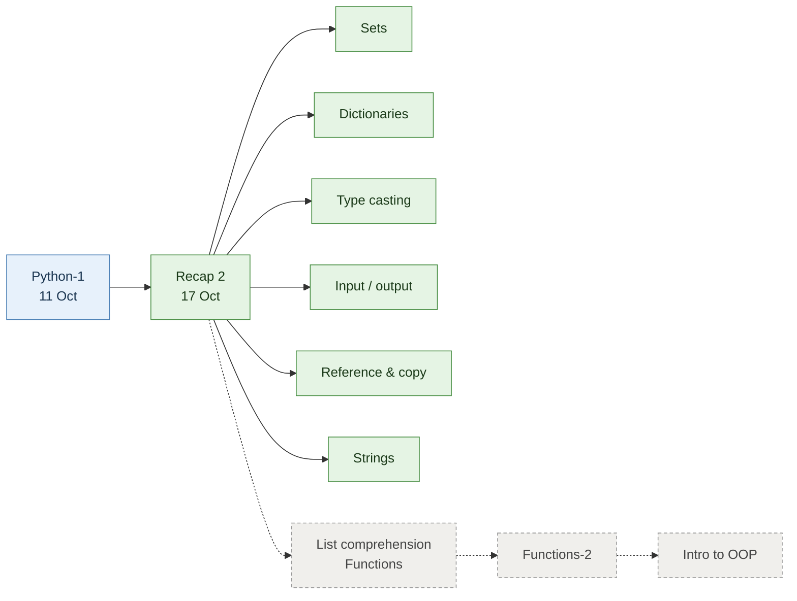

> Green = covered today · dashed = coming next.

---

## Sets

A set is an unordered collection of **unique** values.

### Creating and changing a set

```python
set_1 = set()                 # empty set -> <class 'set'>
set_2 = {}                    # WRONG: this is an empty DICT -> <class 'dict'>

nums = {1, 2, 3, 4, 5}
nums.add(10)                  # {1, 2, 3, 4, 5, 10}
nums.discard(3)               # {1, 2, 4, 5, 10}
nums.discard(100)             # value not there -> no error, set unchanged
nums.remove(100)              # value not there -> KeyError: 100
```

| Method | Value present | Value missing |
| --- | --- | --- |
| `remove(x)` | Removes it | ❌ `KeyError` |
| `discard(x)` | Removes it | ✅ Does nothing (safe) |

> [!TIP]
> Interview question: "create an empty set." The answer is `set()`, not `{}`.

### Set operations

```python
a = {1, 2, 3, 4, 5}
b = {3, 4, 5}

print(a | b)   # union        -> {1, 2, 3, 4, 5}  everything, no duplicates
print(a & b)   # intersection -> {3, 4, 5}        only what is common
print(a - b)   # difference   -> {1, 2}           in a but not in b
```

| Operation | Symbol | Keeps | Result for `a`, `b` above |
| --- | :-: | --- | --- |
| Union | `\|` | Everything in either set | `{1, 2, 3, 4, 5}` |
| Intersection | `&` | Only what's in **both** | `{3, 4, 5}` |
| Difference | `-` | In the first, **not** the second | `{1, 2}` |

### Why sets matter: the two-camera example

Each camera detects people and stores their names in a set. The intersection tells you who appeared in **both** rooms.

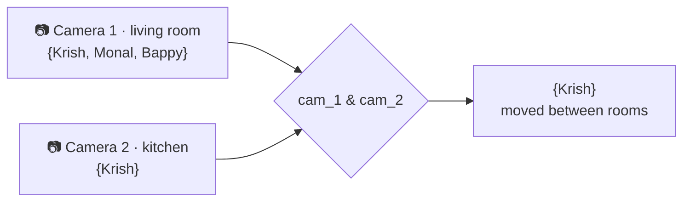

---

## Dictionaries

A dictionary stores data as **key : value** pairs.

| Rule | Detail |
| --- | --- |
| Keys must be unique | A repeated key does **not** raise an error; the **latest** value is kept |
| Keys must be hashable | Strings, numbers, tuples work; lists don't (see [assignment](#assignment)) |
| Values can be anything | Numbers, strings, lists, even other dictionaries |
| Syntax | `key : value` with a **colon**, not `=` |

```python
a = {"name": "hello"}
print(a["name"])            # hello

d = {"a": 1, "a": 2}
print(d)                    # {'a': 2} -> latest value retained
```

### Why a dictionary instead of separate lists

Keeping `names = []`, `id_ = []`, `class_ = []`, `dept = []` means you must line up the same index across four lists, and one slip mixes up students. A dictionary keeps each student's record together under one key.

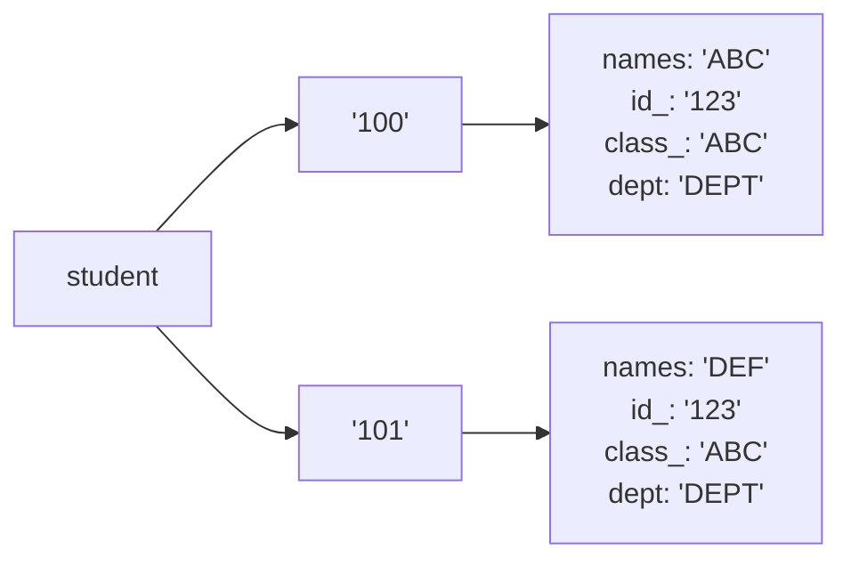

```python
student = {
    "100": {"names": "ABC", "id_": "123", "class_": "ABC", "dept": "DEPT"},
    "101": {"names": "DEF", "id_": "123", "class_": "ABC", "dept": "DEPT"},
}

student["101"]["names"]            # 'DEF'  (nested access)
student.get("101").get("names")    # 'DEF'  (same thing with .get)
```

### `[ ]` vs `.get()`

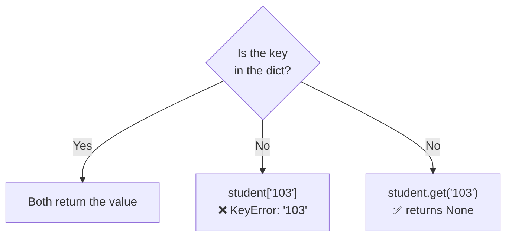

### Dictionary methods

| Method | What it does | Example result |
| --- | --- | --- |
| `keys()` | All keys | `dict_keys(['100', '101'])` |
| `values()` | All values | `dict_values([{...}, {...}])` |
| `items()` | All `(key, value)` pairs | `dict_items([('100', {...}), ...])` |
| `pop(key)` | Remove a key and **return** its value | `pop("101")` → `{'names': 'DEF', ...}` |
| `update({...})` | Merge another dict in: adds new keys, **overwrites** existing ones | see below |
| `clear()` | Empty the dictionary | `{}` |

```python
student.update({"102": {"abc": 123, "def": 345}})     # adds key '102'
student.update({"102": {"ABCDE": 123, "def": 345}})   # '102' REPLACED, not merged inside
student["102"]["ABCDE"] = 4000                         # change one nested value
```

> [!CAUTION]
> `update()` replaces the **whole value** of an existing key. In the example the inner `"abc"` entry disappears; it does not merge the inner dictionaries.

---

## Type casting

Converting data from one type to another.

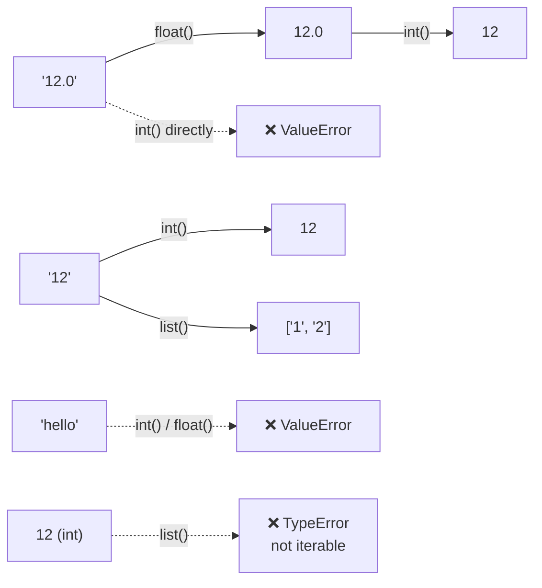

| Conversion | Result | Why |
| --- | --- | --- |
| `float(12)` | `12.0` | int → float always works |
| `int("12")` | `12` | Whole-number text converts |
| `float("12.0")` | `12.0` | Decimal text converts to float |
| `int("12.0")` | ❌ `ValueError` | `int()` can't read a decimal point in text |
| `int(float("12.0"))` | `12` | ✅ Go through float first |
| `float("hello")` | ❌ `ValueError` | Not a number |
| `list("12")` | `['1', '2']` | A string is a sequence, split into characters |
| `list(12)` | ❌ `TypeError` | `list()` needs sequential (iterable) data |
| `list(d.keys())` | `[101, 102]` | Turn dict keys into a real list |
| `list({1, 2, 5, 5})` | `[1, 2, 5]` | Duplicates already gone |
| `set([1, 4, 4, 45])` | `{1, 4, 45}` | Quick de-duplication |

---

## Input and output

`print()` shows output; `input()` reads what the user types. **`input()` always returns a string.**

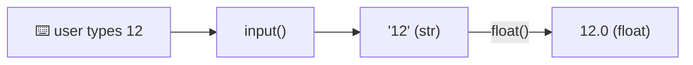

```python
# without casting: text is joined, not added
a = input()            # user types 5
b = input()            # user types 7
a + b                  # '57'

# input_demo.py: cast immediately
input_value_1 = float(input("Enter a number :"))
input_value_2 = float(input("Enter another number :"))
print(input_value_1 + input_value_2)    # 12.0
```

> [!NOTE]
> `input()` pauses the program for the keyboard in a `.py` script; in Jupyter it shows a text box. That's why the demos live in separate `.py` files.

---

## Reference, shallow copy and deep copy

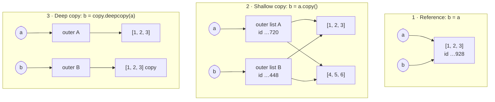

| | `b = a` | `b = a.copy()` | `b = copy.deepcopy(a)` |
| --- | --- | --- | --- |
| New outer object? | ❌ same object | ✅ | ✅ |
| New inner (nested) objects? | ❌ | ❌ shared | ✅ |
| `id(a) == id(b)` | True | False | False |
| Change `a[0]` (a nested list) | Shows in `b` | **Shows in `b`** | Doesn't affect `b` |
| Use when | You want two names for one object | Flat data (no nesting) | Nested data you must keep independent |

```python
# 1. Reference
a = [1, 2]
b = a
b.append(3)
print(a)                 # [1, 2, 3]  <- a changed too!

# 2. Shallow copy: fine for flat lists...
a = [1, 2, 3]
b = a.copy()             # new id

# ...but nested lists are still shared
a = [[1, 2, 3], [4, 5, 6]]
b = a.copy()
a[0].append(456)
print(b)                 # [[1, 2, 3, 456], [4, 5, 6]]  <- b changed!

# 3. Deep copy: fully independent
import copy
a = [[1, 2, 3], [4, 5, 6]]
b = copy.deepcopy(a)
a[0].append(456)
print(b)                 # [[1, 2, 3], [4, 5, 6]]  <- b untouched
```

> [!IMPORTANT]
> This only matters for **mutable** objects (list, dict, set). The instructor's rule of thumb: default to `deepcopy` when in doubt, and re-watch this part of the recording if copy vs reference is unclear.

---

## Strings

### Creating strings and comments

```python
batch_name = "FDE (Forward Deployed Engineering Bootcamp v1.0)"   # double quotes
batch_name_ = 'FDE (Forward Deployed Engineering Bootcamp v1.0)'  # single quotes: same thing
multi = """FDE
(Forward
Deployed ...)"""                                                   # triple quotes: multi-line

# single-line comment
"""
multi-line comment (a string that isn't assigned)
"""
```

### Indexing: positive and negative

Every sequence has two index directions.

| Value | 1 | 2 | 3 | 4 | 5 | 6 | 7 | 8 |
| --- | :-: | :-: | :-: | :-: | :-: | :-: | :-: | :-: |
| Positive index → | 0 | 1 | 2 | 3 | 4 | 5 | 6 | 7 |
| ← Negative index | -8 | -7 | -6 | -5 | -4 | -3 | -2 | -1 |

```python
print(batch_name[0])                    # F
print(len(batch_name))                  # 48  -> last index is 47
print(batch_name[len(batch_name) - 1])  # )
print(batch_name[-1])                   # )   same, much simpler
```

### Slicing: `[start : end : step]`

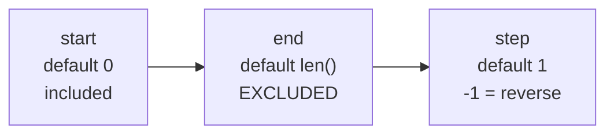

| Slice | Meaning | Result on `batch_name` |
| --- | --- | --- |
| `[0:3]` | Index 0, 1, 2 | `'FDE'` |
| `[5:13]` | Index 5 to 12 | `'Forward '` |
| `[5:]` | From 5 to the end | `'Forward Deployed ... v1.0)'` |
| `[:3]` | Start to index 2 | `'FDE'` |
| `[:]` | Whole thing (a copy) | the full string |
| `[0:4:2]` | Index 0, 2 | `'FE'` |
| `[::-1]` | Reversed | `')0.1v pmactooB ... EDF'` |
| `[4::-1]` | From 4 backwards to the start | `'( EDF'` |

Slicing works on lists too: `[1, 2, 3, 4, 5, 56][::-1]` → `[56, 5, 4, 3, 2, 1]`.

### String operators

| Operator | Example | Result |
| --- | --- | --- |
| `*` repeat | `"hello" * 3` | `'hellohellohello'` |
| `+` join | `"hello" + "hello"` | `'hellohello'` |
| `in` contains | `"ll" in "hello"` | `True` |
| `==` compare | `"abc" == "def"` | `False` |

### String methods

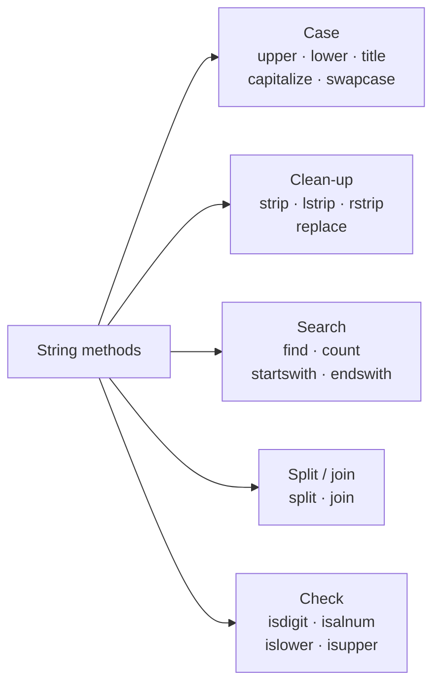

Examples on `batch_name = "FDE forward deployed engineering bootcamp v1.0)"`:

| Method | Result |
| --- | --- |
| `.upper()` | `'FDE FORWARD DEPLOYED ENGINEERING BOOTCAMP V1.0)'` |
| `.lower()` | `'fde forward deployed engineering bootcamp v1.0)'` |
| `.title()` | `'Fde Forward Deployed Engineering Bootcamp V1.0)'` |
| `.capitalize()` | `'Fde forward deployed engineering bootcamp v1.0)'` |
| `.swapcase()` | `'fde FORWARD DEPLOYED ENGINEERING BOOTCAMP V1.0)'` |
| `.find("f")` | `4` (first match, case-sensitive) |
| `.find("F")` | `0` |
| `.find("Z")` | `-1` (not found, no error) |
| `.count("e")` | `5` |
| `.startswith("FDE")` | `True` |
| `.endswith(")")` | `True` |

| Clean-up on `"   dummy text    "` | Result |
| --- | --- |
| `.lstrip()` | `'dummy text    '` |
| `.rstrip()` | `'   dummy text'` |
| `.strip()` | `'dummy text'` |
| `.replace("dummy", "actual")` | `'   actual text    '` |

> [!WARNING]
> Strings are immutable: methods **return a new string**. Write `text_1 = text_1.strip()` to keep the result.

| Check | `True` example | `False` example |
| --- | --- | --- |
| `.isdigit()` | `"123"` | `"abc123"` |
| `.isalnum()` | `"abc123"`, `"123"` | `"abc 123"` |
| `.islower()` | `"abc"` | `"Abc"` |
| `.isupper()` | `"ABC"` | `"abc"` |

### Split and join

`split()` breaks a string into a **list**; `join()` glues a **list of strings** back together.

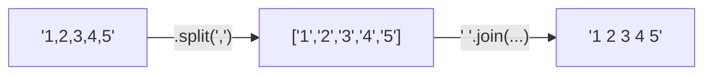

```python
batch_name.split()        # default splits on whitespace
# ['FDE', 'forward', 'deployed', 'engineering', 'bootcamp', 'v1.0)']
"---".join(batch_name.split())
# 'FDE---forward---deployed---engineering---bootcamp---v1.0)'

"abc     def".split()     # ['abc', 'def']: runs of spaces count as one

name = "krish naik".split()
first_name, last_name = name[0], name[1]   # 'krish', 'naik'

"1,2,3".replace(",", " ")  # '1 2 3' (same result as split + join)

" ".join([1, 2, 3, "4"])   # TypeError: join needs ALL items to be strings
```

### Formatting output

```python
name = "alex"
dob = "17-10-1970"

result_1 = name + " date of birth is " + dob      # concatenation: stored, reusable
print(name, "date of birth is", dob)             # print only: commas add spaces
result_2 = f"{name} date of birth is {dob}"      # f-string: cleanest ✅

num_1 = 178989.8668632
print(f"{num_1:.2f}")     # 178989.87  (2 decimal places)
```

| Escape | Meaning | Code | Output |
| --- | --- | --- | --- |
| `\n` | New line | `print("hello\nhello")` | `hello`<br>`hello` |
| `\t` | Tab | `print("hello\thello")` | `hello    hello` |

### Real use: cleaning an email

People type `@Gmail.com`, `@gmail.com`, `@GMAIL.com`; sites don't store every combination, they **normalise** the text first. Same idea as typing "FIX IT" in capitals in a prompt: the computer only understands what you standardise.

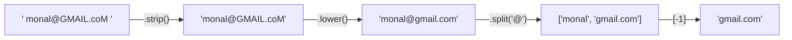

```python
email = "   monal@GMAIL.coM  "
email = email.strip().lower()
mail_provider = email.split("@")[-1]
print(f"email is : {email}, mail provider is {mail_provider}")
# email is : monal@gmail.com, mail provider is gmail.com
```

> [!CAUTION]
> If the separator isn't in the text, `split()` returns a one-item list: `"@".split("a")` → `['@']`. Index `0` and `-1` both work, but index `1` raises `IndexError`. That's why `[-1]` (last item) is safer than `[1]` here.

---

## Assignment

From `assignment.txt`:

- [ ] **Research hashing**: what makes a value "hashable"?
- [ ] **`str.format()`** string formatting (optional)
- [ ] Revise **if-elif-else**, **for**, **while** and **basic functions**

<details>
<summary>Starter pointers (click to expand)</summary>

**Hashing:** `hash(value)` turns a value into a fixed integer. Python uses it to find dictionary keys and set items instantly instead of scanning every entry. Only immutable values are hashable.

```python
hash("101") == hash("101")   # True: same value, same hash (within one run)
hash((1, 2))                 # works: tuple is immutable
hash([1, 2])                 # TypeError: unhashable type: 'list'
```

That's why lists can't be dictionary keys or set items.

**`str.format()`:** the older cousin of f-strings.

```python
"{} date of birth is {}".format("alex", "17-10-1970")
# 'alex date of birth is 17-10-1970'
```

</details>

---

## Key takeaways and audit application

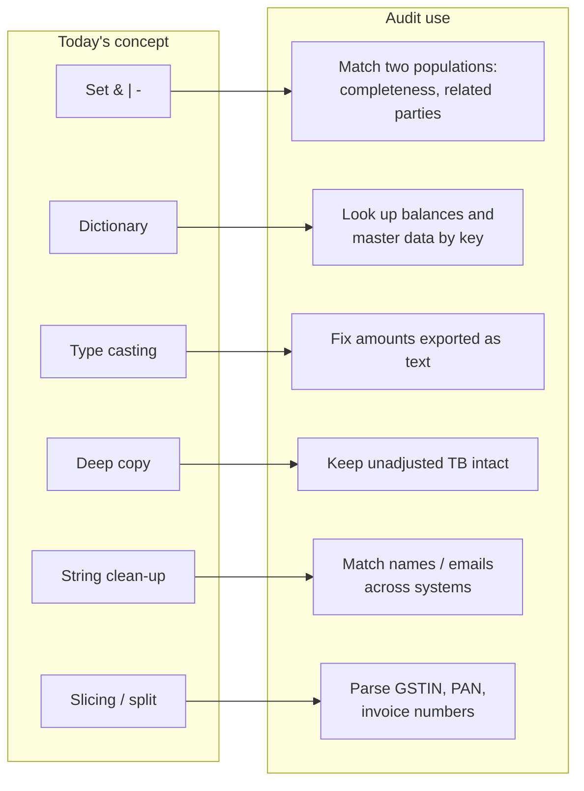

| Concept | Key takeaway | Application in financial statement audit |
| --- | --- | --- |
| Set intersection `&` | What's common to two groups | Find bank accounts shared by the vendor master and employee master (possible fictitious vendor or related party) |
| Set difference `-` | What's in one group but not the other | Goods received with no supplier invoice booked: search for unrecorded liabilities |
| Set union `\|` | Combined unique population | Build a full list of customers across two sub-ledgers before sampling |
| `remove` vs `discard` | `discard` never errors | Exclude already-tested items safely even if they aren't in the population |
| Dictionary | Key → value lookup; keys unique | Trial balance as `{account_code: balance}`; vendor master as `{vendor_id: {...}}` |
| `[ ]` vs `.get()` | `.get()` returns `None` instead of crashing | Look up accounts that may be missing from a period's TB without stopping the test |
| `update()` overwrites | Same key = replaced value | Applying a corrected balance replaces the old one: keep a copy first |
| Type casting | `input()` and exports give text | Strip `,` from `"1,25,000.50"` and cast with `float()` before totalling |
| `int(float(x))` | Decimal text needs two steps | Quantities exported as `"12.0"` |
| Reference vs copy | `b = a` is not a copy | `adjusted = unadjusted` silently changes the client's original TB |
| Deep copy | Nested data fully independent | Keep unadjusted and adjusted trial balances side by side for the summary of misstatements |
| `strip()`, `lower()` | Normalise before comparing | `"ABC Traders "` vs `"abc traders"` are the same vendor: duplicate vendor checks |
| `split()` / `[-1]` | Pull out parts of text | Get the email domain of a vendor; flag free-mail domains (gmail, yahoo) |
| Slicing | Fixed-position fields | GSTIN chars `[2:12]` = PAN; `[:2]` = state code |
| f-string `:,.2f` | Readable numbers | Exception reports with amounts like `INR 182,345.68` |

> [!TIP]
> Today's big idea for audit: **data rarely arrives clean**. Casting, stripping and lower-casing come *before* any matching or totalling, otherwise the test gives wrong answers without any error.

---

## Real-world audit examples

Each example uses only what's been taught so far, and every output shown was checked by running the code. Data is illustrative.

| # | Example | Assertion / risk | Concepts |
| :-: | --- | --- | --- |
| 1 | [Vendor–employee bank match](#1-vendoremployee-bank-account-match) | Occurrence / fraud | set `&` |
| 2 | [Unrecorded liabilities](#2-unrecorded-liabilities) | Completeness | set `-`, `\|` |
| 3 | [Trial balance lookup](#3-trial-balance-lookup) | Existence of balances | dict, `.get()` |
| 4 | [Vendor master review](#4-vendor-master-review) | Controls over master data | nested dict |
| 5 | [Amounts exported as text](#5-amounts-exported-as-text) | Accuracy | type casting |
| 6 | [Protecting the unadjusted TB](#6-protecting-the-unadjusted-trial-balance) | Audit trail | reference vs deep copy |
| 7 | [Duplicate vendors and free-mail domains](#7-duplicate-vendors-and-free-mail-domains) | Fraud indicators | string clean-up |
| 8 | [Parsing GSTIN and invoice numbers](#8-parsing-gstin-and-invoice-numbers) | Validity | slicing, `split` |
| 9 | [Exception reporting](#9-exception-reporting) | Communication | f-strings |

### 1. Vendor–employee bank account match

A vendor paid into an employee's bank account is a classic fictitious-vendor red flag. This is the two-camera example with bank accounts instead of people.

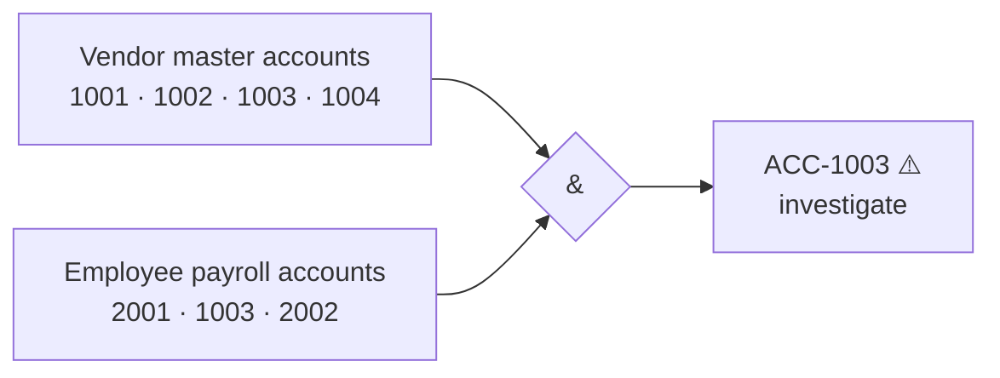

```python
vendor_bank_accounts   = {"ACC-1001", "ACC-1002", "ACC-1003", "ACC-1004"}
employee_bank_accounts = {"ACC-2001", "ACC-1003", "ACC-2002"}

print(vendor_bank_accounts & employee_bank_accounts)   # {'ACC-1003'}
```

### 2. Unrecorded liabilities

Goods received before year-end should have a liability booked. Anything received but not invoiced may be an unrecorded liability.

```python
goods_received  = {"GRN-01", "GRN-02", "GRN-03", "GRN-04"}
invoices_booked = {"GRN-01", "GRN-02", "GRN-04"}

print(goods_received - invoices_booked)        # {'GRN-03'} -> accrue or investigate
print(len(goods_received | invoices_booked))   # 4 -> total unique population
```

### 3. Trial balance lookup

```python
trial_balance = {"1100": 2500000.00, "2100": -1800000.00, "4100": -9500000.00}

print(trial_balance["1100"])             # 2500000.0
print(trial_balance.get("5100"))         # None -> account not in TB, no crash
print(trial_balance.get("5100", 0.0))    # 0.0  -> optional default value
# trial_balance["5100"]                  # KeyError: '5100' would stop the script
```

Account codes are stored as **strings** (`"1100"`), so codes with leading zeros keep them.

### 4. Vendor master review

The vendor master has the same shape as the class's `student` dictionary.

```python
vendor_master = {
    "V001": {"name": "ABC Traders",  "gstin": "27AAPFU0939F1ZV", "approved": True},
    "V002": {"name": "XYZ Supplies", "gstin": "",                "approved": False},
}

print(vendor_master["V002"]["approved"])               # False -> unapproved vendor
print(vendor_master.get("V002").get("gstin") == "")    # True  -> GSTIN missing
print(list(vendor_master.keys()))                      # ['V001', 'V002']
```

### 5. Amounts exported as text

ERP exports often use Indian digit grouping inside text, which neither `float()` nor `int()` can read directly.

```python
amount_text = "1,25,000.50"
print(float(amount_text.replace(",", "")))   # 125000.5  (float("1,25,000.50") -> ValueError)

qty_text = "12.0"
print(int(float(qty_text)))                  # 12        (int("12.0") -> ValueError)
```

### 6. Protecting the unadjusted trial balance

The summary of misstatements needs both the client's original numbers and your proposed adjustments. Only a deep copy keeps the original safe.

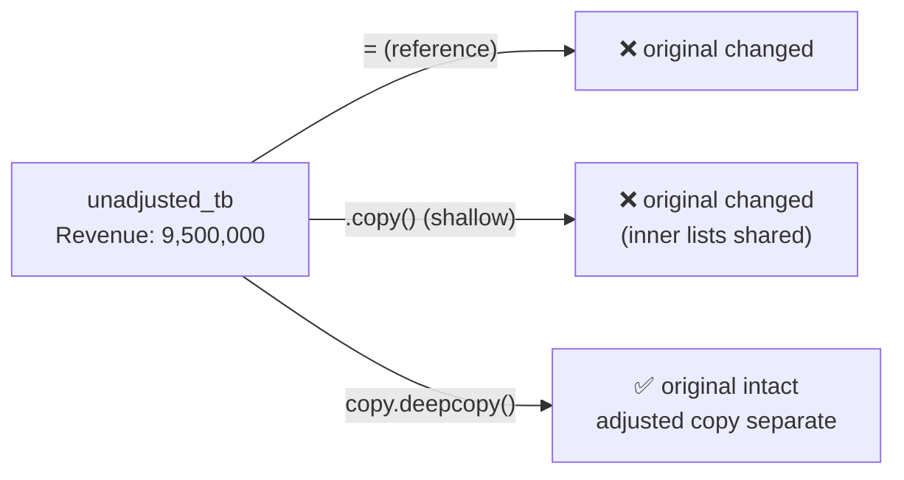

```python
import copy

# ❌ Reference: proposing an adjustment edits the client's numbers
unadjusted_tb = {"Revenue": [9500000], "Receivables": [2500000]}
wrong = unadjusted_tb
wrong["Revenue"].append(-150000)
print(unadjusted_tb)   # {'Revenue': [9500000, -150000], ...}

# ❌ Shallow copy: still shared, because the values are lists
unadjusted_tb = {"Revenue": [9500000], "Receivables": [2500000]}
shallow = unadjusted_tb.copy()
shallow["Revenue"].append(-150000)
print(unadjusted_tb)   # {'Revenue': [9500000, -150000], ...}

# ✅ Deep copy: original untouched
unadjusted_tb = {"Revenue": [9500000], "Receivables": [2500000]}
adjusted_tb = copy.deepcopy(unadjusted_tb)
adjusted_tb["Revenue"].append(-150000)
print(unadjusted_tb)   # {'Revenue': [9500000], 'Receivables': [2500000]}
print(adjusted_tb)     # {'Revenue': [9500000, -150000], 'Receivables': [2500000]}
```

### 7. Duplicate vendors and free-mail domains

```python
name_in_ledger = "  ABC Traders Pvt Ltd "
name_in_master = "abc traders pvt ltd"

print(name_in_ledger == name_in_master)                                  # False
print(name_in_ledger.strip().lower() == name_in_master.strip().lower())  # True -> same vendor

vendor_email = "  Accounts.ABC@GMAIL.com "
domain = vendor_email.strip().lower().split("@")[-1]
print(domain)                                               # gmail.com
print(domain in {"gmail.com", "yahoo.com", "outlook.com"})  # True -> free-mail vendor, review
```

### 8. Parsing GSTIN and invoice numbers

A GSTIN is 15 characters: a 2-digit state code, the 10-character PAN, then entity and check characters.

| Position | `[:2]` | `[2:12]` | `[12]` | `[13]` | `[-1]` |
| --- | :-: | :-: | :-: | :-: | :-: |
| Meaning | State code | PAN | Entity no. | Default `Z` | Check digit |
| `27AAPFU0939F1ZV` | `27` | `AAPFU0939F` | `1` | `Z` | `V` |

```python
gstin = "27AAPFU0939F1ZV"
print(len(gstin))     # 15 -> length check
print(gstin[:2])      # 27 -> state code (Maharashtra)
print(gstin[2:12])    # AAPFU0939F -> PAN: compare with the PAN on file

invoice_no = "INV-2026-0045"
parts = invoice_no.split("-")
print(parts)                         # ['INV', '2026', '0045']
print(parts[1])                      # 2026 -> invoice year, for cut-off
print(invoice_no.startswith("INV"))  # True -> format check
```

### 9. Exception reporting

```python
difference = 182345.6789
print(f"Exception: revenue cut-off difference of INR {difference:,.2f}")
# Exception: revenue cut-off difference of INR 182,345.68

print("Account\tBalance\n1100\t2500000.00")
# Account   Balance
# 1100      2500000.00
```

`:,.2f` adds thousands separators and rounds to 2 decimals.

> [!NOTE]
> Once list comprehension and functions are covered next class, each of these checks can run over a full ledger instead of a handful of records.

---

<sub>Source: KrishNaikAcademy · Python Recap 2 session · 17 Oct 2026</sub>
