# Python Recap 3 – Session Notes (18 Oct 2026)


Revision notes for the **Python Recap 3** live session from **KrishNaikAcademy** (instructor: Monal S), built from the class notebook (`18-10-2026.ipynb`), the demo scripts (`functions.py`, `functions_2.py`), the handwritten notes, the assignment sheet and the recording transcript.

## Contents

1. [Session overview](#session-overview)
2. [Control flow](#control-flow)
3. [Loops](#loops)
4. [Functions](#functions)
5. [Function arguments](#function-arguments)
6. [Variable scope](#variable-scope)
7. [Assignment](#assignment)
8. [Key takeaways and audit application](#key-takeaways-and-audit-application)
9. [Real-world audit examples](#real-world-audit-examples)

---

## Session overview

| Item | Details |
| --- | --- |
| Source | KrishNaikAcademy |
| Date | 18 Oct 2026 |
| Previous sessions | [Python-1 (11 Oct)](python-basics-2026-10-11.md) · [Recap 2 (17 Oct)](python-recap-2-2026-10-17.md) |
| Covered | Control flow (if / elif / else, nested, truthiness, conditional expression), loops (for, while, break, continue, pass, nested), functions, argument types, variable scope |
| Next | OOP deep dive (next week). This was the last class covering basics; the rest is self-study via the assignment |

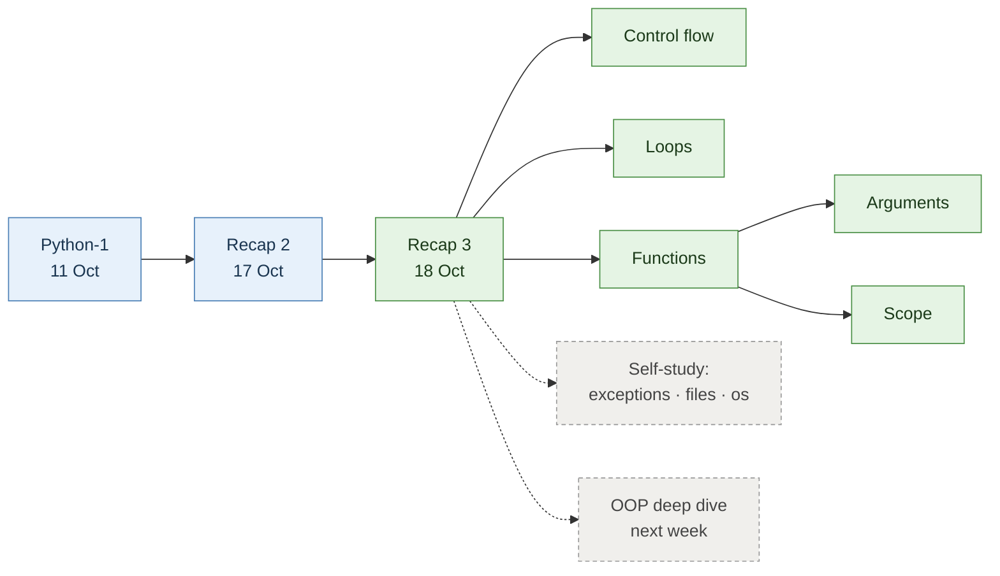

> Blue = earlier sessions · green = today · dashed = what's next.

---

## Control flow

Control flow **decides the order in which a program runs its instructions**. Without it, Python simply runs top to bottom, line 1 to the last line. Control flow lets code **choose** a path (`if` / `elif` / `else`) or **repeat** a block (`for` / `while`).

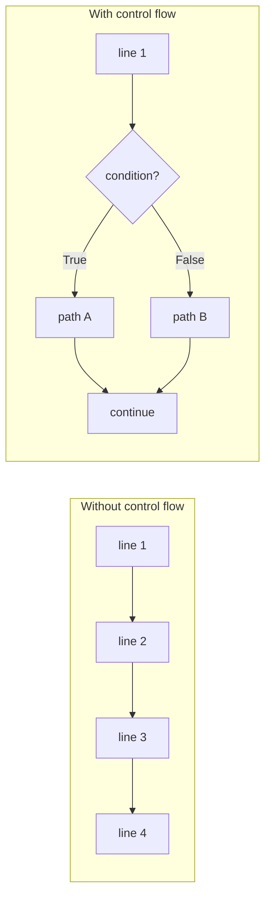

### `if`, `if-else`, `if-elif-else`

```python
first_class = True
if first_class:
    print("Complete the backlog")

class_no = 5
if (class_no > 3) and (class_no <= 5):
    print("Welcome back!, We are refreshing python")
else:
    print("Please Complete the backlog")
```

> [!IMPORTANT]
> The colon `:` and the **indentation** (4 spaces) define the block. Everything indented under `if` belongs to it.

### Grading example: only the first match runs

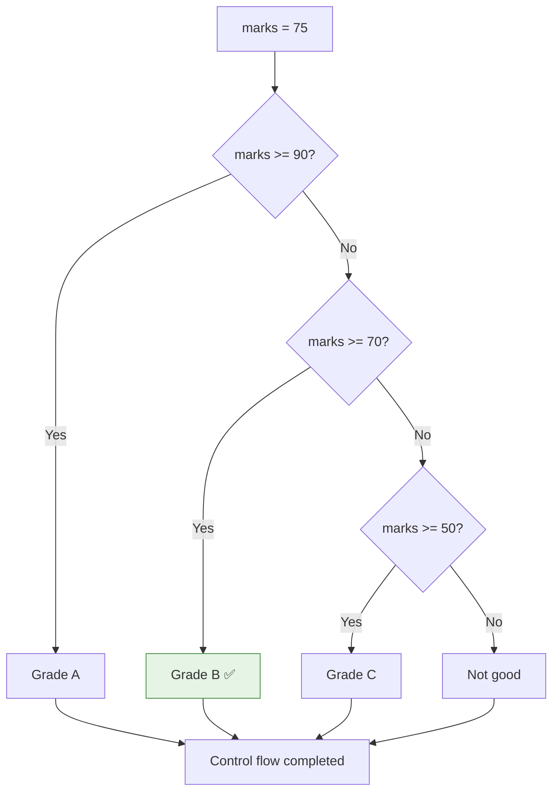

```python
marks = 75
if marks >= 90:
    print("Grade A")
elif marks >= 70:
    print("Grade B")      # <- runs, the rest is skipped
elif marks >= 50:
    print("Grade C")
else:
    print("Not good")
print("Control flow completed")
```

### Separate `if`s vs one `if-elif` chain

| | Several separate `if` blocks | One `if-elif-else` chain |
| --- | --- | --- |
| How many conditions are checked | **All** of them | Until the **first True** |
| How many blocks can run | Any number | **Exactly one** |
| Use when | Checks are independent | Options are mutually exclusive (grades, buckets) |

```python
class_no = 5
if (class_no > 3) and (class_no <= 5):     # block 1: checked
    print("Welcome back!, We are refreshing python")
if class_no == 5:                           # block 2: ALSO checked
    print("Welcome back!, you are on track")
# both lines print
```

### Nested `if`: the club entry check

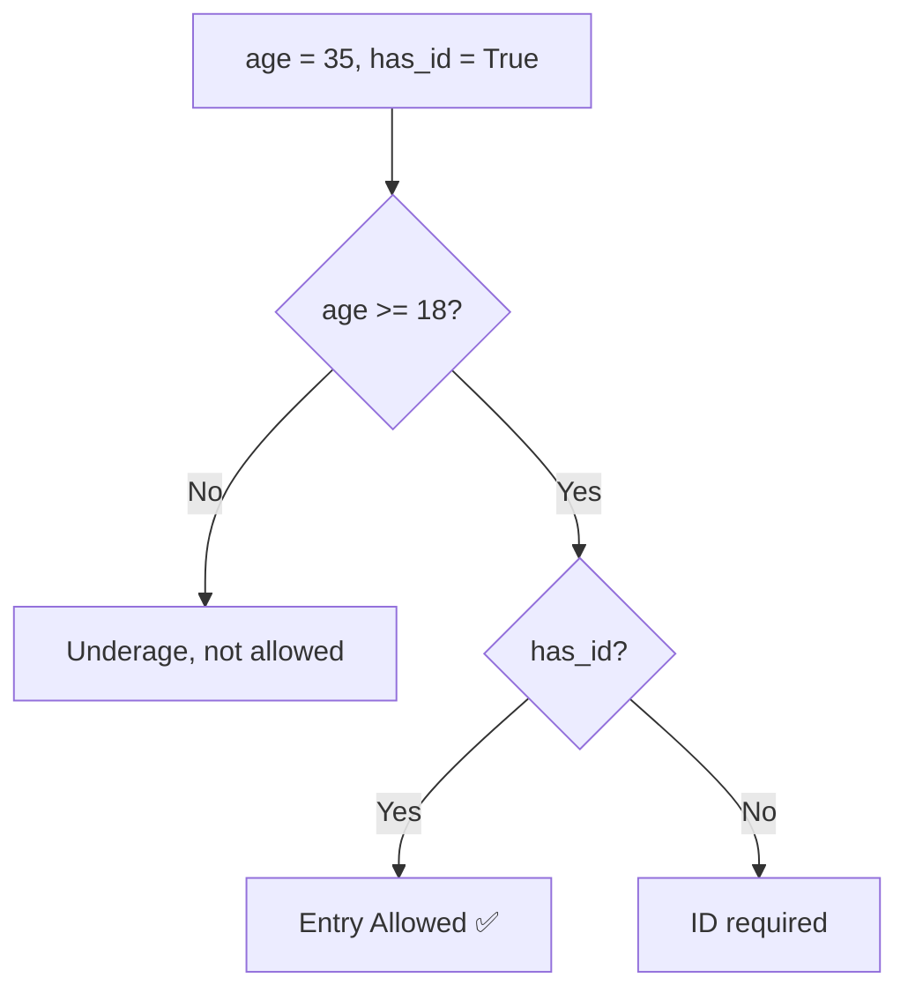

```python
age = 35
has_id = True
if age >= 18:
    if has_id:
        print("Entry Allowed")
    else:
        print("ID required")
else:
    print("Underage, not allowed")
```

### Truthiness

Every value counts as True or False inside an `if`.

| Falsy (treated as `False`) | Truthy (treated as `True`) |
| --- | --- |
| `False`, `None` | `True` |
| `0`, `0.0` | Any non-zero number: `1`, `1.0`, `-5` |
| `""` empty string | Any non-empty string, even `"0"` or `" "` |
| `[]`, `{}`, `set()`, `()` empty collections | Any non-empty collection, even `[0]` |

```python
name = ""
if name:                 # "" is falsy
    print("Hello", name)
else:
    print("Name missing")
```

### Conditional expression (one-line if-else)

```python
# 4-line version
if age >= 18:
    status = "Adult"
else:
    status = "Minor"

# one-line version: value_if_true if condition else value_if_false
status = "Adult" if age >= 18 else "Minor"
```

Use it only when the logic is short; long conditions are easier to read in the full form.

> [!NOTE]
> Python also has `match` (similar to switch-case in other languages). It came up in class but wasn't used.

---

## Loops

A loop **repeats** a block of code instead of copying it again and again.

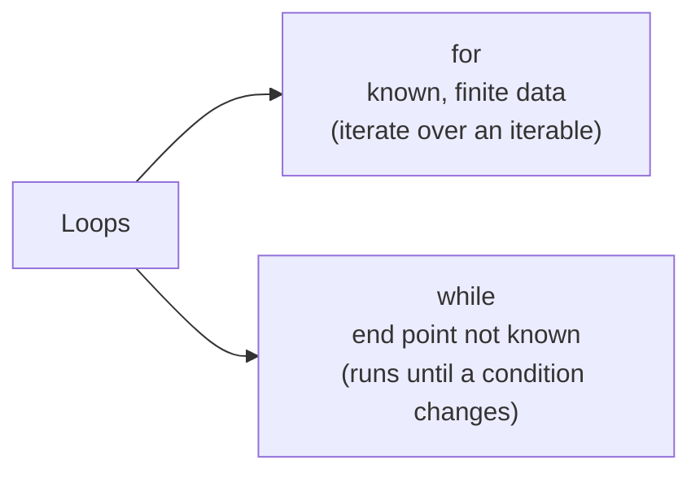

### `for` loop

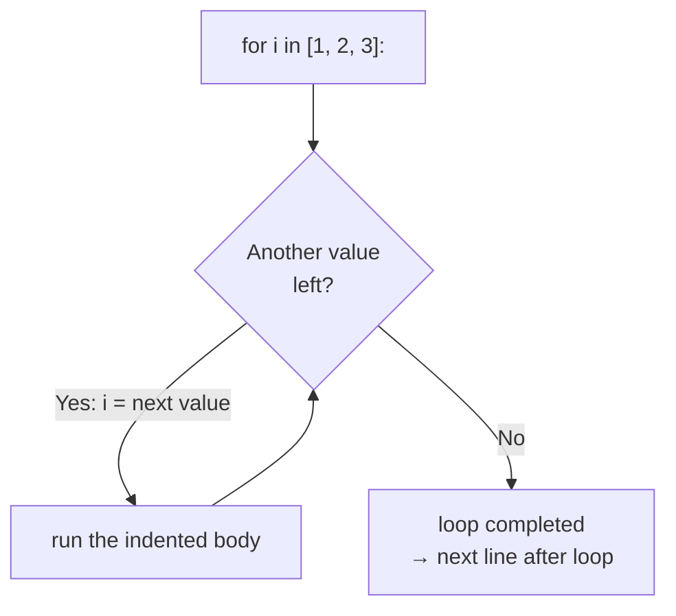

**Iterables** are anything a `for` loop can walk through: a string (`"Hello"`), a list (`[1, 2, 3, 4]`), a tuple (`(1, 2, 3)`), a dictionary (walks its **keys**), and `range()`.

### `range(start, end, step)`

| Call | Values produced | Note |
| --- | --- | --- |
| `range(1, 11)` | 1, 2, … 10 | `end` is **excluded** |
| `range(1, 4)` | 1, 2, 3 | Loop runs 3 times |
| `range(1, 11, 2)` | 1, 3, 5, 7, 9 | Step of 2 |
| `range(0, 11)` | 0, 1, … 10 | |

`range(1, 11)` on its own prints as `range(1, 11)`; wrap it as `list(range(1, 11))` to see the values.

```python
for i in range(1, 4):
    print(i)
    print("FDE")
# 1 FDE 2 FDE 3 FDE
```

> [!CAUTION]
> The loop variable name is your choice, but use it consistently. In class, `for KNA in range(1, 4): print(i)` printed `3` three times, because `i` was the **leftover value from the previous loop**, not the current one.

### Looping over a dictionary

```python
values = {"101": "Ananda", "102": "Yuval", "103": "Anurag"}

for i in values:                 # keys only
    print(i)                     # 101, 102, 103

count = 0
for key, name in values.items(): # key and value together
    print(key, name)
    count += 1
print(f"Loop executed {count} times")   # 3
```

**Unpacking** is what makes `key, name` work: each item is a pair, split into two names.

```python
a1, b1, c1 = (10, 2, 4)   # a1=10, b1=2, c1=4
```

**`enumerate()`** adds a counter so you don't need `count += 1`. The class attempt `for i, j, k in enumerate(...)` failed with `ValueError: not enough values to unpack`. The working form brackets the inner pair:

```python
for n, (key, name) in enumerate(values.items(), start=1):
    print(n, key, name)
# 1 101 Ananda
# 2 102 Yuval
# 3 103 Anurag
```

### `pass` vs `continue` vs `break`

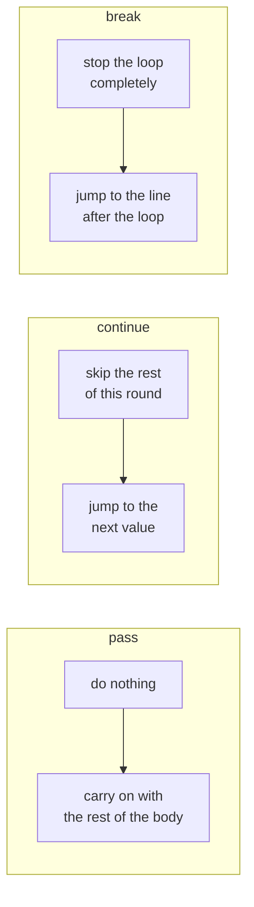

Same loop over `0…10`, skipping `3, 4, 5`:

| Keyword | Code inside `if i in [3, 4, 5]:` | Numbers printed | "Iteration completed" printed |
| --- | --- | --- | --- |
| `pass` | placeholder, does nothing | 0–2, 6–10 | **11 times** (still runs for 3, 4, 5) |
| `continue` | skip to next value | 0–2, 6–10 | **8 times** (skipped for 3, 4, 5) |
| `break` (on `i == 3`) | exit the loop | 0, 1, 2 | **3 times**, then "Loop completed." |

```python
for i in range(0, 11):
    if i in [3, 4, 5]:
        continue          # try pass, then break, and compare
    else:
        print(i)
    print("Iteration completed")
print("Loop completed.")
```

### Nested loops and the dry run

Problem: go through 0–10; when the number is 7, print "Welcome to FDE bootcamp" 3 times.

```python
for i in range(0, 11):
    print(i)
    if i == 7:
        for j in range(0, 300):
            if j == 3:
                break                       # exits ONLY the inner loop
            print("Welcome to FDE bootcamp")
```

**Dry run**: trace each step on paper.

| `i` | Inner loop? | `j` values | Output |
| :-: | --- | --- | --- |
| 0 – 6 | No | – | `0` … `6` |
| 7 | Yes | 0, 1, 2 → print · 3 → `break` | `7`, then "Welcome…" ×3 |
| 8 – 10 | No | – | `8`, `9`, `10` |

> [!IMPORTANT]
> `break` exits only the **innermost** loop it's in; the outer loop keeps going. Use `break` only inside loops.

### `while` loop

Use `while` when the **end point isn't known** in advance. It's the loop version of `if`: keep going as long as the condition is True.

Class example: a website stores user data, so compliance rules require consent. Keep showing the Terms & Conditions page until the user agrees.

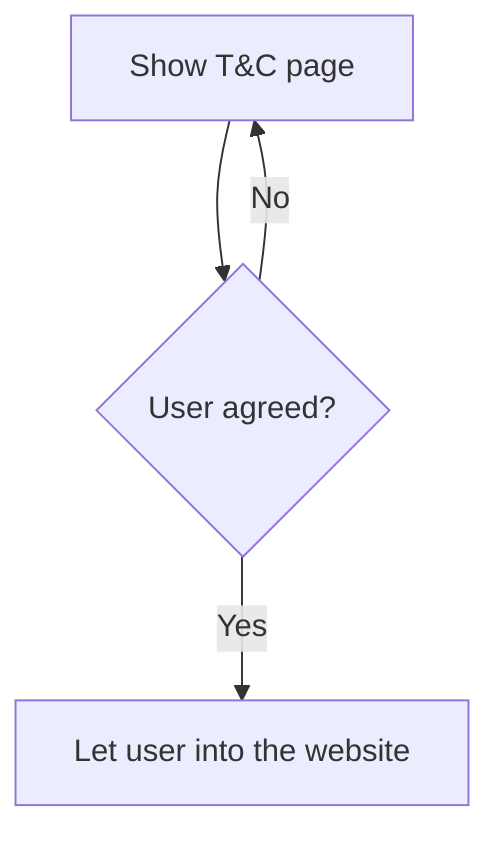

```python
consent = ""
while consent != "yes":
    consent = input("Do you agree to the Terms & Conditions? (yes/no): ").strip().lower()
print("Welcome! You can now use the website.")
```

```python
# while True + break: from the class notebook
i = 0
while True:
    print("hello")
    i = i + 1
    if i > 10:
        break          # prints "hello" 11 times (i = 0 … 10)
```

> [!WARNING]
> A `while` loop needs something that eventually makes the condition False (or a `break`). Otherwise it runs forever (an infinite loop).

---

## Functions

A function is a **named, reusable block of code**. Write the logic once and call it anywhere, instead of copying the same lines (the class example: a 1,000-line payment routine you wouldn't paste everywhere it's needed).

### Before and after

```python
# functions.py: repeated logic
price_1 = 100;  quantity_1 = 5
total_price_1 = price_1 * quantity_1
price_2 = 1000; quantity_2 = 2
total_price_2 = price_2 * quantity_2
```

```python
# functions_2.py: written once, reused
def calculate_total(price, quantity):    # price, quantity -> PARAMETERS
    total_price = price * quantity
    return total_price

value_1 = calculate_total(60, 70)        # 60, 70 -> ARGUMENTS
value_2 = calculate_total(1000, 2)
print(value_1 + value_2)                 # 4200 + 2000 = 6200
```

### Anatomy of a function

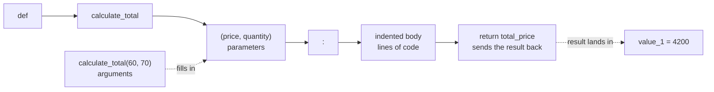

| Term | Meaning | In the example |
| --- | --- | --- |
| `def` | Keyword that defines a function | `def` |
| Name | How you call it later (snake_case) | `calculate_total` |
| Parameters | Placeholders in the definition | `price`, `quantity` |
| Arguments | Actual values passed when calling | `60`, `70` |
| `return` | Sends a value back to the caller | `return total_price` |

Defining a function does nothing on its own. The code runs only when you **call** it.

### `print` vs `return`: the BP machine

A blood-pressure machine that calculates your reading but keeps it inside would be useless. You want the result handed back on the display.

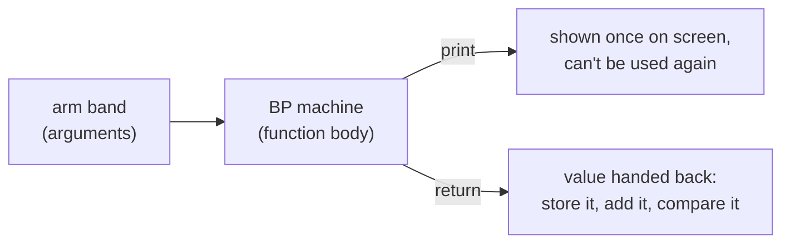

| | `print(...)` | `return ...` |
| --- | --- | --- |
| What it does | Shows a value on screen | Sends a value back to the caller |
| Can you store or reuse the result? | ❌ the call itself gives `None` | ✅ `x = func()` |
| Ends the function? | No | Yes, immediately |

```python
def add_print(a, b):
    print(a + b)

def add_return(a, b):
    return a + b

r1 = add_print(1, 2)    # shows 3, but r1 is None
r2 = add_return(1, 2)   # r2 is 3, ready to use
```

---

## Function arguments

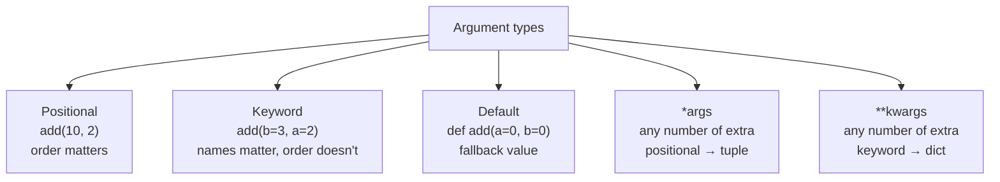

### Positional and keyword

```python
def add(a, b):
    return a + b

add(10, 2)        # positional: a=10, b=2  -> 12
add(b=3, a=2)     # keyword:    a=2,  b=3  -> 5
add(1, b=2)       # mix: positional first  -> 3
add()             # TypeError: missing 2 required positional arguments: 'a' and 'b'
add(1)            # TypeError: missing 1 required positional argument: 'b'
```

### Default arguments

```python
def greet(name, message="great day!"):
    print(message, name)

greet("amit")            # great day! amit   (default used)
greet("amit", "Hi")      # Hi amit           (default overridden)
```

| Definition | Valid? | Why |
| --- | :-: | --- |
| `def add(a=0, b=0):` | ✅ | All defaults |
| `def add(a, b=0):` | ✅ | Defaults come last; `add(10)` → 10 |
| `def add(a=0, b):` | ❌ | `SyntaxError`: a parameter without a default can't follow one with a default |

### `*args`: any number of positional values

```python
def total(a=0, b=0, c=0, d=0):
    print(a + b + c + d)
total(10, 20, 30, 40, 50)   # TypeError: takes from 0 to 4 positional arguments but 5 were given

def total(*args):
    print(args)             # args is a TUPLE
    return sum(args)
total(1)                    # (1,)  -> 1
total(1, 2, 3, 4, 5)        # (1, 2, 3, 4, 5) -> 15
```

### `**kwargs`: any number of named values

```python
def show_user_info(name, phone_no, **kwargs):
    print(kwargs)           # kwargs is a DICT
    print(name, phone_no)

show_user_info(phone_no="+983232323", name="suhas", email="hgjdh@gmail.com")
# {'email': 'hgjdh@gmail.com'}
# suhas +983232323
```

### How values are packed

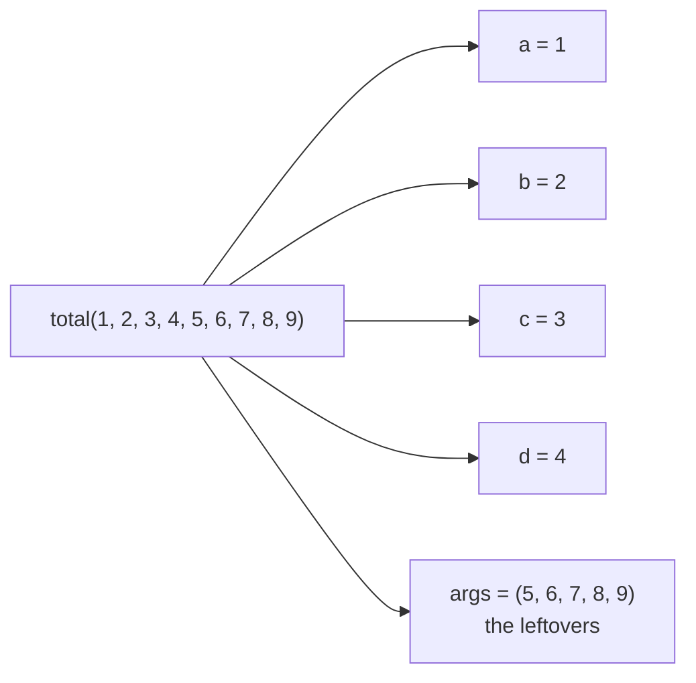

```python
def show_all(*args, **kwargs):
    print(args)
    print(kwargs)

show_all(1, 2, 3, name="monal", phone_no="+8908029w")
# (1, 2, 3)
# {'name': 'monal', 'phone_no': '+8908029w'}
```

> [!TIP]
> The names `args` and `kwargs` are convention; the `*` and `**` do the work. Order in a definition: normal → defaults → `*args` → `**kwargs`.

---

## Variable scope

**Global** variables live outside functions; **local** variables are created inside a function and disappear when it ends.

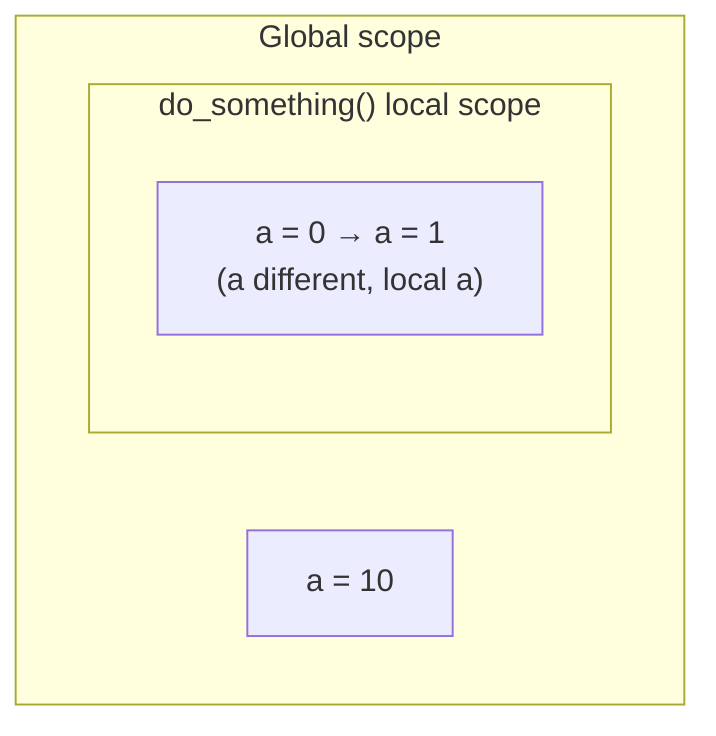

| Inside the function you… | Allowed? | Effect on the global variable |
| --- | :-: | --- |
| **Read** a global (`print(a)`) | ✅ | None |
| **Assign** the same name (`a = 0`) | ✅ | None: creates a separate local `a` |
| **Update** it (`a = a + 1`) without `global` | ❌ | `UnboundLocalError` |
| Declare `global a`, then update | ✅ | Global changes |
| **Modify** a global list/dict in place (`a.append(...)`) | ✅ | Global changes (mutable) |

```python
a = 10
def do_something():
    a = 0          # local a
    a = a + 1
    print(a)       # 1
do_something()
print(a)           # 10 -> global untouched

a = 10
def do_something():
    global a       # use the outside a
    a = a + 1
    print(a)       # 11
do_something()
print(a)           # 11

a = [1, 2, 3]
def do_something():
    a.append(123)  # in-place change on a mutable global
do_something()
print(a)           # [1, 2, 3, 123]
```

> [!TIP]
> Prefer **passing values in as arguments and returning results** over `global`. It keeps functions predictable and testable.

---

## Assignment

From `Assignement.txt`. This was the last class on basics; these are self-study.

**Priority 1**

- [ ] Exception handling (`try` / `except`)
- [ ] `os` library: `os.path.join`, `os.getcwd`, `os.listdir`, relative vs full path
- [ ] File handling, practised together with exception handling
- [ ] OOP: class, object, constructor, methods, attributes, `self`

**Priority 2**

- [ ] Comprehensions: list and dict
- [ ] Useful built-ins: `any()`, `all()`, `map()`, `filter()`, `enumerate()`, `zip()`, `sorted()`
- [ ] `lambda`

The suggested way to learn each topic:

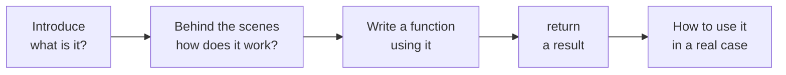

---

## Key takeaways and audit application

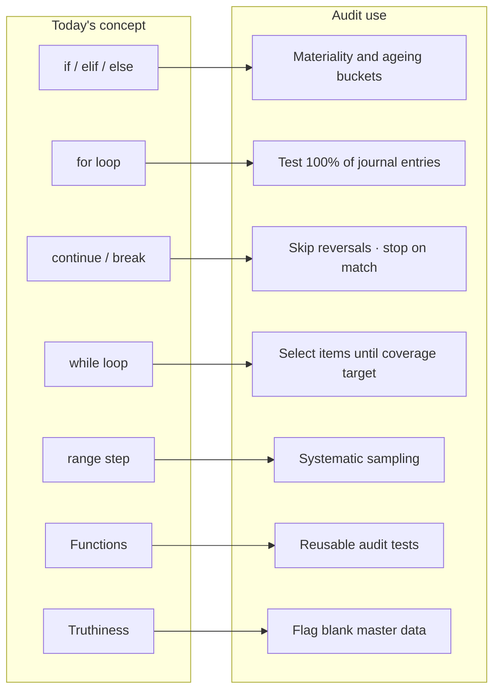

| Concept | Key takeaway | Application in financial statement audit |
| --- | --- | --- |
| `if-elif-else` | First True branch wins; exactly one runs | Classify misstatements against overall materiality, performance materiality and the clearly-trivial threshold |
| Separate `if`s | Every check runs | Independent red flags on one entry (weekend, round sum, unapproved) can all be reported |
| Nested `if` | Second check only if the first passes | Only test approval if the amount exceeds the authorisation limit |
| Truthiness | Empty / `None` / `0` are False | `if not vendor["gstin"]:` catches blank master-data fields |
| Conditional expression | One-line choice | `status = "Exception" if diff > tolerance else "Agreed"` |
| `for` loop | Repeat over a finite population | Test every journal entry, invoice or customer, not just a sample |
| `.items()` / unpacking | Key and value together | Loop over `{customer: balance}` or `{account: amount}` |
| `continue` | Skip this item, keep going | Skip zero-value or reversed entries |
| `break` | Stop once found | Stop searching the bank statement once a cash-book item is matched |
| Nested loops | Compare every item in A with B | Bank reconciliation, three-way match (PO / GRN / invoice) |
| `while` | Run until a condition changes | Keep selecting the largest items until a coverage target is reached |
| `range(start, end, step)` | Every n-th value | Systematic sampling with a random start and fixed interval |
| `enumerate()` | Automatic counter | Number samples as "Sample 1, 2, 3…" in the working paper |
| Functions + `return` | Write once, reuse, get a usable result | One `calculate_materiality()` used across every engagement |
| Default arguments | Sensible fallback values | Default benchmark percentage (e.g. 5% of profit before tax), overridable per client |
| `*args` / `**kwargs` | Flexible inputs | Total any number of sample items; attach any extra details to an exception log |
| Scope | Locals don't leak; prefer `return` | Each test function returns its own exception count instead of editing a global total |

> [!TIP]
> Today's big idea for audit: **control flow turns audit judgement rules into code, loops apply them to the whole population, and functions make the test reusable** on the next client or next year.

---

## Real-world audit examples

Every output shown was checked by running the code. Thresholds and data are illustrative; real materiality levels are set by professional judgement under your firm's methodology.

| # | Example | Audit area | Concepts |
| :-: | --- | --- | --- |
| 1 | [Classifying misstatements](#1-classifying-misstatements) | Evaluation of misstatements | if-elif-else, function |
| 2 | [Calculating materiality](#2-calculating-materiality) | Planning | default and keyword arguments |
| 3 | [Journal entry testing](#3-journal-entry-testing) | Management override | for, continue, logical operators |
| 4 | [Receivables ageing](#4-receivables-ageing) | Impairment / valuation | function, `.items()` |
| 5 | [Systematic sampling](#5-systematic-sampling) | Sample selection | `range` step |
| 6 | [High-value coverage](#6-high-value-coverage) | Substantive testing | while loop |
| 7 | [Bank reconciliation](#7-bank-reconciliation) | Cash | nested loops, break |
| 8 | [Blank master-data fields](#8-blank-master-data-fields) | Controls over master data | truthiness |
| 9 | [Flexible audit helpers](#9-flexible-audit-helpers) | Working papers | `*args`, `**kwargs`, enumerate |
| 10 | [Return, don't use global](#10-return-dont-use-global) | Reliable tests | scope, return |

### 1. Classifying misstatements

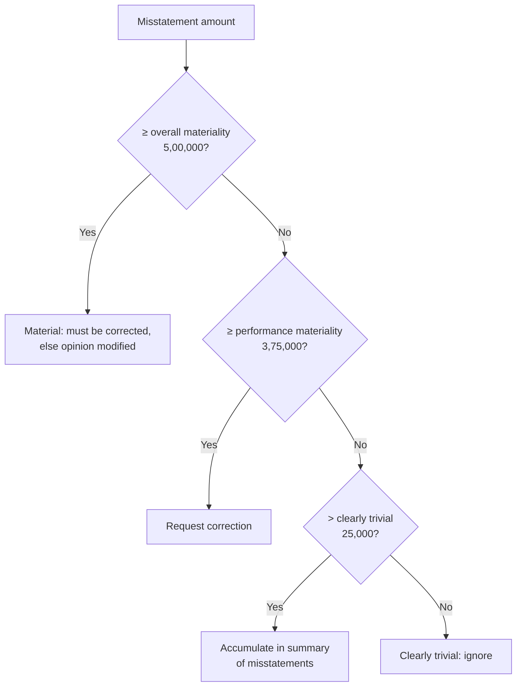

```python
def classify_misstatement(amount, overall=500000, performance=375000, trivial=25000):
    if amount >= overall:
        return "Material - modify opinion / must be corrected"
    elif amount >= performance:
        return "Above performance materiality - request correction"
    elif amount > trivial:
        return "Accumulate in summary of misstatements"
    else:
        return "Clearly trivial - ignore"

print(classify_misstatement(620000))   # Material - modify opinion / must be corrected
print(classify_misstatement(410000))   # Above performance materiality - request correction
print(classify_misstatement(90000))    # Accumulate in summary of misstatements
print(classify_misstatement(12000))    # Clearly trivial - ignore
```

The order matters: checking `> trivial` first would put a 6,20,000 misstatement in the wrong bucket.

### 2. Calculating materiality

```python
def calculate_materiality(benchmark, percentage=5):
    return benchmark * percentage / 100

pbt = 12000000
print(calculate_materiality(pbt))                                  # 600000.0  (default 5%)
print(calculate_materiality(pbt, 2))                               # 240000.0  (positional override)
print(calculate_materiality(percentage=1, benchmark=150000000))    # 1500000.0 (keyword: e.g. 1% of revenue)
```

### 3. Journal entry testing

Test the whole population: skip zero-value entries, then flag large weekend postings or anything unapproved.

```python
journal_entries = [
    {"je_no": "JE001", "amount": 45000,  "day": "Monday",   "approved": True},
    {"je_no": "JE002", "amount": 0,      "day": "Tuesday",  "approved": True},
    {"je_no": "JE003", "amount": 780000, "day": "Sunday",   "approved": True},
    {"je_no": "JE004", "amount": 120000, "day": "Friday",   "approved": False},
    {"je_no": "JE005", "amount": 60000,  "day": "Saturday", "approved": True},
]
threshold = 500000
exceptions = []

for je in journal_entries:
    if je["amount"] == 0:
        continue                                   # nothing to test
    weekend = je["day"] in ["Saturday", "Sunday"]
    if (je["amount"] > threshold and weekend) or not je["approved"]:
        exceptions.append(je["je_no"])

print(exceptions)                                  # ['JE003', 'JE004']
print(f"{len(exceptions)} of {len(journal_entries)} entries selected for testing")
# 2 of 5 entries selected for testing
```

JE005 is a weekend posting but below the threshold and approved, so it isn't selected.

### 4. Receivables ageing

```python
def ageing_bucket(days_overdue):
    if days_overdue <= 30:
        return "0-30"
    elif days_overdue <= 90:
        return "31-90"
    elif days_overdue <= 180:
        return "91-180"
    else:
        return "180+ (assess for impairment)"

receivables = {"C001": 15, "C002": 75, "C003": 200, "C004": 120}
for customer, days in receivables.items():
    print(customer, days, ageing_bucket(days))
# C001 15 0-30
# C002 75 31-90
# C003 200 180+ (assess for impairment)
# C004 120 91-180
```

### 5. Systematic sampling

Pick a random start, then every n-th item: exactly what `range(start, end, step)` produces.

```python
population = list(range(1001, 1021))     # 20 invoice numbers: 1001 … 1020
interval = 5                             # population size / sample size = 20 / 4
start = 2                                # random start between 0 and interval - 1

for position in range(start, len(population), interval):
    print(position, population[position])
# 2 1003
# 7 1008
# 12 1013
# 17 1018
```

### 6. High-value coverage

Keep selecting the largest balances until at least 70% of the population value is covered. You don't know in advance how many items that takes, so this is a `while` loop.

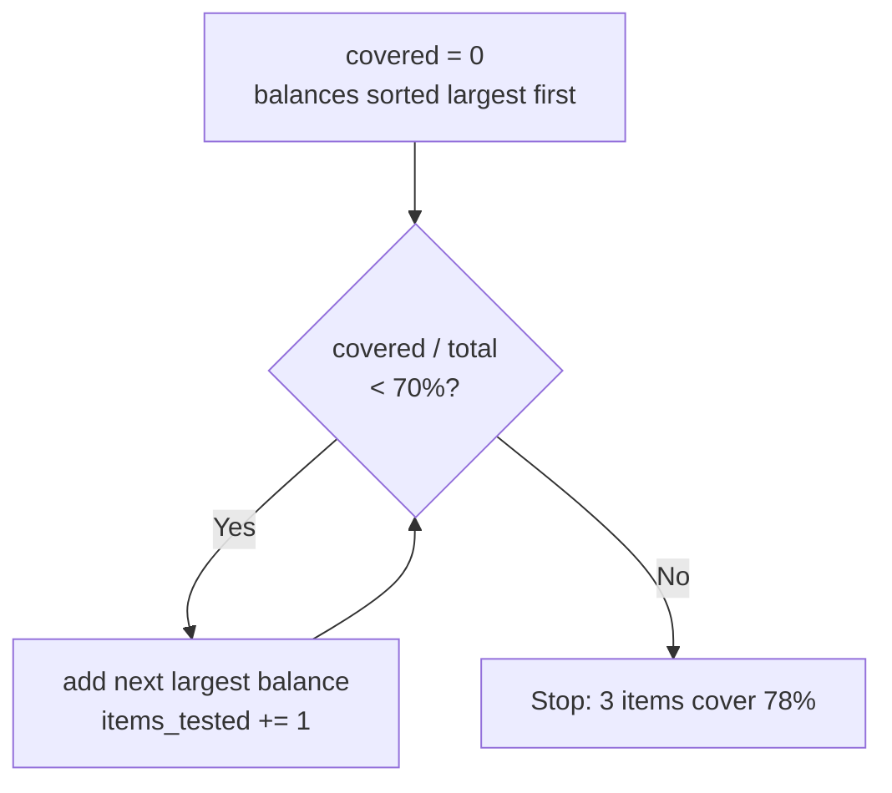

```python
balances = [900000, 650000, 400000, 250000, 150000, 100000, 50000]   # sorted largest first
total = sum(balances)              # 2500000
target = 0.70
covered = 0
items_tested = 0

while covered / total < target:
    covered = covered + balances[items_tested]
    items_tested += 1

print(items_tested, covered, round(covered / total * 100, 1))
# 3 1950000 78.0  -> 3 items cover 78% of the value
```

### 7. Bank reconciliation

Match every cash-book cheque against the bank statement; `break` stops searching once a match is found.

```python
cash_book      = [("CHQ101", 50000), ("CHQ102", 72000), ("CHQ103", 15000)]
bank_statement = [("CHQ103", 15000), ("CHQ101", 50000)]

for cb_ref, cb_amt in cash_book:
    found = False
    for bank_ref, bank_amt in bank_statement:
        if cb_ref == bank_ref and cb_amt == bank_amt:
            found = True
            break                       # matched: stop searching
    if not found:
        print(f"{cb_ref} for {cb_amt:,} not yet cleared - outstanding cheque")
# CHQ102 for 72,000 not yet cleared - outstanding cheque
```

| Cash book | Bank statement | Result |
| --- | --- | --- |
| CHQ101 · 50,000 | ✅ found | Cleared |
| CHQ102 · 72,000 | ❌ not found | Outstanding: verify clears after year-end |
| CHQ103 · 15,000 | ✅ found | Cleared |

### 8. Blank master-data fields

Truthiness catches `""`, `None` and `0` in one check.

```python
vendor = {"name": "XYZ Supplies", "gstin": "", "bank_account": None, "approver": "R. Shah"}

for field, value in vendor.items():
    if not value:
        print(f"Missing: {field}")
# Missing: gstin
# Missing: bank_account
```

### 9. Flexible audit helpers

```python
def total_sample_value(*amounts):          # any number of items
    return sum(amounts)

print(total_sample_value(45000, 120000, 780000))   # 945000

def log_exception(je_no, amount, **details):       # any extra detail
    print(je_no, f"{amount:,}", details)

log_exception("JE003", 780000, reason="Weekend posting", posted_by="admin01")
# JE003 780,000 {'reason': 'Weekend posting', 'posted_by': 'admin01'}

selected = ["JE003", "JE004"]
for n, je in enumerate(selected, start=1):
    print(f"Sample {n}: {je}")
# Sample 1: JE003
# Sample 2: JE004
```

### 10. Return, don't use global

Each test returns its own result, so it can be reused and checked independently.

```python
def count_unapproved(entries):
    count = 0                    # local: starts fresh on every call
    for e in entries:
        if not e["approved"]:
            count += 1
    return count

total_exceptions = 0
total_exceptions = total_exceptions + count_unapproved(journal_entries)
print(total_exceptions)          # 1
```

---

<sub>Source: KrishNaikAcademy · Python Recap 3 session · 18 Oct 2026</sub>
