# Network I/O, Memory & Generators – Session Notes (24 Oct 2026)


Revision notes for the **Module 1 · Day 1** live session from **KrishNaikAcademy** (instructor: Monal S), built from the class notebook (`demo_file_1.ipynb`), the handwritten notes, the assignment sheet and the recording transcript.

## Contents

1. [Session overview](#session-overview)
2. [Network I/O](#network-io)
3. [URL, website and API](#url-website-and-api)
4. [Protocols](#protocols)
5. [HTTP vs HTTPS and HTTP versions](#http-vs-https-and-http-versions)
6. [HTTP methods](#http-methods)
7. [Making requests in Python](#making-requests-in-python)
8. [Memory management and garbage collection](#memory-management-and-garbage-collection)
9. [Why memory matters: LLMs and large PDFs](#why-memory-matters-llms-and-large-pdfs)
10. [Iterators and generators](#iterators-and-generators)
11. [Assignment](#assignment)
12. [Key takeaways and audit application](#key-takeaways-and-audit-application)
13. [Real-world audit examples](#real-world-audit-examples)

---

## Session overview

| Item | Details |
| --- | --- |
| Source | KrishNaikAcademy |
| Date | 24 Oct 2026 |
| Module | Module 1: Python & Linux Foundation, **day one of the actual syllabus** (earlier classes were recaps) |
| Previous sessions | Python-1 (11 Oct) · Recap 2 (17 Oct) · Recap 3 (18 Oct) |
| Covered | Network I/O, URLs vs APIs, protocols, HTTP vs HTTPS, HTTP versions, HTTP methods, `requests`, status codes, memory management, garbage collection, iterators, generators |
| Next | Linux for engineers (Multipass install demo next Saturday) |

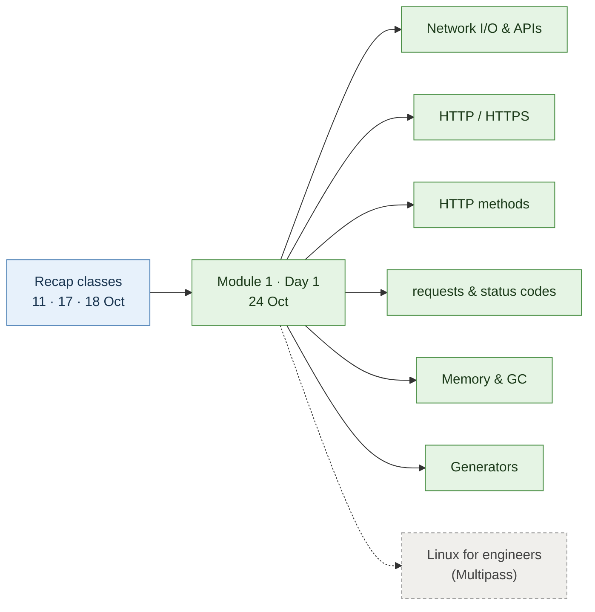

> Green = covered today · dashed = coming next.

> [!TIP]
> The expectation from here on isn't to learn every concept from zero to 100. It's **problem → skills → solution**, and to think in systems: **concept → usage → scale**. The pace will increase class by class.

---

## Network I/O

**I/O** means input/output. **Network I/O** is managing input and output of data **across a network**: your program sending a request to another computer and receiving data back.

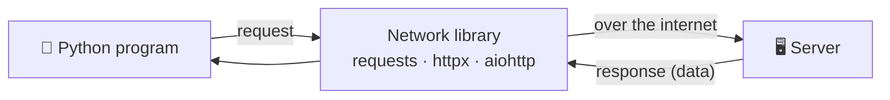

| Library | Notes |
| --- | --- |
| `requests` | The most widely used; simple, one request at a time. Used in today's demo |
| `httpx` | Modern alternative with a `requests`-style interface; also supports async |
| `aiohttp` | Async: many requests at once. Common in existing code online |

---

## URL, website and API

A **URL** is a digital mailing address (e.g. `google.com`). What comes back from that address depends on who's asking.

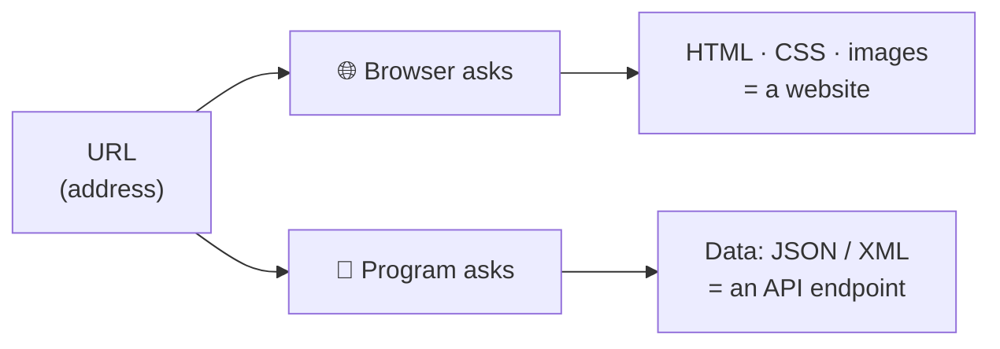

| | Website | API endpoint |
| --- | --- | --- |
| Who uses it | People, through a browser | Programs (Python, apps, LLM tools) |
| What comes back | HTML, CSS, images to display | Structured data: **JSON** (or XML) |
| Example | `https://dummyjson.com` | `https://dummyjson.com/products` |

**API** (Application Programming Interface) is the agreed way for two programs to communicate. LLMs work the same way: you send data to a URL and get data back.

---

## Protocols

For communication to work, both sides follow the same rules: a **protocol**.

| Primary purpose | Protocol |
| --- | --- |
| Transferring web pages and API data | **HTTP / HTTPS** |
| Real-time, two-way communication (live chat apps) | **WebSocket** |
| Moving large files between computers | **FTP / SFTP** |
| Sending and receiving email | **SMTP / IMAP** |
| Translating names to computer addresses (`google.com` → IP address) | **DNS** |
| Lightweight messaging for smart homes / IoT | **MQTT** (Message Queuing Telemetry Transport) |
| Video streaming, peer-to-peer calls | **WebRTC** |

> [!NOTE]
> These are each protocol's *primary* use. HTTP can also send live updates, for example, but WebSocket is the better fit for two-way chat.

---

## HTTP vs HTTPS and HTTP versions

### HTTP vs HTTPS

The **S** stands for **secure**: data is encrypted in transit using **TLS/SSL**. With plain HTTP, anyone in between can read the message.

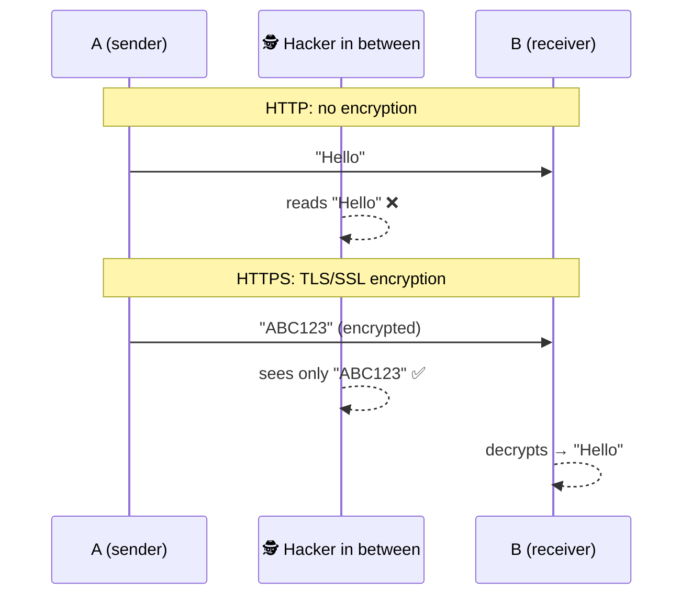

| | `http://` | `https://` |
| --- | --- | --- |
| Encryption | ❌ None: plain text | ✅ TLS/SSL |
| Safe for passwords, payments, client data | ❌ | ✅ |
| Today | Rare; browsers warn "Not secure" | The **standard** |

### The handshake: why older HTTP is "slow"

Before HTTP/1.1 and HTTP/2 send any data, they make **2 to 3 round trips**: first a 3-step network handshake (TCP), then a security handshake (TLS).

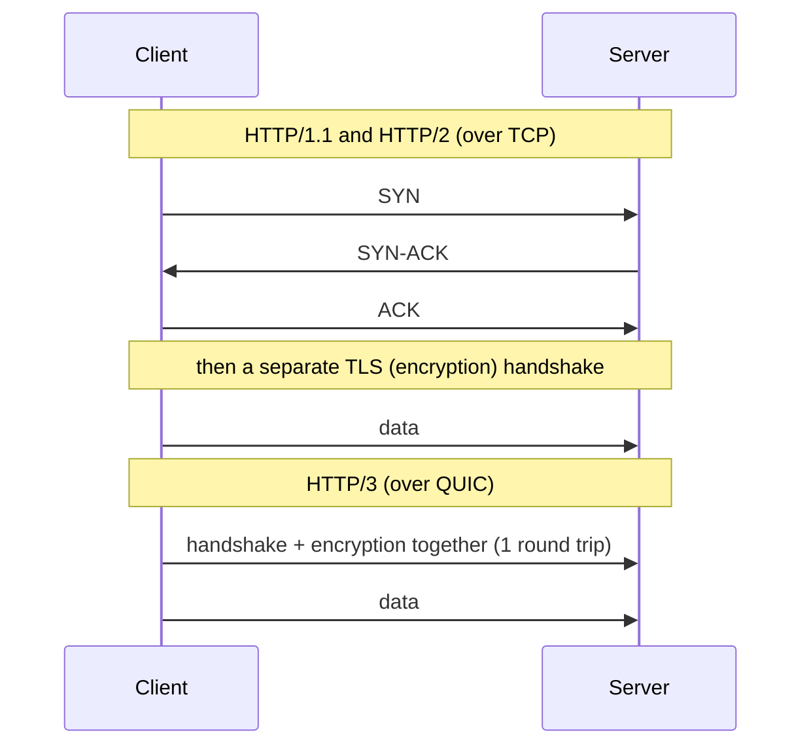

### HTTP versions

| Version | Handshake | Security | Speed |
| --- | --- | --- | --- |
| HTTP/1.1, HTTP/2 | TCP 3-step + TLS (2–3 round trips) | Encryption added via HTTPS | Slower to start |
| HTTP/3 | Handshake and encryption combined (1 round trip) | Secure built in | Faster to start |

**How do client and server agree on a version?** You still type `https://`; there's no `http3://` in practice. The server advertises what it supports in a response header such as `Alt-Svc: h3=":443"` ("I also speak HTTP/3 on port 443"), and the client switches if it can.

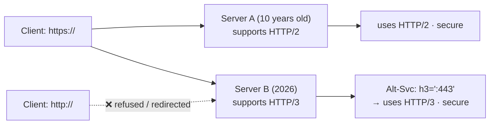

> [!TIP]
> The class target isn't to implement TLS. It's to understand **that** communication happens through handshakes, **that** HTTPS keeps data secure, and **why** newer versions are faster.

---

## HTTP methods

The method tells the API **what you want to do**.

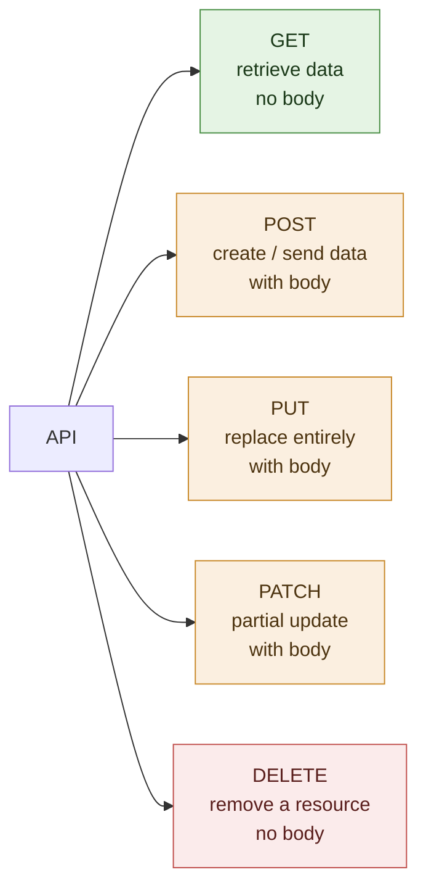

| Method | Purpose | Body? | Example |
| --- | --- | :-: | --- |
| `GET` | Retrieve data | No | Get product list |
| `POST` | Create a resource / send data to process | Yes | `{"date": "17/10/2026"}` |
| `PUT` | **Replace** a resource entirely | Yes | see below |
| `PATCH` | **Partially** update a resource | Yes | see below |
| `DELETE` | Remove a specified resource | No | Delete record 101 |

### PUT vs PATCH

Starting record: `a = {"name": "krish", "batch": "all"}`

| Request | Body sent | Result |
| --- | --- | --- |
| `PUT` | `{"name": "Yuval", "batch": "fde"}` | `{"name": "Yuval", "batch": "fde"}`: whole record **replaced** |
| `PATCH` | `{"name": "gowri"}` | `{"name": "gowri", "batch": "all"}`: only `name` **changed** |

> [!NOTE]
> In practice a lot can be done with just `GET` and `POST`; the others make intent clearer.

---

## Making requests in Python

Install the library (the class used `uv`; plain `pip install requests` also works):

```bash
uv pip install requests
```

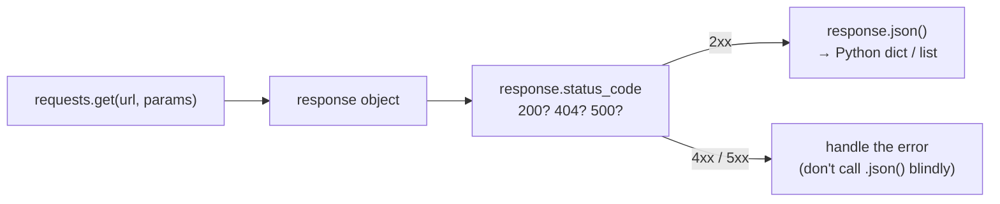

### A simple GET

```python
import requests

response = requests.get("https://dummyjson.com/test")
print(f"Status Code : {response.status_code}")   # Status Code : 200

data = response.json()     # extract the JSON payload into a dict
print(data)                # {'status': 'ok', 'method': 'GET'}
```

### GET with query parameters

```python
url = "https://dummyjson.com/products"
query_params = {"limit": 1, "skip": 5}           # becomes ?limit=1&skip=5

response = requests.get(url, params=query_params)
data = response.json()
print(data["products"][0]["title"], data["products"][0]["price"])
# Calvin Klein CK One 49.99
```

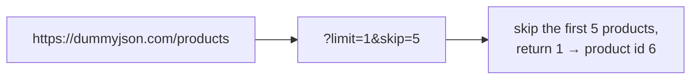

### Status codes

| Series | Meaning | Common codes |
| --- | --- | --- |
| **2xx** | ✅ Success | `200` OK · `201` Created |
| **4xx** | ❌ **Client-side** error: something wrong with *your* request | `400` Bad request · `401` Unauthorised · `403` Forbidden · `404` Not found |
| **5xx** | ❌ **Server-side** error: the server is busy or broken | `500` Internal error · `502` Bad gateway · `503` Unavailable |

> [!CAUTION]
> In class, a wrong URL returned `404`, and calling `response.json()` then raised a **JSON decode error**, because the error page isn't JSON. **Check `status_code` first.**

---

## Memory management and garbage collection

When Python starts, it already takes some RAM (the instructor's showed ~69 MB in Task Manager). Every object you create adds more. On a server running an LLM or API, memory is limited, so freeing what you no longer need matters.

### References and `del`

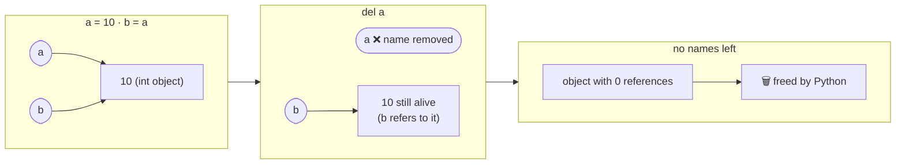

| Step | What happens |
| --- | --- |
| `a = 10` | Name `a` refers to an int object |
| `b = a` | `b` refers to the **same** object (2 references) |
| `del a` | Removes the **name** `a`, not the object; `b` still uses it |
| No references left | Python frees the object automatically |
| `gc.collect()` | Manually runs the garbage collector to free unreachable objects now |

```python
large_embeddings = [
    [0.12, -0.45, 0.87] * 100000 for _ in range(10)    # ~3 million floats
]

del large_embeddings     # remove the reference

import gc
gc.collect()             # free objects that have no references -> returned 6829 in class
```

> [!TIP]
> Python frees most objects automatically as soon as nothing refers to them. Call `gc.collect()` deliberately after dropping something **large** in a long-running process (an API server, an LLM pipeline); you don't need it in everyday scripts.

---

## Why memory matters: LLMs and large PDFs

### LLMs work on numbers


Text is converted to arrays of numbers (**embeddings**), processed, and converted back. Those arrays are large, which is why the class demo used `large_embeddings`, and why a deployment server (say 100 GB disk, 28 GB RAM, much of it used by the model) has little memory to spare.

### The 10,000-page PDF problem

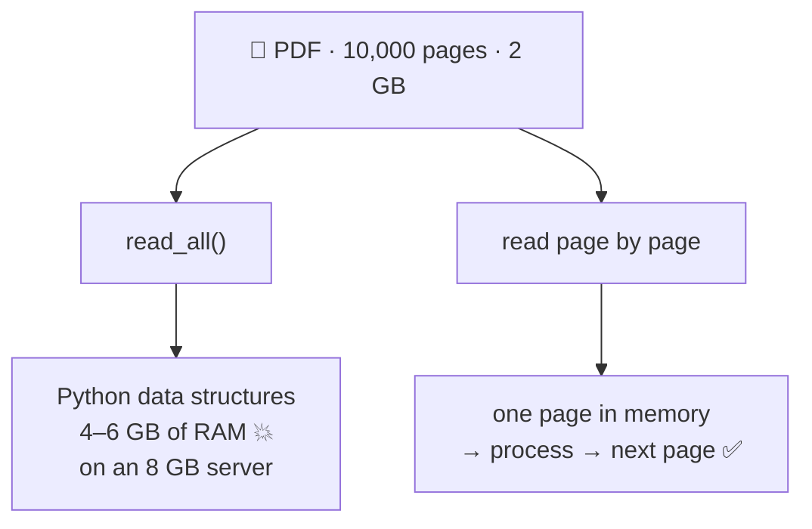

Some PDF pages are **text**; others are **images** (scans, screenshots). Images need **OCR** (deep-learning text recognition) to turn pixels into text: tools such as Tesseract, PaddleOCR, Amazon Textract, Amazon Rekognition and other OCR APIs. They can return text, tables and images, which are then sent to the LLM.

```python
# Reads everything into one list: fine for small files, risky for huge ones
def extract_all_pages(pdf_document):
    all_page_text = []
    for page in pdf_document:
        all_page_text.append(page.extract_text() or "")
    return all_page_text
```

The fix is to read **lazily**, one page at a time, using a generator.

---

## Iterators and generators

### Iterators: values one by one

`range()` and `enumerate()` don't build the whole list upfront; they hand out values **one at a time** (lazy loading).

```python
for i, value in enumerate(range(100, 104), start=1):
    print(i, value)          # 1 100 · 2 101 · 3 102 · 4 103

r_1_iter = iter(range(100, 104))
next(r_1_iter)               # 100
next(r_1_iter)               # 101
next(r_1_iter)               # 102
```

An **iterator** is any object with `__iter__()` and `__next__()` methods. Writing those yourself means writing a class (OOP, coming later). A **generator** gives you an iterator automatically.

### Generators: `yield` instead of `return`

```python
list_a = range(1, 100, 3)

def get_list_values(list_temp):           # builds the whole list
    return list(list_temp)                # [1, 4, 7, ..., 97] all at once

def get_list_values_generator(list_temp): # hands out one value at a time
    for i in list_temp:
        yield i

generator_a = get_list_values_generator(list_a)
next(generator_a)    # 1   -> pauses here
next(generator_a)    # 4   -> resumes, pauses again
next(generator_a)    # 7
next(generator_a)    # 10
```

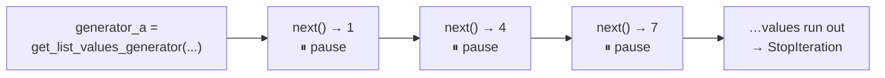

| | `return` | `yield` |
| --- | --- | --- |
| Gives back | Everything, once | One value per `next()` |
| Function after that | Ends | **Pauses**, remembers where it was |
| Memory | Holds the full result | Holds one value at a time |
| When finished | – | Raises `StopIteration` |
| Best for | Small results | Huge files, big API responses, streams |

**The memory difference, measured:**

```python
import sys
big_list = list(range(1_000_000))
def numbers(n):
    for i in range(n):
        yield i

sys.getsizeof(big_list)            # 8000056 bytes  (~8 MB)
sys.getsizeof(numbers(1_000_000))  # about 200 bytes, regardless of n
```

### Page-by-page PDF with a generator

```python
def extract_pages(pdf_document):
    for page_number, page in enumerate(pdf_document, start=1):
        page_text = page.ocr().extract_text() or ""
        yield page_number, page_text

pdf_generator = extract_pages(pdf_fde_book)
next(pdf_generator)    # (1, '...page 1 text...')  one page in memory at a time
```

> [!NOTE]
> In class `pdf_fde_book` was an empty string placeholder, so the first `next()` raised `StopIteration`: there was nothing to yield. With a real PDF object, each `next()` returns one page.

### Streaming large API responses

The same idea applies to network I/O. A plain `requests.get()` downloads the **entire** response (say 1 GB of JSON) into memory before you can touch it. With `stream=True`, data arrives in **chunks** you process as they come.

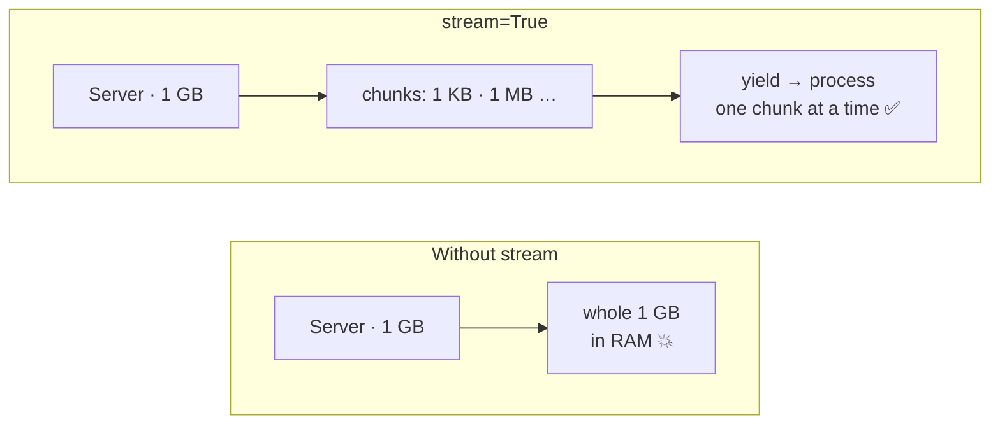

```python
response = requests.get(url, params=params, stream=True)
for chunk in response.iter_content(chunk_size=1024 * 1024):   # 1 MB at a time
    ...  # process or write the chunk, then it can be discarded
```

> [!TIP]
> The pattern the instructor stressed: **concept → usage → scale**. A function that works on 10 pages must still work on 10,000. That's where iterators and generators come in.

---

## Assignment

From `assignment.txt` (24 Oct), plus the self-study list carried over from the 18 Oct assignment, which the instructor flagged again in today's notebook.

**New: install Linux**

- [ ] **Install Multipass** and launch an Ubuntu machine. Skip it if you already have WSL or a Linux machine.

**Self-study, Priority 1**

- [ ] Exception handling (`try` / `except`)
- [ ] `os` library: `os.path.join`, `os.getcwd`, `os.listdir`, relative vs full path
- [ ] File handling, practised together with exception handling
- [ ] OOP: class, object, constructor, methods, attributes, `self`

**Self-study, Priority 2**

- [ ] Comprehensions: list and dict
- [ ] Useful built-ins: `any()`, `all()`, `map()`, `filter()`, `enumerate()`, `zip()`, `sorted()`
- [ ] `lambda`

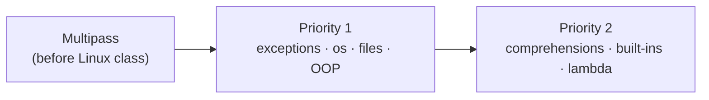

Every example below was run and its output checked.

<details>
<summary><b>Multipass: step-by-step install guide</b> (click to expand)</summary>

#### What and why

Multipass is a free tool from Canonical (the makers of Ubuntu) that creates a small **Ubuntu Linux virtual machine** on your Windows PC or Mac. The next part of Module 1 is *Linux for engineers*, and real engineering work (Docker, servers, deployments) runs on Linux.

| Option | Why the instructor didn't pick it |
| --- | --- |
| WSL | Windows only; Mac users can't use it |
| Docker | Doesn't give every command a real Linux environment has (Docker comes later) |
| **Multipass** | ✅ Works on both Windows and Mac and gives a full Ubuntu system |

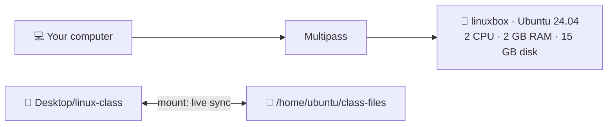

#### Step 1: check your computer

| Requirement | Minimum | Windows: where to check | Mac: where to check |
| --- | --- | --- | --- |
| CPU | 64-bit Intel/AMD, or Apple Silicon (M1–M4) | Settings → System → About | Apple menu → About This Mac |
| RAM | 4 GB | Settings → System → About | Apple menu → About This Mac |
| Free disk | 5 GB (the commands below use 15 GB) | File Explorer → This PC | System Settings → General → Storage |
| OS | Windows 10 or 11 (Home or Pro) | `Win + R` → `winver` | macOS 14 Sonoma or newer recommended |

> [!IMPORTANT]
> **Windows edition matters.** Pro / Enterprise / Education uses **Hyper-V** (built in). Home uses **VirtualBox** (a free separate install).

#### Step 2: install

| | Windows | Mac |
| --- | --- | --- |
| a | **Pro:** press `Win`, open *Turn Windows features on or off*, tick **Hyper-V**, then restart. **Home:** install VirtualBox from virtualbox.org | – |
| b | Download the Windows installer from **canonical.com/multipass/install** and run it. Pick Hyper-V (Pro) or VirtualBox (Home), and allow it to add Multipass to PATH | Download the macOS `.pkg` from **canonical.com/multipass/install** and open it, **or** run `brew install --cask multipass` |
| c | Open **PowerShell** and run `multipass version` | Open **Terminal** and run `multipass version` |

#### Step 3: launch and log in

```bash
# Launch a box with 2 CPU cores, 2GB RAM, and 15GB of disk space
multipass launch --name linuxbox --cpus 2 --memory 2G --disk 15G 24.04

# Only 4 GB RAM on your laptop? Use the lighter version instead:
# multipass launch --name linuxbox --cpus 1 --memory 1G --disk 10G 24.04

multipass list              # linuxbox -> Running
multipass shell linuxbox    # opens a Linux terminal
whoami                      # ubuntu
lsb_release -a              # Ubuntu 24.04 ...
exit                        # back to Windows / Mac
```

#### Step 4: share a folder (mount)

> [!CAUTION]
> The assignment sheet lists the mount before the launch command, but the machine must **exist first**. Do step 3 before step 4.

| Step | Windows (PowerShell) | Mac (Terminal) |
| --- | --- | --- |
| Create folder | `mkdir "$HOME\Desktop\linux-class"` | `mkdir -p ~/Desktop/linux-class` |
| Allow mounts | In **admin** PowerShell: `multipass set local.privileged-mounts=true` (off by default on Windows) | Not needed |
| Mount | `multipass mount "$HOME\Desktop\linux-class" linuxbox:/home/ubuntu/class-files` | `multipass mount ~/Desktop/linux-class linuxbox:/home/ubuntu/class-files` |

If your Windows Desktop lives in OneDrive, use `"$HOME\OneDrive\Desktop\linux-class"` instead.

Test the live sync:

```bash
multipass shell linuxbox
cd /home/ubuntu/class-files
echo "hello from linux" > test.txt   # test.txt now appears in Desktop/linux-class
```

#### Everyday commands

Run these outside Linux, in PowerShell or Terminal.

| Command | What it does |
| --- | --- |
| `multipass list` | Show machines and their state |
| `multipass shell linuxbox` | Open a Linux terminal |
| `multipass stop linuxbox` / `start linuxbox` | Shut down (frees RAM) / start again |
| `multipass info linuxbox` | CPU, memory, disk, IP and mounts |
| `multipass umount linuxbox` | Remove the folder share |
| `multipass delete linuxbox` then `multipass purge` | Delete the machine completely |

#### Troubleshooting

| Problem | Fix |
| --- | --- |
| `multipass` not recognised | Reopen PowerShell / Terminal, or restart |
| Launch error mentioning Hyper-V | Pro: enable Hyper-V. Home: install VirtualBox, then in admin PowerShell run `multipass set local.driver=virtualbox` |
| Launch error mentioning virtualisation | Enable *Intel VT-x* / *AMD-V* in BIOS/UEFI settings |
| Mount refused (Windows) | `multipass set local.privileged-mounts=true` in admin PowerShell |
| Mount empty or refused (Mac) | Allow the permission prompt, or give Multipass access in System Settings → Privacy & Security |
| Laptop sluggish | Relaunch with `--cpus 1 --memory 1G` |

#### Done checklist

- [ ] `multipass version` works
- [ ] `linuxbox` launched; `whoami` inside shows `ubuntu`
- [ ] `Desktop/linux-class` mounted; `test.txt` from Linux visible on the desktop
- [ ] Stopped the machine with `multipass stop linuxbox`

</details>

<details>
<summary><b>Exception handling: <code>try</code> / <code>except</code></b> (click to expand)</summary>

An **exception** is an error raised while the program runs. Unhandled, it stops the program. `try` / `except` catches it so you can respond and carry on.

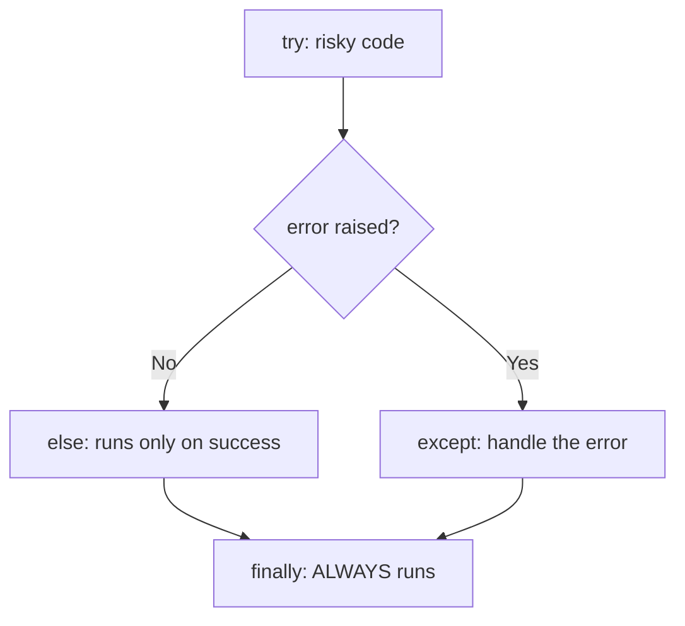

| Block | When it runs | Use it for |
| --- | --- | --- |
| `try` | Always: the code you want to attempt | Converting, dividing, opening files, API calls |
| `except SomeError` | Only if that error happens | Recovering or logging |
| `else` | Only if **no** error happened | Code that should run only on success |
| `finally` | **Always**, error or not | Clean-up (closing, final messages) |

```python
def safe_divide(a, b):
    try:
        result = a / b
    except ZeroDivisionError:
        print("Cannot divide by zero")
        result = None
    else:
        print("Division worked")
    finally:
        print("Check finished")
    return result

safe_divide(10, 2)   # Division worked · Check finished -> 5.0
safe_divide(10, 0)   # Cannot divide by zero · Check finished -> None
```

**Common exceptions** (most seen already in earlier classes):

| Exception | Example that raises it |
| --- | --- |
| `ValueError` | `float("N/A")`, `int("12.0")` |
| `ZeroDivisionError` | `100 / 0` |
| `KeyError` | `tb["5100"]` when the key doesn't exist |
| `IndexError` | `[1, 2][5]` |
| `TypeError` | `"a" + 1` |
| `FileNotFoundError` | `open("missing.csv")` |

```python
tb = {"1100": 2500000}
try:
    print(tb["5100"])
except KeyError as e:          # 'as e' gives you the error message
    print("Missing account:", e)
# Missing account: '5100'
```

**Raise your own** error when input breaks a rule:

```python
def set_materiality(amount):
    if amount <= 0:
        raise ValueError("Materiality must be positive")
    return amount

try:
    set_materiality(-5)
except ValueError as e:
    print("Rejected:", e)      # Rejected: Materiality must be positive
```

> [!WARNING]
> Catch **specific** exceptions (`except ValueError:`). A bare `except:` hides every bug, including typos in your own code.

**Audit use:** clean a column of amounts without the script crashing on one bad row, and keep the rejects as evidence.

```python
rows = ["45000", "12,500.75", "", "abc", "9800"]
clean, rejected = [], []
for row in rows:
    try:
        clean.append(float(row.replace(",", "")))
    except ValueError:
        rejected.append(row)

print(clean)      # [45000.0, 12500.75, 9800.0]
print(rejected)   # ['', 'abc']  -> follow up with the client
```

</details>

<details>
<summary><b><code>os</code> library: paths and folders</b> (click to expand)</summary>

The `os` module lets Python work with your computer's folders and files.

**Relative vs full (absolute) path**

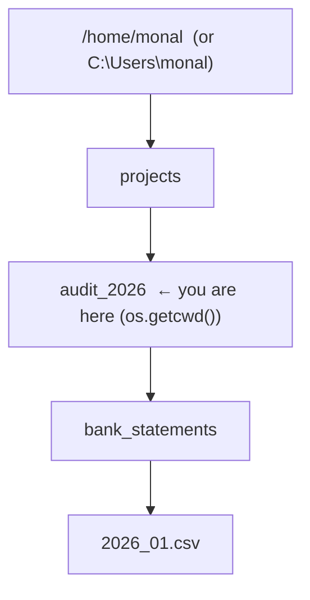

| | Relative path | Full (absolute) path |
| --- | --- | --- |
| Example | `audit_2026/bank_statements/2026_01.csv` | `/home/monal/projects/audit_2026/bank_statements/2026_01.csv` |
| Starts from | Your **current working directory** | The **root** of the drive (`/` or `C:\`) |
| Works if you move the project folder? | ✅ Yes | ❌ No, the path breaks |
| Works if you run the script from another folder? | ❌ Can break | ✅ Yes |

**Key functions**

| Function | What it does | Example result |
| --- | --- | --- |
| `os.getcwd()` | Current working directory | `'/home/monal/projects'` |
| `os.listdir(path)` | Names of files and folders inside `path` | `['2026_01.csv', '2026_02.csv', ...]` |
| `os.path.join(a, b, c)` | Joins parts with the **right separator** for your OS | `audit_2026/bank_statements/2026_01.csv` |
| `os.path.abspath(p)` | Relative → full path | `'/home/monal/projects/audit_2026/...'` |
| `os.path.isabs(p)` | Is it a full path? | `False` for relative |
| `os.path.exists(p)` | Does it exist? | `True` / `False` |
| `os.path.isfile(p)` / `isdir(p)` | File or folder? | `True` / `False` |
| `os.path.splitext(name)` | Split name and extension | `('2026_01', '.csv')` |
| `os.makedirs(p, exist_ok=True)` | Create folders (no error if they exist) | – |

```python
import os

print(os.getcwd())                       # where Python is running from

path = os.path.join("audit_2026", "bank_statements", "2026_01.csv")
print(path)                              # audit_2026/bank_statements/2026_01.csv
                                         # (audit_2026\bank_statements\2026_01.csv on Windows)
print(os.path.isabs(path))               # False -> relative
print(os.path.isabs(os.path.abspath(path)))  # True -> full
print(os.path.exists(path))              # True
print(os.path.exists("audit_2026/missing.csv"))  # False
```

> [!TIP]
> Always build paths with `os.path.join()` instead of typing `/` or `\`. The same code then works on Windows, Mac and Linux.

**Audit use:** check that all monthly bank statements were received.

```python
folder = os.path.join("audit_2026", "bank_statements")
files = sorted(os.listdir(folder))
print(files)        # ['2026_01.csv', '2026_02.csv', '2026_03.csv', 'notes.txt']

statements = [f for f in files if f.endswith(".csv")]
print(len(statements), "of 12 statements received")   # 3 of 12 statements received
```

</details>

<details>
<summary><b>File handling, with exception handling</b> (click to expand)</summary>

**Opening a file: modes**

| Mode | Meaning | If the file exists | If it doesn't |
| --- | --- | --- | --- |
| `"r"` | Read (default) | Reads it | ❌ `FileNotFoundError` |
| `"w"` | Write | ⚠️ **Wipes** it, then writes | Creates it |
| `"a"` | Append | Adds to the end | Creates it |
| `"x"` | Create only | ❌ `FileExistsError` | Creates it |

Always use `with`: it **closes the file automatically**, even if an error happens.

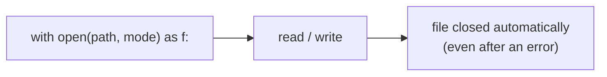

**Write, append, read**

```python
with open("exceptions_log.txt", "w") as f:      # new file
    f.write("JE003 weekend posting\n")
    f.write("JE004 not approved\n")

with open("exceptions_log.txt", "a") as f:      # add to the end
    f.write("JE007 round sum\n")

with open("exceptions_log.txt") as f:           # "r" is the default
    for line in f:                              # one line at a time (memory-friendly, like a generator)
        print(line.strip())
# JE003 weekend posting
# JE004 not approved
# JE007 round sum
```

| Read method | Returns |
| --- | --- |
| `f.read()` | The whole file as one string |
| `f.readlines()` | A list of lines: `['JE003 weekend posting\n', ...]` |
| `for line in f:` | One line per loop: best for large files |

**Add exception handling**

```python
try:
    with open("trial_balance_2026.csv") as f:
        data = f.read()
except FileNotFoundError:
    print("File not found - request the TB from the client")
```

**Audit use: read a CSV trial balance safely.** Handle a missing file *and* bad rows. The `csv` module splits each row into named columns.

```python
import csv

total = 0
bad_rows = []
try:
    with open("tb.csv", newline="") as f:
        for row in csv.DictReader(f):           # each row -> {'account': ..., 'balance': ...}
            try:
                total += float(row["balance"])
            except ValueError:
                bad_rows.append(row["account"])
except FileNotFoundError:
    print("TB missing - request it from the client")

print(total, bad_rows)
# 700000.0 ['4100']   <- TB: 1100 = 2500000, 2100 = -1800000, 4100 = 'abc'
```

A TB should total zero, so 700,000 plus one unreadable row are both findings to follow up.

</details>

<details>
<summary><b>OOP: class, object, constructor, methods, attributes, <code>self</code></b> (click to expand)</summary>

**Object-oriented programming** bundles **data** (attributes) and **behaviour** (methods) together. A **class** is the blueprint; an **object** is one thing built from it.

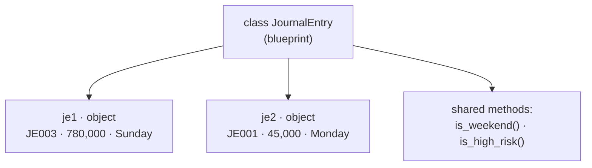

| Term | Meaning | In the example below |
| --- | --- | --- |
| Class | Blueprint | `class JournalEntry:` |
| Object (instance) | One item made from the class | `je1 = JournalEntry(...)` |
| Constructor | `__init__`, runs automatically when an object is created | Stores `je_no`, `amount`, … |
| Attribute | Data stored on the object | `self.amount` |
| Class attribute | Shared by all objects | `threshold = 500000` |
| Method | A function that belongs to the class | `is_high_risk()` |
| `self` | "This particular object"; always the first parameter of a method | `self.day` = *this* entry's day |

```python
class JournalEntry:
    threshold = 500000                      # class attribute (shared)

    def __init__(self, je_no, amount, day, approved):   # constructor
        self.je_no = je_no                  # instance attributes
        self.amount = amount
        self.day = day
        self.approved = approved

    def is_weekend(self):                   # method
        return self.day in ["Saturday", "Sunday"]

    def is_high_risk(self):                 # a method can use other methods
        return (self.amount > self.threshold and self.is_weekend()) or not self.approved

    def describe(self):
        return f"{self.je_no}: {self.amount:,} on {self.day}"

je1 = JournalEntry("JE003", 780000, "Sunday", True)
je2 = JournalEntry("JE001", 45000, "Monday", True)

print(je1.amount)            # 780000
print(je1.describe())        # JE003: 780,000 on Sunday
print(je1.is_high_risk())    # True
print(je2.is_high_risk())    # False

je2.approved = False         # attributes can be changed
print(je2.is_high_risk())    # True
```

> [!NOTE]
> `je1.is_high_risk()` is shorthand for `JournalEntry.is_high_risk(je1)`. Python passes the object in as `self` automatically, which is why you never type it when calling.

**Combine with exception handling:** a method can refuse invalid actions.

```python
class BankAccount:
    def __init__(self, owner, balance=0):
        self.owner = owner
        self.balance = balance

    def deposit(self, amount):
        self.balance += amount
        return self.balance

    def withdraw(self, amount):
        if amount > self.balance:
            raise ValueError("Insufficient funds")
        self.balance -= amount
        return self.balance

acct = BankAccount("monal", 1000)
acct.deposit(500)            # 1500
acct.withdraw(200)           # 1300
acct.withdraw(5000)          # ValueError: Insufficient funds
```

**Audit use:** model each journal entry, invoice or vendor as an object, so the test logic lives with the data and is reused everywhere. Iterators (from today's class) are also classes, with `__iter__()` and `__next__()` methods.

</details>

<details>
<summary><b>Comprehensions: list and dict</b> (click to expand)</summary>

A comprehension builds a list or dictionary in **one line**, replacing a `for` loop plus `append()`.

```mermaid
flowchart LR
    E["[ expression"] --> F["for item in iterable"] --> I["if condition ]"]
```

```python
# loop version
evens = []
for x in range(1, 11):
    if x % 2 == 0:
        evens.append(x)

# comprehension version: same result
evens = [x for x in range(1, 11) if x % 2 == 0]      # [2, 4, 6, 8, 10]
```

**List comprehension**

| Pattern | Example | Result |
| --- | --- | --- |
| Transform | `[x * x for x in range(1, 6)]` | `[1, 4, 9, 16, 25]` |
| Filter | `[x for x in range(1, 11) if x % 2 == 0]` | `[2, 4, 6, 8, 10]` |
| Clean strings | `[n.strip().title() for n in names]` | `['Abc Traders', 'Xyz Supplies', 'Lmn Pvt Ltd']` |
| If-else in the expression | `["High" if x > 3 else "Low" for x in [1, 5, 3, 7]]` | `['Low', 'High', 'Low', 'High']` |

> [!NOTE]
> `if` at the **end** filters items out. `if … else` at the **front** chooses a value for every item.

**Dict comprehension:** `{key: value for … in … if …}`

```python
tb = {"1100": 2500000, "2100": -1800000, "4100": -9500000, "5100": 0}

non_zero = {acc: bal for acc, bal in tb.items() if bal != 0}
# {'1100': 2500000, '2100': -1800000, '4100': -9500000}

absolute = {acc: abs(bal) for acc, bal in tb.items()}
# {'1100': 2500000, '2100': 1800000, '4100': 9500000, '5100': 0}
```

**Audit use:** select entries for testing in one line.

```python
entries = [
    {"je_no": "JE001", "amount": 45000,  "approved": True},
    {"je_no": "JE003", "amount": 780000, "approved": True},
    {"je_no": "JE004", "amount": 120000, "approved": False},
]
selected = [e["je_no"] for e in entries if not e["approved"] or e["amount"] > 500000]
print(selected)    # ['JE003', 'JE004']
```

> [!TIP]
> A comprehension builds the **whole** list in memory. For millions of rows, use a generator (today's class) instead. Swap `[ ]` for `( )` to get a generator expression.

</details>

<details>
<summary><b>Useful built-ins: <code>any</code>, <code>all</code>, <code>map</code>, <code>filter</code>, <code>enumerate</code>, <code>zip</code>, <code>sorted</code></b> (click to expand)</summary>

| Built-in | What it does | Example | Result |
| --- | --- | --- | --- |
| `any(it)` | `True` if **at least one** item is truthy | `any([True, True, False])` | `True` |
| `all(it)` | `True` only if **every** item is truthy | `all([True, True, False])` | `False` |
| `map(func, it)` | Applies `func` to every item | `list(map(str.upper, ["inv", "grn"]))` | `['INV', 'GRN']` |
| `filter(func, it)` | Keeps items where `func` returns `True` | `list(filter(lambda v: v > 100000, values))` | `[780000, 120000]` |
| `enumerate(it, start)` | Adds a counter | `enumerate(["JE003", "JE004"], start=1)` | `(1, 'JE003'), (2, 'JE004')` |
| `zip(a, b)` | Pairs items position by position | `list(zip(["INV-1", "INV-2"], [1000, 2500]))` | `[('INV-1', 1000), ('INV-2', 2500)]` |
| `sorted(it, key, reverse)` | Returns a **new** sorted list | `sorted(values, reverse=True)` | `[780000, 120000, 60000, 45000]` |

```mermaid
flowchart LR
    subgraph MAP["map: change every item"]
        direction LR
        m1["'45,000'<br/>'1,20,000'"] --> m2["45000.0<br/>120000.0"]
    end
    subgraph FIL["filter: keep some items"]
        direction LR
        f1["45000 · 780000<br/>120000 · 60000"] --> f2["780000 · 120000"]
    end
    subgraph ZIP["zip: pair two lists"]
        direction LR
        z1["INV-1, INV-2<br/>1000, 2500"] --> z2["(INV-1, 1000)<br/>(INV-2, 2500)"]
    end
```

```python
values = [45000, 780000, 120000, 60000]

approvals = [True, True, False]
print(any(approvals), all(approvals))     # True False
print(any([]), all([]))                   # False True  <- edge case: all() of nothing is True

amounts = ["45,000", "1,20,000", "7,80,000"]
print(list(map(lambda a: float(a.replace(",", "")), amounts)))
# [45000.0, 120000.0, 780000.0]

invoices = ["INV-1", "INV-2", "INV-3"]
amts = [1000, 2500, 400]
for inv, a in zip(invoices, amts):
    print(inv, a)                         # INV-1 1000 · INV-2 2500 · INV-3 400

print(sorted(values))                     # [45000, 60000, 120000, 780000]
print(values)                             # [45000, 780000, 120000, 60000]  <- original unchanged
print(sorted(["b", "C", "a"]))            # ['C', 'a', 'b']  <- capitals sort first
print(sorted(["b", "C", "a"], key=str.lower))   # ['a', 'b', 'C']
```

> [!NOTE]
> `map()`, `filter()`, `zip()` and `enumerate()` are **lazy**, like today's generators: they hand out values one at a time. Wrap them in `list()` to see everything.

**Audit use**

| Check | Code |
| --- | --- |
| Was every step of a control performed? | `all(step_signed_off for step_signed_off in checklist)` |
| Is any entry posted by an unauthorised user? | `any(e["user"] not in approved_users for e in entries)` |
| Match invoice numbers to amounts from two columns | `zip(invoice_numbers, amounts)` |
| Largest items first for high-value testing | `sorted(entries, key=lambda e: e["amount"], reverse=True)` |

</details>

<details>
<summary><b><code>lambda</code>: small one-line functions</b> (click to expand)</summary>

A `lambda` is a **tiny, unnamed function** written in one line. It's used where a short function is needed only once, usually as the `key` for `sorted()` or the function for `map()` / `filter()`.

```mermaid
flowchart LR
    D["def double(x):<br/>    return x * 2"] -- "same as" --> L["lambda x: x * 2"]
```

| Part | Meaning |
| --- | --- |
| `lambda` | Keyword |
| `x` (or `a, b`) | Parameters; defaults work too |
| `: x * 2` | A single expression, returned automatically (no `return` keyword) |

```python
double = lambda x: x * 2
double(5)                                   # 10

add = lambda a, b: a + b
add(2, 3)                                   # 5

gst = lambda amount, rate=18: amount * rate / 100
gst(1000)                                   # 180.0
gst(1000, 5)                                # 50.0
```

**Where lambdas really shine: as a `key`**

```python
receivables = [("C001", 75), ("C002", 15), ("C003", 200)]   # (customer, days overdue)
sorted(receivables, key=lambda p: p[1], reverse=True)
# [('C003', 200), ('C001', 75), ('C002', 15)]  <- most overdue first

entries = [
    {"je_no": "JE001", "amount": 45000},
    {"je_no": "JE003", "amount": 780000},
    {"je_no": "JE004", "amount": 120000},
]
largest = sorted(entries, key=lambda e: e["amount"], reverse=True)[0]
print(largest["je_no"])                     # JE003
```

> [!TIP]
> Keep lambdas to one simple expression. If it needs an `if` block, a loop or a comment to understand, write a normal `def` function instead.

</details>

---

## Key takeaways and audit application

```mermaid
flowchart LR
    subgraph PY["Today's concept"]
        direction TB
        p1["API + GET + params"]
        p2["Status codes"]
        p3["HTTP methods"]
        p4["HTTPS / TLS"]
        p5["Generators / streaming"]
        p6["OCR + page-by-page"]
        p7["del + gc"]
    end
    subgraph AU["Audit use"]
        direction TB
        a1["Pull data direct from source:<br/>prices, FX, ERP"]
        a2["Prove the extract is complete"]
        a3["IT controls: who can<br/>change or delete data"]
        a4["Secure client data<br/>in transit"]
        a5["Test full GL with<br/>millions of lines"]
        a6["Vouch scanned invoices<br/>#amp; contracts"]
        a7["Process many entities<br/>in one run"]
    end
    p1 --> a1
    p2 --> a2
    p3 --> a3
    p4 --> a4
    p5 --> a5
    p6 --> a6
    p7 --> a7
```

| Concept | Key takeaway | Application in financial statement audit |
| --- | --- | --- |
| Network I/O / API | Programs fetch data from a URL as JSON | Pull independent evidence (market prices, FX rates, ERP extracts) directly from the source instead of relying on client-prepared spreadsheets |
| Query parameters | `params` filter what comes back | Request only the period, entity or account you're testing |
| Status codes | 2xx success; 4xx your fault; 5xx server's fault | A failed or partial pull must be detected and documented, or the population isn't complete |
| `GET` vs `POST/PUT/PATCH/DELETE` | Read vs change | Auditor access should be **read-only (GET)**. Review API and system logs for `DELETE`/`PUT` on posted ledger data as part of IT general controls |
| PUT vs PATCH | Replace vs partial change | Distinguish a full master-data overwrite from a single-field change (e.g. vendor bank account) when reviewing change logs |
| HTTPS / TLS | Encrypted in transit | Client data, bank confirmations and portal uploads should only move over HTTPS; a plain `http://` data endpoint is an IT control finding |
| Protocols | Each has a purpose | SFTP for bulk ledger transfers; SMTP/email is *not* a secure channel for client data |
| Generators / `yield` | One item at a time; tiny memory | Run journal-entry tests over a full year's general ledger (millions of lines) without loading it all |
| `stream=True` | Process big downloads in chunks | Download a large ERP extract safely |
| OCR + page-by-page | Scans need OCR; read lazily | Extract text from scanned invoices, contracts and bank statements for vouching |
| `del` + `gc.collect()` | Drop references to free memory | Process several group entities or years in one script without running out of RAM |
| Concept → usage → scale | Design for the full population | A test that works on a 100-line sample must also work on the full ledger |

> [!TIP]
> Today's big idea for audit: **APIs give direct, verifiable access to data at its source, and generators let you test 100% of a huge population on an ordinary laptop.**

---

## Real-world audit examples

Each example uses only what's been taught so far, plus the file handling from the assignment. Every offline output shown was checked by running the code; examples 1, 3 and 6 need internet access, and their logic was tested against simulated responses. Data is illustrative.

| # | Example | Audit area | Concepts |
| :-: | --- | --- | --- |
| 1 | [Independent price check for inventory](#1-independent-price-check-for-inventory) | Inventory valuation (NRV) | `GET`, params, JSON |
| 2 | [Status checks for complete data pulls](#2-status-checks-for-complete-data-pulls) | Completeness of population | status codes |
| 3 | [Pulling every page of a population](#3-pulling-every-page-of-a-population) | Completeness | `while`, params, generator |
| 4 | [Footing a full general ledger](#4-footing-a-full-general-ledger) | GL integrity | generator, file reading |
| 5 | [Large-entry screen on millions of lines](#5-large-entry-screen-on-millions-of-lines) | Journal entry testing | chained generators |
| 6 | [Vouching scanned invoices](#6-vouching-scanned-invoices) | Occurrence / accuracy | OCR, page-by-page `yield` |
| 7 | [Multi-entity processing](#7-multi-entity-processing) | Group audits | `del`, `gc.collect()` |
| 8 | [HTTP methods in IT general controls](#8-http-methods-in-it-general-controls) | ITGC / access | methods, HTTPS |

### 1. Independent price check for inventory

Compare the client's recorded cost with an external price to test net realisable value. The class's dummy API stands in for a real market-price source.

```python
import requests

url = "https://dummyjson.com/products"
response = requests.get(url, params={"limit": 1, "skip": 5}, timeout=10)

if response.status_code == 200:
    product = response.json()["products"][0]
    market_price = product["price"]          # 49.99 (product id 6)
    book_cost = 55.00                        # client's recorded unit cost

    if market_price < book_cost:
        print(f"Write-down needed: {book_cost - market_price:.2f} per unit")
        # Write-down needed: 5.01 per unit
else:
    print(f"Price source unavailable: {response.status_code}")
```

### 2. Status checks for complete data pulls

If an extract fails silently, your population is incomplete and the test conclusion is wrong.

```python
def check_status(status_code):
    if 200 <= status_code < 300:
        return "Success"
    elif 400 <= status_code < 500:
        return "Client error - check URL, parameters or access"
    elif 500 <= status_code < 600:
        return "Server error - retry later, document the outage"
    else:
        return "Unexpected status"

for code in [200, 201, 404, 401, 503]:
    print(code, check_status(code))
# 200 Success
# 201 Success
# 404 Client error - check URL, parameters or access
# 401 Client error - check URL, parameters or access
# 503 Server error - retry later, document the outage
```

### 3. Pulling every page of a population

APIs usually return data in pages (`limit` + `skip`). Keep requesting until a page comes back empty, so nothing is missed. The generator hands records out one at a time.

```mermaid
flowchart TD
    S["skip = 0"] --> R["GET ?limit=3#amp;skip=…"]
    R --> Q1{"status 200?"}
    Q1 -- No --> STOP1["stop + log the failure"]
    Q1 -- Yes --> Q2{"page empty?"}
    Q2 -- Yes --> DONE["✅ whole population pulled"]
    Q2 -- No --> Y["yield each record"] --> INC["skip += 3"] --> R
```

```python
def fetch_products(url, page_size=3):
    skip = 0
    while True:
        response = requests.get(url, params={"limit": page_size, "skip": skip}, timeout=10)
        if response.status_code != 200:
            print(f"Stopped: status {response.status_code}")
            break
        batch = response.json()["products"]
        if not batch:
            break                              # no more pages
        for product in batch:
            yield product
        skip = skip + page_size

count = 0
for product in fetch_products("https://dummyjson.com/products"):
    count += 1
print(f"{count} records retrieved")             # reconcile to the API's "total" field
```

Reconcile the count to the source's own total (`response.json()["total"]`). That reconciliation is your **completeness** evidence.

### 4. Footing a full general ledger

Debits must equal credits. A generator reads a GL export line by line, so file size doesn't matter. (`with open(...)` is explained under *File handling* in the [Assignment](#assignment) section.)

```python
def read_gl_lines(path):
    with open(path) as file:
        next(file)                                    # skip the header row
        for line in file:
            je_no, account, debit, credit = line.strip().split(",")
            yield je_no, account, float(debit), float(credit)

total_dr = 0
total_cr = 0
rows = 0
for je_no, account, debit, credit in read_gl_lines("gl_2026.csv"):
    total_dr += debit
    total_cr += credit
    rows += 1

print(rows, f"{total_dr:,.2f}", f"{total_cr:,.2f}", total_dr == total_cr)
# 400000 249,900,000.00 249,900,000.00 True    <- on a 400,000-line test file
```

Sample `gl_2026.csv` format:

| je_no | account | debit | credit |
| --- | --- | --: | --: |
| JE1 | 1100 | 1001 | 0 |
| JE1 | 4100 | 0 | 1001 |

### 5. Large-entry screen on millions of lines

Generators can feed other generators: read → filter → test, still holding one line at a time.

```mermaid
flowchart LR
    F["gl_2026.csv<br/>400,000 lines"] --> R["read_gl_lines()<br/>yield each line"] --> L["large_entries()<br/>yield only ≥ threshold"] --> T["your test<br/>400 items"]
```

```python
def large_entries(path, threshold):
    for je_no, account, debit, credit in read_gl_lines(path):
        if debit >= threshold:
            yield je_no, debit

flagged = large_entries("gl_2026.csv", 1499)
print(next(flagged))     # ('JE499', 1499.0)
print(next(flagged))     # ('JE999', 1499.0)
```

### 6. Vouching scanned invoices

Supplier invoices are often scanned PDFs. Read them page by page with OCR, and check each page for the invoice number you're vouching.

```python
def extract_pages(pdf_document):
    for page_number, page in enumerate(pdf_document, start=1):
        page_text = page.ocr().extract_text() or ""
        yield page_number, page_text

for page_number, text in extract_pages(scanned_invoices_pdf):
    if "INV-2026-0045" in text:
        print(f"Invoice found on page {page_number}: agree amount and date to the ledger")
        break                                  # stop reading once found
```

`page.ocr()` stands for whichever OCR library you use (Tesseract, PaddleOCR, Textract…). The method name differs by library.

### 7. Multi-entity processing

In a group audit, process one subsidiary's ledger, keep only the results, then free the memory before loading the next.

```python
import gc

ledger_2025 = [[0.0] * 1000 for _ in range(1000)]   # stands in for one entity's full ledger
# ... run tests, keep only the summary results ...
del ledger_2025                                     # drop the big object
gc.collect()                                        # free it before the next entity
```

### 8. HTTP methods in IT general controls

| Method seen in an access or change log | Risk | Audit response |
| --- | --- | --- |
| `GET` | Low: read only | Expected for auditors and reporting users |
| `POST` | New records created | Agree new journals and vendors to approved source documents |
| `PUT` | Entire record **replaced** | Review overwrites of master data (customer limits, price lists) |
| `PATCH` | One field changed | Classic fraud risk: a vendor's **bank account** changed. Confirm with the vendor through an independent channel |
| `DELETE` | Record removed | Posted ledger entries should never be deleted, only reversed. Investigate any `DELETE` on posted data |
| Any method over `http://` | Data readable in transit | Report as an IT control deficiency |

---

<sub>Source: KrishNaikAcademy · Module 1 (Python & Linux Foundation) · 24 Oct 2026</sub>
