# Session 01 — AI Foundations: How LLMs Work, Tokens & Context Windows

> **Course:** No-Code AI for Everyone 2.0 &nbsp;|&nbsp; **Instructor:** Mayank Aggarwal &nbsp;|&nbsp; **Date:** 23 May 2026 &nbsp;|&nbsp; **Length:** ~4 hrs (≈2h 20m lecture + Q&A)

> **Sources:** live-class transcript + the instructor's class board (`001_AI-Basics.pdf`). Original slides are in [`assets/`](assets/).

> [!NOTE]
> The session was planned to cover *AI foundations → landscape → how LLMs reason*. The lecture covered **foundations, tokens and context windows** in depth. **Hallucination, temperature and the AI landscape** were moved to **Session 02**.
> The class board already includes slides on **Temperature, the 4 Waves of AI, the 2026 AI Ecosystem and Which AI to Use**. They're summarised in [Part B](#part-b) as a preview.

---

## 📑 Table of Contents

1. [Hook Demo: A Board Briefing in 20 Seconds](#hook-demo)
2. [What Is an LLM? A Next-Word Predictor](#what-is-an-llm)
3. [Knowledge Cutoff: The Closed-Book Exam](#knowledge-cutoff)
4. [Tokens: The Currency of AI](#tokens)
5. [Input vs Output Tokens: Which Costs More?](#input-vs-output)
6. [Context Window: AI's Working Memory](#context-window)
7. [Lost in the Middle](#lost-in-the-middle)
8. [Chat History vs Memory vs Context Window](#history-memory-context)
9. [Why You Hit Usage Limits](#usage-limits)
10. [Saving Tokens & Getting Better Output](#saving-tokens)
11. [Privacy & Data Use](#privacy)
12. [**Part B: From the Class Board (Preview of Session 02)**](#part-b)
    - [AI Temperature: The Creativity Dial](#temperature)
    - [The 4 Waves of AI](#four-waves)
    - [The 2026 AI Ecosystem](#ecosystem)
    - [Which AI Should I Use?](#which-ai)
13. [Q&A Digest](#qa-digest)
14. [Analogy Cheat Sheet](#analogies)
15. [Glossary](#glossary)
16. [Self-Check Quiz](#quiz)

---

<a id="hook-demo"></a>

## 🎬 Hook Demo: A Board Briefing in 20 Seconds

The instructor uploaded the **Nestlé Annual Review 2025** (67-page PDF) to Claude with this prompt:

```text
You are an expert analyst. I have 15 minutes before a board meeting.
Give me 5 key takeaways, 3 risks nobody is talking about,
and 2 questions I should ask in the meeting. Be direct and specific.
```

**Result:** a structured briefing in ~20 seconds (e.g., risks like a Greater China slowdown and the ongoing Nestlé Waters strategic review).

> 💡 **Point of the course:** two years ago this would have taken a consultant or research team about a week. The goal isn't just knowing AI exists. It's being **the person in the room who can do this**, and understanding *why* it works so new models make sense when they come out.

---

<a id="what-is-an-llm"></a>

## 🧠 What Is an LLM? A Next-Word Predictor

**LLM = Large Language Model** (e.g., ChatGPT, Gemini, Claude, DeepSeek, Grok).

At its core, every LLM does one thing: **predict the next word (token)**, one at a time. That's why you see answers stream in word by word.

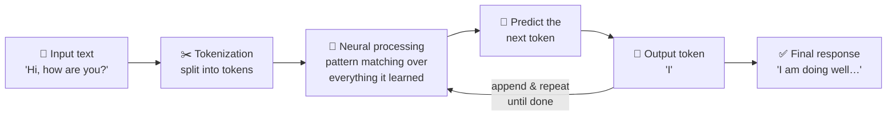

### 🧩 The brain analogy

Neural networks are loosely inspired by neurons in the brain, where signals pass between connected cells. When someone says *"Hi Mayank, how are you?"* you break the sentence up, process it, and reply. An LLM follows the same pattern: **input → understand → process → output**.

### 📱 Autocomplete vs 🤖 LLM: same mechanism, very different scale

| | Phone Autocomplete | Large Language Model |
|---|---|---|
| **Trained on** | Your personal typing history | Billions of books, articles, websites |
| **Predicts** | 1–3 likely next words | Next token using vast learned patterns |
| **Good for** | "Good morning", "On my way" | Research, analysis, writing, code |
| **Reasoning** | None, just pattern matching | Handles complex multi-step instructions |
| **Context** | A few words | Thousands to **millions** of tokens |

| **Board tagline** | *"Predicts the obvious next word"* | *"Pattern matching at planetary scale"* |

> **The core is the same:** both break text into tokens and predict the most likely next token. The difference is the **scale of training data** (~1M× more): *"Same core, different universe."*

> 🔑 **Key insight (class board)**
> - It's not magic. It's **prediction**, done millions of times per response.
> - **More data = smarter predictions.**
> - **Your prompts shape the prediction.**

> ⚠️ Because LLMs learn from human-written data, they can also **pick up its biases**.

<details>
<summary>🖼️ View the class slides: LLM Workflow · Autocomplete vs LLM</summary>

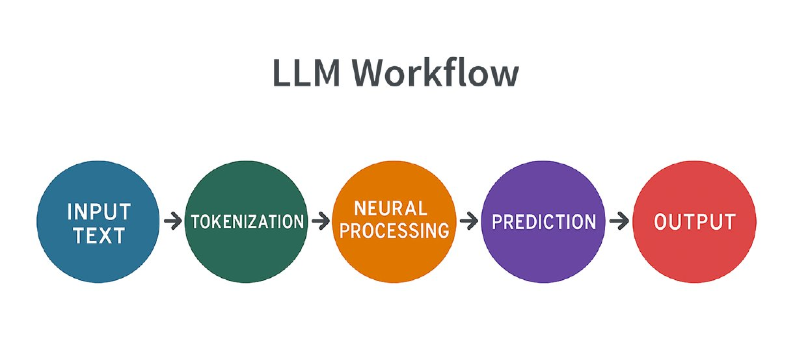
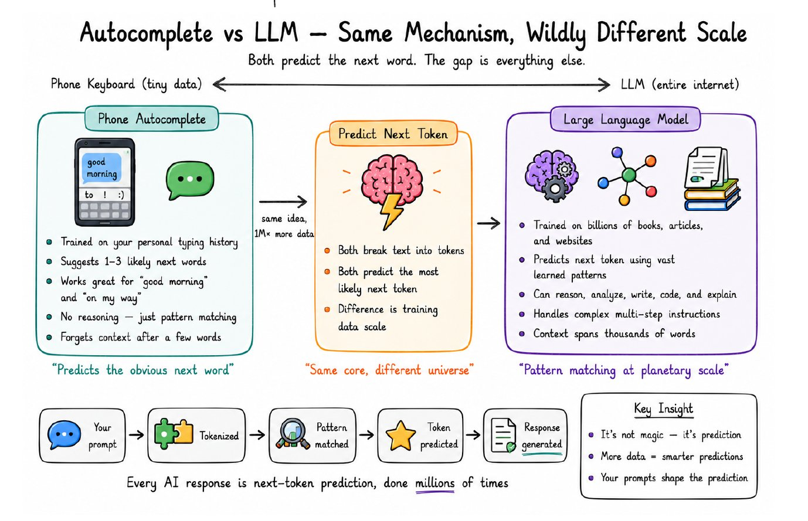
</details>

---

<a id="knowledge-cutoff"></a>

## 📚 Knowledge Cutoff: The Closed-Book Exam

An LLM only knows what was in its training data, up to a **knowledge cutoff date**.

> 🎓 **Analogy:** an LLM is like a student who has walked into the exam hall. The books are taken away. Anything that happens outside after that moment (news, elections, wars) is unknown to them.
> **Web search turns it into an open-book exam.**

**Live demo:** *"Without searching the internet, who is the president of Venezuela?"*

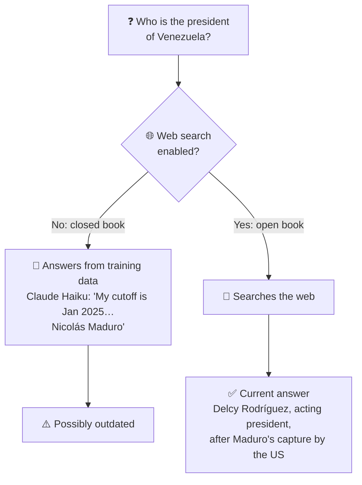

**Takeaways**
- Every model has a cutoff, and it differs by model. Search *"Claude models knowledge cutoff"* to check.
- Modern assistants often **search automatically** for current topics. You can toggle web search.
- Different models give answers of different depth and quality. Model choice and cost are covered later.

---

<a id="tokens"></a>

## 🪙 Tokens: The Currency of AI

A **token** is the unit an LLM reads and writes. You're **billed in tokens**, limits are **measured in tokens**, and context windows are **sized in tokens**.

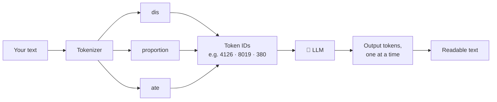

> *The IDs above are illustrative. Try the real thing at the **OpenAI Tokenizer**: <https://platform.openai.com/tokenizer>*

### Rules of thumb

> 📏 **Quick rule (class board):** 1 token ≈ ¾ word · **750 tokens ≈ 1 page** · **1M tokens ≈ 5 novels** · keep prompts focused.

| Rule | Example |
|---|---|
| 1 token ≈ **¾ of a word** | *"Not always one word"* |
| **1,000 tokens ≈ 750 English words** | |
| Short common words ≈ 1 token | `Hi` · ` how` · ` are` · ` you` · `?` → **5 tokens**; `Hello world` → **2 tokens** |
| Contractions split | `I don't` → `I` + `don` + `'t` → **3 tokens** |
| Long words split into 2–3 tokens | `building` → `build` + `ing`; `disproportionate` → `dis` + `proportionate` |
| Spaces & punctuation count too | `AI, is amazing!` → `AI` `,` `is` `amazing` `!`; even a **leading space** can be its own token |
| Each token gets a numeric **Token ID** | |
| Tokenization **varies by model / algorithm** | Same word can split differently in different LLMs |
| **Images & video are token-heavy** | "A picture is worth a thousand words." Generating 3 images can burn your limit faster than 10 text messages. |
| Files you ask for (Excel, code) are tokens too | An Excel file is code under the hood |

**Why tokens matter (class board):** AI is billed by tokens (input + output) · context windows are measured in tokens · longer prompts = more tokens = higher cost · free tiers have monthly token limits. *"Tokens = AI's currency."*

<details>
<summary>🖼️ View the class slide: Tokens</summary>

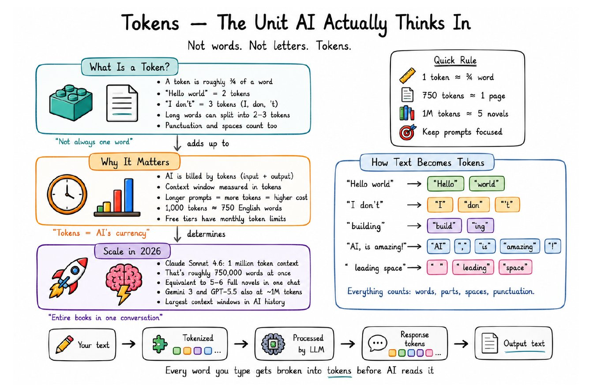
</details>

---

<a id="input-vs-output"></a>

## 💸 Input vs Output Tokens: Which Costs More?

> **Class quiz:** for the *same number* of tokens, what's more expensive, input or output?
> The room split about 50/50. **Answer: OUTPUT tokens.**

**Why?** Reading is cheaper than writing. If someone hands you a 500-page book, reading it costs effort. Producing a thoughtful 500-page summary costs far more: thinking, processing, researching, writing. An LLM that just echoed your input back would be useless. Generating a *better* answer is where the compute goes.

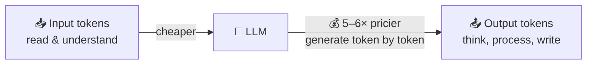

### Pricing shown in class (API, per 1M tokens)

| Model | Input | Output | Output ÷ Input |
|---|---:|---:|---:|
| Claude Opus | $5 | $25 | 5× |
| GPT-5.5 | $5 | $30 | 6× |
| GPT-5.4 | $2.50 | $15 | 6× |

> *Prices as displayed during the session. Check the providers' pricing pages for current rates.*

### 🧑‍🔬 Bigger brain = higher price

> **Analogy:** an hour with Einstein costs more than an hour with an average person.
> **Opus ≈ Einstein** (largest, smartest, priciest) → **Sonnet** → **Haiku** (smaller brain, cheaper, faster).
> There is **no single "best" model**. Like asking "who's the best scientist?", it depends on the task.

---

<a id="context-window"></a>

## 🪟 Context Window: AI's Working Memory

The **context window** is the maximum number of tokens a model can "see" at once: everything it can consider when writing its next reply.

### 🔑 The big misconception

> **~95% of people think the AI only receives their latest message. It doesn't.**
> The model is **stateless**: it remembers nothing between calls. **Every time you hit send, the entire conversation (or a summary of it) is sent again.**

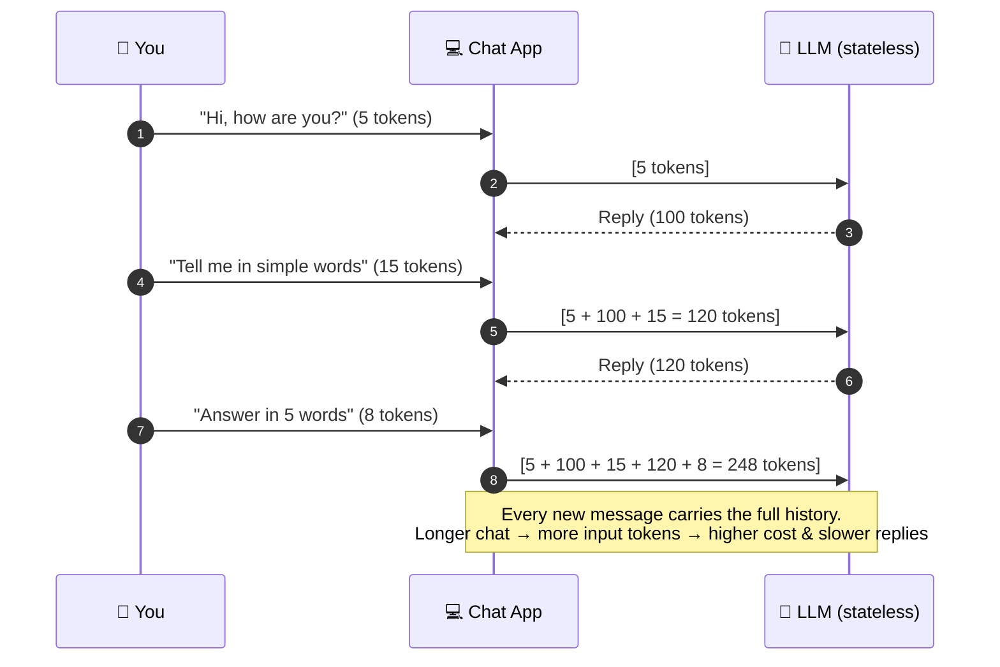

### 🧮 Worked cost example (from Q&A)

*Hypothetical pricing: **$1 per input token**, **$2 per output token***

| Step | What's sent / generated | Tokens | Cost |
|---|---|---:|---:|
| 1. Your first message | 12 (input) | 12 | **$12** |
| 2. AI reply | 11 (output) | 11 | **$22** |
| 3. Your second message (12 new) | 12 + 11 + 12 resent as **input** | 35 | **$35** |

Previous outputs become **future inputs**. That's why long chats get expensive.

### 🧪 Demo: "Context with Mayank" simulator (window = 120 tokens)

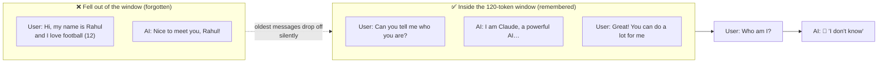

**What happened:** once the chat passed 120 tokens, the oldest messages (including *"my name is Rahul"*) silently slid out. Asking *"Who am I?"* got *"I don't know."*

### What fills the context window

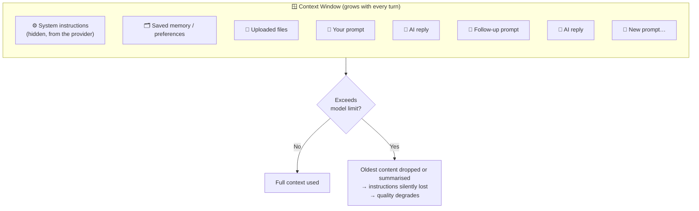

### ⚠️ What this means in practice

- **The AI doesn't tell you when it forgets.** Earlier instructions silently drop off.
  *E.g., "always reply in Hindi" or "give code in Python" at the start of a long chat may be ignored later, and you suddenly get Java.*
- **Output quality degrades** in very long chats.
- **Long chats hit usage limits faster**, since every message resends more tokens.
- Context window is **not time-based**. Coming back after 3 days doesn't reset or empty it; the stored messages are resent.
- **You can't change** a hosted model's context window. It's fixed per model (it can be changed for self-hosted/local models).
- If a single message exceeds the window, the earliest part of it gets cut off.

### Context sizes mentioned in class

| Model | Context window | Roughly |
|---|---|---|
| Claude Sonnet 4.6 / Opus | **1M tokens** | ~750K words ≈ 5–6 full novels |
| Claude Haiku | **200K tokens** | ~150K words |
| Gemini 3, GPT-5.5 | **1M tokens** | |
| DeepSeek V4 Flash | **1M tokens** | |

**What 1M tokens holds (class board):** ~750,000 words · an entire legal contract + exhibits · 5–6 novels back to back · months of email history · a full codebase + documentation. *"Massive, but still finite."*

> A decade ago, windows were tiny (the simulator's 120 tokens is that scale). Today's 1M-token windows are the largest in AI history, **but the mechanics are identical.**

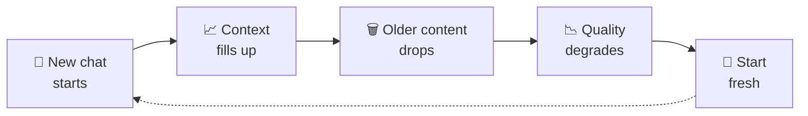

> *"Know the window. Work **with** it, not against it."*

<details>
<summary>🖼️ View the class slide: The Context Window</summary>

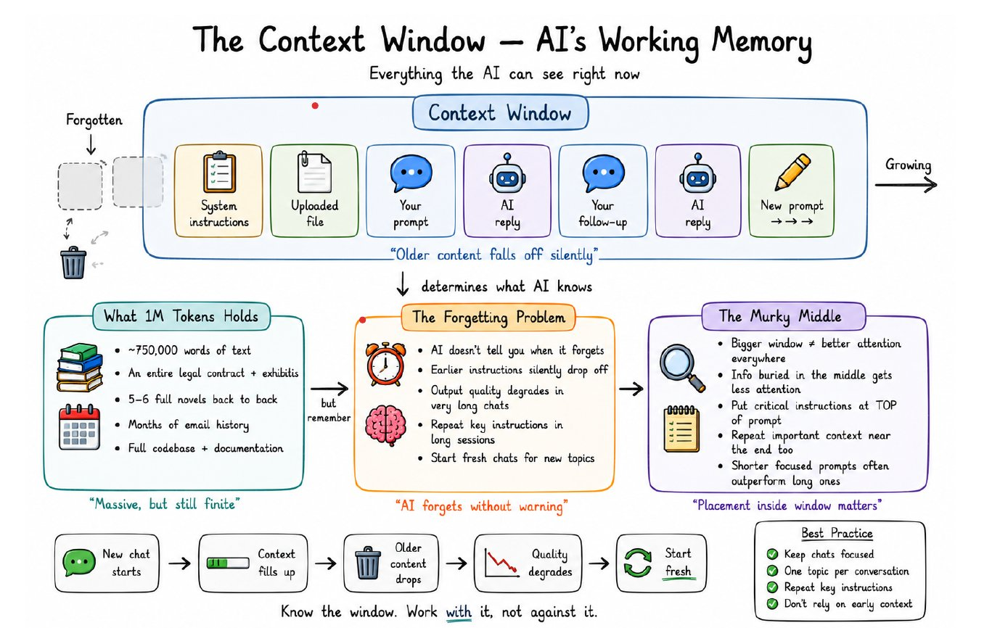
</details>

---

<a id="lost-in-the-middle"></a>

## 📉 Lost in the Middle

**A bigger context window ≠ better attention.** Models pay most attention to the **start** and **end** of the context; the **middle gets less attention**.

```text
Attention
   ▲
 █ │█                                         █
 █ │ █                                       █
   │  ██                                   ██
   │    ███                             ███
   │       █████                   █████
   │            ███████████████████
   └──────────────────────────────────────────▶ Position in context
     START              MIDDLE               END
   (remembered)    (often overlooked)    (remembered best)
```

> 🏢 **Meeting analogy:** in a 1-hour meeting you remember the opening (who's there, the agenda) and the closing (*"send me the report by tomorrow"*), but the middle is fuzzy. LLMs behave the same way.

> 📖 **Two-friends analogy:** one friend reads 100 pages and remembers little; another reads 10 pages and remembers everything. A bigger window (more pages) doesn't guarantee better recall.

**How to use this**
- ✅ Put **critical instructions at the top** of your prompt
- ✅ **Repeat key instructions near the end** (e.g., after a long paste: *"…now summarise the above"*)
- ✅ **Shorter, focused prompts often outperform long ones** (class board). *"Placement inside the window matters."*
- How well a model handles the middle varies by model; there's no single threshold

---

<a id="history-memory-context"></a>

## 🗄️ Chat History vs Memory vs Context Window

These three are often confused. They are **different things**:

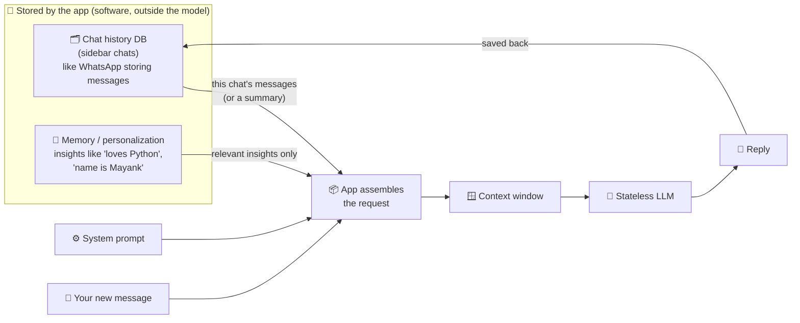

| Concept | What it is | Where it lives |
|---|---|---|
| **Chat history** | Your saved conversations in the sidebar | App's database (like a notebook / WhatsApp) |
| **Memory** | Insights distilled from chats (preferences, facts about you), not full chats | App's database, injected into new chats |
| **Context window** | What the model can see **for this one request** | Assembled fresh every time you send |

- The **context window is per chat session**. Other chats aren't included directly; only *memory insights* carry across.
- Memory can be toggled (ChatGPT: *Settings → Personalization → Memory*). Off = every chat starts fresh.
- Even a *"Hi"* in a new chat may cost ~4,000+ tokens behind the scenes because of system instructions + memory.
- ⚠️ "Memory" has a specific technical meaning in AI (covered later). **Don't call the context window "temporary memory".** It's just everything being resent.

---

<a id="usage-limits"></a>

## 🚦 Why You Hit Usage Limits

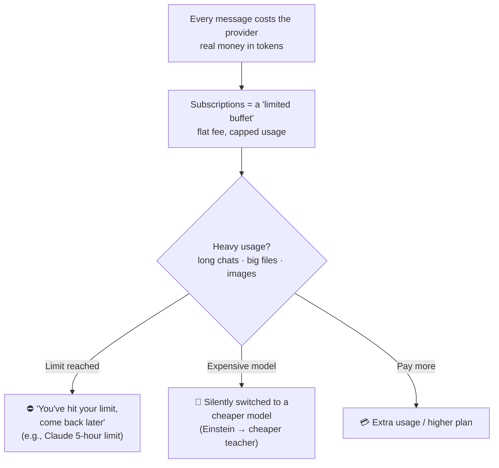

- **Free tiers** get small limits; paid plans (ChatGPT Plus/Go, Claude Pro) get more, but **still limited**, even on paid plans (shown live: the instructor's paid Claude hit 100% of its limit).
- **The same limit stretches further in a fresh chat** (e.g., ~50 messages) than in an already-long one (e.g., ~10), because each message resends more context.
- Providers are **burning money** to win users now. Expect prices to rise later ("Jio model": hook first, charge later).
- Providers don't show you when context is being cut. It's a business choice; explaining it to non-technical users is hard.
- Aggregators (e.g., Copilot) charge based on the **underlying model's tokens**; your company pays for your usage.

---

<a id="saving-tokens"></a>

## 🛠️ Saving Tokens & Getting Better Output

| ✅ Do | Why |
|---|---|
| **Start a new chat for each new topic** | Less context resent → cheaper, faster, more usage |
| **Start fresh when a chat gets long** | Avoids silent forgetting & quality drop (judge by length, not message count) |
| **Ask the AI to summarise, then paste into a new chat** | Carries the essentials forward (you'll lose some detail) |
| **Ask for concise answers** | Fewer output tokens (the expensive ones) |
| **Put key instructions at the top & repeat at the end** | Beats "lost in the middle" |
| **Repeat key instructions in long sessions** | Earlier ones may have dropped off |
| **Write better prompts** | Better input → better output, fewer retries (prompt engineering comes later) |
| **Don't rely on early context** | It may already have dropped off (class board best practice) |

> 🦴 **"Caveman mode":** a GitHub instruction set that makes Claude reply in terse caveman-speak (*"why use many token when few token do trick"*), reportedly cutting ~65% of tokens. It shows the principle: **ask the brain to speak less.**

> 🧊 **Caching:** providers cache repeated inputs to cut costs (a detail for later sessions).

---

<a id="privacy"></a>

## 🔒 Privacy & Data Use

- **Consumer accounts:** chats *may* be used for model training by default. Look for an opt-out.
  *Claude: Settings → Privacy → "Help improve Claude" (toggle off).*
- **Enterprise accounts** (e.g., Copilot Premium at work) typically **don't** train on your data. Otherwise company secrets could leak into public answers.
- Instructor's advice: even with opt-outs, **be careful with truly sensitive data**.
- **Governance (banking / regulated industries):** use only **company-approved tools**. Compliance has done the due diligence (e.g., if Copilot is approved, don't use another assistant). Full governance & guardrails are covered **around Month 3**.

---

<a id="part-b"></a>

## 🧩 Part B: From the Class Board (Preview of Session 02)

> [!IMPORTANT]
> These four slides are on the Session 01 class board but **weren't taught live**. They're scheduled for Session 02 (*hallucination → temperature → AI landscape*). Use this as a pre-read, and expand it after the next class.

<a id="temperature"></a>

### 🎛 AI Temperature: The Creativity Dial

**Temperature** is the knob between **precise** and **unpredictable** output. It controls how much randomness the model uses when picking the next token. *Most tools set it automatically.*

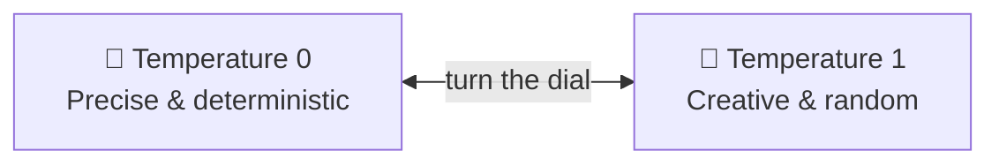

| | 🎯 Low (0.0 – 0.2) | ⚖️ Medium (0.4 – 0.6) | 🚀 High (0.8 – 1.0) |
|---|---|---|---|
| **Behaviour** | Same answer every time | Slight variation between responses | Highly varied, unpredictable |
| **Hallucination risk** | Low | Moderate | **Higher, so verify output** |
| **Best for** | Analysis, summaries, data, factual & legal tasks | Writing, brainstorming, professional tone | Stories, brainstorms, creative ads, ideation |
| **Avoid for** | Creative work (no creativity, pure precision) | n/a | **Facts, legal or financial tasks** |
| **Tagline** | *"Predictable and accurate"* | *"The everyday sweet spot"* (default for most AI tools) | *"Creative, but fact-check everything"* |

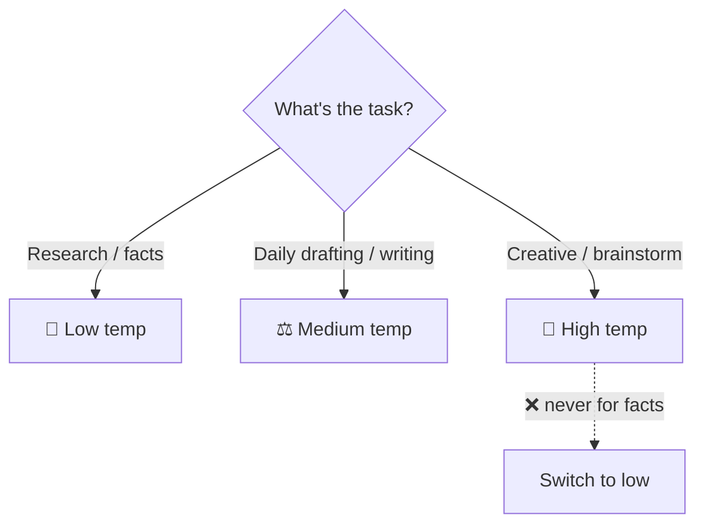

> *"Match temperature to the **task**, not just the tool."*

<details>
<summary>🖼️ View the class slide: AI Temperature</summary>

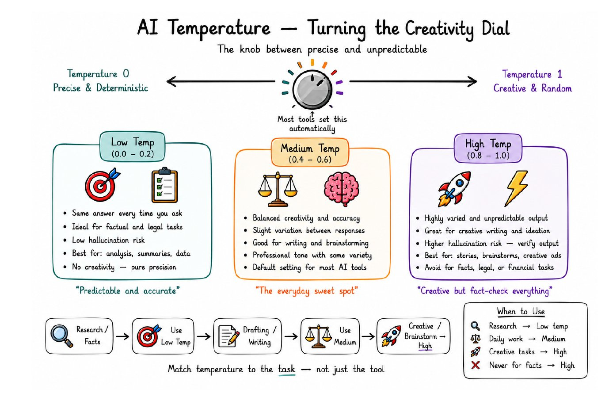
</details>

<a id="four-waves"></a>

### 🌊 The 4 Waves of AI: We Are in Wave 4

Each wave arrived faster than the last.

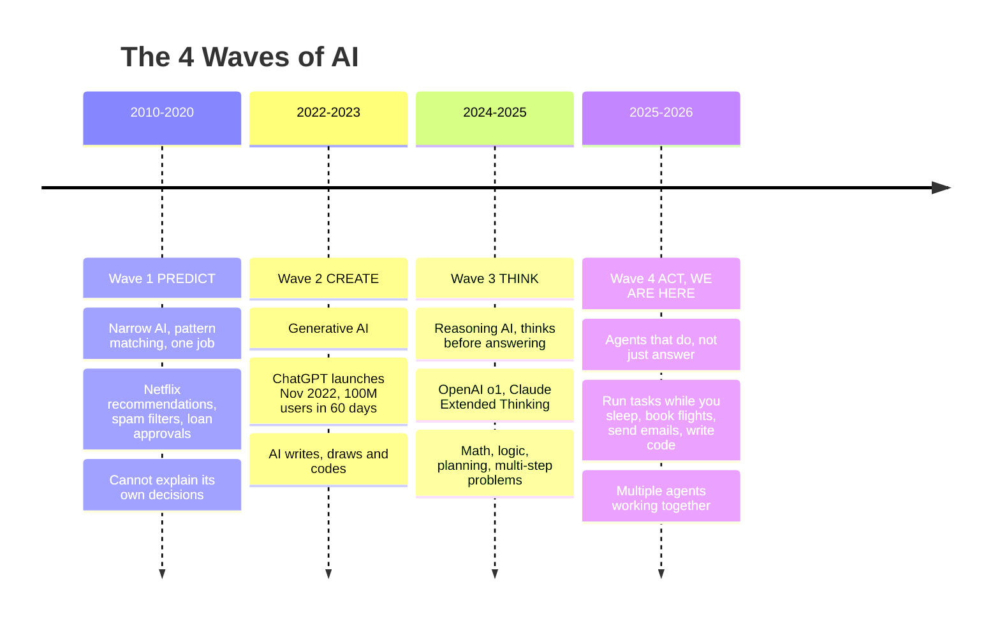

| Wave | Era | Tagline | Took |
|---|---|---|---|
| 1 · **Predict** (Narrow AI) | 2010–2020 | *"Pattern matching, one job"* | ~10 years |
| 2 · **Create** (Generative AI) | 2022–2023 | *"AI starts making things"* | ~2 years |
| 3 · **Think** (Reasoning AI) | 2024–2025 | *"AI reasons before responding"* | ~18 months |
| 4 · **Act** (Agents) | 2025–2026 | *"AI acts without being asked"* | Already here |

Examples of Wave 4 agents listed on the board: OpenClaw, Hermes Agent, Claude Cowork.

> 🎓 *"This course teaches you to thrive in Wave 4."*

<details>
<summary>🖼️ View the class slide: The 4 Waves of AI</summary>

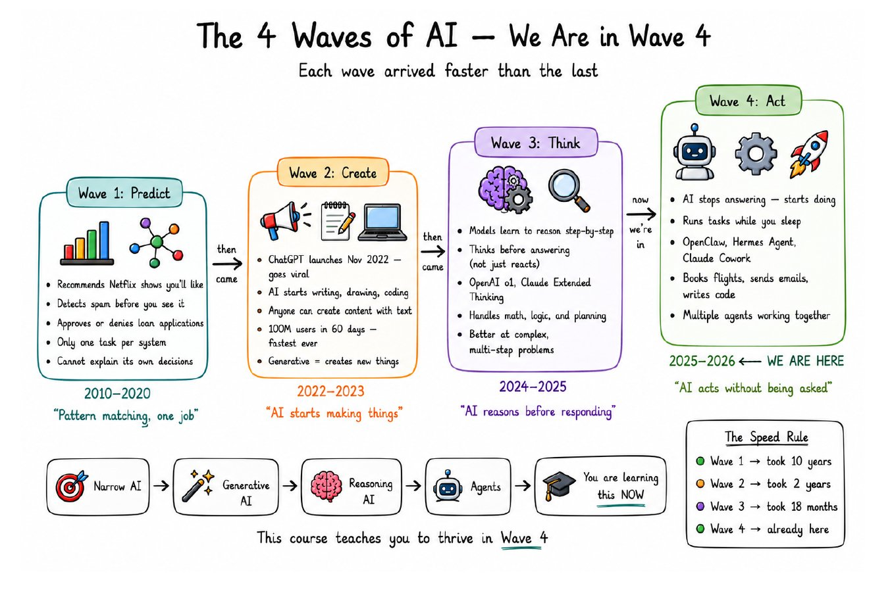
</details>

<a id="ecosystem"></a>

### 🏗 The 2026 AI Ecosystem: Two Layers

> *"Every AI tool is a **wrapper** around a foundation model."*

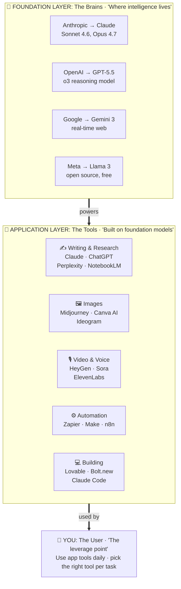

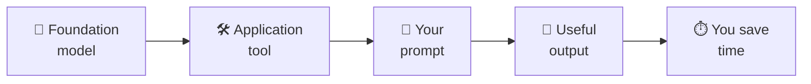

**🔑 Key insights**
- Tools change **every month**; foundation models stay relevant **longer**.
- **Learn the layer, not just the tool.** Skills transfer across tools.
- You don't need to know the foundation layer deeply to use the application layer.

<details>
<summary>🖼️ View the class slide: The 2026 AI Ecosystem</summary>

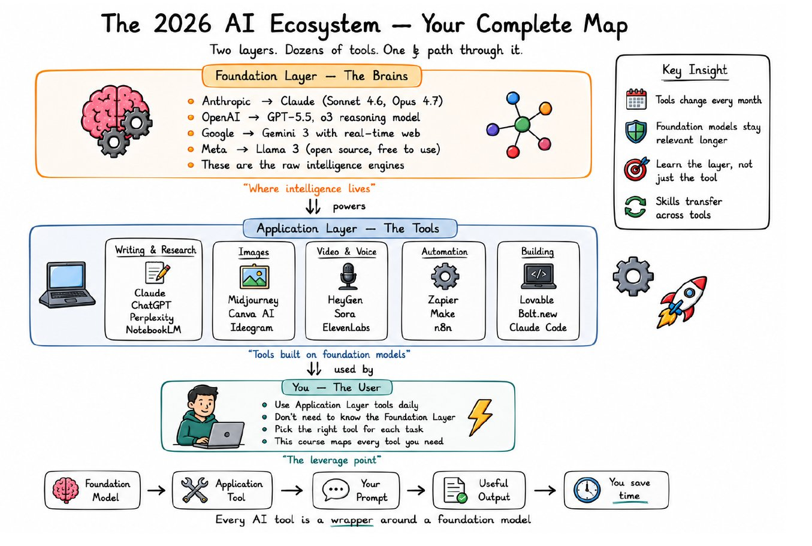
</details>

<a id="which-ai"></a>

### 🧭 Which AI Should I Use? The 30-Second Decision

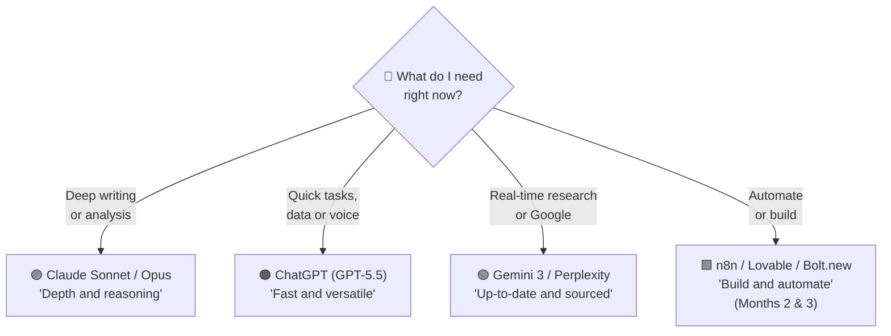

| Need | Use | Good for |
|---|---|---|
| **Deep writing & analysis** | Claude Sonnet / Opus | Long reports & proposals, analysing contracts & PDFs, complex reasoning, research summaries |
| **Quick tasks & data** | ChatGPT (GPT-5.5) | Spreadsheet analysis & charts, quick conversational tasks, voice mode on mobile, image generation (DALL-E) |
| **Live research & Google** | Gemini 3 / Perplexity | Current news & trends, cited/sourced research, Google Docs & Sheets workflows, competitor monitoring |
| **Automate or build** | n8n / Lovable / Bolt.new | Repetitive tasks & workflows, connecting apps, building a real web app *(coming in Months 2 & 3)* |

**Process:** 🎯 Identify the task → 🧩 match to tool category → 🚀 run it → ⚖️ compare outputs → 🏆 pick your default.

> 💡 **Pro tips:** pros use **3–4 tools daily** · one tool ≠ right for everything · **start with Claude this month** · switch when the task demands it.
> *"The right tool beats the best prompt in the wrong tool."*

<details>
<summary>🖼️ View the class slide: Which AI Should I Use?</summary>

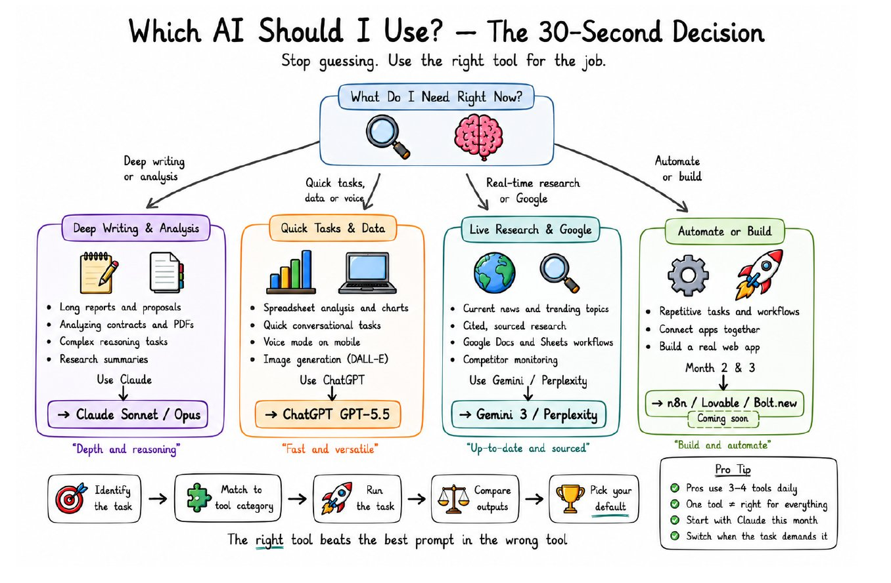
</details>

---

<a id="qa-digest"></a>

## 💬 Q&A Digest

<details>
<summary><b>If LLMs can search the web, why train them on so much knowledge?</b></summary>

Give a 3-year-old Google: they still can't explain tokens. Knowing *how* to search isn't understanding. Training gives the model a "brain" with experience; search just adds fresh facts.
</details>

<details>
<summary><b>Is the output also counted in the context window?</b></summary>

Yes. Each AI reply becomes part of the input for the next turn. Messages that have fallen out of the window aren't resent, so you're not charged for them.
</details>

<details>
<summary><b>Does a new chat include my previous chats?</b></summary>

Not directly. The sidebar is just stored history (a database). Only **memory insights** (e.g., "user prefers Python") plus system instructions are added to new chats, and those are charged as input.
</details>

<details>
<summary><b>How do I know when I've hit the context limit?</b></summary>

Consumer apps usually don't tell you. Watch for vaguer answers or ignored instructions. Some tools (e.g., Kiro) auto-summarise at ~80% and open a new session; others silently summarise or drop content.
</details>

<details>
<summary><b>Can I increase or reset the context window?</b></summary>

No, it's fixed per model (adjustable only for self-hosted/local models). It doesn't reset over time. Your options are summarise & restart, or start a new chat.
</details>

<details>
<summary><b>Does tokenization differ between models? Is NLP obsolete?</b></summary>

All LLMs tokenize, but the algorithm (and therefore the split) differs by model. NLP (Natural Language Processing) isn't obsolete; it's mostly used in research now.
</details>

<details>
<summary><b>Same prompt sent 3–4 times: is it one token count?</b></summary>

No, each send is charged again. Caching can reduce the cost (advanced topic).
</details>

<details>
<summary><b>Same chat, new topic (e.g., Excel file done, now an email)?</b></summary>

Previous context is still sent. **Switch to a new chat** for better usage.
</details>

<details>
<summary><b>Can my chat context leak to other users?</b></summary>

No. Apps isolate users at the software level. A leak would only happen through a serious software bug, or if you share your chat.
</details>

<details>
<summary><b>Why do ChatGPT replies use long em-dashes (—)?</b></summary>

Likely learned from training data as a way to "switch gears" in thought, and reinforced as AI-generated text feeds back into training.
</details>

<details>
<summary><b>Career & course-fit questions</b></summary>

- **This course** → non-tech & semi-tech roles: operations, marketing, sales, HR, PMs, automation expert, freelancer / AI agency. Builds AI systems with no-code / vibe-coding tools.
- **"AI engineer" = software engineer + AI.** Needs Python, OOP, APIs, rate limiting, async, system design. That's the separate, code-heavy Agentic AI course.
- Senior professionals (15–20 yrs) don't need to learn data science from scratch.
- Building/training models from scratch is a 4–5 month ML/DL/NLP path. Only worth it if your role needs it.
- Freelancing: **understanding the client's requirement matters more than doing the work.**
- Claude Code, VS Code, agents, n8n integrations and the full Claude interface are covered later in this course.
</details>

---

<a id="analogies"></a>

## 🎯 Analogy Cheat Sheet

| Concept | Analogy |
|---|---|
| LLM | A brain: input → understand → process → respond |
| Knowledge cutoff | Student in the exam hall, books taken away |
| Web search | Open-book exam |
| Token | The "currency" of AI, like words for humans |
| Output > input cost | Reading a 500-page book vs writing a great summary of it |
| Model tiers | Einstein (Opus) vs an average person (Haiku): smarter costs more |
| Context window | How much a brain can hold in mind at once |
| Stateless model | Re-reading the whole WhatsApp thread before every reply |
| Lost in the middle | Remembering a meeting's start and end, not the middle |
| Bigger window ≠ better | Reading 100 pages and remembering little vs 10 pages remembered fully |
| Subscription limits | A limited buffet, or a free 10-min doctor consult |
| Model downgrade | Expensive tutor swapped for a cheaper one when you ask too much |
| Hidden context cuts | A restaurant won't announce it's using 3-day-old onions |
| Temperature | A creativity dial: 0 = precise, 1 = random *(board)* |
| AI tools vs models | Every app is a wrapper around a foundation-model "brain" *(board)* |

---

<a id="glossary"></a>

## 📖 Glossary

| Term | Meaning |
|---|---|
| **LLM** | Large Language Model: predicts the next token based on patterns learned from huge text datasets |
| **Token** | Chunk of text (~¾ of a word) the model reads/writes; unit of billing |
| **Tokenization** | Splitting text into tokens before processing |
| **Token ID** | Numeric ID assigned to each token |
| **Knowledge cutoff** | Last date covered by a model's training data |
| **Context window** | Max tokens a model can consider in a single request |
| **Stateless** | The model keeps no memory between calls; every call is new |
| **Lost in the middle** | Models attend less to information in the middle of long contexts |
| **System instructions** | Hidden provider instructions sent before your message |
| **Memory** | App-level saved insights about you, injected into new chats |
| **NLP** | Natural Language Processing: the field behind language AI |
| **Opus / Sonnet / Haiku** | Claude model tiers: largest → mid → smallest |
| **Temperature** | Setting (0–1) controlling randomness/creativity of output |
| **Foundation model** | The core "brain" (Claude, GPT, Gemini, Llama) that apps are built on |
| **Application layer** | Tools built on foundation models (Perplexity, Canva AI, n8n…) |
| **Narrow AI** | Single-task pattern-matching AI (Wave 1) |
| **Generative AI** | AI that creates new text, images, code (Wave 2) |
| **Reasoning model** | Model that thinks step-by-step before answering (Wave 3) |
| **AI agent** | AI that takes actions and completes tasks, not just answers (Wave 4) |

---

<a id="quiz"></a>

## ✅ Self-Check Quiz

1. At its core, what does every LLM do?
2. Roughly how many words are 1,000 tokens?
3. For the same number of tokens, which is pricier: input or output? Why?
4. You set "reply only in Hindi" at the start of a very long chat and it stops. Why?
5. You come back to a chat after 3 days. Has the context window reset?
6. Where should critical instructions go in a long prompt?
7. Chat history, memory, context window: which one does the model actually "see"?
8. *(Board)* You need a contract summary. High or low temperature?
9. *(Board)* Which wave of AI are we in, and what defines it?
10. *(Board)* Why learn the foundation layer and not just individual tools?

<details>
<summary><b>Answers</b></summary>

1. Predicts the next token, one at a time.
2. ~750 words.
3. Output. Generating requires far more processing than reading.
4. The instruction slid out of the context window (or got lost in the middle). Repeat it or start fresh.
5. No. Context is not time-based; the stored messages are resent.
6. At the top, and repeated near the end.
7. Only the context window. History and memory are stored by the app and fed *into* the context window.
8. Low (0.0–0.2): factual/legal work needs precision and low hallucination risk.
9. Wave 4: Act. Agents that do tasks, not just answer.
10. Tools change monthly; the underlying models (and your skills) transfer across tools.
</details>
