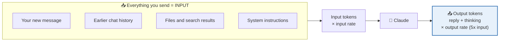
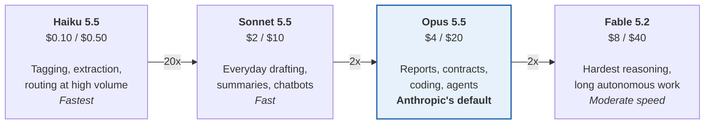
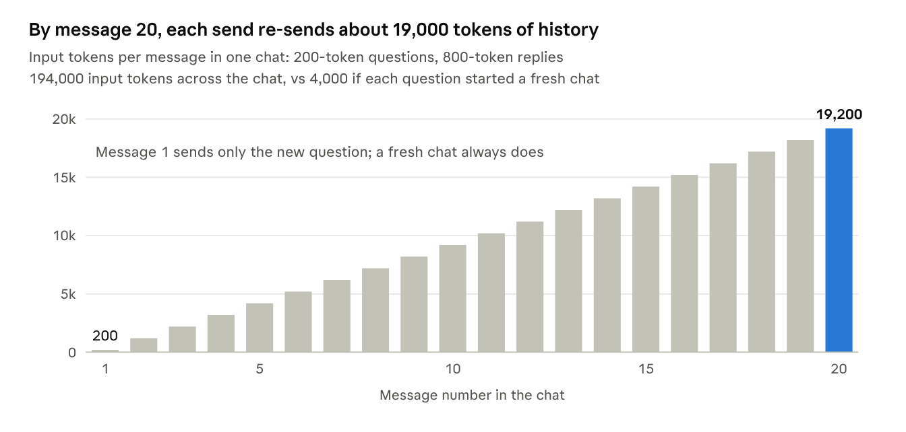
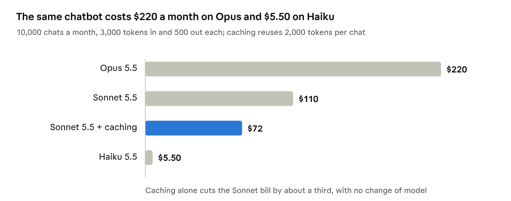

# Claude Model Costs Explained

> **As of:** 14 Nov 2026 &nbsp;|&nbsp; **Prices:** Claude API list prices in USD

Most single tasks cost under one cent, but the model you pick changes the bill by up to **80x** for the same work.

## 📑 Contents

1. [How pricing works](#how-pricing-works)
2. [Prices at a glance](#prices-at-a-glance)
3. [Which model to pick](#which-model-to-pick)
4. [Worked examples](#worked-examples)
5. [Hidden cost drivers](#hidden-cost-drivers)
6. [Ways to cut cost](#ways-to-cut-cost)
7. [Subscriptions vs API](#subscriptions-vs-api)
8. [Sources](#sources)

---

## How pricing works

You pay per million tokens (MTok). Output costs **5x** input on every current model.



```math
\text{Cost} = \frac{\text{input tokens}}{1{,}000{,}000} \times \text{input rate} + \frac{\text{output tokens}}{1{,}000{,}000} \times \text{output rate}
```

On current models, **1 word ≈ 1.8 tokens** (1M tokens ≈ 555,000 words), and a 500-word page ≈ 900 tokens.

---

## Prices at a glance

All four current models have a **1M-token context window** and a **June 2026** knowledge cutoff. One Opus 5.5 output token costs $0.00002.

| Model | Input $/MTok | Output $/MTok | Input per token | Output per token | Output tokens per $1 |
|---|---:|---:|---:|---:|---:|
| [Fable 5.2](https://platform.claude.com/docs/en/models/overview) | $8 | $40 | $0.000008 | $0.00004 | 25,000 |
| [Opus 5.5](https://platform.claude.com/docs/en/models/opus-5-5/overview) | $4 | $20 | $0.000004 | $0.00002 | 50,000 |
| [Sonnet 5.5](https://platform.claude.com/docs/en/models/sonnet-5-5/overview) | $2 | $10 | $0.000002 | $0.00001 | 100,000 |
| [Haiku 5.5](https://platform.claude.com/docs/en/models/haiku-5-5/overview), prompt ≤ 100K | $0.10 | $0.50 | $0.0000001 | $0.0000005 | 2,000,000 |
| Haiku 5.5, prompt > 100K | $0.50 | $2.50 | $0.0000005 | $0.0000025 | 400,000 |

> [!NOTE]
> - Haiku is the only model whose price jumps (**5x**) when one request passes 100,000 prompt tokens.
> - Session 01 showed Opus at $5 / $25; that was Opus 4.5 to Opus 5. Opus 5.5 is cheaper.

---

## Which model to pick

Start with the cheapest model that does the job well; move up only when the output falls short.

**Each step up costs about 2x more, except Haiku → Sonnet at 20x.** *(Price per million tokens, input / output)*



<p align="center"><sub>⬅️ Cheaper and faster &nbsp;·&nbsp; More capable, pricier ➡️</sub></p>

---

## Worked examples

Single tasks cost cents on any model; the gap matters at volume. *API list prices, before thinking tokens.*

| Scenario | Tokens in / out | Haiku 5.5 | Sonnet 5.5 | Opus 5.5 | Fable 5.2 |
|---|---|---:|---:|---:|---:|
| Draft one email | 500 / 400 | $0.0003 | $0.005 | $0.01 | $0.02 |
| Summarise a 67-page report (Session 01 demo) | 60K / 1.5K | $0.007 | $0.14 | $0.27 | $0.54 |
| Analyse a ~220-page document | 200K / 3K | $0.11 | $0.43 | $0.86 | $1.72 |
| Support chatbot, 10,000 chats a month | 30M / 5M | $5.50 | $110 | $220 | $440 |
| Tag 100,000 documents a month | 200M / 5M | $22.50 | $450 | $900 | $1,800 |

**Worked out:** the report on Sonnet = 60,000 ÷ 1M × $2 + 1,500 ÷ 1M × $10 = **$0.135**.

**Quick estimate:** reading 100 pages and writing 10 costs about $0.01 on Haiku, $0.27 on Sonnet, $0.54 on Opus and $1.08 on Fable.

---

## Hidden cost drivers

Every message re-sends the whole chat as input. Twenty questions in one chat cost about **3.3x** more than the same questions as fresh chats ($0.55 vs $0.17 on Sonnet).


<sub>Illustrative 20-message chat · 200-token questions, 800-token replies</sub>

- **Thinking** is billed as output, the expensive side.
- **Files and search results** are re-sent with every later message. Web search adds $10 per 1,000 searches.
- **Newer tokenizer:** current models count about 30% more tokens for the same text.
- **Fast mode** doubles Opus 5.5 to $8 / $40; US-only processing adds 10%.

---

## Ways to cut cost


<sub>Worked example from this doc · API list prices, Nov 2026</sub>

**Cost-saving checklist**

- [ ] Use the smallest model that does the job (2x cheaper per step down)
- [ ] Cache repeated prompts and documents (cached input costs 0.05x–0.1x)
- [ ] Batch work that can wait ([Batch API](https://platform.claude.com/docs/en/about-claude/pricing): 50% off)
- [ ] Ask for shorter answers (output costs 5x input)
- [ ] Start a fresh chat for each new topic
- [ ] Lower the effort setting for simple tasks (less thinking)

---

## Subscriptions vs API

On claude.ai you pay a flat fee for a usage allowance that resets every 5 hours and every week; bigger models and long chats use it up faster ([Claude pricing](https://claude.com/pricing)).

| Plan | Price (USD) | Usage vs Pro | Fable access |
|---|---|---|---|
| Free | $0 | Limited | No |
| Pro | $20/month ($17 annual) | Baseline | Via usage credits |
| Max | $100/month | 5x | Up to half the weekly limit |
| Ultra | $200/month | 10x weekly | Up to half the weekly limit |
| Team | $25 or $125/seat/month | Standard or 5x Standard | Premium seats |
| Enterprise | $20/seat + API-rate usage | Admin-set | Yes |

> [!TIP]
> **Rule of thumb:** subscription for your own chatting and Claude Code; API for anything that runs automatically (chatbots, n8n flows, batch jobs).

---

## Sources

- [Pricing, Claude Platform Docs](https://platform.claude.com/docs/en/about-claude/pricing): model rates, caching, Batch API, long-context rules, web search, fast mode, tokenizer note
- [Models overview, Claude Platform Docs](https://platform.claude.com/docs/en/models/overview): positioning, context windows, max output, cutoffs
- [Claude Opus 5.5 overview](https://platform.claude.com/docs/en/models/opus-5-5/overview): 1M tokens ≈ 555,000 words on the current tokenizer
- [Claude Haiku 5.5 overview](https://platform.claude.com/docs/en/models/haiku-5-5/overview): 100K-token pricing threshold
- [Claude plans and pricing](https://claude.com/pricing): Free, Pro, Max, Ultra, Team, Enterprise
