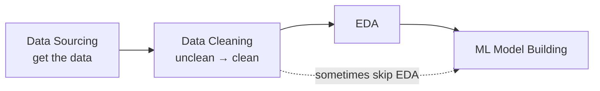
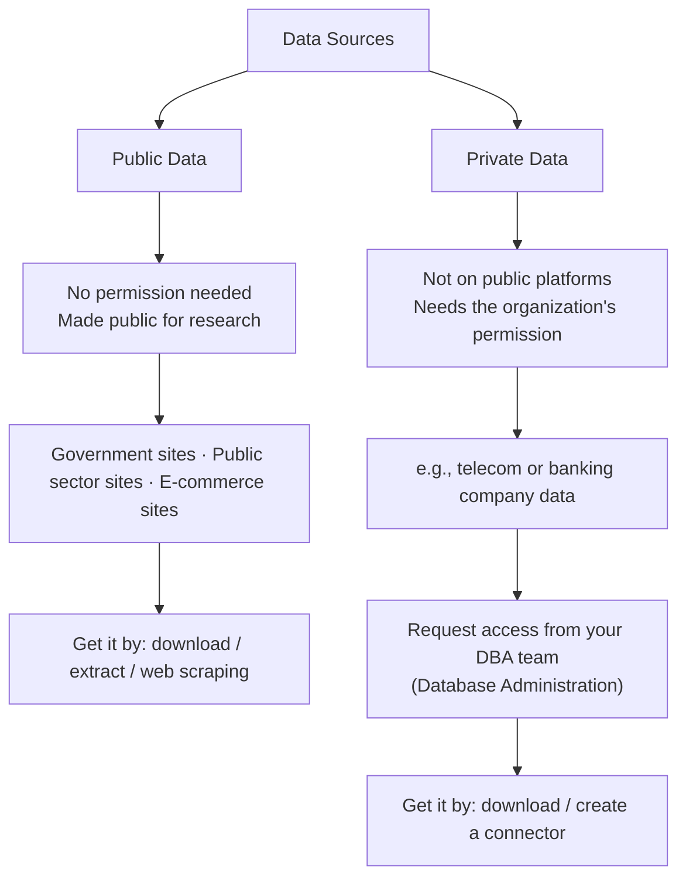
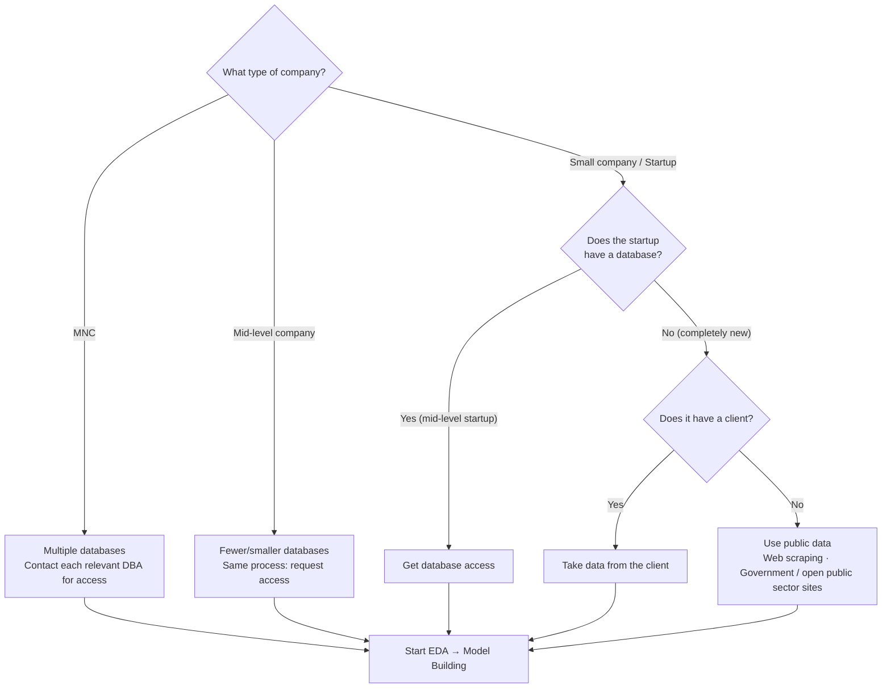
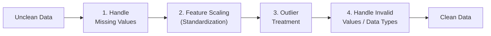
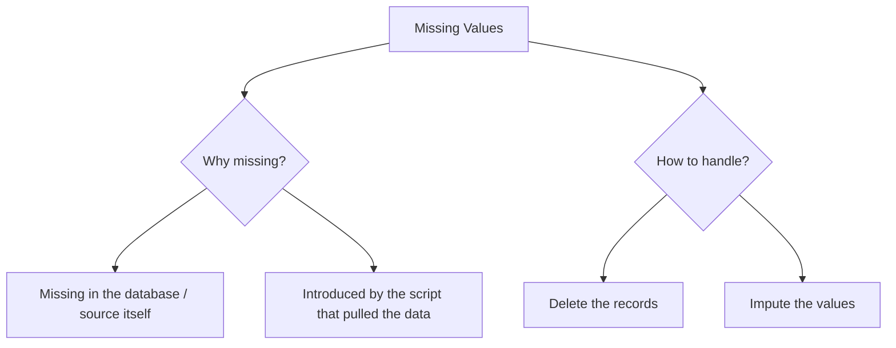
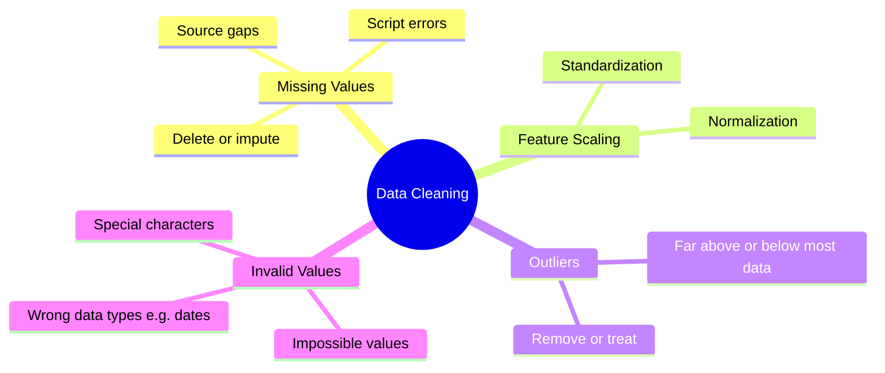

# Chapter 1.1 — Steps in EDA: Data Sourcing & Data Cleaning

> **Course:** Data Science & AI Masters 2026 — From Python to Gen AI
> **Module:** Exploratory Data Analysis
> **Topics:** Step 1 — Data Sourcing · Step 2 — Data Cleaning

---

## Table of Contents

1. [Where These Steps Fit](#1-where-these-steps-fit)
2. [Step 1 — Data Sourcing](#2-step-1--data-sourcing)
3. [Step 2 — Data Cleaning](#3-step-2--data-cleaning)
4. [Key Takeaways](#4-key-takeaways)

---

## 1. Where These Steps Fit

Data sourcing gets the data; data cleaning makes it usable. Whether you go to EDA first or straight to model building, **cleaning is always a prerequisite**.

---

## 2. Step 1 — Data Sourcing

**Data sourcing** is the process of gathering data from multiple sources, through **internal or external** data collection.

### Two kinds of data (by source)

| | **Public Data** | **Private Data** |
|---|---|---|
| **Access** | Open — no permission required | Restricted — organization's permission required |
| **Why available** | Agencies publish it for research | Internal business data |
| **Examples** | Government, public sector, e-commerce websites | Telecom or banking company databases |
| **How to get it** | Download, extract, or web scrape | Get access from the DBA team, then download or build a connector |

> Choose your data source wisely based on the **use case** you are solving.

### Sourcing by company type

The data source depends heavily on the kind of company you work for.

| Company type | Typical data source |
|---|---|
| **MNC** (multinational) | Many internal databases — talk to each database administrator for access |
| **Mid-level company** | Some internal databases — same access process |
| **Mid-level startup** | Its own database, if it has one |
| **New startup with a client** | Data provided by the client |
| **New startup with no client** | Public data via web scraping or government / open public-sector sites |

---

## 3. Step 2 — Data Cleaning

**Data cleaning** removes information that doesn't need to be there, improving **data quality** for further analysis and for building machine learning models.

### Why it matters

All **incorrect and irrelevant data is removed**, leaving good-quality data that **improves the accuracy of predictive / ML models**.

### Major steps in data cleaning

> The order shown follows the lesson; each step will be covered in detail in later lessons.

#### 1. Missing values

Missing values must be dealt with before further analysis — either **delete** the affected records or **impute** them.

#### 2. Feature scaling

Also referred to as **standardization of the data**. Feature scaling has two techniques:
- **Standardization**
- **Normalization**

#### 3. Outlier treatment

**Outliers** are data points that lie far above or far below the range where most of the data sits. Most real datasets contain them. Treatment means either **removing them** or **dealing with them**.

#### 4. Invalid values / data types

Common examples:
- **Impossible values** — e.g., an age of -180.
- **Special characters** in columns where they don't belong.
- **Wrong data types** — e.g., a date column not stored in date format.

### Data cleaning at a glance

---

## 4. Key Takeaways

- **Data sourcing** = gathering data from internal or external sources; data is either **public** (open, for research) or **private** (needs organizational permission via the DBA team).
- **Your data source depends on the company type and the use case** — MNCs and mid-level firms use internal databases; new startups rely on clients or public data.
- **Data cleaning** turns unclean data into clean data and is a **prerequisite for both EDA and model building**.
- **Four major cleaning steps:** handle missing values (delete/impute) · feature scaling (standardization/normalization) · outlier treatment · invalid values and data types.
- **Clean data → better model accuracy.**

---

*Part of my Data Science & AI learning log.*
