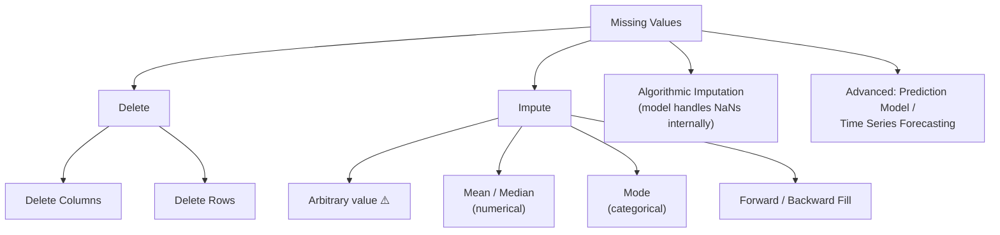
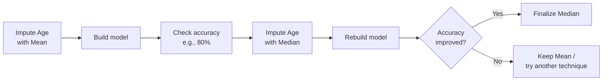
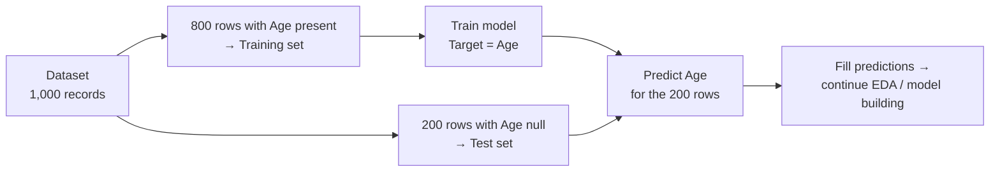
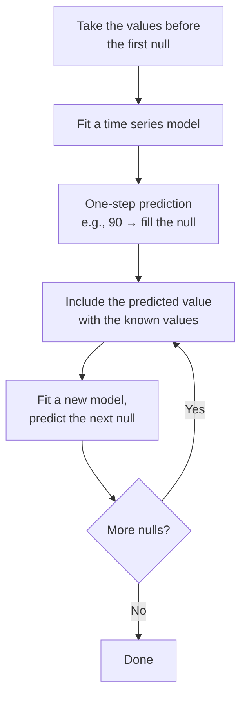
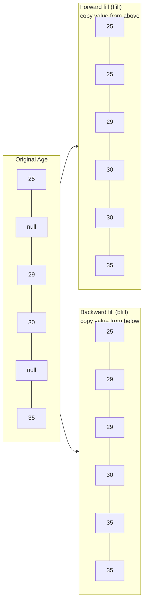
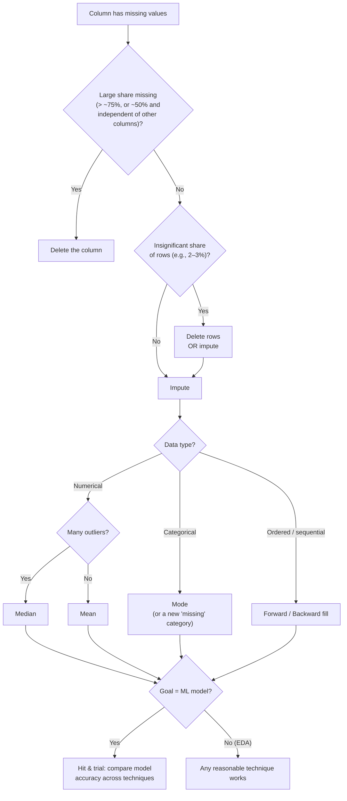

# Chapter 1.3 — Handling Missing Values

> **Course:** Data Science & AI Masters 2026 — From Python to Gen AI
> **Module:** Exploratory Data Analysis → Data Cleaning
> **Topics:** Theory of missing-value techniques · Practical in Python (pandas) on the Churn Modelling dataset
> **Notebook:** [`1.3_Handling_Missing_Values.ipynb`](./1.3_Handling_Missing_Values.ipynb)

---

## Table of Contents

1. [Overview](#1-overview)
2. [Theory: Techniques to Handle Missing Values](#2-theory-techniques-to-handle-missing-values)
3. [Practical: Handling Missing Values in Python](#3-practical-handling-missing-values-in-python)
4. [Choosing a Technique](#4-choosing-a-technique)
5. [Key Takeaways](#5-key-takeaways)

---

## 1. Overview

Missing values are one of the most common issues in the data cleaning step. Before analysis, they must be **deleted** or **imputed** (replaced).



---

## 2. Theory: Techniques to Handle Missing Values

### 2.1 Delete rows or columns

The most commonly used method. There is **no fixed rule** for choosing rows vs. columns, but these guidelines help:

| Delete... | When | Example |
|---|---|---|
| **Columns** | The column has **more than ~75%** missing values, or it has a large share missing (e.g., 50%) **and no dependency on other columns** | No point imputing a mostly-empty, independent column |
| **Rows** | Only an **insignificant** share of rows have missing values | 2% of 10,000 records = 200 rows → 9,800 remain. Some information is lost, but little |

When only a small percentage is missing, you can either delete or impute — it depends on the scenario.

### 2.2 Impute (replace) the missing values

| Method | Used for | Verdict |
|---|---|---|
| **Arbitrary value** (e.g., fill all missing ages with 25) | Any | Works, but a poor technique |
| **Mean** (e.g., age mean ≈ 32) | Numerical | Better — grounded in the data |
| **Median** (e.g., age median ≈ 31) | Numerical | Better — grounded in the data |
| **Mode** | Categorical | Standard choice for categories |

**Which is best — mean, median, or mode?**
- **For EDA:** any of them is acceptable.
- **For ML / predictive models:** there's no right or wrong — use **hit and trial**.



### 2.3 Algorithmic imputation

Some ML algorithms **handle missing values internally** — you can pass data with nulls and the algorithm deals with them. Useful when the **final goal is a predictive model**. Not considered in this module, since the focus is EDA.

### 2.4 Advanced techniques (theory only)

#### Prediction model



Rows with no missing values become the **training set**; rows with missing values become the **test set**; the column with missing values is the **target variable**. Optional to use.

#### Time series forecasting

For time-indexed data (e.g., daily sales in $M: 120, 150, 110, 80, 70, **null**, 80, **null**, 120, 130, **null**...):



**Why it's rarely used in practice:** one model per null value — 100 nulls means 100 models. This is costly in **time and memory**; the effort is better spent on model building. Mean/median/mode is preferred.

---

## 3. Practical: Handling Missing Values in Python

**Notebook:** [`1.3_Handling_Missing_Values.ipynb`](./1.3_Handling_Missing_Values.ipynb) — full code for this section.

**Dataset:** Churn Modelling (10,000 rows, 14 columns), with nulls created manually in two columns. Environment: Google Colab.

### 3.1 Setup

```python
import pandas as pd
import numpy as np
import matplotlib.pyplot as plt

df = pd.read_csv('/content/Churn_Modelling.csv')
```

### 3.2 Detect missing values

```python
df.info()                 # Way 1: compare non-null counts per column
print(df.isnull().sum())  # Way 2: null count per column
```

| Column | Missing | % of 10,000 |
|---|---|---|
| **Gender** | 54 | < 1% |
| **Age** | 300 | ~3% |

### 3.3 Technique 1 — Delete columns with missing data

```python
updated_df = df.dropna(axis=1)   # axis=1 → columns
updated_df.info()                # 14 columns → 12 (Gender & Age dropped)
```

- ❌ **Not wise here:** Age (~3% null) and Gender (<1% null) likely carry valuable information.
- Loses the entire feature because of a few nulls. Use only when a column has **too many** nulls.

### 3.4 Technique 2 — Delete rows with missing data

```python
updated_df = df.dropna(axis=0)   # axis=0 → rows
updated_df.info()                # 10,000 → 9,662 rows
```

- Any row with a null in **any** column is removed.
- May give **better accuracy** than dropping columns, since the columns may hold more valuable information than expected.
- An **acceptable approach** for ML / predictive model building.

### 3.5 Technique 3 — Imputation with mean / median

Options for imputation:
- **Numerical:** fill with **mean** or **median**.
- **Categorical:** fill with **mode**.
- **Numerical:** fill with `0`, `-999`, or another number that **never occurs** in the data, so the machine can recognize the value as not real.
- **Categorical:** fill with a **new category** representing "missing".

```python
df['Age'].mean()     # 38.89
df['Age'].median()   # 37

# fillna → fills null records | dropna → drops null records
updated_df = df
updated_df['Age'] = updated_df['Age'].fillna(df['Age'].mean())
updated_df.info()    # Age now has no nulls

updated_df1 = df
updated_df1['Age'] = updated_df['Age'].fillna(df['Age'].median())
updated_df1.info()   # Age has no null values after treatment
```

**Mean or median?** No thumb rule, but:

| Data condition | Prefer |
|---|---|
| **Many outliers** | **Median** |
| **Few outliers** | **Mean** |

### 3.6 Technique 4 — Forward & backward fill

Fills each null with a neighbouring value in the column.



```python
df = pd.read_csv('/content/Churn_Modelling.csv')   # reload with nulls
df.info()

df1 = df
df1['Age'] = df1['Age'].bfill()   # backward fill
df1.info()

# Forward fill: df1['Age'] = df1['Age'].ffill()
```

### 3.7 pandas quick reference

| Method | Purpose |
|---|---|
| `df.info()` | Non-null count and dtype per column |
| `df.isnull().sum()` | Null count per column |
| `df.dropna(axis=1)` | Drop **columns** containing nulls |
| `df.dropna(axis=0)` | Drop **rows** containing nulls |
| `s.fillna(value)` | Fill nulls with a value (mean, median, mode, constant) |
| `s.mean()` / `s.median()` | Values for numerical imputation |
| `s.ffill()` / `s.bfill()` | Forward / backward fill |

---

## 4. Choosing a Technique



---

## 5. Key Takeaways

- **Two core options:** delete (rows/columns) or impute (replace).
- **Delete columns** only when most values are missing; **delete rows** when only a small share is affected.
- **Impute numerical** with mean or median (median when outliers are many); **impute categorical** with mode. Avoid arbitrary values.
- **Forward/backward fill** copies neighbouring values into nulls.
- **Algorithmic imputation, prediction models, and time series forecasting** exist, but are outside the EDA focus or too costly in practice.
- **For EDA,** any reasonable technique is fine; **for ML,** pick by **hit and trial** on model accuracy.
- **pandas essentials:** `isnull().sum()`, `dropna(axis=…)`, `fillna()`, `ffill()`, `bfill()`.

---

*Part of my Data Science & AI learning log.*
