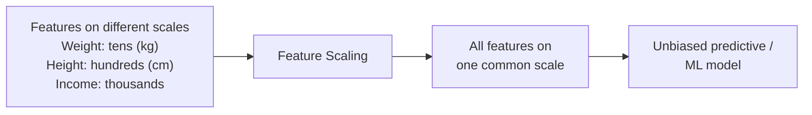
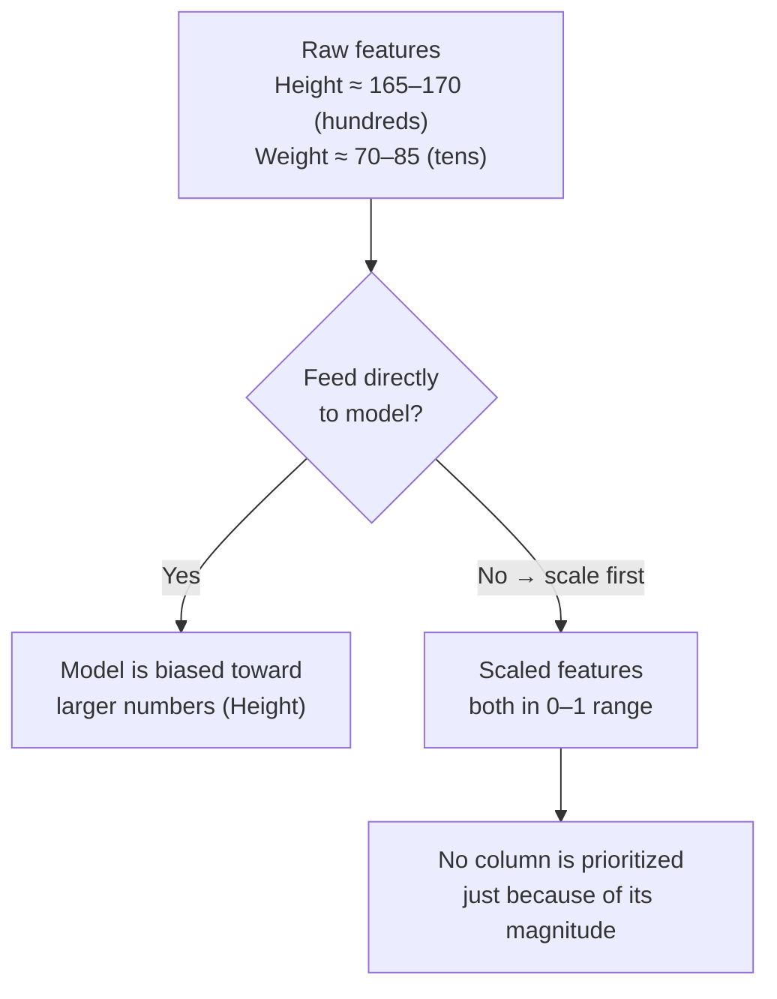
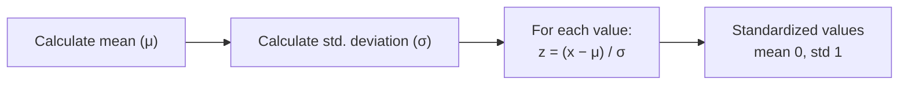
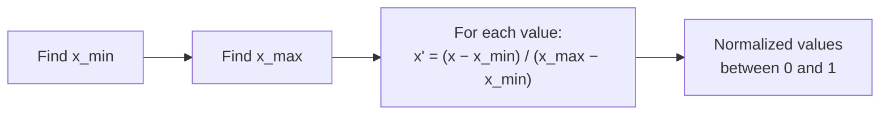
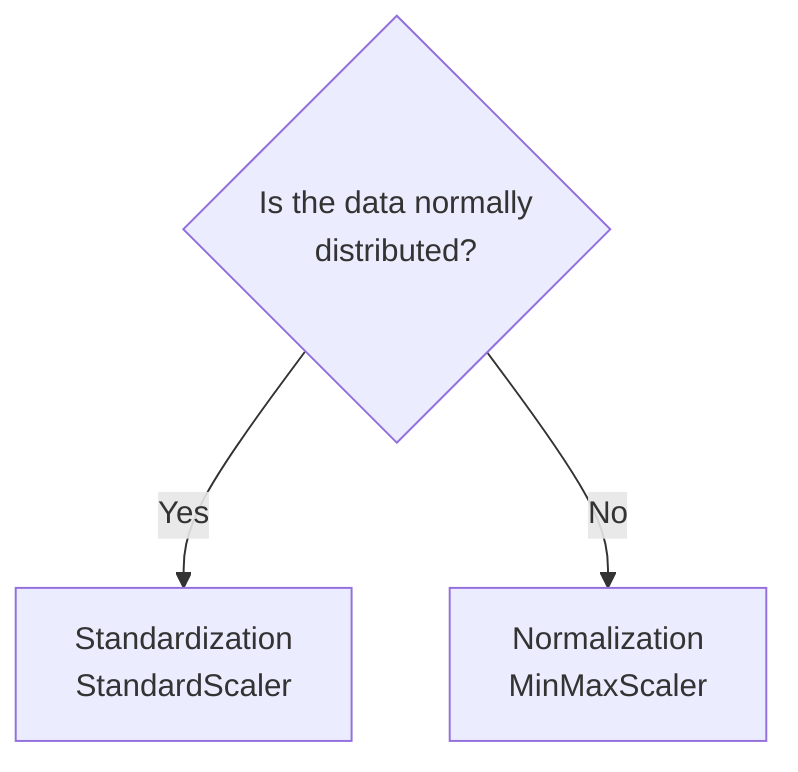
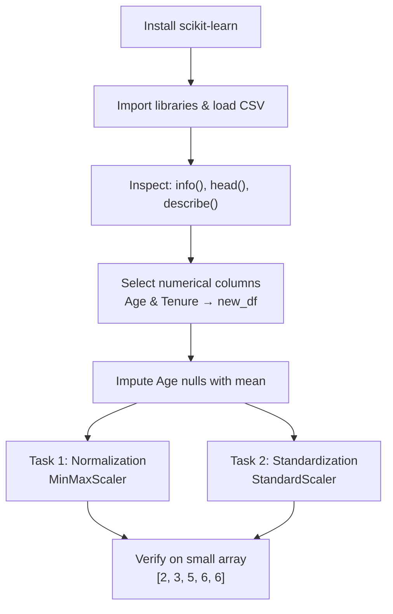

# Chapter 1.4 — Feature Scaling

> **Course:** Data Science & AI Masters 2026 — From Python to Gen AI
> **Module:** Exploratory Data Analysis → Data Cleaning
> **Topics:** Feature scaling theory · Standardization · Normalization · Practical with scikit-learn
> **Notebook:** [`1.4_Feature_Scaling.ipynb`](./1.4_Feature_Scaling.ipynb)

---

## Table of Contents

1. [What is Feature Scaling?](#1-what-is-feature-scaling)
2. [Why Feature Scaling Matters](#2-why-feature-scaling-matters)
3. [Standardization](#3-standardization)
4. [Normalization](#4-normalization)
5. [Standardization vs. Normalization](#5-standardization-vs-normalization)
6. [Practical: Feature Scaling in Python](#6-practical-feature-scaling-in-python)
7. [Key Takeaways](#7-key-takeaways)

---

## 1. What is Feature Scaling?

**Feature scaling** is a method to **rescale the values present in the features**. It converts different measurement scales into a **single scale**, bringing the whole dataset into one range.

- Part of the **data cleaning** process.
- **Essential for predictive model building**; in **EDA** it is sometimes used and sometimes not.



---

## 2. Why Feature Scaling Matters

ML algorithms run on computers, which only understand **numbers** (ultimately bytes of 0s and 1s) — not units or context. Humans know a height of 170 is in cm and a weight of 85 is in kg; a model only sees that 170 > 85.



When features **differ in range of values or units**, standardize or normalize them so the difference in range doesn't affect the outcome.

### Example: scaling keeps the relative ordering

Simple scaling by **dividing each value by the column's maximum**:

| Person | Weight | Scaled Weight (÷85) | Height | Scaled Height (÷170) |
|---|---|---|---|---|
| A | 85 | 1.00 | 170 | 1.00 |
| B | 80 | 0.95 | 165 | 0.97 |
| C | 75 | 0.88 | 168 | 0.98 |
| D | 70 | 0.82 | 170 | 1.00 |

- **Before and after scaling:** A has the highest weight and D the lowest; A and D share the highest height and B the lowest.
- **Feature importance doesn't change** — only the scale does. Both columns now sit in a 0–1 range.

> Dividing by the maximum is one technique, but the **two most accepted** feature scaling techniques in statistics are **standardization** and **normalization**.

---

## 3. Standardization

Converts data to **z-scores** based on the mean and standard deviation.

$$
z = \frac{x - \mu}{\sigma}
\qquad
\sigma = \sqrt{\frac{\sum (x_i - \mu)^2}{n}}\ \text{(population)}\quad \text{or}\quad \sqrt{\frac{\sum (x_i - \mu)^2}{n-1}}\ \text{(sample)}
$$

- Resulting data has **mean = 0** and **standard deviation = 1**.
- Based on the **standard normal distribution** — values generally fall between **−3 and +3**.

| Range around mean | Share of data |
|---|---|
| ±1σ (z = −1 to 1) | 68% |
| ±2σ (z = −2 to 2) | 95.4% |
| ±3σ (z = −3 to 3) | 99.7% |



### Worked example — Income

| Income | Calculation | Standardized |
|---|---|---|
| 15,000 | (15,000 − 19,000) / 9,643.65 | −0.41 |
| 12,000 | (12,000 − 19,000) / 9,643.65 | −0.72 |
| 30,000 | (30,000 − 19,000) / 9,643.65 | 1.14 |

μ = (15,000 + 12,000 + 30,000) / 3 = **19,000** · σ = **9,643.65**

---

## 4. Normalization

Rescales values into a **0 to 1** range. Also known as **Min-Max scaling**.

$$
x' = \frac{x - x_{min}}{x_{max} - x_{min}}
$$

- Minimum value → **0**, maximum value → **1**.



### Worked example — Income

x_min = 12,000 · x_max = 30,000 · range = 18,000

| Income | Calculation | Normalized |
|---|---|---|
| 15,000 | (15,000 − 12,000) / 18,000 = 3/18 = 1/6 | 0.16 |
| 12,000 | (12,000 − 12,000) / 18,000 | 0 |
| 30,000 | (30,000 − 12,000) / 18,000 | 1 |

> Without scaling, a model fed features in tens (Age) and thousands (Income) would be **biased toward Income** and toward larger numbers.

---

## 5. Standardization vs. Normalization

| | **Standardization** | **Normalization** |
|---|---|---|
| **Formula** | (x − μ) / σ | (x − x_min) / (x_max − x_min) |
| **Result** | Mean 0, std 1; mostly −3 to +3 | Range 0 to 1 |
| **Based on** | Standard normal distribution (z-score) | Min and max of the data |
| **scikit-learn** | `StandardScaler` | `MinMaxScaler` |
| **Use when** | Data is **normally distributed** | Data is **not normally distributed** |



---

## 6. Practical: Feature Scaling in Python

**Notebook:** [`1.4_Feature_Scaling.ipynb`](./1.4_Feature_Scaling.ipynb) — full code for this section.

**Dataset:** Churn Modelling (10,000 rows, 14 columns; Gender has 54 nulls, Age has 300). Environment: Google Colab.

### Workflow



### 6.1 Setup

```python
pip install -U scikit-learn

import pandas as pd
import numpy as np
import matplotlib.pyplot as plt
import seaborn as sns

df = pd.read_csv('/content/Churn_Modelling.csv')
df.info()

from sklearn.preprocessing import StandardScaler
from sklearn.preprocessing import MinMaxScaler
```

- `StandardScaler` → **standardization**: removes the mean and scales to unit variance.
- `MinMaxScaler` → **normalization**: scales each feature to a given range.
- Refer to the official scikit-learn documentation for each scaler to learn more.

### 6.2 Explore and prepare the data

```python
df.head()
df.describe().round(2)   # statistical summary of numerical columns
```

Some columns are categorical, and some aren't important for analysis (these should normally be removed). This exercise focuses only on scaling, so two numerical columns are selected:

```python
new_df = pd.DataFrame(df, columns = ['Age', 'Tenure'])
new_df.head(5)   # Age is in tens, Tenure in ones

new_df['Age'] = new_df['Age'].fillna(new_df['Age'].mean())   # impute nulls
new_df.info()    # 10,000 non-null in both columns
```

### 6.3 Task 1 — Normalization (`MinMaxScaler`)

```python
scaler = MinMaxScaler()   # Instantiating the MinMaxScaler() function
normalized_df = scaler.fit_transform(new_df)
print(normalized_df)
```

```
[[0.32432432 0.2       ]
 [0.31081081 0.1       ]
 [0.32432432 0.8       ]
 ...
 [0.24324324 0.7       ]
 [0.32432432 0.3       ]
 [0.13513514 0.4       ]]
```

`fit_transform` fits the scaler to the data and transforms it. Both columns now sit on the same 0–1 scale.

**Small example to verify:**

```python
x_array = np.array([[2],[3],[5],[6],[6]])

scaler = MinMaxScaler()
normalized_arr = scaler.fit_transform(x_array)
print(normalized_arr)   # [0, 0.25, 0.75, 1, 1]
```

Manual check (x_min = 2, x_max = 6, range = 4):

| x | (x − 2) / 4 | Result |
|---|---|---|
| 2 | 0 / 4 | 0 |
| 3 | 1 / 4 | 0.25 |
| 5 | 3 / 4 | 0.75 |
| 6 | 4 / 4 | 1 |
| 6 | 4 / 4 | 1 |

### 6.4 Task 2 — Standardization (`StandardScaler`)

Same code, different scaler:

```python
scaler = StandardScaler()
standardized_df = scaler.fit_transform(new_df)
print(standardized_df)
```

```
[[ 0.30105697 -1.04175968]
 [ 0.20409338 -1.38753759]
 [ 0.30105697  1.03290776]
 ...
 [-0.28072461  0.68712986]
 [ 0.30105697 -0.69598177]
 [-1.05643338 -0.35020386]]
```

**Small example to verify:**

```python
x_array = np.array([[2],[3],[5],[6],[6]])

scaler = StandardScaler()
normalized_arr_ss = scaler.fit_transform(x_array)
print(normalized_arr_ss)   # [-1.477, -0.862, 0.369, 0.985, 0.985]
```

Manual check, treating the data as a **population** (÷ n):

- μ = (2 + 3 + 5 + 6 + 6) / 5 = **4.4**
- Σ(xᵢ − μ)² = 5.76 + 1.96 + 0.36 + 2.56 + 2.56 = **13.2**
- σ = √(13.2 / 5) = √2.64 ≈ **1.62**

| x | (x − 4.4) / 1.62 | Manual | scikit-learn |
|---|---|---|---|
| 2 | −2.4 / 1.62 | −1.48 | −1.477 |
| 3 | −1.4 / 1.62 | −0.86 | −0.862 |
| 5 | 0.6 / 1.62 | 0.37 | 0.369 |
| 6 | 1.6 / 1.62 | 0.98 | 0.985 |
| 6 | 1.6 / 1.62 | 0.98 | 0.985 |

Small differences come from rounding to two decimals in the manual calculation.

### 6.5 Quick reference

| Code | Purpose |
|---|---|
| `pip install -U scikit-learn` | Install / upgrade scikit-learn |
| `from sklearn.preprocessing import StandardScaler, MinMaxScaler` | Import scalers |
| `scaler = MinMaxScaler()` | Create a normalization scaler |
| `scaler = StandardScaler()` | Create a standardization scaler |
| `scaler.fit_transform(data)` | Fit the scaler to the data and return scaled values |
| `df.describe().round(2)` | Statistical summary of numerical columns |

---

## 7. Key Takeaways

- **Feature scaling** brings features with different ranges or units onto one common scale.
- **Why:** models only see numbers, so larger-magnitude columns get unfairly prioritized. Scaling removes that bias **without changing feature importance**.
- **Mandatory before predictive modeling;** optional in EDA, but important to understand.
- **Standardization:** z = (x − μ) / σ → mean 0, std 1 → use for **normally distributed** data → `StandardScaler`.
- **Normalization:** (x − x_min) / (x_max − x_min) → range 0 to 1 → use for **non-normal** data → `MinMaxScaler`.
- **In scikit-learn,** instantiate the scaler, then call `fit_transform()` on the data.

---

*Next is handling outliers and invalid data.*
