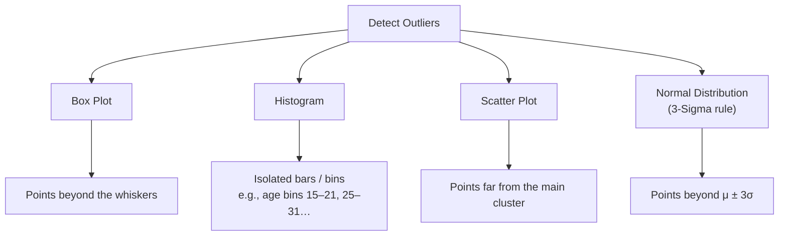
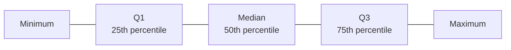
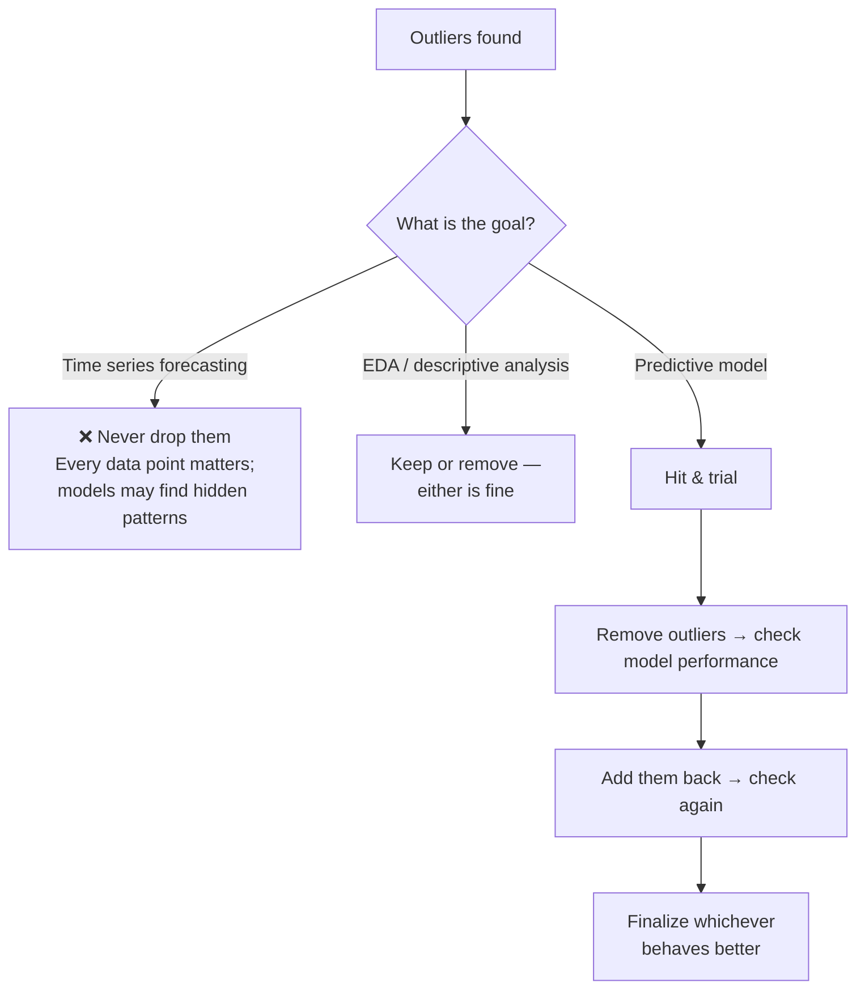
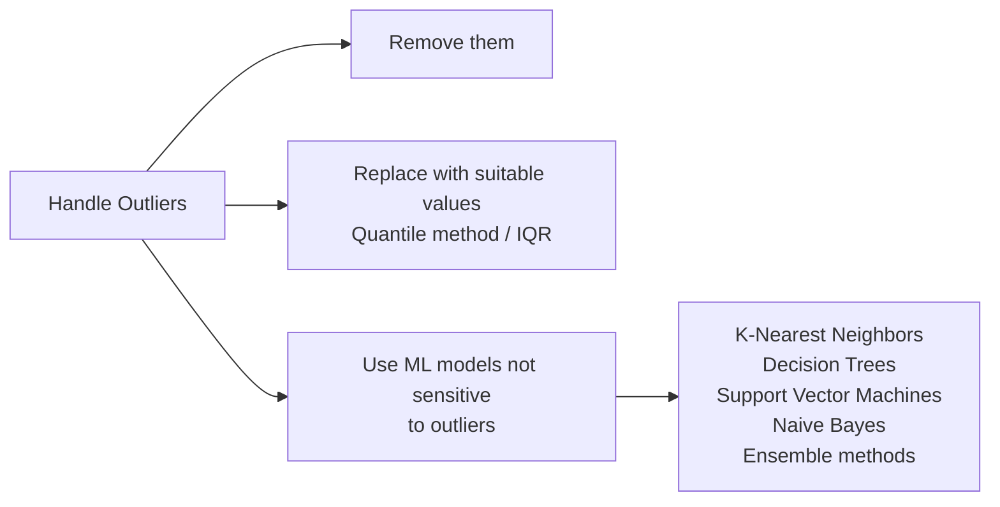
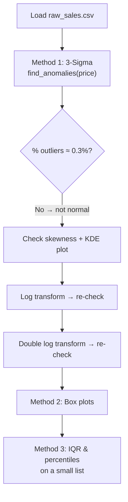
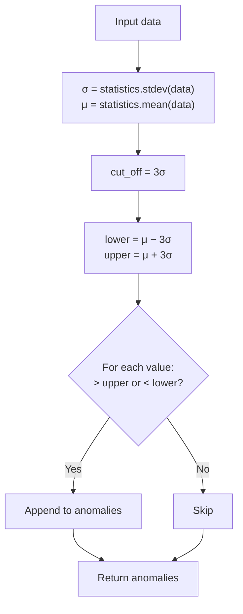
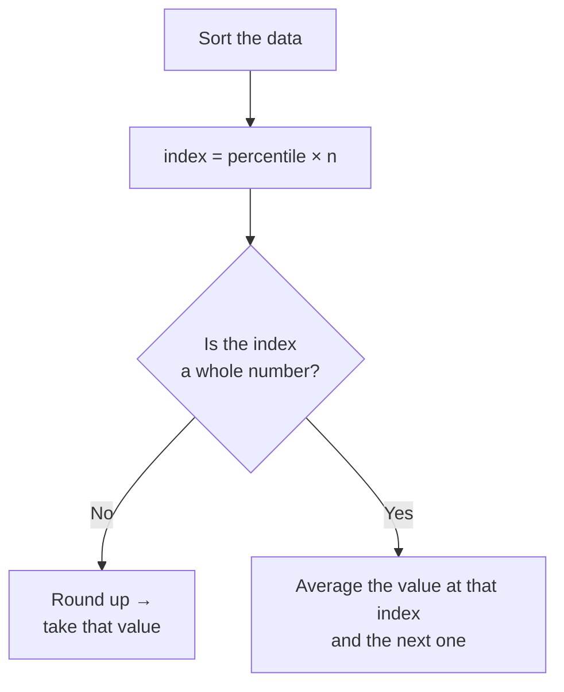

# Chapter 1.5 — Handling Outliers

> **Course:** Data Science & AI Masters 2026 — From Python to Gen AI
> **Module:** Exploratory Data Analysis → Data Cleaning
> **Topics:** What outliers are · Detection techniques · When to treat them · Practical: 3-Sigma, Box Plots, IQR & Percentiles
> **Notebook:** [`1.5_Outliers.ipynb`](./1.5_Outliers.ipynb)

---

## Table of Contents

1. [What is an Outlier?](#1-what-is-an-outlier)
2. [Detecting Outliers](#2-detecting-outliers)
3. [To Treat or Not to Treat?](#3-to-treat-or-not-to-treat)
4. [Handling Outliers](#4-handling-outliers)
5. [Practical: Detecting Outliers in Python](#5-practical-detecting-outliers-in-python)
6. [Key Takeaways](#6-key-takeaways)

---

## 1. What is an Outlier?

An **outlier** is one of the **most extreme values** in the data: an abnormal observation that **deviates from the normal data** and doesn't fit its normal behaviour. Outliers are also called **anomalies**, and they are common in almost any dataset.

| Example | Data | Potential outlier |
|---|---|---|
| **Age** | 28, 29, 31, **92**, 28 | 92 — far from the 28–31 range |
| **Monthly sales ($M)** | 120, 150, 130, **10** (April), back on track | April's sudden drop to 10 |

---

## 2. Detecting Outliers



### Box plot

Built on five measures:



The box (Q1 to Q3) holds **50% of the data**. Points lying well outside the box and whiskers are **potential outliers**.

### Histogram

Group values into bins (e.g., age bins 15–21, 25–31). A value like 92 shows up as an isolated bar far from the rest.

### Scatter plot

Most points cluster in one range; points falling outside that range are potential outliers.

### Normal distribution (the classical way)

About **99.7%** of data lies within **±3 standard deviations** of the mean. The remaining **0.3%** beyond ±3σ are treated as outliers.

---

## 3. To Treat or Not to Treat?

There is **no thumb rule** for whether to remove outliers. It depends on the scenario.



- **Time series forecasting** — e.g., daily temperature in Malaysia with occasional days of 41° or 17°. Don't drop these: each point is important, and models may pick up internal patterns you can't see.
- **A few extreme records** — e.g., 1–2 people with very high age. You can remove or keep them; there's no right or wrong.
- **Predictive analytics** — an iterative, hit-and-trial process: compare model behaviour with and without outliers.

---

## 4. Handling Outliers



Dedicated **outlier-detection algorithms** will be covered later in the predictive analytics part.

---

## 5. Practical: Detecting Outliers in Python

**Notebook:** [`1.5_Outliers.ipynb`](./1.5_Outliers.ipynb) — full code for this section.

**Dataset:** `raw_sales.csv` — 29,580 property sales with `datesold`, `postcode`, `price`, `propertyType`, `bedrooms`. Environment: Google Colab with Google Drive mounted (or upload the file directly).

### Workflow



### 5.1 Setup

```python
import numpy as np
import matplotlib.pyplot as plt
import statistics
import pandas as pd

from google.colab import drive
drive.mount('/content/drive')

# Place your csv file inside this folder --> MyDrive/AI, Data Science & Analytics
data = pd.read_csv('/content/drive/MyDrive/AI, Data Science & Analytics/raw_sales.csv')
data.head(5)
type(data)   # pandas.core.frame.DataFrame
```

### 5.2 Method 1 — 3-Sigma technique (standard deviation)

Anything beyond **μ ± 3σ** is an outlier. For perfectly normal data, that's **0.3%** of values; real data is rarely perfectly normal, so the share can be higher (1%, 2%, …) depending on how far the data is from normal.



```python
# Function to Detection Outlier on one-dimentional datasets.
def find_anomalies(data):
    #define a list to accumlate anomalies
    anomalies = []

    # Set upper and lower limit to 3 standard deviation
    random_data_std = statistics.stdev(data)
    random_data_mean = statistics.mean(data)
    # 3-standard deviation

    anomaly_cut_off = random_data_std * 3

    lower_limit  = random_data_mean - anomaly_cut_off
    upper_limit = random_data_mean + anomaly_cut_off

    # Generate outliers
    for outlier in data:
        if outlier > upper_limit or outlier < lower_limit:
            anomalies.append(outlier)
    return anomalies
```

**Run on raw price:**

```python
list_1 = find_anomalies(data['price'])
len(list_1)          # 461
len(data)            # 29580
data.price.skew()    # 4.31 → strongly right (positively) skewed

import seaborn as sns
sns.kdeplot(data.price)   # long right tail — not normal
```

461 / 29,580 ≈ **1.55%** outliers, far above the 0.3% expected for normal data, so the data **isn't normally distributed**. Skewness (or kurtosis) confirms it.

**Transform to reduce skew and re-check:**

```python
# Log transform
data['price_transformed'] = np.log(data.price)
data.price_transformed.skew()                  # 0.47
list_2 = find_anomalies(data.price_transformed)
len(list_2)                                    # 266
sns.kdeplot(data.price_transformed)

# Double log transform
data['price_transformed_double'] = np.log(data.price_transformed)
data['price_transformed_double'].skew()        # 0.33
list_3 = find_anomalies(data.price_transformed_double)
len(list_3)                                    # 251
```

| Data | Skewness | Outliers | % of 29,580 |
|---|---|---|---|
| `price` (raw) | 4.31 | 461 | ~1.55% |
| `price_transformed` (log) | 0.47 | 266 | ~0.9% |
| `price_transformed_double` (log of log) | 0.33 | 251 | ~0.8% |

Each transformation brings the data **closer to a normal distribution**, and the share of outliers drops toward 0.3%.

> 📝 Notebook note: *"Anything below 40, or above 80 are considered as outliers"*

### 5.3 Method 2 — Box plots

A **visual** way to identify outliers. Scatter plots and histograms also work, but box plots are better than other visual methods for this.

```python
import seaborn as sns
import matplotlib.pyplot as plt

sns.boxplot(data=data)
```

> 📝 Notebook note: *"As you can see, it considers everything above 75 or below ~ -35 to be an outlier. The results are very close to method 1 above."*

```python
df = pd.DataFrame(data)
len(df)          # 29580
df.describe()    # Statistical information of the dataframe columns
```

From `describe()`, `price_transformed_double` has a 75th percentile of ~2.60 and a max of ~2.77: a visible gap that points to outliers at the top end.

| Column | 25% | 50% | 75% | Max |
|---|---|---|---|---|
| `price` | 440,000 | 550,000 | 705,000 | 8,000,000 |
| `price_transformed` | 12.99 | 13.22 | 13.47 | 15.89 |
| `price_transformed_double` | 2.56 | 2.58 | 2.60 | 2.77 |

### 5.4 Method 3 — Interquartile range (IQR) & percentiles

$$
IQR = Q3 - Q1
$$

where **Q1** is the first quartile (25th percentile) and **Q3** the third quartile (75th percentile).

```python
list1 = [43, 54, 56, 61, 62, 66, 68, 69, 69, 70, 71, 72, 77, 78, 79, 85, 87, 88, 89, 93, 95, 96, 98, 99, 99]

len(list1)                # 25
max(list1)                # 99 (appears twice)
min(list1)                # 43

import statistics
statistics.mean(list1)    # 76.96

list2 = sorted(list1)
```

**Finding a percentile by hand (ordered data, n = 25):**



| Percentile | Calculation | Result |
|---|---|---|
| **90th** | 0.90 × 25 = 22.5 → round up to 23 → 23rd value | **98** |
| **20th** | 0.20 × 25 = 5 (whole) → average of 5th & 6th values: (62 + 66) / 2 | **64** |
| **50th (median)** | 13th value | **77** |

### 5.5 Which technique?

The **standard deviation (3-sigma) technique** is the most important and most reliable — it's the usual choice for identifying outliers. Specialized outlier-detection algorithms come later in predictive analytics.

### 5.6 Quick reference

| Code | Purpose |
|---|---|
| `statistics.stdev(data)` / `statistics.mean(data)` | Standard deviation / mean |
| `find_anomalies(data)` | Custom 3-sigma outlier finder |
| `series.skew()` | Skewness (0 ≈ symmetric, > 0 right-skewed) |
| `sns.kdeplot(series)` | Distribution shape |
| `np.log(series)` | Log transform to reduce right skew |
| `sns.boxplot(data=df)` | Visual outlier check |
| `df.describe()` | Quartiles, min, max per column |
| `sorted(list)` | Order data for manual percentiles |

---

## 6. Key Takeaways

- **Outliers (anomalies)** are extreme values that don't fit the data's normal behaviour.
- **Detect** them with box plots, histograms, scatter plots, or the **3-sigma rule** (beyond μ ± 3σ).
- **No thumb rule for treatment:** never drop them in **time series forecasting**; either choice is fine in **EDA**; use **hit and trial** for predictive models.
- **Handle** them by removing, replacing (quantile / IQR), or using outlier-insensitive models (KNN, decision trees, SVM, Naive Bayes, ensembles).
- **If 3-sigma flags far more than 0.3%,** the data isn't normal; check **skewness** and try a **log transform**.
- **IQR = Q3 − Q1;** percentiles are found from sorted data using index = percentile × n.

---

*Upcoming Chapter will focus on feature binning and feature encoding.*
