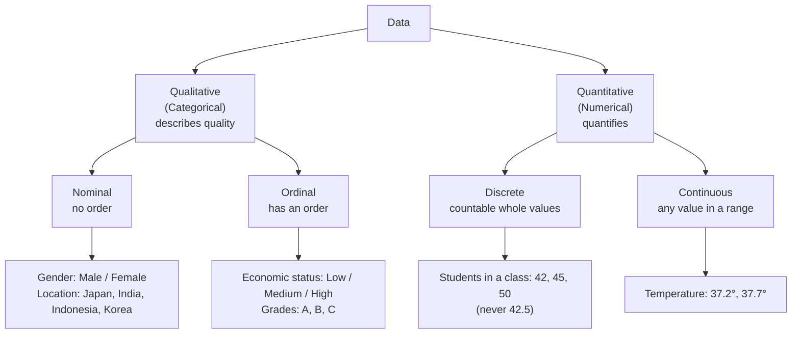
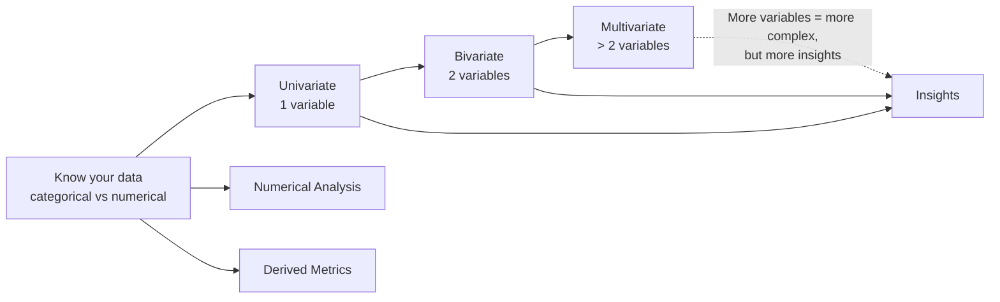
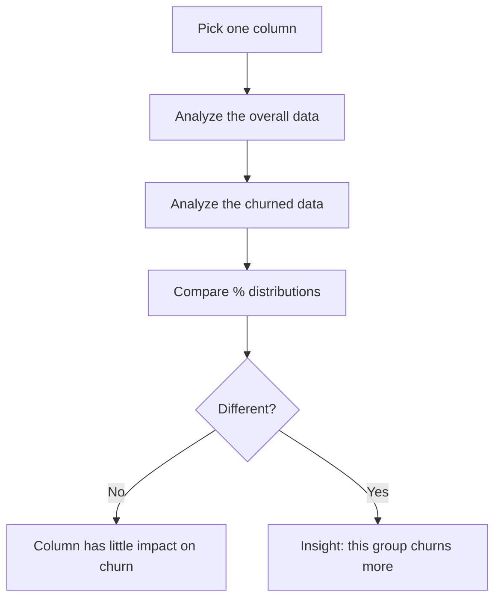
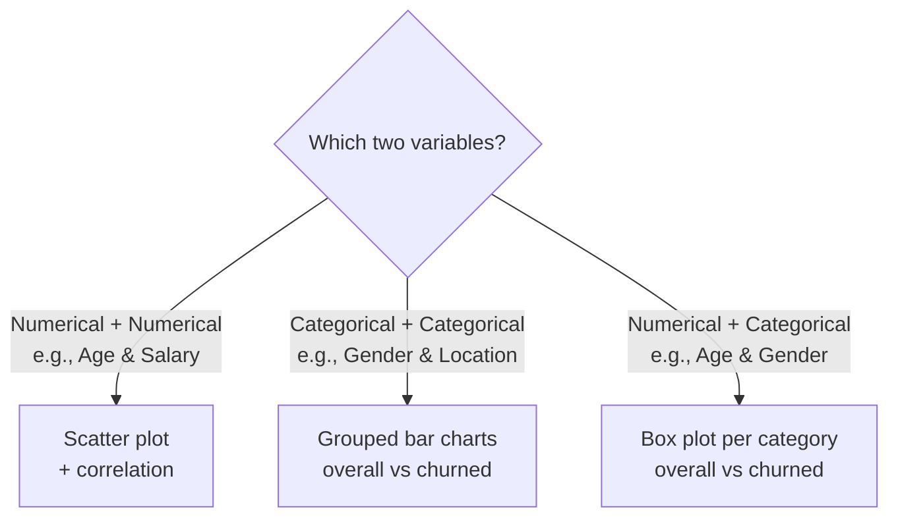
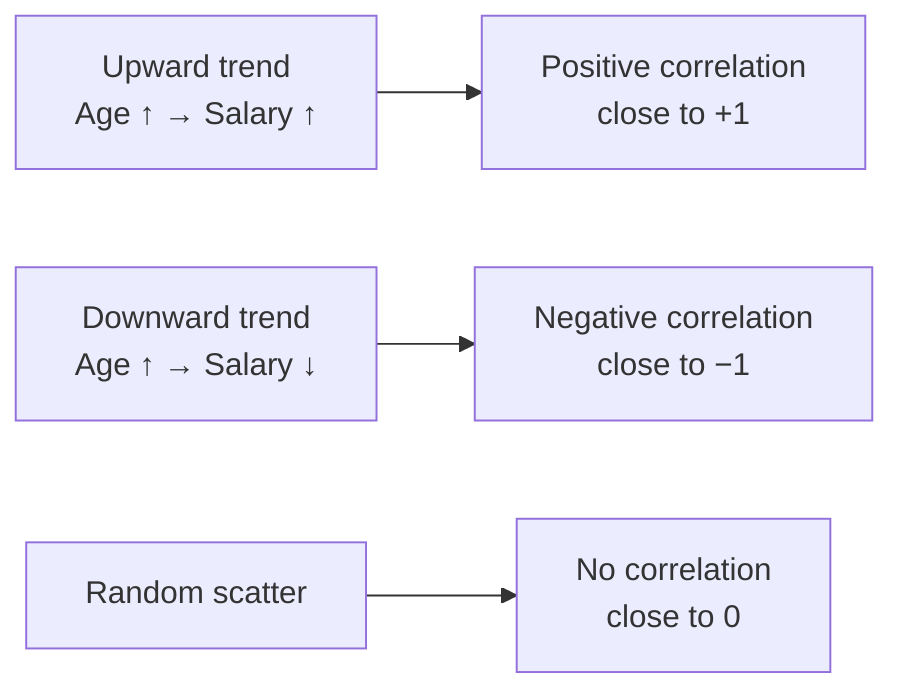
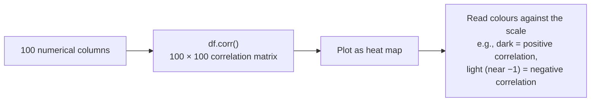
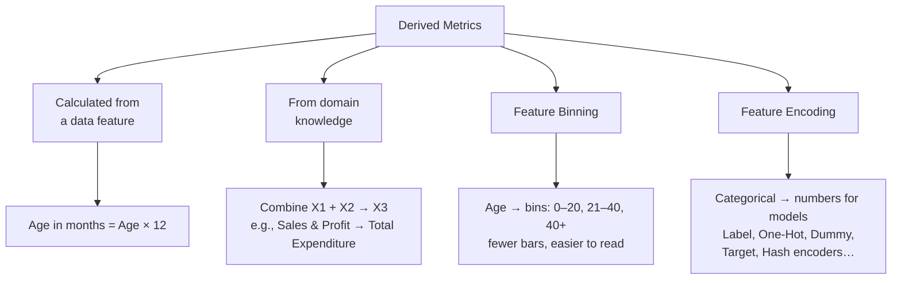
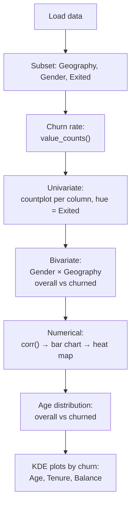

# Chapter 1.6 — Types of Data & Types of Analysis

> **Course:** Data Science & AI Masters 2026 — From Python to Gen AI
> **Module:** Exploratory Data Analysis
> **Topics:** Types of data · Univariate, Bivariate & Multivariate analysis · Numerical analysis · Derived metrics · Practical on the Churn Modelling dataset
> **Notebook:** [`1.6_Cat_Num_Analysis.ipynb`](./1.6_Cat_Num_Analysis.ipynb)

---

## Table of Contents

1. [Types of Data](#1-types-of-data)
2. [Types of Analysis — Overview](#2-types-of-analysis--overview)
3. [Univariate Analysis](#3-univariate-analysis)
4. [Bivariate Analysis](#4-bivariate-analysis)
5. [Multivariate Analysis](#5-multivariate-analysis)
6. [Numerical Analysis](#6-numerical-analysis)
7. [Derived Metrics](#7-derived-metrics)
8. [Practical: Categorical & Numerical Analysis in Python](#8-practical-categorical--numerical-analysis-in-python)
9. [Key Takeaways](#9-key-takeaways)

---

## 1. Types of Data



| Type | Sub-type | Meaning | Example |
|---|---|---|---|
| **Qualitative (Categorical)** | **Nominal** | Categories with **no order** | Gender, Country |
| | **Ordinal** | Categories **in an order** (ascending/descending) | Economic status, Grades |
| **Quantitative (Numerical)** | **Discrete** | Countable, whole values | No. of students |
| | **Continuous** | Any value within a range | Temperature |

Knowing which columns are categorical vs. numerical is the first step before choosing how to analyze them.

---

## 2. Types of Analysis — Overview



All three variate types apply to **numerical, categorical, or mixed** data.

### Running use case: telecom churn

- You join **Vodafone** as a data analyst. Data covers the past **24 months**, with a churn rate of about **25%**.
- **Churn** = a customer leaving for a competitor (e.g., a Vodafone user switching networks, or moving from HSBC to Standard Chartered for better deposit rates). It's a loss to the company.
- **Goal:** find the **characteristics of churners** and the **patterns** behind churn.
- Example dataset: **1,000 customers → 750 active, 250 churned**, with columns like age, gender, location.

---

## 3. Univariate Analysis

**Uni** = one, **variate** = variable. Analyzing **one variable** at a time — the simplest form of analysis.

| Column type | What you look at | Tells you |
|---|---|---|
| **Numerical** (e.g., Age) | Summary statistics or box plot: min, max, median, 25th & 75th percentile | **Spread** of the data |
| **Categorical** (e.g., Gender) | Counts per category (e.g., 8,000 male vs 2,000 female → ~4:1) | **Distribution** of the data |

### The approach: overall vs. churned



| Column | Overall | Churned | Insight |
|---|---|---|---|
| **Gender** (scenario 1) | 510 M : 490 F (~1:1) | 125 M : 125 F (~1:1) | Gender has little impact on churn |
| **Gender** (scenario 2) | 510 M : 490 F (~1:1) | 180 M : 70 F (> 2.5:1) | Male customers are more likely to churn |
| **Age** | Mean 25, max 92 | Mean ~35, max 92 (active: mean 23, max 56) | Older / more senior customers churn more |

> Univariate analysis gives **insights**, not **reasons**. Why males or older customers churn is still unknown at this stage.

---

## 4. Bivariate Analysis

**Bi** = two. Analyzing **two variables** to measure the relationship between them.



### Numerical + numerical → correlation



Correlation ranges from **−1 to +1** and is the usual way to measure the relationship between two numerical attributes.

### Categorical + categorical

Example: Gender (M/F) × Location (Japan/Malaysia).
- **Overall data:** most customers are from Japan.
- **Churned data:** females in Malaysia stand out → **insight: females in Malaysia are more likely to churn** (reason unknown).

### Numerical + categorical

Example: Age × Gender — draw a box plot of age for males and for females, first on the overall data, then on churned customers, and compare. Other chart types work too; the concept stays the same.

---

## 5. Multivariate Analysis

**Multi** = multiple. Analysis involving **more than two variables** (e.g., four categorical columns), using any mix of categorical and numerical attributes.

- **Pro:** the deeper you go, the **more insights** you get.
- **Con:** graphs and analysis become **more complex**.
- **EDA depends on requirements:** with limited time, you may **skip** multivariate analysis; with enough time, progress from univariate → bivariate → multivariate.

---

## 6. Numerical Analysis

Extra analysis done specifically on numerical data:

| Scope | Interest | Tool |
|---|---|---|
| **Single variable** | Mean, median, 25th/75th percentile, min, max | Box plot |
| **Two variables** | Positive, negative, or no correlation | Scatter plot |
| **Many variables** | Correlations across all pairs | `df.corr()` + **heat map** |
| **Distributions** | Shape of the data | KDE plots, histograms, and more |

### Why a heat map?

With **100 numerical columns**, plotting a scatter plot for every pair (1 vs 2, 1 vs 3, 1 vs 4…) isn't feasible.



E.g., a dark cell at Variable 1 × Variable 2 shows positive correlation; a light cell near −1 at Variable 50 × Variable 2 shows negative correlation.

---

## 7. Derived Metrics

**Derived metrics** are new variables **manually created from existing ones** to get more insightful information. They aren't in the original data.



| Technique | What it does | Example |
|---|---|---|
| **Calculated from data** | Simple transformation of an existing column | Age × 12 = Age in months |
| **Domain knowledge** | Combine columns using a known formula | Expenditure from Sales and Profit |
| **Binning** | Group a numerical column into ranges | Age → 0–20, 21–40, 40+ |
| **Encoding** | Convert categorical data into a form models understand (computers don't understand categories) | Label, One-Hot, Dummy, Target, Hash encoding |

Feature binning and encoding get their own sessions later.

---

## 8. Practical: Categorical & Numerical Analysis in Python

**Notebook:** [`1.6_Cat_Num_Analysis.ipynb`](./1.6_Cat_Num_Analysis.ipynb) — full code for this section.

**Dataset:** Churn Modelling — sample customer data showing customers who left last month. Target column: **`Exited`** (1 = churned, 0 = stayed).

### Workflow



### 8.1 Setup

```python
#import the required libraries
import numpy as np
import pandas as pd
import seaborn as sns
import matplotlib.ticker as mtick
import matplotlib.pyplot as plt
%matplotlib inline

telco_base_data = pd.read_csv('/content/Churn_Modelling.csv')
telco_base_data.head(5)
```

### 8.2 Focus on categorical columns & churn rate

```python
telco_new = telco_base_data[['Geography', 'Gender', 'Exited']]
telco_new.head(5)

telco_new.Exited.value_counts()                    # 0: 7963 | 1: 2037
telco_new.Exited.value_counts()/len(telco_new)*100 # 0: 79.63% | 1: 20.37%
```

Churn rate ≈ **20.37%**.

### 8.3 Univariate analysis

One count plot per categorical column (Geography, Gender), split by `Exited`:

```python
for i, predictor in enumerate(telco_new.drop(columns=['Exited'])):
  plt.figure()
  sns.countplot(data=telco_new, x=predictor, hue='Exited')
```

### 8.4 Bivariate analysis (categorical × categorical)

Gender × Geography — first on all customers, then on churned customers only:

```python
# Overall
sns.histplot(x='Gender', hue='Geography', data=telco_new, stat="count", multiple="dodge")

# Churned only
telco_new_target1 = telco_new.loc[telco_new["Exited"]==1]
sns.histplot(x='Gender', hue='Geography', data=telco_new_target1, stat="count", multiple="dodge")
```

### 8.5 Numerical analysis — correlation

> **Correlation** ranges from −1 to +1:
> - **+1** → Positive correlation
> - **−1** → Negative correlation
> - **~0** → No correlation

```python
telco_base_data.corr()

# Correlation of every numerical column with Exited
plt.figure(figsize=(20,8))
telco_base_data.corr()['Exited'].sort_values(ascending=False).plot(kind='bar')

# Full correlation heat map
plt.figure(figsize=(6,6))
sns.heatmap(telco_base_data.corr(), cmap='Paired')
```

**Correlation with `Exited`** (from `corr()` output, sorted):

| Column | Correlation |
|---|---|
| Age | 0.284 |
| Balance | 0.119 |
| EstimatedSalary | 0.012 |
| CustomerId | −0.006 |
| HasCrCard | −0.007 |
| Tenure | −0.014 |
| RowNumber | −0.017 |
| CreditScore | −0.027 |
| NumOfProducts | −0.048 |
| IsActiveMember | −0.156 |

Also from the matrix: **Balance × NumOfProducts = −0.304**.

### 8.6 Numerical analysis — Age distribution

```python
# All customers: count per age
telco_base_data['Age'].value_counts().sort_index(ascending=True).plot()

# Churned customers only
telco_base_data_1 = telco_base_data.loc[telco_base_data["Exited"]==1]
telco_base_data_1['Age'].value_counts().sort_index(ascending=True).plot()
```

### 8.7 Numerical analysis — KDE plots by churn

Overlay the distribution for **No Churn (red)** vs **Churn (blue)**:

```python
Tot = sns.kdeplot(telco_base_data.Age[(telco_base_data["Exited"]==0)],
                  color="Red", shade=True)
Tot = sns.kdeplot(telco_base_data.Age[(telco_base_data["Exited"]==1)],
                  color="Blue", shade=True)
Tot.legend(["No Churn", "Churn"], loc='upper right')
Tot.set_ylabel('Density')
Tot.set_xlabel('Age')
Tot.set_title('Age by churn')
```

The same pattern is repeated for **Tenure** (`'Tenure by churn'`) and **Balance** (`'Balance by churn'`).

### 8.8 Quick reference

| Code | Purpose |
|---|---|
| `df[['col1','col2']]` | Select a subset of columns |
| `s.value_counts()` | Counts per category |
| `s.value_counts()/len(df)*100` | Percentage per category |
| `sns.countplot(data=, x=, hue=)` | Univariate categorical counts, split by a group |
| `sns.histplot(x=, hue=, stat="count", multiple="dodge")` | Side-by-side bars for two categorical variables |
| `df.loc[df["Exited"]==1]` | Filter to churned customers |
| `df.corr()` | Correlation matrix |
| `df.corr()['Exited'].sort_values().plot(kind='bar')` | Correlation of each column with the target |
| `sns.heatmap(df.corr(), cmap=)` | Correlation heat map |
| `s.value_counts().sort_index().plot()` | Count by value as a line |
| `sns.kdeplot(s, color=, shade=True)` | Distribution (density) curve |

---

## 9. Key Takeaways

- **Data types:** Qualitative (Nominal, Ordinal) and Quantitative (Discrete, Continuous). Identify them before analyzing.
- **Univariate** = 1 variable: spread for numerical, distribution for categorical. Compare **overall vs. churned** to find insights.
- **Bivariate** = 2 variables: scatter plot + correlation (num × num), grouped bars (cat × cat), box plots per category (num × cat).
- **Multivariate** = more than 2 variables: more complex but more insightful; optional when time is short.
- **Numerical analysis:** box plots, scatter plots, and for many columns, `corr()` + **heat map**; also KDE plots and histograms.
- **Derived metrics:** new columns built from existing ones via calculation, domain knowledge, **binning**, or **encoding**.
- **Analysis gives insights, not reasons** — "who churns" comes before "why they churn."

---

*Upcoming Chapter focuses on feature binning and feature encoding.*
