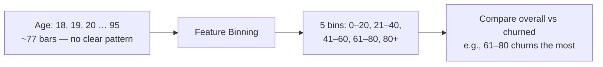
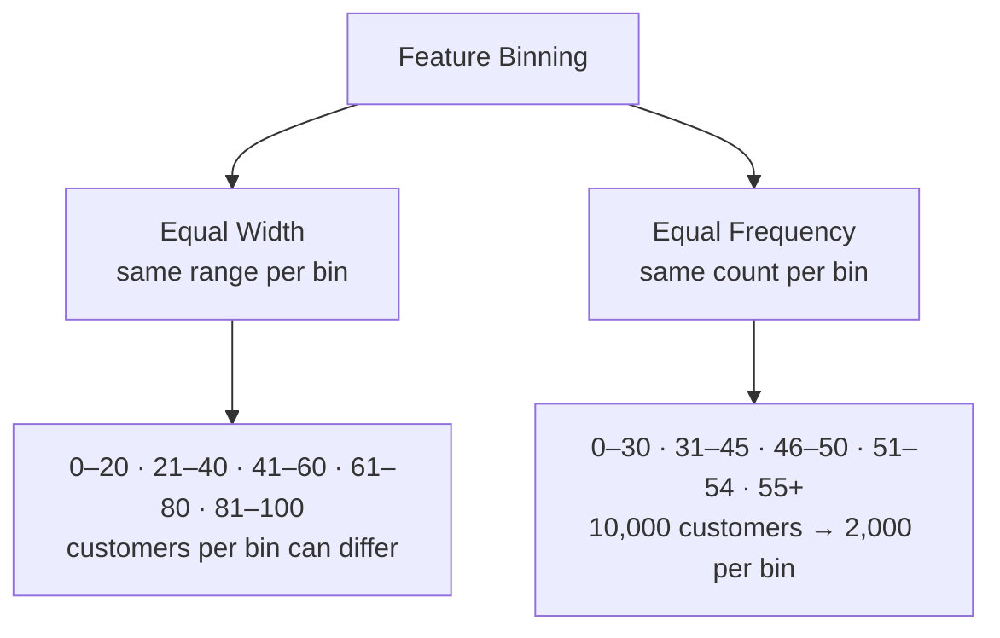
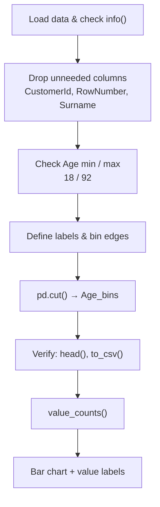
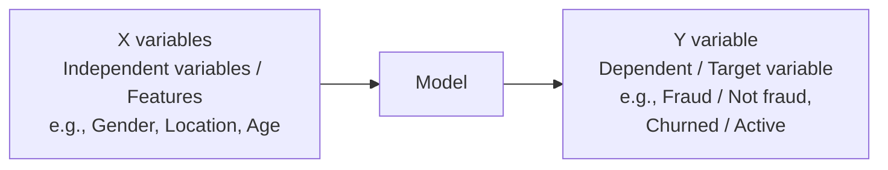
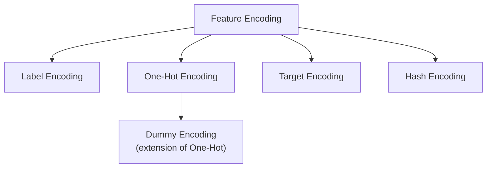
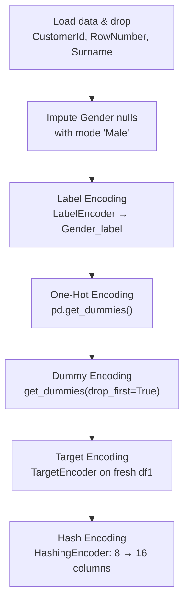
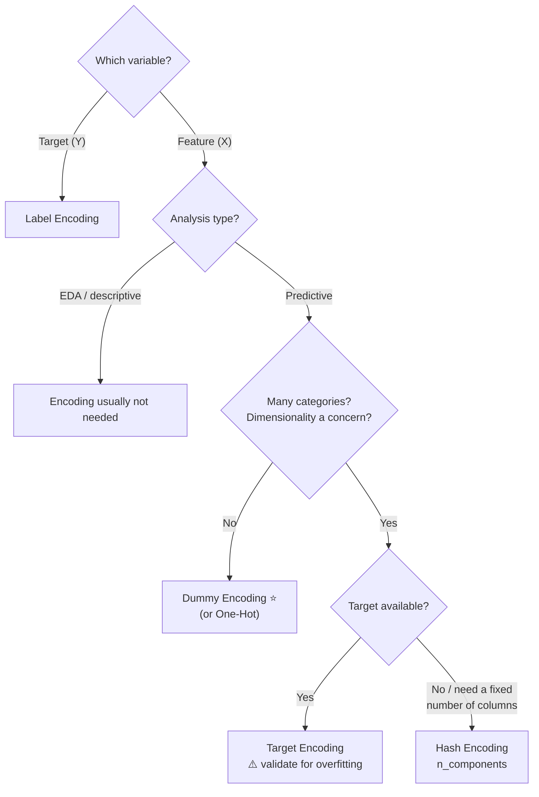

# Chapter 1.7 — Feature Binning & Feature Encoding

> **Course:** Data Science & AI Masters 2026 — From Python to Gen AI
> **Module:** Exploratory Data Analysis → Derived Metrics
> **Topics:** Feature binning (equal width / equal frequency) · Feature encoding (Label, One-Hot, Dummy, Target, Hash) · Practicals on the Churn Modelling dataset
> **Notebooks:** [`1.7_Feature_Binning.ipynb`](./1.7_Feature_Binning.ipynb) · [`1.7_Feature_Encoding.ipynb`](./1.7_Feature_Encoding.ipynb)

---

## Table of Contents

1. [Feature Binning — Theory](#1-feature-binning--theory)
2. [Feature Binning — Practical](#2-feature-binning--practical)
3. [Feature Encoding — Theory](#3-feature-encoding--theory)
4. [Feature Encoding — Practical](#4-feature-encoding--practical)
5. [Choosing an Encoding Technique](#5-choosing-an-encoding-technique)
6. [Key Takeaways](#6-key-takeaways)

---

## 1. Feature Binning — Theory

**Feature binning** converts a **continuous numerical** variable into a **categorical** one, without taking the dependent variable into consideration. It can also help identify **missing values or outliers**.

### Why bin?

Customer ages range from **18 to 95**. A bar chart of every age gives **~75–77 bars** — nearly impossible to read, so you can't tell which age group stands out or why.



### Two types of binning



| | **Equal Width** | **Equal Frequency** |
|---|---|---|
| **Bins defined by** | Same **range** of values | Same **number of records** |
| **Bin sizes** | Fixed width; counts vary | Varying width; counts equal |
| **Preference** | ✅ **Preferred** | Less preferred |

**Tip:** to decide bin ranges, consult **domain experts**, or your peers, superiors, and managers.

Binning is an important EDA step: most datasets have one or more continuous columns worth binning when patterns aren't visible.

---

## 2. Feature Binning — Practical

**Notebook:** [`1.7_Feature_Binning.ipynb`](./1.7_Feature_Binning.ipynb)

**Dataset:** Churn Modelling (`Exited`: 1 = exited, 0 = active). Gender and Age have null values. Age or Tenure can be binned; this example uses **Age** (min 18, max 92).

### Workflow



### 2.1 Setup & cleanup

```python
import pandas as pd
import numpy as np
import matplotlib.pyplot as plt
from sklearn import preprocessing

df = pd.read_csv('/content/Churn_Modelling.csv')
df.head(5)
df.info()   # Gender: 9946 non-null, Age: 9700 non-null

df.drop(columns=['CustomerId', 'RowNumber', 'Surname'], axis=1, inplace=True)
df.head(5)
```

- Dropping columns you don't need is **good practice**; they waste space and memory.
- `inplace=True` updates the DataFrame directly, with no need to reassign it.

### 2.2 Create the bins

```python
df.Age.min()   # 18.0
df.Age.max()   # 92.0

labels = ['0-20', '21-40', '41-60', 'Above 61']
bins = [0, 20, 40, 60, 100 ]

df['Age_bins'] = pd.cut(df.Age, bins, labels = labels, include_lowest=True)
df.head(5)
```

| Parameter | Meaning |
|---|---|
| `bins` | Bin edges; the last edge (100) is set beyond the max value |
| `labels` | One label per bin |
| `include_lowest=True` | Includes the lowest edge in the first bin |

> **Lesson from the session:** edges were first written as `[0, 21, 41, 61, 100]`, which put age **41** into `21-40`. Changing them to `[0, 20, 40, 60, 100]` fixed it, so age 42 correctly falls in `41-60`.

### 2.3 Verify

```python
df[['Age', 'Age_bins']].to_csv('test.csv')
```

- In **Google Colab**, download `test.csv` to check it; in **Jupyter**, it's saved in the notebook's folder.
- **Null ages stay null** in `Age_bins`. Treat missing values **before** binning, or you'll have to impute twice.

### 2.4 Count & visualize

```python
df.Age_bins.value_counts()
```

| Age_bins | Count |
|---|---|
| 21-40 | 6,146 |
| 41-60 | 3,021 |
| Above 61 | 446 |
| 0-20 | 87 |

If one bin holds too many records, split it further (e.g., 21–30 and 31–40). It depends on the use case.

```python
# making the bar chart on the data
plt.bar(labels, df.Age_bins.value_counts())

# giving the title
plt.title('Age Count')

# giving X & Y labels
plt.xlabel('Age Bins')
plt.ylabel('Age Count')

# visualizing the plot
plt.show()
```

**Adding value labels on top of bars** (not part of binning, just a useful extra):

```python
def add_labels(x,y):
  for i in range(len(x)):
    plt.text(i,y[i],y[i])

# making the bar chart on the data
plt.bar(labels, df.Age_bins.value_counts())

# add labels
add_labels(labels, df.Age_bins.value_counts())

# giving the title
plt.title('Age Count')

# giving X & Y labels
plt.xlabel('Age Bins')
plt.ylabel('Age Count')

# visualizing the plot
plt.show()
```

### 2.5 Alternative: a for loop

Bins can also be built by looping through the DataFrame with conditions, e.g., if age ≥ 60 → "Above 60", else if age ≥ 41 → "41-60", and so on.

---

## 3. Feature Encoding — Theory

### Features vs. target



- **Y (dependent / target):** what you predict. E.g., whether a transaction is fraud, or a customer has churned. It **depends on** the X variables.
- **X (independent / features):** all the other columns.

### What is feature encoding?

**Converting a categorical feature into a numerical one.** Models run on computers, and computers **only understand numbers**, not text. You can't pass `M`/`F` directly.

- **EDA / descriptive analytics:** encoding is mostly **not needed**.
- **Predictive analytics:** encoding is **essential**.



### 3.1 Label encoding

Assigns **a number to each category**.

| Gender | Encoded | | Location | Encoded |
|---|---|---|---|---|
| Male | 1 | | Malaysia | 1 |
| Female | 2 | | Indonesia | 2 |
| | | | India | 3 |

**Problem:** a model may **prioritize larger numbers** — Female over Male, India over Indonesia over Malaysia. Algorithms should treat data in an **unbiased** way.

> ✅ Use label encoding **only for target (Y) variables** (e.g., churned Y/N → 1/0).
> ❌ Not recommended for X variables. Not needed at all if there's no target.

### 3.2 One-hot encoding

Used when independent variables are **nominal**. Creates **k new columns** (one per category): **1** where the category matches, **0** elsewhere.

| Location | Location_Malaysia | Location_Indonesia | Location_India |
|---|---|---|---|
| Malaysia | 1 | 0 | 0 |
| Indonesia | 0 | 1 | 0 |
| India | 0 | 0 | 1 |
| India | 0 | 0 | 1 |
| Malaysia | 1 | 0 | 0 |

**Why it's one of the most important techniques:** computers accept numbers best, and in numbers the **byte format (0s and 1s)** is the most accepted.

### 3.3 Dummy encoding

The new one-hot columns are called **dummy features**. One of them is **redundant**: if `Malaysia = 0` and `Indonesia = 0`, the row **must** be India.


| Technique | Implementation |
|---|---|
| **One-hot encoding** | `sklearn` `OneHotEncoder`, or `pd.get_dummies()` |
| **Dummy encoding** | `pd.get_dummies(..., drop_first=True)` |

### 3.4 Target encoding

Replaces a category with a value **calculated from the category and the target variable**. Requires a target — don't use it without one.

| ✅ Benefits | ⚠️ Limitations |
|---|---|
| Simple and quick | Dependent on the **target distribution** |
| **Doesn't add dimensionality** — replace one column with one column | Needs careful validation; **prone to overfitting** |
| A good **first-try** technique | Rarely used in practice by the instructor |

**Dimensionality comparison:** a Location column with **100 values** → one-hot adds 100 columns, dummy adds 99, **target encoding adds 0 net columns**.

> **Overfitting:** good performance on training data, but accuracy drops sharply on unseen test data. Covered in detail in the next module.

### 3.5 Hash encoding

A multivariate hashing implementation with **configurable dimensionality**.
- `n_components` (default **8**) sets how many numerical columns are created, **regardless of how many categories** the column has (2 genders or 100 locations → still 8 columns).
- **Doesn't maintain a dictionary** of observed categories, so the encoder doesn't grow in size and **accepts new values** during data scoring.

---

## 4. Feature Encoding — Practical

**Notebook:** [`1.7_Feature_Encoding.ipynb`](./1.7_Feature_Encoding.ipynb)

### Workflow



### 4.1 Setup & missing values

```python
import pandas as pd
import numpy as np
import matplotlib.pyplot as plt
from sklearn import preprocessing

df = pd.read_csv('/content/Churn_Modelling.csv')
df.head(5)
df.info()   # Gender & Age have nulls

df.drop(columns = ["CustomerId", "RowNumber", "Surname"], axis = 1, inplace=True)
df.head(5)

df.Gender.value_counts()   # Male 5428 | Female 4518 → nulls (54) not shown
```

> `value_counts()` **doesn't show null values**. Use `info()` to spot them.

**Handling missing values in Gender:**

```python
df.Gender.mode()                          # Male
df['Gender'] = df['Gender'].fillna('Male')
df.Gender.value_counts()                  # Male 5482 (+54) | Female 4518
df.info()                                 # Gender: 10000 non-null
```

### 4.2 Label encoding

```python
le = preprocessing.LabelEncoder()
df['Gender_label'] = le.fit_transform(df.Gender.values)
df.head(5)
df.Gender_label.value_counts()   # 1: 5482 (Male) | 0: 4518 (Female)
```

The scikit-learn docs say `LabelEncoder` should encode the **target variable (y), not the input X**. It's used on Gender here only to demonstrate the technique.

### 4.3 One-hot encoding

```python
one_hot = pd.get_dummies(df['Geography'])
one_hot   # columns: France, Germany, Spain (10000 rows x 3 columns)

df.head(5)

df_dummies = pd.get_dummies(df)   # encodes all categorical columns
df_dummies.head(5)
```

`pd.get_dummies(df)` encoded both categorical columns: **Geography** → `Geography_France`, `Geography_Germany`, `Geography_Spain`; **Gender** → `Gender_Female`, `Gender_Male`.

> `Gender_label` from label encoding is still present. **Delete redundant columns** like this when doing real work.

### 4.4 Dummy encoding

```python
df_dummies_de = pd.get_dummies(df, drop_first=True)
df_dummies_de.head(5)
```

With `drop_first=True`, `Geography_France` and `Gender_Female` are dropped, leaving `Geography_Germany`, `Geography_Spain`, `Gender_Male`.

> ⭐ **Instructor's preferred technique for X variables: dummy encoding.**

### 4.5 Target encoding

```python
pip install category_encoders

from category_encoders import TargetEncoder

df1 = pd.read_csv('/content/Churn_Modelling.csv')   # fresh copy
df1.drop(columns = ["CustomerId", "RowNumber", "Surname"], axis = 1, inplace=True)
df1['Gender'] = df1['Gender'].fillna('Male')
df1.head(5)

encoder = TargetEncoder()

df1['Gender Encoded'] = encoder.fit_transform(df1['Gender'], df1['Exited'])
df1.head(5)
df1['Gender Encoded'].value_counts()
```

| Gender | Gender Encoded | Count |
|---|---|---|
| Male | 0.164356 | 5,482 |
| Female | 0.251439 | 4,518 |

The values come from mathematical calculations between **Gender** and the target **Exited**.

### 4.6 Hash encoding

```python
from category_encoders import HashingEncoder

X = df.Gender
y = df.Exited

ce_hash = HashingEncoder(cols = ['Gender'])
ce_hash.fit_transform(X,y)          # 8 columns: col_0 … col_7

X = df.Geography
ce_hash2 = HashingEncoder(cols = ['Geography'])
ce_hash2.fit_transform(X,y)         # 8 columns

ce_hash2 = HashingEncoder(n_components=16, cols = ['Geography'])
ce_hash2.fit_transform(X,y)         # 16 columns
```

Whether the column has 2 values (Gender) or 3 (Geography), the output has **`n_components` columns**. The hashing algorithm's internals aren't necessary to understand.

### 4.7 Quick reference

| Code | Purpose |
|---|---|
| `df.drop(columns=[...], axis=1, inplace=True)` | Drop unneeded columns in place |
| `pd.cut(s, bins, labels=, include_lowest=True)` | Equal-width style binning |
| `df[[...]].to_csv('file.csv')` | Export to check results |
| `plt.bar()` / `plt.text()` | Bar chart / value labels |
| `s.mode()` + `s.fillna()` | Impute categorical nulls |
| `preprocessing.LabelEncoder().fit_transform()` | Label encoding |
| `pd.get_dummies(df)` | One-hot encoding |
| `pd.get_dummies(df, drop_first=True)` | Dummy encoding |
| `TargetEncoder().fit_transform(X, y)` | Target encoding (`category_encoders`) |
| `HashingEncoder(n_components=, cols=[...])` | Hash encoding (`category_encoders`) |

---

## 5. Choosing an Encoding Technique



| Technique | Columns added | Best for | Watch out for |
|---|---|---|---|
| **Label** | 0 (replaces) | Target variable | Implies false ordering in X |
| **One-Hot** | k | Nominal X variables | Many categories → many columns |
| **Dummy** | k − 1 | Nominal X variables ⭐ | Same, but one fewer column |
| **Target** | 0 (replaces) | Quick first try | Overfitting; needs a target |
| **Hash** | `n_components` (default 8) | Fixed dimensionality; new values | Hashed columns aren't interpretable |

---

## 6. Key Takeaways

- **Binning** turns a continuous column into categories so patterns become visible. **Equal width** is preferred over **equal frequency**.
- **`pd.cut()`** does the binning. Choose edges carefully, and **treat nulls first**.
- **Encoding** turns categories into numbers. Needed for **predictive analytics**, mostly not for EDA.
- **Label encoding** → target only. **One-hot** → k columns. **Dummy** → k − 1 columns (preferred for X).
- **Target encoding** keeps dimensionality the same but risks **overfitting**. **Hash encoding** gives a fixed number of columns via `n_components`.
- **Drop redundant columns** (IDs, leftover encodings) before modeling.

---

*Coming up next is Data Exploration and Data Cleaning.*
