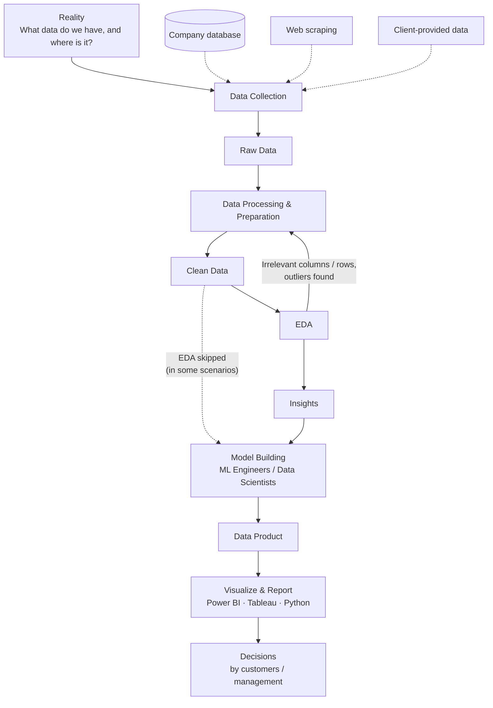
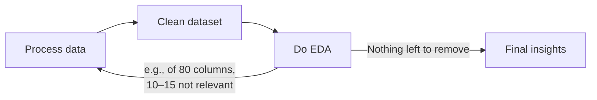
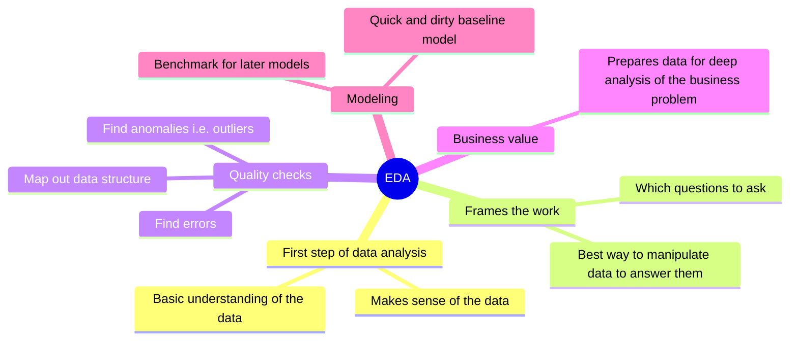
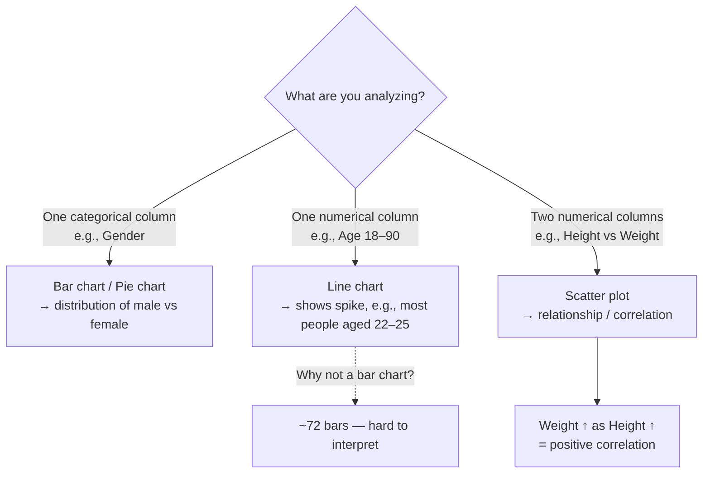
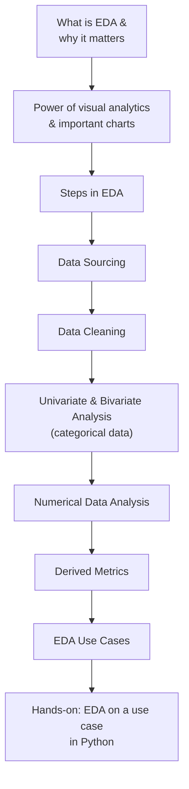

# Chapter 1 — Exploratory Data Analysis (EDA): Theory

> **Course:** Data Science & AI Masters 2026 — From Python to Gen AI
> **Module:** Exploratory Data Analysis
> **Topics:** The DA/DS process · What is EDA · What is Visualization · The EDA process & module roadmap

---

## Table of Contents

1. [The Data Analytics / Data Science Process](#1-the-data-analytics--data-science-process)
2. [What is EDA?](#2-what-is-eda)
3. [What is Visualization?](#3-what-is-visualization)
4. [How the EDA Process Fits In](#4-how-the-eda-process-fits-in)
5. [Key Takeaways](#5-key-takeaways)

---

## 1. The Data Analytics / Data Science Process

The textbook sequence (business understanding → data understanding → collection/preparation → model building) is correct, but it doesn't fully reflect how a **real-world problem** is solved. The flow below is closer to practice.

### Stage by stage

| Stage | What happens | Output |
|---|---|---|
| **Reality / Data Collection** | Identify what data exists and its source. Source varies by scenario: own company database, web scraping, or the client. *Without data, nothing is possible.* | Raw data |
| **Data Processing & Preparation** | Clean the raw data: drop columns irrelevant to the problem (using domain knowledge), handle missing values, fix invalid data types, remove special characters. | Clean data |
| **EDA** | Analyze the clean data (e.g., outlier detection). Often reveals more irrelevant columns, rows, or outlier records. | Insights — the problem and possible reasons it occurred |
| **Model Building** | ML engineers / data scientists build models and set algorithms. Can start directly from clean data, but doing EDA first is the better practice. | Model |
| **Data Product & Reporting** | Final data product is prepared; visualizations are built in Power BI, Tableau, or Python for end customers / senior management. | Reports & visuals |
| **Decisions** | Stakeholders act on the findings. | Business decisions |

### 🔁 Processing ↔ EDA is iterative

You loop between cleaning and exploring until the data is ready and the insights are clear.

> **Module focus:** Data collection is hard to cover because scenarios vary so much, so this module concentrates on **data processing, data cleaning, and EDA**.

---

## 2. What is EDA?

**Exploratory Data Analysis (EDA)** is an approach to analyzing datasets to **summarize their main characteristics using visual methods**. It is a data exploration technique for understanding the various aspects of the data.

### Main aim

> Gain enough **confidence in the data** to be ready to engage a machine learning model.

### Why EDA matters

- **Finding errors** and discovering the data.
- **Mapping out data structure.**
- **Finding anomalies** — anomalies are outliers.
- **Business importance** — prepares the dataset for thorough analysis that uncovers the business problem.
- **Baseline model** — supports a quick-and-dirty model to compare later models against.

### Why the output must be visual

EDA insights are presented to **senior management or clients** who may not be able to interpret Python code. Visual output lets a non-technical audience understand what the data is saying.

**Example questions EDA answers (customer churn):**
- Is a customer in Japan more likely to churn than one in Indonesia?
- Are males more likely to churn than females? If so, why?
- Are customers paying by credit card more likely to churn? What is the reason?

---

## 3. What is Visualization?

**Visualization** is the presentation of data in **graphical or visual form** to understand the data more clearly. In data analytics it is one of the main ways insights reach end customers and management who may not know Python.

### Numbers vs. visuals

| Approach | Example | Takeaway |
|---|---|---|
| **Numbers** | Age described by mean, 25th/75th percentile, median, max. Gender: 1,400 male vs 2,000 female. | Interpretable, but takes effort. |
| **Visual** | A bar or pie chart of gender. | Instantly shows females outnumber males — more intuitive and attractive. |

### Advantages of visualization

1. Easily understand the **features** of the data.
2. Easily **analyze and summarize** the data.
3. Get **meaningful insights** from the data.
4. Find **trends or patterns** in the data.

### Choosing a chart (examples from the lesson)

### Chart types to know

Bar chart · Pie chart · Line chart · Area chart · Box-and-whisker plot · Violin plot · Scatter plot · Pair plot — plus many others.

> **Visual analytics** is one of the most powerful forms of analytics and the go-to technique for presenting insights to customers and managers.

---

## 4. How the EDA Process Fits In

### Where EDA sits in the standard framework

- Always **understand the business problem first**, then the data, then begin collection.
- **Data preparation** turns unclean data into clean data.
- **EDA expects clean data** as its input; its **output is insights**.
- EDA is one of the most important areas of data analysis.

### Module roadmap — what's coming

---

## 5. Key Takeaways

- **Everything starts with data** — its source depends on the scenario (database, web scraping, client).
- **Raw → Clean → Insights:** processing produces clean data; EDA turns clean data into insights.
- **Cleaning and EDA are iterative** — EDA often sends you back to remove irrelevant columns, rows, or outliers.
- **EDA can be skipped** before modeling in some settings, but doing it is the better practice.
- **EDA's goal:** build enough confidence in the data to move to machine learning, and provide a baseline model.
- **Visuals are the language of stakeholders** — choose charts that fit the data type (categorical → bar/pie; one numeric → line; two numeric → scatter).

---

*Part of my Data Science & AI learning log.*
